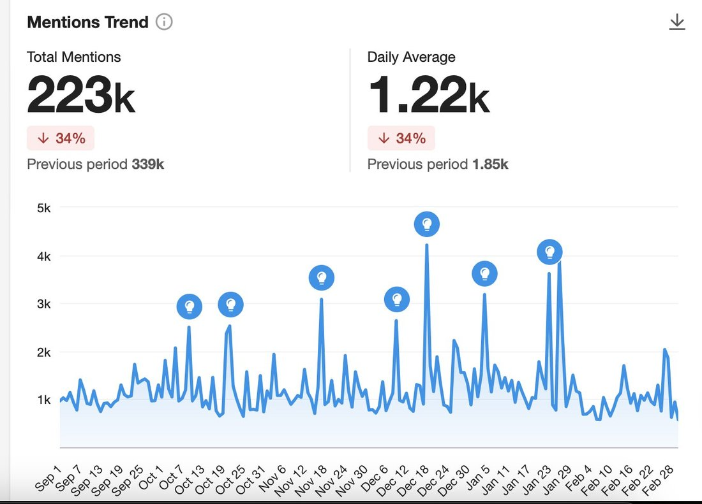
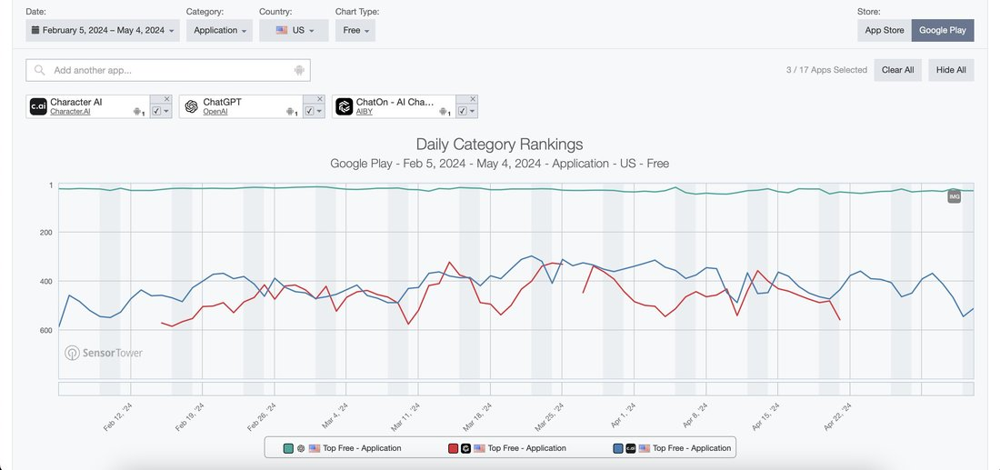
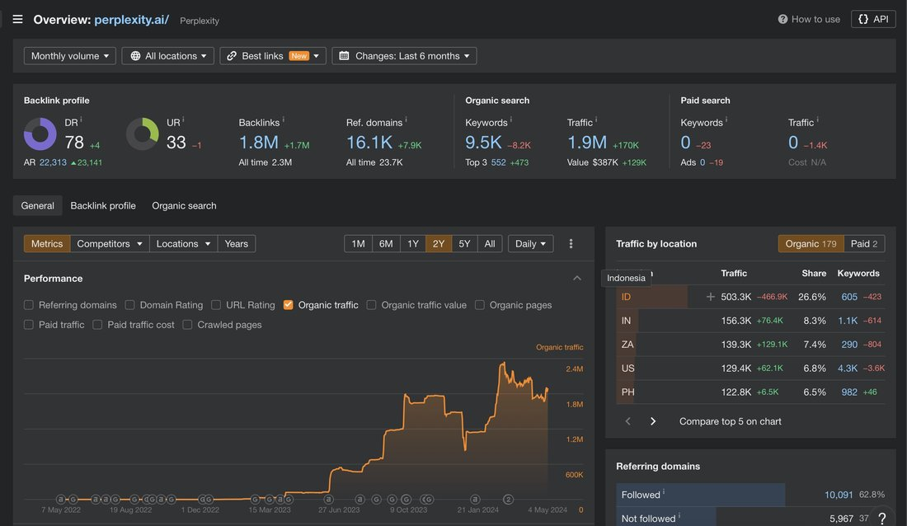

# @sdand — 2024-05-05

♥38 ↻3 · https://x.com/sdand/status/1786939145656705312

Character AI has fallen from #2 to #40 in the App Store, mentions of Character AI and similar apps have all fall 30% this year compared to last, and 50%+ of Perplexity traffic comes from SEA and South Africa. Artifact(self funded) shutdown in a year after also blowing up for the first month and tailing off, failing to get “PMF”. Many other gpt wrappers have also had quick spikes before either trying to pivot or the founders move on while handling growth to contractors.

tags: author:sdand, deprecation, has-image, kind:image, kind:tweet, on:character-ai, year:2024
cited on: _dossiers/character-ai.md, character-ai
