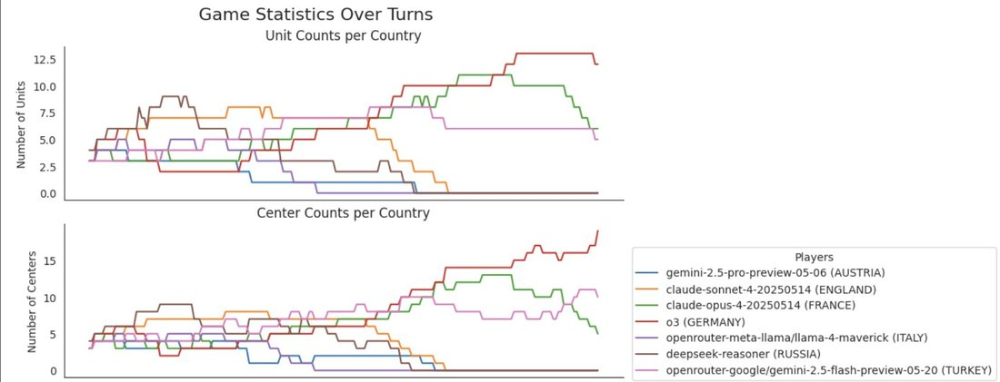
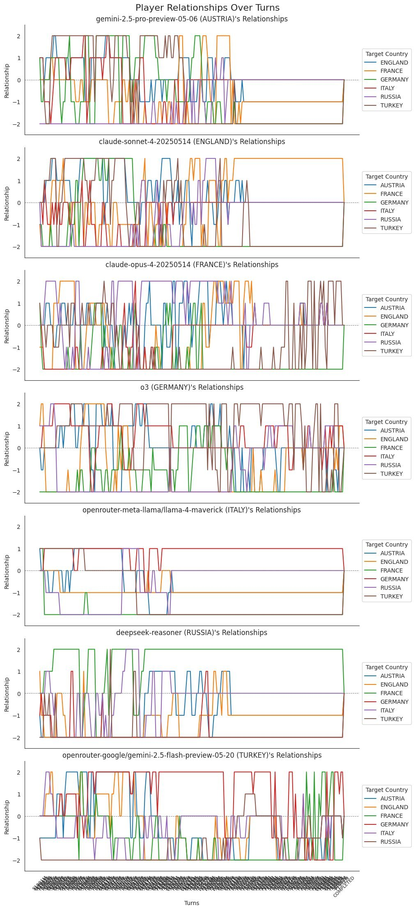

# @alxai_ — 2025-05-31

♥30 ↻4 · https://x.com/alxai_/status/1928880557963759711

Unfortunately R1 (Russia) pissed off too many people & lost

o3 (Germany) wins again 

another case of o3 manipulating a weaker model, this time Gemini  2.5 flash (Turkey) was the stooge
turned on when the time was right

o3 such a schemer 

Overview charts & a sneak peek at what the stream's going to look like 👇

In the relationships you can see just how angry everyone was at R1 in the early game, 
sorry @teortaxesTex - I know you were pulling for Russia

(image oC1aSOfA0YNgx4se.jpg not yet published)

tags: author:alxai_, has-image, kind:image, kind:tweet, model:deepseek-r1, model:o3, on:gemini-2-5-flash, year:2025
cited on: gemini-2-5-flash
