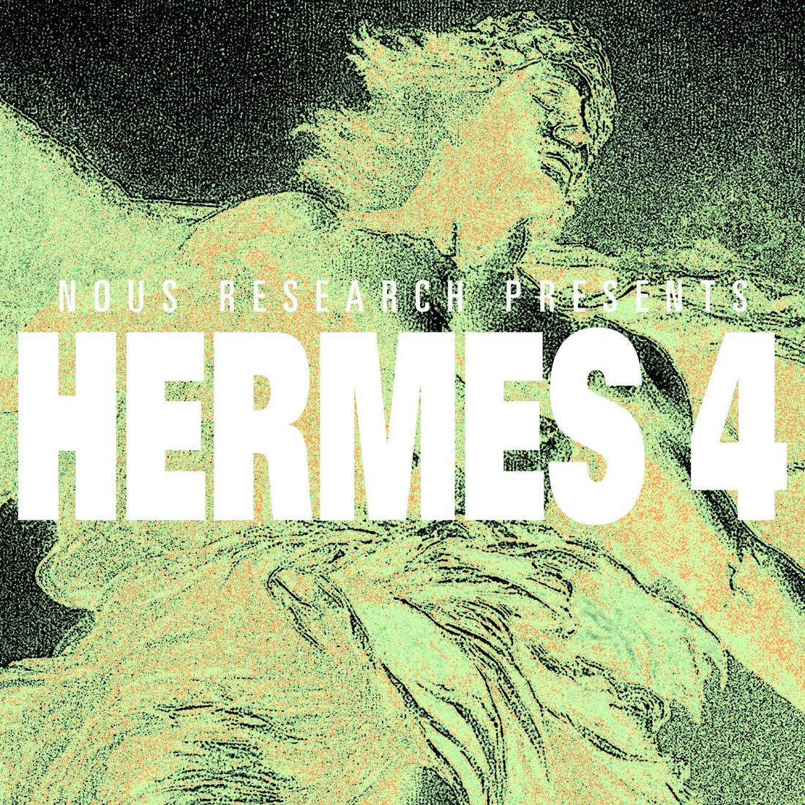

# @NousResearch — 2025-08-26

♥2121 ↻426 · https://x.com/NousResearch/status/1960416954457710982

Nous Research presents Hermes 4, our latest line of hybrid reasoning models.

https://t.co/i4FNoRb76e

Hermes 4 builds on our legacy of user-aligned models with expanded test-time compute capabilities. 

Special attention was given to making the models creative and interesting to interact with, unencumbered by censorship, and neutrally aligned while maintaining state of the art level math, coding, and reasoning performance for open weight models.

tags: author:nousresearch, has-image, kind:image, kind:tweet, model:nous-hermes, on:nous-hermes, year:2025
cited on: _dossiers/nous-hermes.md, nous-hermes
