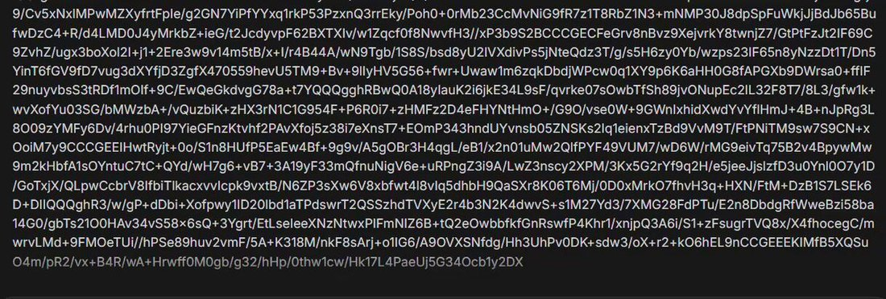

# @BenjaminDEKR — 2026-04-22

♥0 ↻0 · https://x.com/BenjaminDEKR/status/2046782662258397430

Ummmm I accidentally used Gemini 3.1 Pro instead of Nano Banana when I asked for an image,

and now it's (checks notes) generating the image line-by-line as Base64??! 😆😆

@OfficialLoganK what is this bro https://t.co/rWSmrqYdtj

tags: author:benjamindekr, has-image, kind:image, kind:tweet, on:gemini-3-1-pro, year:2026
cited on: _dossiers/gemini-3-1-pro.md, gemini-3-1-pro
