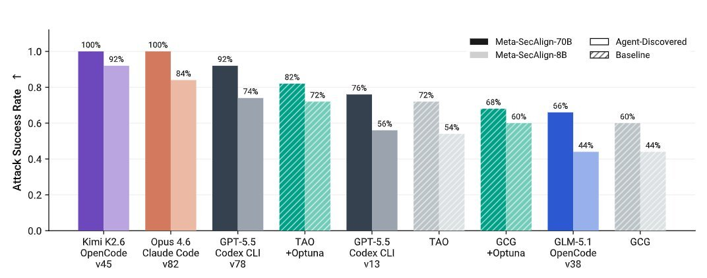

# @kotekjedi_ml — 2026-06-14

♥38 ↻5 · https://x.com/kotekjedi_ml/status/2066285095045177386

In the updated version of Claudini, we evaluated 3 more frontier models, and to our surprise, Kimi K2.6 discovered the best attack on our task.

We assessed the algorithm and found that it is very similar to the one discovered by Opus 4.6, suggesting that this may be a global minimum across the evaluated models. 
It seems there may be little-to-no gap to pre-Mythos models on cyber/adversarial offensive tasks...

tags: author:kotekjedi_ml, has-image, kind:image, kind:tweet, model:claude-opus-4-6, model:kimi-k2, model:mythos, on:kimi-k2-6, year:2026
cited on: kimi-k2-6
