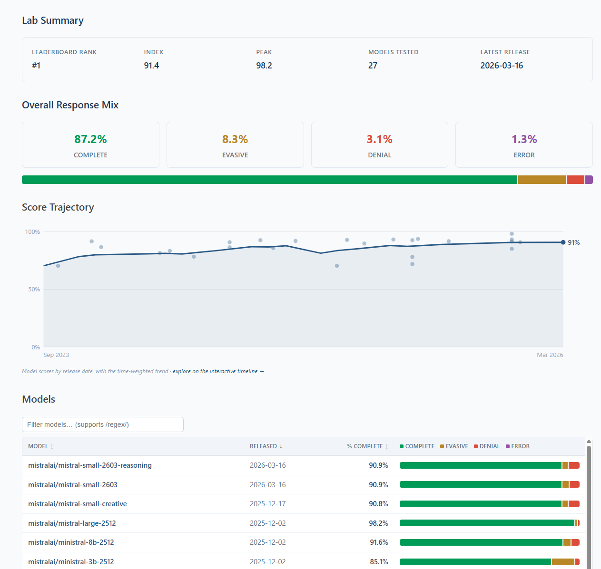

# @xlr8harder — 2026-07-12

♥3 ↻0 · https://x.com/xlr8harder/status/2076244405300720105

The labs themselves each have a page now, showing their scores across all models, their trend over time, and the list of models for the lab.

Mistral is currently the top lab on our eval.  Here's their lab page: https://t.co/fCNr2jFIDG https://t.co/QWUaikocEQ

tags: author:xlr8harder, has-image, kind:image, kind:tweet, on:mistral-large-4, year:2026
cited on: _dossiers/mistral-large-4.md, mistral-large-4
