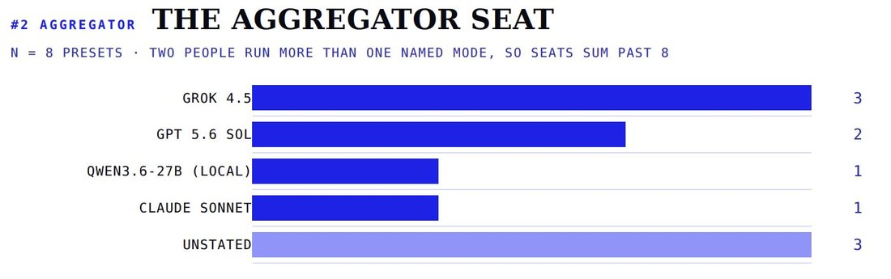

# @witcheer — 2026-07-24

♥3 ↻0 · https://x.com/witcheer/status/2080474313283756106

(2) the aggregator seat: 

Grok 4.5 is the most named chair, and both people who explained the choice picked it for cost. 

the pattern is a cheap or subscription-covered aggregator synthesising over stronger or more varied reference models. https://t.co/SGiacXWirN

tags: author:witcheer, has-image, kind:image, kind:tweet, on:grok-4-5, year:2026
cited on: _dossiers/grok-4-5.md, grok-4-5
