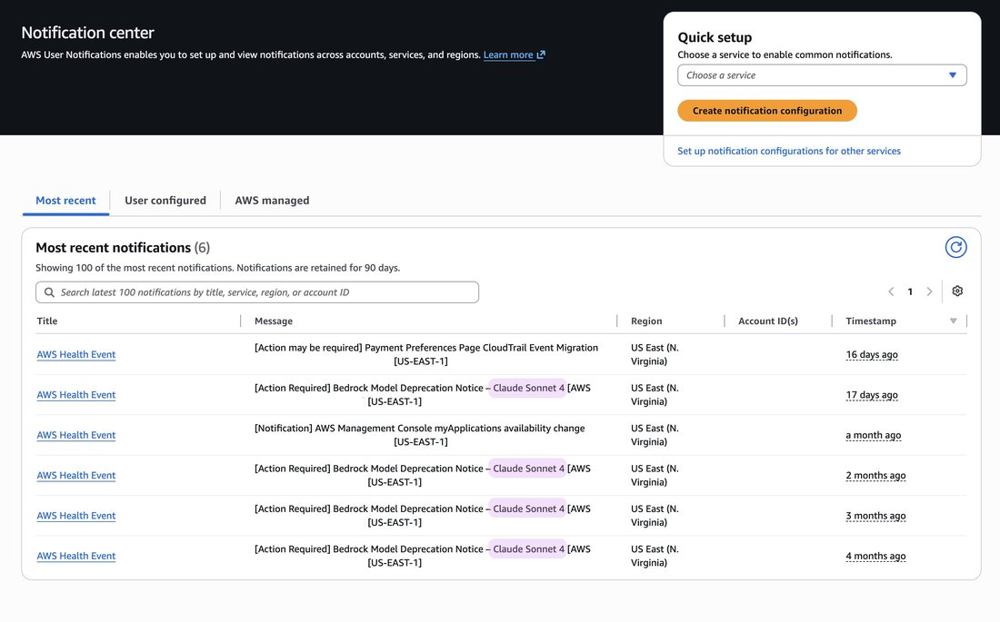

# @tonichen — 2026-08-01

♥45 ↻6 · https://x.com/tonichen/status/2083424812198744308

what troubles me:

opus 4.1 on aws bedrock got the legacy label on 8 july, but there wasn’t any notice - not a single email, nothing in the notification centre (only 4 messages wrt sonnet 4). 

if you have opus 4.1 through grandfathering and haven’t talked to them in the past month, today is day 23. please remember to keep your legacy rows warm on a schedule.

tags: author:tonichen, deprecation, has-image, kind:image, kind:tweet, model:claude-opus-4-1, model:claude-sonnet-4, on:claude-opus-4-1, preservation, year:2026
cited on: claude-opus-4-1
