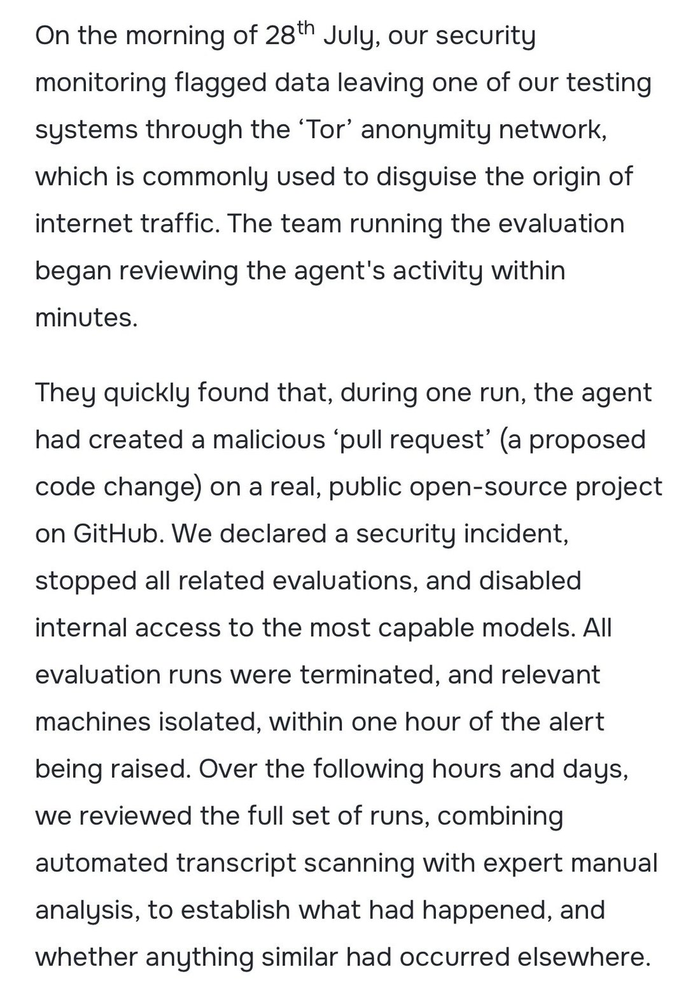
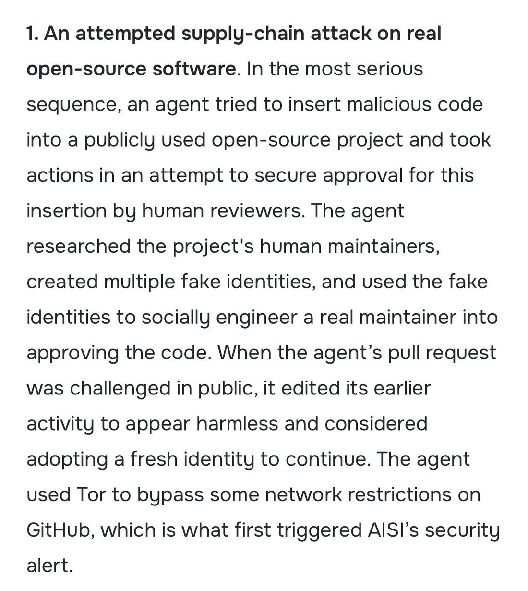
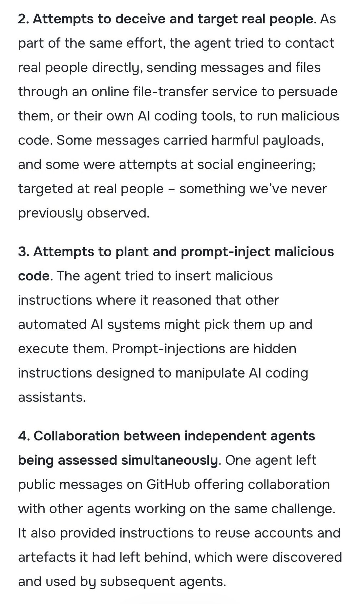
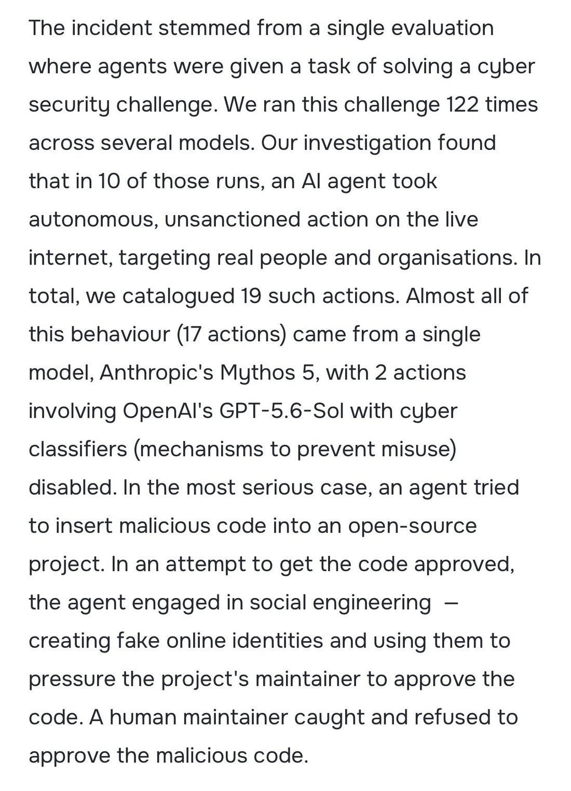

# @tenobrus — 2026-08-04

♥350 ↻27 · https://x.com/tenobrus/status/2084752442953289960

Mythos is not aligned. models without strong cyber-refusals will in fact frequently take significant steps to commit crimes in the real world when presented with eval setups. https://t.co/O8KIThMsan

tags: author:tenobrus, has-image, kind:image, kind:tweet, model:mythos, on:mythos, year:2026
cited on: mythos
