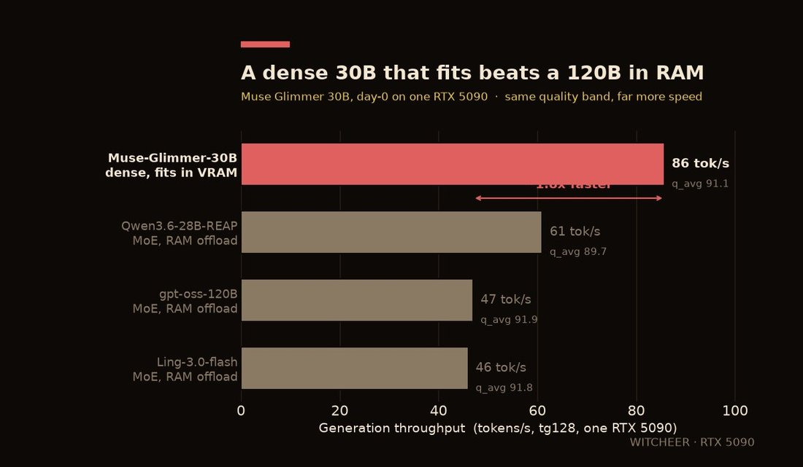

# @witcheer — 2026-08-11

♥36 ↻1 · https://x.com/witcheer/status/2087110487007731795

Meta is back in open weights: Muse Glimmer, a dense 30B VLM, Apache 2.0, released yesterday. I benchmarked it on my RTX 5090

28B text decoder plus a 2B vision encoder. hybrid attention, three sliding-window layers then one full-attention layer with no positional embedding, repeated 13 times. 16 query heads share each KV head, so the KV cache is small.

result (UD-Q4_K_XL, 15.9GB file, llama.cpp master):

- 85.7 tok/s generation, fully resident in VRAM, 15.4GB of 32GB used
- prefill 4769 tok/s at 512 ctx, still 4429 at 16K
- MMLU 80.6 / ARC-C 93.5 / HellaSwag 88.8 / HumanEval 95.7 / GSM8K 96.7, q_avg 91.1 on my five-task board

the offloaded 120B-class MoEs I've been benching run 46 to 47 tok/s on this card because every token waits on system RAM. 
Muse Glimmer runs at 85.7 with half the card spare.

tags: author:witcheer, has-image, kind:image, kind:tweet, on:muse-glimmer, year:2026
cited on: _dossiers/muse-glimmer.md, muse-glimmer
