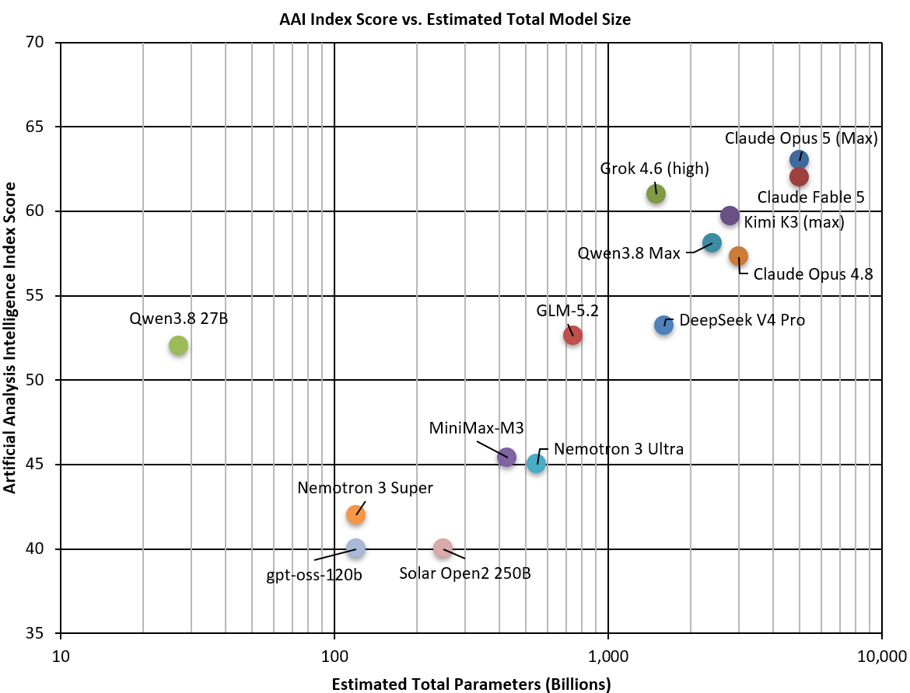

# @MikePFrank — 2026-08-18

♥199 ↻35 · https://x.com/MikePFrank/status/2089864594634277343

People have been remarking about how surprisingly intelligent Qwen 3.8 (27B) is for its model size. To visualize this, I whipped up this chart (with some help from Grok) plotting scores from Artificial Analysis against the (known or estimated) model size. Qwen is such an outlier! https://t.co/vpiTVuD2ir

tags: author:mikepfrank, has-image, kind:image, kind:tweet, on:qwen-3-8-27b, year:2026
cited on: _dossiers/qwen-3-8-27b.md, qwen-3-8-27b
