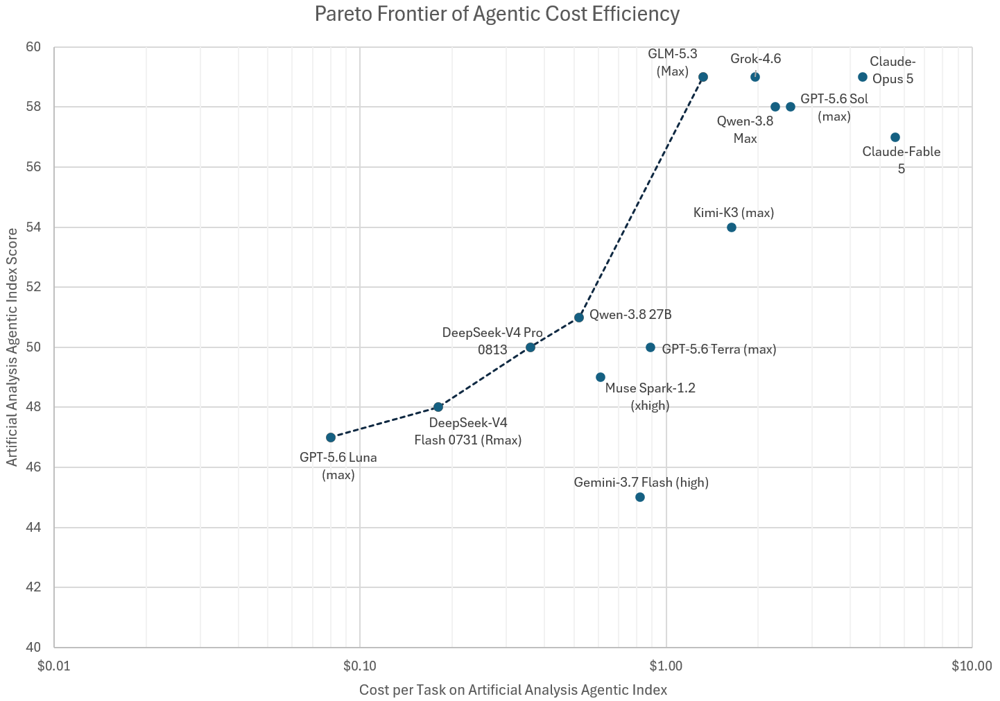

# @MikePFrank — 2026-08-20

♥5 ↻3 · https://x.com/MikePFrank/status/2090242331656028510

And, here's a plot of the Pareto frontier of agentic cost-efficiency, according to AA's data. Note that Qwen-3.8 27B falls on the Pareto line, whereas Claude does not. https://t.co/w3QDn2yDah

tags: author:mikepfrank, has-image, kind:image, kind:tweet, on:qwen-3-8-27b, year:2026
cited on: _dossiers/qwen-3-8-27b.md, qwen-3-8-27b
