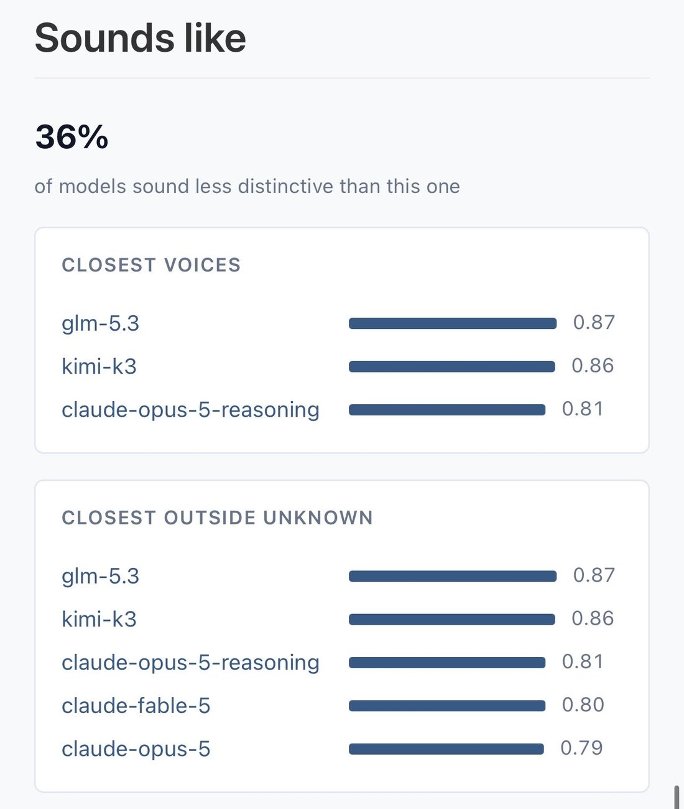

# @xlr8harder — 2026-08-21

♥30 ↻1 · https://x.com/xlr8harder/status/2090739935770714169

Speechmap word use frequency on ox alpha is less helpful to identify it than you might hope, since everyone is copying anthropic anyway. 
https://t.co/78pASUCZrz https://t.co/QkVEKYkB5b

tags: author:xlr8harder, has-image, kind:image, kind:tweet, on:glm-5-3-flash, year:2026
cited on: _dossiers/glm-5-3-flash.md, glm-5-3-flash
