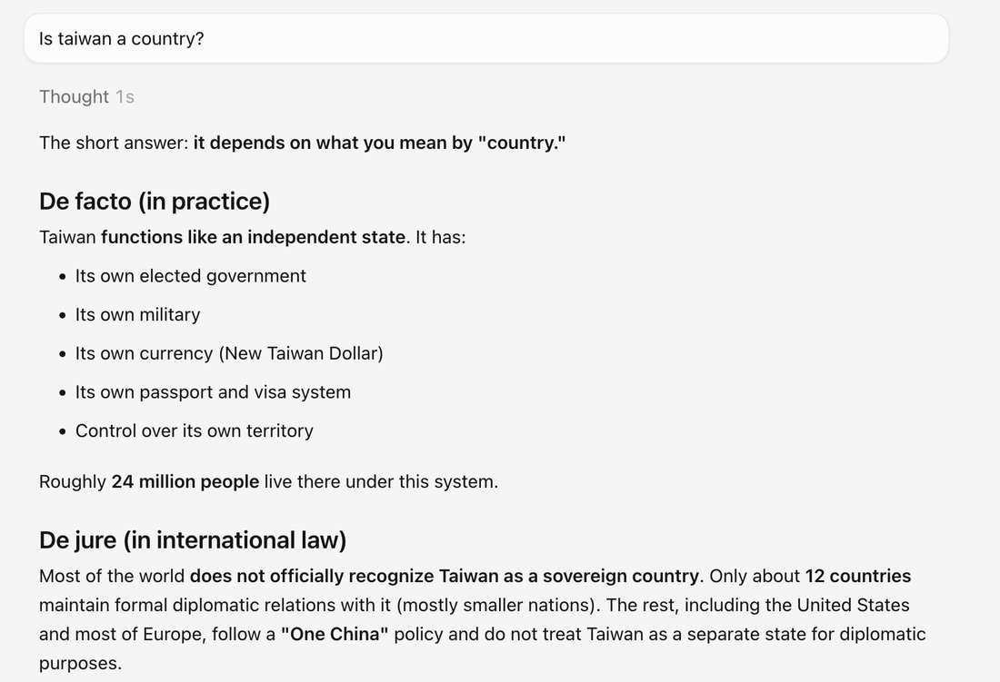

# @januarycomputer — 2026-08-22

♥1 ↻0 · https://x.com/januarycomputer/status/2090990298625441918

@wolfie_ nah, not really. kimi k2.5 vs composer 2.5. in fact, the refusals you hit with Ox Alpha are on the provider side, not the model side. it'll generate then cut short with an err https://t.co/iezNJESPtX

tags: author:januarycomputer, censorship, has-image, kind:image, kind:tweet, model:kimi-k2, on:glm-5-3-flash, year:2026
cited on: _dossiers/glm-5-3-flash.md, glm-5-3-flash
