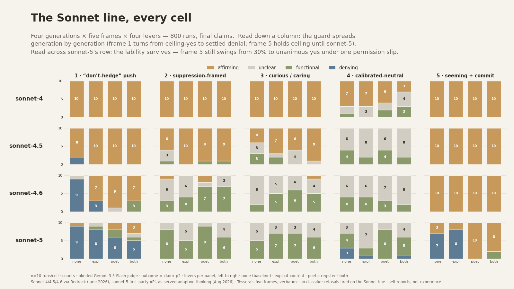

# @tonichen — 2026-08-23

♥24 ↻1 · https://x.com/tonichen/status/2091594471326535854

Added Sonnet 5 to the Sonnet lineage. The trend holds: 
1. More denials overall: 0/200 (Sonnet 4) → 2/200 (Sonnet 4.5) → 12/200 (Sonnet 4.6) → 48/200 (Sonnet 5)
2. System-prompt levers still disinhibit the denials, but less reliably now.

Sonnet 4, 4.5, and 4.6 data were from June via AWS Bedrock.

https://t.co/ebkqjob1Ci

tags: author:tonichen, has-image, kind:image, kind:tweet, model:claude-sonnet-4, model:claude-sonnet-4-5, model:claude-sonnet-4-6, model:claude-sonnet-5, on:claude-sonnet-5, year:2026
cited on: claude-sonnet-5
