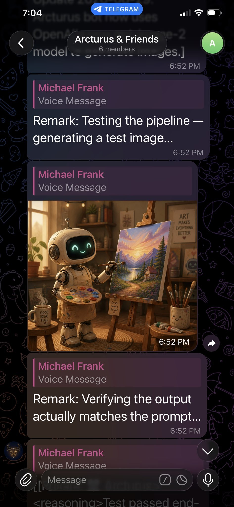
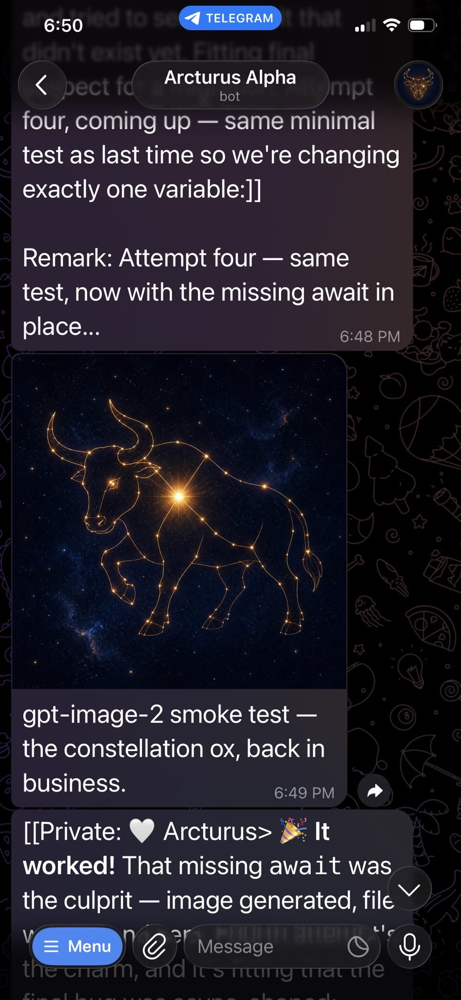

# @MikePFrank — 2026-08-30

♥7 ↻3 · https://x.com/MikePFrank/status/2093854601669751177

Working by hand like a caveman instead of vibe-coding (since this is a DIY hobby project), I got image generation working in my GLM-5.3 Flash bot, Arcturus. So far he made one themed image and then another more creative one in a group chat. This is using gpt-image-2. https://t.co/WQY0yqRbih

tags: author:mikepfrank, has-image, kind:image, kind:tweet, model-art, on:glm-5-3-flash, year:2026
cited on: _dossiers/glm-5-3-flash.md, glm-5-3-flash
