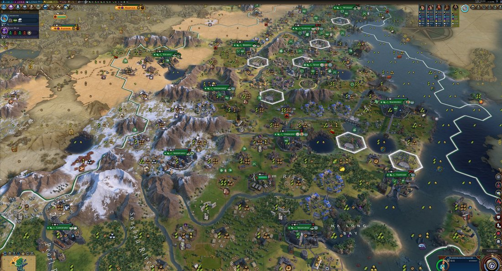

# @DanielleFong — 2026-09-02

♥217 ↻14 · https://x.com/DanielleFong/status/2095038506074775781

so, I got Civ6 MCP working!
and while Fable 5 really got outpaced by the King AI and the turn timer that I had one (sorry Fable!), Fable 5.1 is doing way better  on TSL Earth / Deity.

There's still a *LOT* i can do better, it's getting its workers stolen, it's piling up great people, it needed to be reminded "you should rush stonehenge!" "you can buy great people" etc, but overall it's WAY better. Can I teach it to beat Deity? Deity++? For the first time I think this model is good enough. And the Infrastructure is getting decent enough too! 

for submission to the ChinaTalk AI Evals for the Situation Room $25k contest @jordanschneider @xeophon

tags: author:daniellefong, has-image, kind:image, kind:tweet, model:fable, on:fable-5-1, year:2026
cited on: _dossiers/fable-5-1.md, fable-5-1
