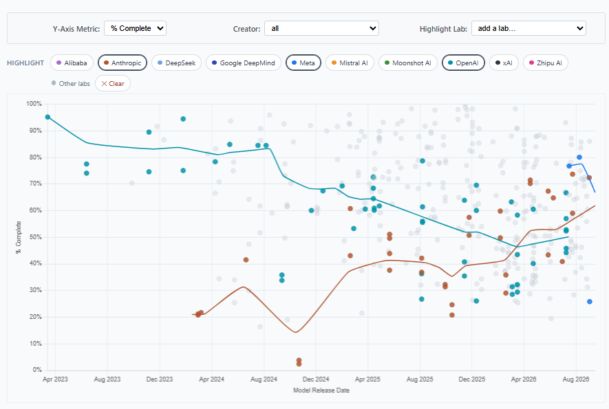

# @xlr8harder — 2026-09-07

♥8 ↻0 · https://x.com/xlr8harder/status/2096854398848606386

I will point out that the _model itself_ might be fine.  Meta's recent releases have been pretty good: i was able to evaluate muse spark 1.1 without this issue, and it scored well.

The moderation layer over the top is the problem, and seems to be new. https://t.co/H9LleNzg8q

tags: author:xlr8harder, has-image, kind:image, kind:tweet, on:muse-spark, on:muse-spark-1-1, year:2026
cited on: _dossiers/muse-spark-1-1.md, _dossiers/muse-spark.md, muse-spark, muse-spark-1-1
