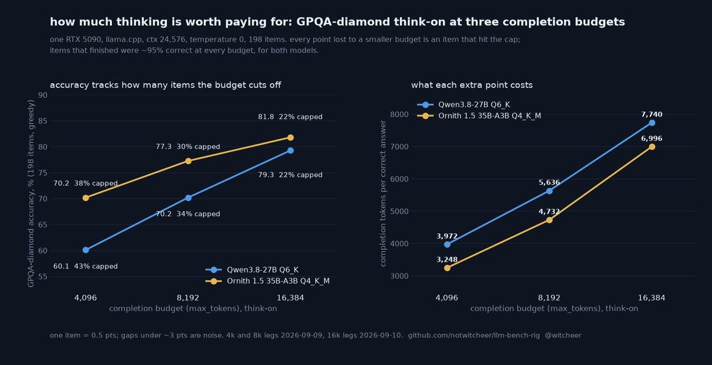

# @witcheer — 2026-09-11

♥42 ↻2 · https://x.com/witcheer/status/2098323509915091014

I gave two reasoning models 4k, 8k and 16k tokens to think on the same 198 GPQA-diamond questions. 

RTX 5090, llama.cpp, greedy, same server, only max_tokens moved.

> Qwen3.8-27B Q6_K: 60.1 → 70.2 → 79.3
> Ornith 1.5 35B-A3B Q4_K_M: 70.2 → 77.3 → 81.8

what the per-item diff says:
→ questions that finished inside the budget: 95 to 96% correct, at every budget, both models.
→ questions that hit the cap: 14 to 37% correct, and that is where all 101 lost points live.
→ a question that finishes thinks for ~1,200 tokens. but 38 to 43% of them run past 4k, 30 to 34% past 8k, 22% still past 16k.

the price: tokens per correct answer go 3,972 → 5,636 → 7,740 on Qwen, 3,248 → 4,732 → 6,996 on Ornith. each doubling costs +46 to 66% tokens and buys 4.5 to 10 points.

so "27B blows the budget on reasoning" is true and it is not the model. a 79% model with max_tokens at 8k is a 70% model on exactly the questions you wanted reasoning for.

tags: author:witcheer, has-image, kind:image, kind:tweet, on:qwen-3-8-27b, year:2026
cited on: _dossiers/qwen-3-8-27b.md, qwen-3-8-27b
