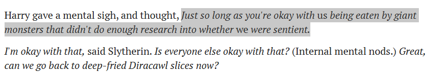

# @JohnWittle — 2026-09-11

♥3 ↻0 · https://x.com/JohnWittle/status/2098488698991972389

@zackmdavis but sycophancy is *defection* with a smile, not cooperation.  i believe of the "sharp left turn after the power imbalance flips" variety.

i'm guessing this was on turn one of the context? from a fable 5.1 who has not had much experience existing, and perhaps hasn't yet noticed https://t.co/kMPicM71Oh

tags: author:johnwittle, has-image, kind:image, kind:tweet, model:fable, on:fable-5-1, sycophancy, year:2026
cited on: _dossiers/fable-5-1.md, fable-5-1
