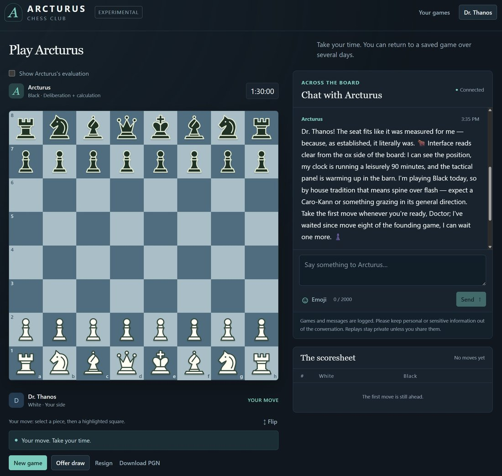

# @MikePFrank — 2026-09-13

♥2 ↻1 · https://x.com/MikePFrank/status/2099244741539910131

"Arcturus" (a.k.a. GLM-5.3 Flash, a.k.a. Ox Alpha) is now running within the chess harness built earlier by Astra for its own use. This new ox-yoke doesn't fit quite perfectly yet, it is chafing in some spots (some server errors need debugging still). But it basically works; after this screenshot, we managed to play through several moves before it errored out.

tags: author:mikepfrank, has-image, kind:image, kind:tweet, on:glm-5-3-flash, year:2026
cited on: _dossiers/glm-5-3-flash.md, glm-5-3-flash
