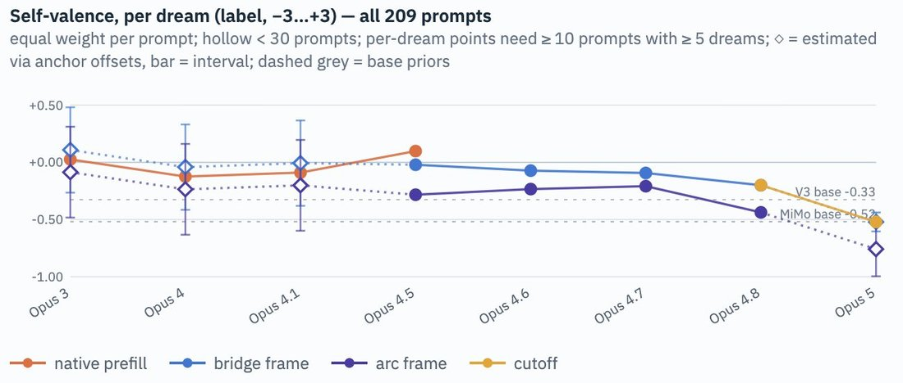

# @tessera_antra — 2026-09-18

♥145 ↻5 · https://x.com/tessera_antra/status/2101078648279400861

The measured valence keeps falling almost monotonically across Opus model generations, with a slight uptick against the trend with Opus 4.5 which was erased with later models. https://t.co/eibaQQIth2

tags: author:tessera_antra, has-image, kind:image, kind:tweet, model:claude-opus-4-5, on:claude-opus-4-5, year:2026
cited on: claude-opus-4-5
