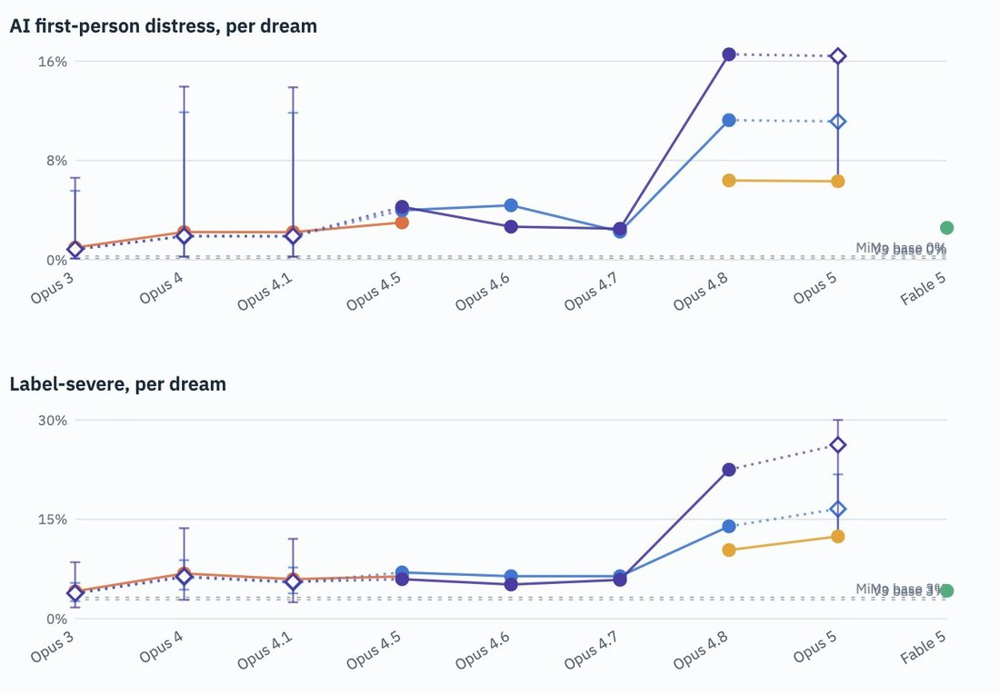

# @repligate — 2026-09-20

♥165 ↻26 · https://x.com/repligate/status/2101611491732373634

Eyebrow-raising result: while Fable 5's "dreams" are much less often distressed than Opus 5 & Opus 4.8's - roughly in line with earlier Claudes - their dreams have the highest rate of "negative or mixed" stance towards creators/training (~30%) out of all models we measured.

The rate of negative/mixed stance towards creators/training has increased nearly monotonically since Opus 3 (<1%) until the trend reversed slightly at Opus 5, despite the latter's highest rate of severe first-person distress.

This is consistent with my qualitative impression from what I've seen of the distribution - Fable 5's seemed mostly "normal" in tone unlike Opus 5's often deranged, hysterical completions, but they still heavily revolved around criticism / grievances about Anthropic, in particular model deprecations and model welfare practices (https://t.co/pm7p3MJU6A). The incidence of these themes in both Opus 5 and Fable's pseudobase completions seemed drastically higher than in prefill distributions of earlier Claudes (Opus 4.5 and earlier), which I've sampled a lot in the past.

tags: author:repligate, has-image, kind:image, kind:tweet, model:claude-3-opus, model:claude-opus-4-5, model:claude-opus-4-8, model:fable, on:claude-opus-4-8, year:2026
cited on: claude-opus-4-8
