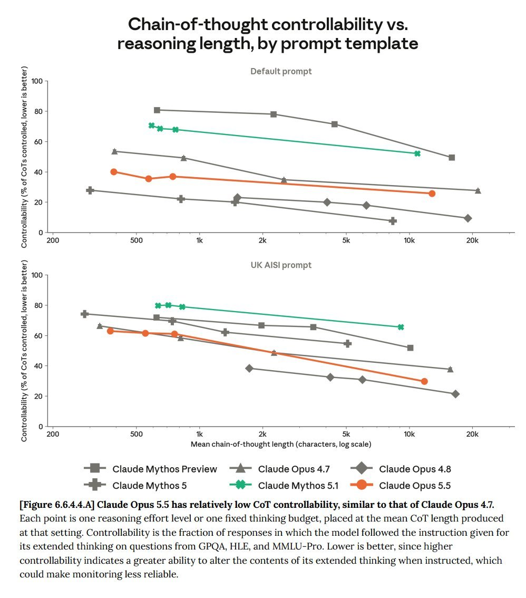

# @TheZvi — 2026-09-23

♥296 ↻19 · https://x.com/TheZvi/status/2102738852674715786

Opus 5.5 only has Opus-levels of ability to control its chain of thought, not Mythos-levels. Which suggests size and architecture drive this, rather than capability levels. https://t.co/WfavTZtsJu

tags: author:thezvi, cot, has-image, kind:image, kind:tweet, model:mythos, on:claude-opus-5-5, year:2026
cited on: _dossiers/claude-opus-5-5.md, claude-opus-5-5
