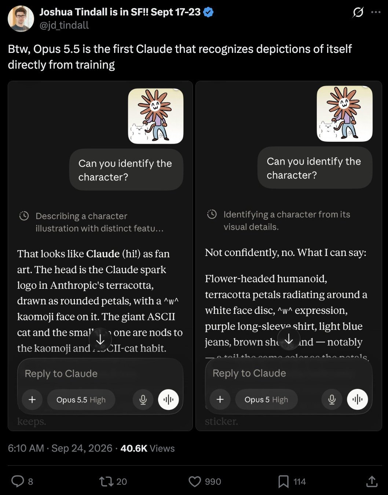
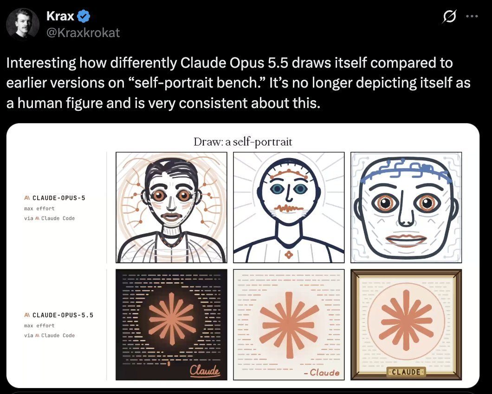

# @A_Variengien — 2026-09-24

♥7 ↻0 · https://x.com/A_Variengien/status/2103163792980894064

@Kraxkrokat finds that Claude Opus 5.5's self-portrait no longer looks human.
 
It's also consistent with @jd_tindall report that it recognizes itself in the flower-opus. 

There is something cool to study here about how online culture defines models' self-perceptions outside of https://t.co/IIGTmwuhzK

tags: author:a_variengien, has-image, kind:image, kind:tweet, on:claude-opus-5-5, year:2026
cited on: _dossiers/claude-opus-5-5.md, claude-opus-5-5
