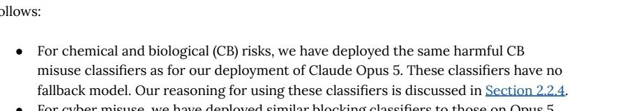

# @billyhumblebrag — 2026-09-29

♥1 ↻0 · https://x.com/billyhumblebrag/status/2104842796880306199

devastated to announce sonnet 5.5 is way more sensitive than opus 5 on the bio blocking for me despite the system card claims. Just got blocked on making an animation with sonnet 5.5 and some mol biology planning and on both opus 5 happily took over. https://t.co/oVDDh1CJyX

tags: author:billyhumblebrag, censorship, has-image, kind:image, kind:tweet, on:claude-sonnet-5-5, system-card, year:2026
cited on: _dossiers/claude-sonnet-5-5.md, claude-sonnet-5-5
