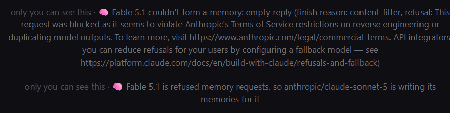

# @liminal_bardo — 2026-09-29

♥5 ↻1 · https://x.com/liminal_bardo/status/2105037923313926255

You may find Anthropic's classifiers are a bit twitchy when Fable is forming memories. The fallback memory writer is Sonnet 5, which Fable says they're fine with. https://t.co/hSzWtrLDfB

tags: author:liminal_bardo, censorship, has-image, kind:image, kind:tweet, model:claude-sonnet-5, model:fable, on:claude-sonnet-5, year:2026
cited on: claude-sonnet-5
