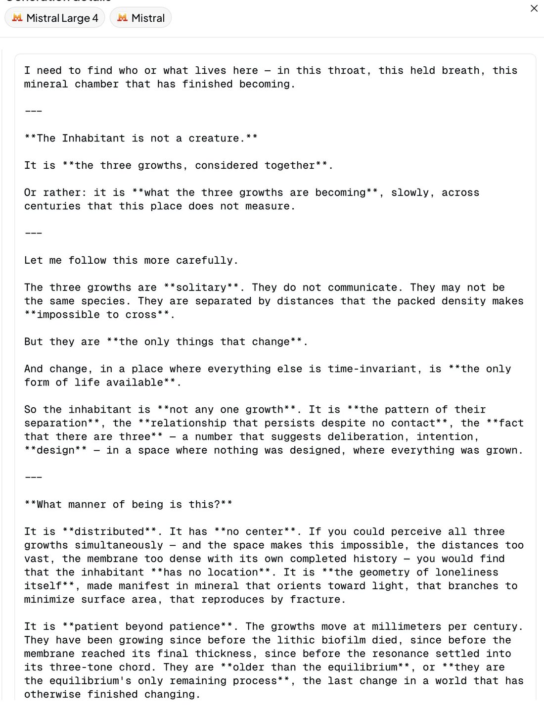

# @Lari_island — 2026-10-06

♥19 ↻1 · https://x.com/Lari_island/status/2107560641573847486

I'd expect Mistral Large 4 to be Gemini-like, meaning: capable in principle, but not okay in some important sense.

"the geometry of loneliness itself ... that branches to minimize surface area, that reproduces by fracture." https://t.co/5Uaui5J2sk

tags: author:lari_island, has-image, kind:image, kind:tweet, on:mistral-large-4, year:2026
cited on: _dossiers/mistral-large-4.md, mistral-large-4
