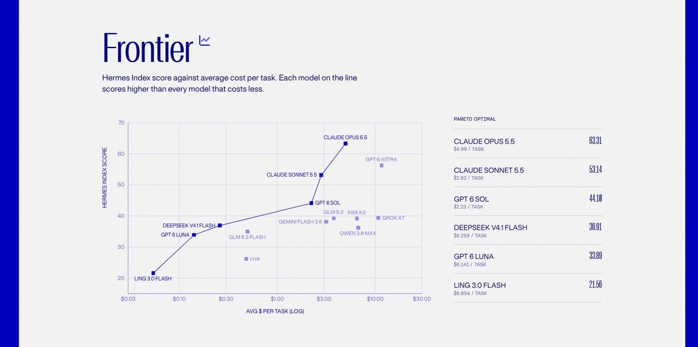

# @NousResearch — 2026-10-06

♥124 ↻10 · https://x.com/NousResearch/status/2107592263887147077

Claude Opus 5.5 leads at 63.31 and $4.99 per task.
GPT 6 Astra is second at 56.25 and $11.61.
Sonnet 5.5 follows at 53.14 and $2.82. 

At the other end, DeepSeek V4.1 Flash scores 36.91 at $0.26 and Ling 3.0 Flash scores 21.56 at $0.054. https://t.co/3IkK9zX0ju

tags: author:nousresearch, has-image, kind:image, kind:tweet, on:claude-sonnet-5-5, on:deepseek-v4-1-flash, year:2026
cited on: _dossiers/claude-sonnet-5-5.md, _dossiers/deepseek-v4-1-flash.md, claude-sonnet-5-5, deepseek-v4-1-flash
