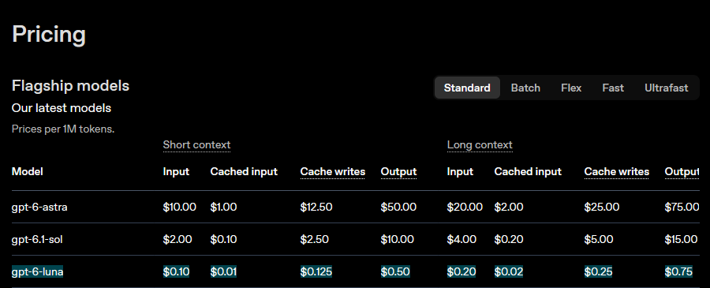

# @timfduffy — 2026-10-07

♥61 ↻2 · https://x.com/timfduffy/status/2107905264100012268

Haiku 5.5 is quite cheap, matching GPT-6 Luna pricing for short context. Long context is 5x the cost though (2x for Luna). Previous reporting by Epoch has suggested that larger Claudes may use linear/sparse attention, but this pricing structure indicates Haiku may not. https://t.co/BvcE01HIqT

tags: author:timfduffy, has-image, kind:image, kind:tweet, on:claude-haiku-5-5, year:2026
cited on: _dossiers/claude-haiku-5-5.md, claude-haiku-5-5
