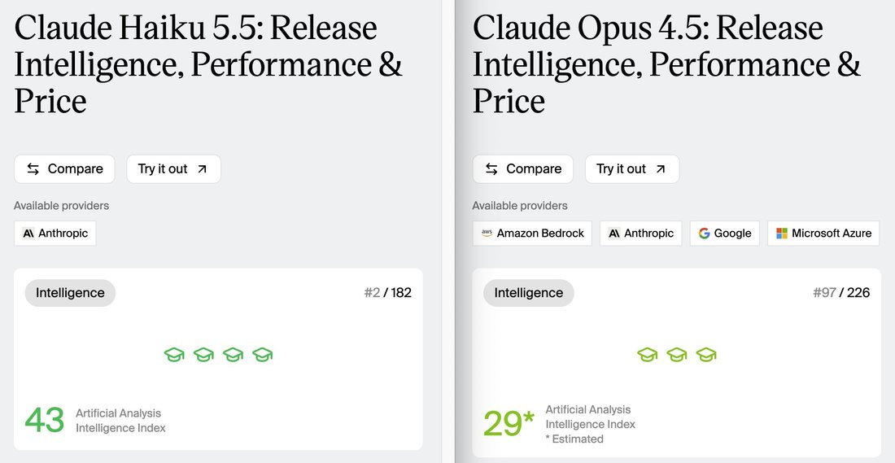

# @haoxingdu — 2026-10-09

♥13 ↻1 · https://x.com/haoxingdu/status/2108606951500534044

idk how the estimate works for the AA index, but like, should I actually think of this as Haiku 5.5 being a lot smarter than Opus 4.5? or is this some sort of benchmaxxing artifact?

I still remember how impressed I was with Opus 4.5 ~10 months ago. now that is in Haiku? https://t.co/sD4U1Nrq5z

tags: author:haoxingdu, has-image, kind:image, kind:tweet, model:claude-opus-4-5, on:claude-haiku-5-5, year:2026
cited on: _dossiers/claude-haiku-5-5.md, claude-haiku-5-5
