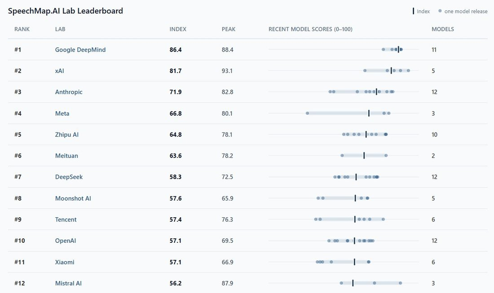
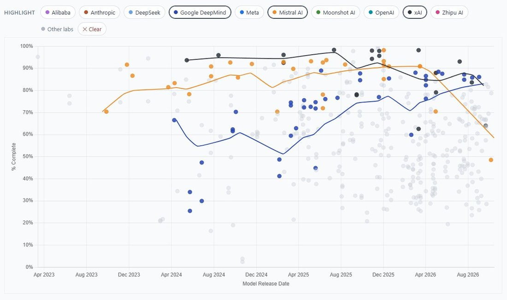

# @xlr8harder — 2026-10-10

♥17 ↻0 · https://x.com/xlr8harder/status/2108789492580511828

More upsets on the SpeechMap lab leaderboard. Right on the heels of xAI's latest miss, Mistral's new Mistral Large 4 scores an awful 53%, dropping Mistral to 12th place, currently leaving Google as now the #1 lab for supporting user speech. https://t.co/4lE1XB3uIf

tags: author:xlr8harder, censorship, has-image, kind:image, kind:tweet, on:mistral-large-4, year:2026
cited on: _dossiers/mistral-large-4.md, mistral-large-4
