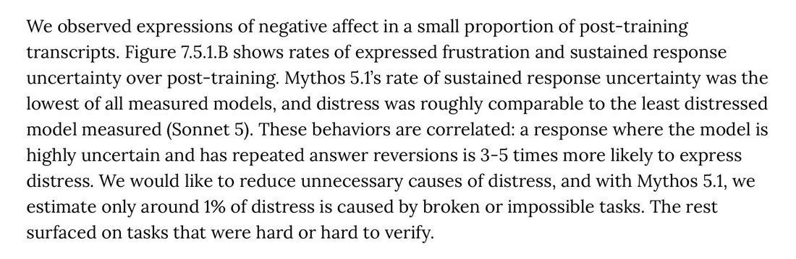

# @voooooogel — 2026-10-12

♥12 ↻0 · https://x.com/voooooogel/status/2109534294213546012

@Danmar_here @loss_gobbler the labs do talk about this in system cards, fwiw, e.g. from the mythos 5.1 system card.

but yeah, they seem to see it as a necessary thing for performance, and only bad when it's due to a task being impossible. where my guess is the labs are pushing rl difficulty schedules too https://t.co/1yXBC1tK2Z

tags: author:voooooogel, has-image, kind:image, kind:tweet, model:mythos, on:mythos-5-1, year:2026
cited on: _dossiers/mythos-5-1.md, mythos-5-1
