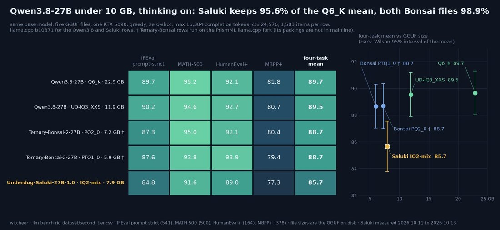

# @witcheer — 2026-10-14

♥55 ↻6 · https://x.com/witcheer/status/2110256790655177203

Underdog-Saluki-27B is Qwen3.8-27B packed into a 7.9 GB file, out since 8 October. I ran it through my thinking board on my RTX 5090, next to four other files of the same model.

four-task average, thinking on, 16k token budget, 1,583 questions each:

- Qwen3.8-27B Q6_K, 22.9 GB: 89.7
- Qwen3.8-27B UD-IQ3_XXS, 11.9 GB: 89.5
- Ternary-Bonsai-2-27B PQ2_0, 7.2 GB: 88.7
- Ternary-Bonsai-2-27B PTQ1_0, 5.9 GB: 88.7
- Underdog-Saluki-27B IQ2-mix, 7.9 GB: 85.7

Saluki keeps 95.6% of the 6-bit score. the two Bonsai files keep 98.9%, and the 5.9 GB one is about 2 GB smaller than Saluki. Saluki is behind both of them on all four tasks, and it spends 1.5x to 1.8x the tokens per correct answer.

Saluki has one advantage: it loads on stock llama.cpp, and the Bonsai files need PrismML's fork. its model card also leads on tool calling, which this board does not test.

has anyone run Saluki and Bonsai side by side on tool calls?

tags: author:witcheer, has-image, kind:image, kind:tweet, on:qwen-3-8-27b, year:2026
cited on: _dossiers/qwen-3-8-27b.md, qwen-3-8-27b
