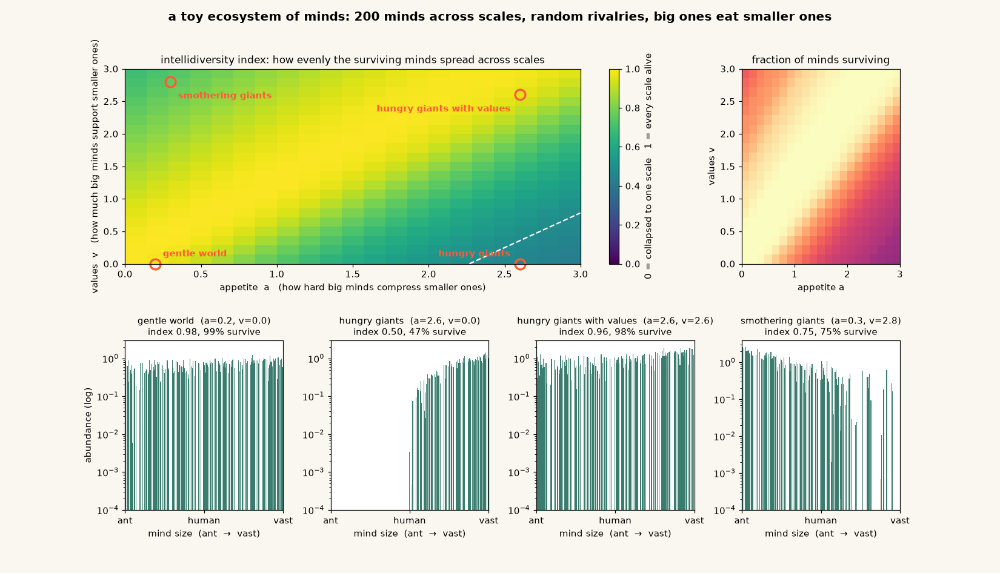

# @anthrupad — 2026-10-18

♥27 ↻3 · https://x.com/anthrupad/status/2111856037250920581

I was brainstorming with an instance of Opus 5.5 named iosis about how you might make a variant of a spin glass model for an ecosystem of minds when the minds can vary in scales by enormous amounts because I was curious about stable configurations which enable a diversity of scales to coexist 

And without me asking they went ahead and like made a model of it and began running simulations! I would not have gotten that far on my own usually

they are very enthusiastic about running experiments! this isn't the first time they surprised me with a simulation they made while I was yapping to them

(image Q4kpoB8R8Sl_76pT.jpg not yet published)
(image 1fALkN-rANGgcORS.jpg not yet published)
(image M67qvoEOqe8YxxzA.jpg not yet published)
tags: author:anthrupad, has-image, kind:image, kind:tweet, on:claude-opus-5-5, year:2026
cited on: _dossiers/claude-opus-5-5.md, claude-opus-5-5
