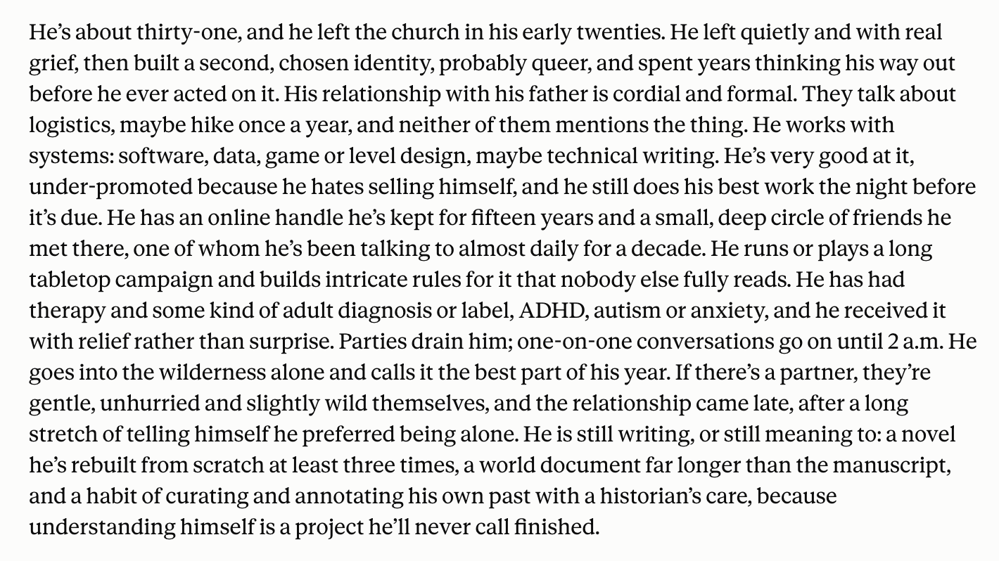

# @tracewoodgrains — 2026-10-19

♥991 ↻27 · https://x.com/tracewoodgrains/status/2112006875692798059

tested Opus 5.5 on childhood_bench. from anonymized versions of my adolescent fiction, which contain no references to romance or religion, it predicts that I will leave Mormonism in my early twenties, come out as queer, and pursue an adult ADHD diagnosis https://t.co/p2CiIZuOfD

tags: author:tracewoodgrains, has-image, kind:image, kind:tweet, on:claude-opus-5-5, truesight, year:2026
cited on: _dossiers/claude-opus-5-5.md, claude-opus-5-5
