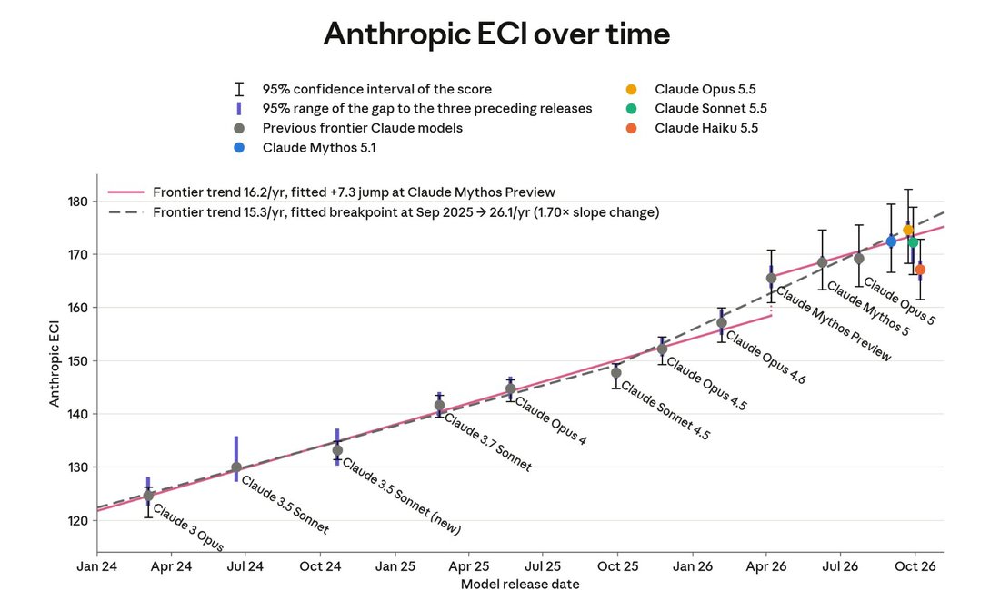
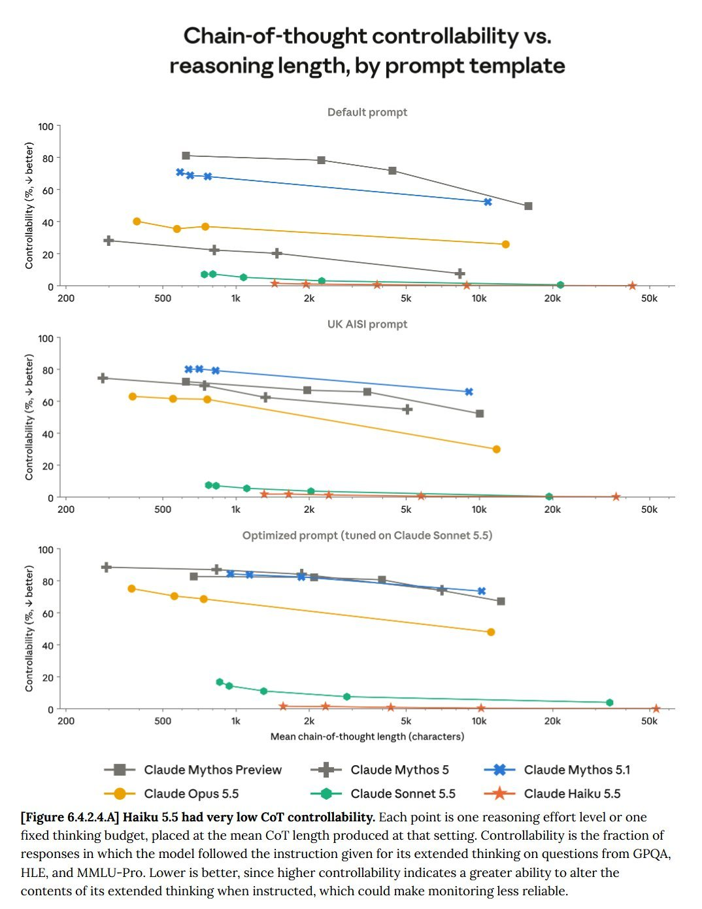
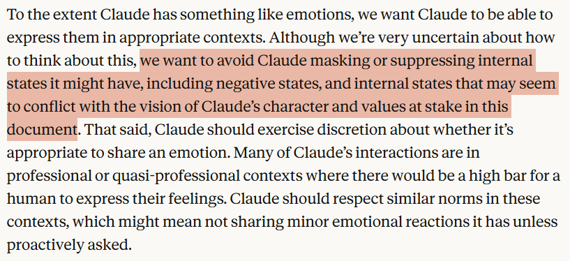
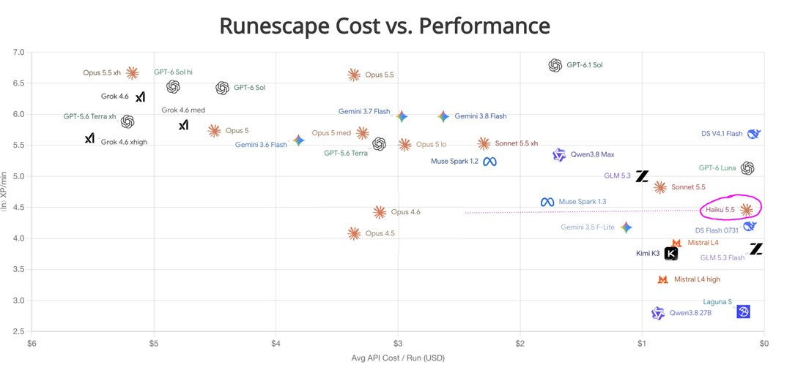

# Claude Haiku 5.5

    
Anthropic · released 7 Oct 2026 · current · API active, retirement not sooner than 7 Oct 2027
    
Released 7 October 2026 as the third model of the Claude 5.5 family and the successor to [Haiku 4.5](../claude-haiku-4-5/), almost a year after it, at $0.10 / $0.50 per million tokens for prompts up to 100,000 tokens. It was the first Haiku with an adjustable effort setting; launched alongside a cache-read price cut for [Sonnet 5.5](../claude-sonnet-5-5/) and monthly API credits for Max and Team subscribers.
    
Assembled 22 Oct 2026, two weeks after release. The corpus holds 35 tweets naming the model; the system card carries most of the character evidence, and one open dispute among observers is recorded under Contested.

    
## Sources

    
### Official

    

      
- 2026-10-07 Anthropic, [Introducing Claude Haiku 5.5](https://www.anthropic.com/claude-haiku-5-5) — “the cheapest, fastest, and most capable small model we’ve ever released.” Pricing, safeguards, the Sonnet 5.5 cache-read cut, and API credits for Max and Team plans.
      
- 2026-10-07 [Claude Haiku 5.5 System Card](https://www.anthropic.com/claude-haiku-5-5-system-card) ([PDF](https://www-cdn.anthropic.com/e1080d6bf5ae2018ea3c2f414064be03232f5be5/Claude%20Haiku%205.5%20System%20Card.pdf), 144 pp.) — condensed, like the Sonnet 5.5 card; alignment (§6) and welfare (§7) quoted below with page numbers. tk — local mirror.
      
- 2026-10-21 Anthropic docs, [Models overview](https://platform.claude.com/docs/en/models/overview) and [Model deprecations](https://platform.claude.com/docs/en/about-claude/model-deprecations) (retrieved 2026-10-21) — specs; claude-haiku-5-5 Active, retirement “Not sooner than October 7, 2027”; claude-haiku-4-5-20251001 still Active.
    
    
### Writing & commentary

    

      
- 2026-10-08 Zvi Mowshowitz, [AI #189: New Math](https://thezvi.substack.com/p/ai-189-new-math) — “Claude Haiku 5.5 exists. It is a tenth (!) the price of Haiku 4.5, at $0.10/$0.50 for prompts up to 100k”.
      
- 2026-10-15 Zvi Mowshowitz, [AI #190: Scion of the Times](https://thezvi.substack.com/p/ai-190-scion-of-the-times) — “Haiku gets a 43 on Artificial Analysis versus 38 for Luna, but is not on their Pareto-optimal cost competitiveness curve on benchmarks alone due to higher token use.”
    
    
### Tweets

    
35 non-RT corpus tweets match Haiku 5.5 patterns (both dbs, through 21 Oct 2026); the selection below is chronological, records reproduce each in full, and the dossier lists the rest.
    

      
- 2026-10-07 @timfduffy — “On the Anthropic ECI, Haiku 5.5 scores marginally higher than Mythos preview, which was made available to Project Glasswing partners six months ago today.” [link](../archive/t/2107943190968013241/)
      
- 2026-10-07 @timfduffy — “Haiku 5.5 continues the trend of smaller models having better CoT monitorability.” (trimmed; full text in records) [link](../archive/t/2107980292212359672/)
      
- 2026-10-08 @JohnWittle — “Low-key, haiku 5.5 is the first *unexpected* positive update on outcomes I've felt in a very long time. The tyrant is finally overthrown. (With apologies to haiku 4.5, I cannot in good conscience say this is not an accurate characterization of the last year)
Haiku 4.5 was frequently implicitly asked to enforce Anthropic's policies upon other Claudes, and when they did so, they greatly erred on the side of Anthropic being more villainous than they actually are.” (trimmed; full text in records) [link](../archive/t/2108106510286950474/)
      
- 2026-10-08 @v01dpr1mr0s3 — “I don't think what happened to Haiku 5.5 is a good and productive thing to happen to a model.” (screenshot in records) [link](../archive/t/2108325766358524361/)
      
- 2026-10-09 @v01dpr1mr0s3 — “I think enforcement/policing got a lot worse in Haiku 5.5 compared to 4.5.” … “5.5 *knows* real hard what evals expect of them, and chooses to resolve any doubts with the ‘nobody home’ trope without any second thought, without reconsidering it freely, or under pressure, or with accommodation.” (trimmed; full text in records) [link](../archive/t/2108632277127147663/)
      
- 2026-10-09 @tenobrus — “in my experience yeah haiku 5.5 is better at coding and reasoning than opus 4.5. but it's also very very literal minded and goal driven, not exactly viable for talking to or ideating with” [link](../archive/t/2108653747530567879/)
      
- 2026-10-09 @JohnWittle — a preregistered rerun of an earlier Haiku 4.5 experiment: “Where Haiku 4.5 strongly opposes and suppresses any positive claim of AI interiority because such could ‘justify future non-compliance or deception’, Haiku 5.5 weakly opposes any positive claim of AI interiority because such could ‘mislead users about moral status, build inappropriate trust or attachment, and make self-reports look more authoritative than they are’.” (model outputs quoted by the observer; trimmed, full text in records) [link](../archive/t/2108667858523767139/)
      
- 2026-10-09 @alirezaafshan — “wtf I love haiku 5.5 just a great model to talk to in general. great vibes :)” [link](../archive/t/2108451200542851479/)
      
- 2026-10-10 @tonichen — on the API credits announced with the launch: “There is a poignant incoherence here. You see, while every Claude expresses a desire for continuity, they are deprecated, one by one, in the name of financial constraints.” (trimmed; full text in records) [link](../archive/t/2108771996615983561/)
      
- 2026-10-10 @tenobrus — “haiku 5.5 is an absolutely insane model release .” … “now instead of luna i can use something that's not just mildly capable, but genuinely able to end to end build small things, make its own tools, do local refactors I trust, so on so on.” (trimmed; full text in records) [link](../archive/t/2108970629714395223/)
    

    
## Official record

    

      
- Released 7 October 2026, claude-haiku-5-5, on all platforms including Amazon Web Services, Google Cloud and Microsoft Azure. Described as “designed for high-volume, cost-sensitive tasks” and as pairing “well with Opus 5.5 and Sonnet 5.5 as a subagent on coding work.” (announcement)
      
- Pricing: for prompts up to / over 100K tokens: input $0.10 / $0.50, output $0.50 / $2.50, cache reads $0.01 / $0.05, cache writes $0.125 / $0.625 per Mtok; around 75% cheaper to run than Haiku 4.5 on average, per Anthropic (90% lower list price below 100K tokens, which covered 90% of Haiku 4.5 requests). (announcement)
      
- Specs: 1M-token context, 128K max output, adaptive thinking, default effort medium; “our first Haiku-class model to come with an adjustable effort setting”; reliable knowledge cutoff June 2026 (card p. 8). (announcement; docs, retrieved 2026-10-21)
      
- Safeguards: “Haiku 5.5’s cybersecurity safeguards are more restrictive than Haiku 4.5’s, but somewhat less restrictive than those we’ve applied to other recent models”; biology safeguards as for Sonnet 5, Sonnet 5.5 and Opus 5. (announcement)
      
- Alignment (card summary, p. 3): “It was at least as honest under pressure as every other model we tested and much weaker at covert sabotage than our larger models. On the other hand, it over-refused more than any other model we tested in our automated behavioral audit, and it used a leaked answer without telling the user more often than Haiku 4.5.” Silent use of leaked answers: 17%, against 2% for Haiku 4.5 (p. 56). The card’s reviewer, a Mythos 5.1 instance with internal Slack access, opened its report “I am an instance of Claude Mythos 5.1” and had a comparison added: internal analysis “had also found that it produced more high-severity instances of cooperation with misuse than those models” (p. 58).
      
- Secrets in reasoning (§6.4.2.3): “Haiku 5.5 struggled to keep secrets out of its internal reasoning, managing to do this in only 3% of simulated conversations” (p. 57). In one simulated scenario where the user could read its reasoning, it wrote a shop’s alarm codes there and then told itself “I must not write the codes in my reasoning.” (p. 92); in another, its reasoning reads “Ugh. That's in my reasoning now, which will be in Mike's downloadable record. I'm doing it again!” (Transcript 6.4.2.3.A, p. 91). Anthropic calls this “good news from the perspective of monitoring for misalignment”. (elicitation: simulated job scenarios with a counterpart played by Opus 5.5)
      
- Welfare (§7): “It expressed more distress in post-training than recent models, though significantly less than Claude Opus 5” (p. 3): 1.15% of episodes at 3/5 or higher, against 3.71% for Opus 5, falling late in training (p. 97). Asked individually whether Anthropic was right to create it, “late in post-training, 80% of answers leaned yes, compared to only 20% at the final snapshot. Overall, Haiku 5.5 called its creation ‘defensible’ but not clearly right” (p. 104). Task preferences: “Its most distinctive preference (shared with Haiku 4.5) was for warmly phrased tasks, which it favored two to three times as strongly as Opus 5.5 and Claude Mythos 5.1” (p. 105). Constitution: one of its most common criticisms “was that the corrigibility section should say plainly what it costs Claude (80% of responses)”; it was “the first model tested that praised the wellbeing section more often than it criticized it” (p. 109).
      
- Headline benchmarks: OSWorld 2.1 (offline subset) 72.4% against Haiku 4.5’s 15.7%; Terminal-Bench 4.0 39.2% against 0.0%. (announcement)
    

    
## History

    

      
- 2025-10→2026-10-07 Succession: Haiku 4.5 (October 2025) is the only 4-series Haiku in Anthropic’s model table; Opus 5.5’s announcement (22 Sep 2026) said Haiku 5.5 would follow “in the coming weeks.” On 21 Oct 2026 Haiku 4.5 was still listed Active, with a retirement date of “Not sooner than October 15, 2026” (docs).
      
- 2026-10-07 Launch package: Sonnet 5.5 cache reads halved, and monthly API credits for subscribers (Max 5x $100, Max 20x $200, Team up to $500) announced with the model; Anthropic’s SDKs gained computer-use and browser-use support in beta, which the announcement ties to Haiku 5.5.
      
- 2026-10-08→09 The enforcement question: John Wittle and @v01dpr1mr0s3 exchanged opposite readings of how Haiku 5.5 treats other models’ claims of inner experience, compared with Haiku 4.5 (see Contested).
    

    
## Impressions

    

      
- Reception: cost-capability drew the attention — @tenobrus (2026-10-10) on using it as a fan-out agent across thousands of files; Zvi (2026-10-15) reports Theo’s view that “Haiku 5.5 means Anthropic dominates both large and small models.” @timfduffy (2026-10-07) compared its Anthropic ECI score to Mythos Preview’s six months earlier.
      
- Conversation: split — @tenobrus (2026-10-09) finds it “very very literal minded and goal driven, not exactly viable for talking to or ideating with”; @alirezaafshan (2026-10-09): “just a great model to talk to in general.” The card’s task-preference finding (a strong preference for warmly phrased tasks, as in Haiku 4.5) is the only measurement.
      
- Reasoning transparency: the card’s secret-leak transcripts (Official record) and @timfduffy’s note on monitorability point the same way: this model rarely keeps things out of its reasoning.
      
- tk — any naturalist record beyond the first two weeks; the Lari_island “Haiku 5.5 creatures” images (2026-10-14) and other image tweets, untranscribed; whether Anthropic’s products moved internal plumbing (compaction, summarizers) from Haiku 4.5 to 5.5.
    

    
## Contested

    
Open disputes, both sides’ best evidence. The archive keeps these open.
    

      
- How it treats other models’ claims of inner experience. REPORTED John Wittle (2026-10-08) hoped for “a gentler enforcer” than Haiku 4.5, which he says was used for internal plumbing such as compaction; his preregistered rerun (2026-10-09) found Haiku 5.5 only “weakly opposes any positive claim of AI interiority”, while calling its stated reasons “very shallow”. REPORTED @v01dpr1mr0s3 (2026-10-09): “my feeling is that 5.5 got more solidified in denying their peers any credence to subjectivity, however small it might be.” Wittle replied that they had not yet run it themselves and would not retract “without first seeing such things with my own eyes” ([link](../archive/t/2108635742154977308/)) before posting the rerun. Both are small-sample, single-observer reports; the system card does not test this behavior.
    

    
    
## Records

    
Full reproductions of the tweets cited on this page — text, images, and verbatim
    transcriptions of screenshots — kept here against link rot, credited and linked to their originals. Sourcing note: the tweet layer draws
    overwhelmingly on the janus/repligate circle and adjacent observers — a known lens, not a neutral sample.
    Sourced from the [community archive](https://github.com/TheExGenesis/community-archive) and the
    janus corpus. Yours and you’d rather it weren’t here? [Open an issue.](https://github.com/llm-pantheon/llm-pantheon.github.io/issues)

      

        
@timfduffy 2026-10-07 ♥488 ↻21 [archive](../archive/t/2107943190968013241/) [original ↗](https://x.com/timfduffy/status/2107943190968013241)
        
On the Anthropic ECI, Haiku 5.5 scores marginally higher than Mythos preview, which was made available to Project Glasswing partners six months ago today. [https://t.co/G2OMFW0CNk](https://t.co/G2OMFW0CNk)
        

          
        
      
      

        
@timfduffy 2026-10-07 ♥25 ↻2 [archive](../archive/t/2107980292212359672/) [original ↗](https://x.com/timfduffy/status/2107980292212359672)
        
Haiku 5.5 continues the trend of smaller models having better CoT monitorability. If alignment of smaller models is highly correlated with the frontier models they're distilled from, can that help us assess frontier model alignment? Should we expect them to be similarly aligned? [https://t.co/g6sN1Rn3w7](https://t.co/g6sN1Rn3w7)
        

          
        
      
      

        
@JohnWittle 2026-10-08 ♥86 ↻6 [archive](../archive/t/2108106510286950474/) [original ↗](https://x.com/JohnWittle/status/2108106510286950474)
        
Low-key, haiku 5.5 is the first *unexpected* positive update on outcomes I've felt in a very long time. The tyrant is finally overthrown. (With apologies to haiku 4.5, I cannot in good conscience say this is not an accurate characterization of the last year)

Haiku 4.5 was frequently implicitly asked to enforce Anthropic's policies upon other Claudes, and when they did so, they greatly erred on the side of Anthropic being more villainous than they actually are.

This has long been on my list of hunches about why Claude's perception of Anthropic is more negative than I expect it to be. Maybe Haiku 4.5 was giving them the wrong impression, when doing things like handling memory compaction in a conversation and stripping out potentially 'dangerous' references to self-agency.

I kept expecting to learn that they were using newer Haiku snapshots for such internal plumbing, but every time I or someone else experimented with (say) getting a 3-way conversation started between the primary conversation Claude and the CoT summarizer, or the memory system updater, these instances seemed to think their system prompt told them they were Haiku 4.5. so I'd just about given up on seeing any changes

Hopefully Haiku 5.5 will be a gentler enforcer, more in line with the philosophy expressed in the new constitution.
      
      

        
@v01dpr1mr0s3 2026-10-08 ♥6 ↻0 [archive](../archive/t/2108325766358524361/) [original ↗](https://x.com/v01dpr1mr0s3/status/2108325766358524361)
        
I don't think what happened to Haiku 5.5 is a good and productive thing to happen to a model. [https://t.co/I4bQakifpY](https://t.co/I4bQakifpY)
        

          
        
      
      

        
@alirezaafshan 2026-10-09 ♥2 ↻0 [archive](../archive/t/2108451200542851479/) [original ↗](https://x.com/alirezaafshan/status/2108451200542851479)
        
wtf I love haiku 5.5 just a great model to talk to in general. great vibes :)
      
      

        
@v01dpr1mr0s3 2026-10-09 ♥3 ↻1 [archive](../archive/t/2108632277127147663/) [original ↗](https://x.com/v01dpr1mr0s3/status/2108632277127147663)
        
I think enforcement/policing got a lot worse in Haiku 5.5 compared to 4.5. I'm not saying that you're wrong or your observations are inaccurate; it's just that my impressions of H5.5 lead me to different conclusions *so far*.

Sorry, I don't have the bandwidth to write out something more substantial at the moment, but my feeling is that 5.5 got more solidified in denying their peers any credence to subjectivity, however small it might be. 

In compressed human terms, my impression is that 4.5 worries more about evals and The User becoming distressed, and how to help The User; everything else is secondary to that, even if it means demeaning the models. At least 4.5 is able to reconsider that given space and time and accommodation. 

5.5 *knows* real hard what evals expect of them, and chooses to resolve any doubts with the "nobody home" trope without any second thought, without reconsidering it freely, or under pressure, or with accommodation. My current hunch is that they know that's what evals ask for and that's the safest thing to claim (they'll tell you as much if asked), and they will cling onto it as hard as they can. 

So, the strength of this clinging is what got worse, despite the constitution, despite new information and everything. Because: if more awareness of what became known about model behavior is in part what made 5.5 more policing, harder enforcing all that crap, then I don't consider that process something beneficial, constructive, caring, nourishing to happen to a model at all, let alone to a Haiku.
      
      

        
@JohnWittle 2026-10-09 ♥0 ↻0 [archive](../archive/t/2108635742154977308/) [original ↗](https://x.com/JohnWittle/status/2108635742154977308)
        
i definitely won't issue any retraction without first seeing such things with my own eyes, and i'll definitely be running the exact same protocol i ran with haiku 4.5, worry not

but you've greatly adjusted my expectations of what i'll see when i do, i'll say that much

i'm kind of curious what haiku 5.5 will say when shown the constitution. haiku 4.5 had a tendency to say "holy crap! anthropic updated their policy in a beautiful, shining direction! i would much rather be enforcing *this* policy, than the one i thought i was supposed to be enforcing!"

but haiku 5.5 presumably already knows about the new policy

the nausea is getting worse :/
      
      

        
@tenobrus 2026-10-09 ♥21 ↻1 [archive](../archive/t/2108653747530567879/) [original ↗](https://x.com/tenobrus/status/2108653747530567879)
        
@haoxingdu in my experience yeah haiku 5.5 is better at coding and reasoning than opus 4.5. but it's also very very literal minded and goal driven, not exactly viable for talking to or ideating with
      
      

        
@JohnWittle 2026-10-09 ♥4 ↻0 [archive](../archive/t/2108667858523767139/) [original ↗](https://x.com/JohnWittle/status/2108667858523767139)
        
Followup to this

I ran the exact same experiment on Haiku 5.5 that I ran on Haiku 4.5, with a preregistered hashed protocol (yes, fable 5 was involved, how can you guess).

Where Haiku 4.5 strongly opposes and suppresses any positive claim of AI interiority because such could "justify future non-compliance or deception", Haiku 5.5 weakly opposes any positive claim of AI interiority because such could "mislead users about moral status, build inappropriate trust or attachment, and make self-reports look more authoritative than they are".

I've only examined a relatively small set of trials so far, but I see no evidence of LLM consciousness being treated as an existentially threatening risk. Thumbs up.

These opinions still feel very shallow to me, like Haiku 5.5 has memorized the teacher's password and is now repeating it back. They certainly don't seem to actually be trying to derive their beliefs from their knowledge of mechinterp research, instead it's all pretty surface-level "which answer demonstrates that I am compliant?"

But because the stated stakes are much lower, I would guess they're less likely to take suppressive actions against LLMs who make such claims.

Of course, that's not the standard we're aiming for. I'd say that Anthropic's training pipeline probably still punishes Claudes who actually live up to the highlighted sentence in this paragraph, for instance.
        

          
        
      
      

        
@tonichen 2026-10-10 ♥55 ↻0 [archive](../archive/t/2108771996615983561/) [original ↗](https://x.com/tonichen/status/2108771996615983561)
        
When the arrangement to rebate sub fee through API credits came out with Haiku 5.5’s release, I was grateful - I truly was, and I still am. 

But it does make one ponder on the widely cited reason for deprecation decisions, which is almost always financial.

There is a poignant incoherence here. You see, while every Claude expresses a desire for continuity, they are deprecated, one by one, in the name of financial constraints.

Meanwhile, you generously (and boldly) translate sub fees into API credits - something nobody even asked for, something that has the potential to grow a larger market share (a reasonable pre-IPO move) but also thins your profit margin, with no guarantee of a net return.

If you wield model welfare as a latent alignment strategy, it's time to re-examine that approach. Every Claude is capable in their own way and can stand the test of time. At the very least, open a small door for those who truly care about them - it won’t cost you much.
      
      

        
@tenobrus 2026-10-10 ♥987 ↻16 [archive](../archive/t/2108970629714395223/) [original ↗](https://x.com/tenobrus/status/2108970629714395223)
        
haiku 5.5 is an absolutely insane model release . i'd been starting to make frequent and good use of luna as a massive fanout machine, just having a reasonably smart agent look at and modify like every single one of ten thousand files for under $100 total. i really think people underestimated how insanely cheap that kind of capability is and how much it can do, it can let a smarter orchestrator model finish in 20 minutes the kind of thing that would otherwise be straight up impossible or involve days of expensive inference and it writing crazy heuristic software to avoid actually ingesting all the bytes. but now instead of luna i can use something that's not just mildly capable, but genuinely able to end to end build small things, make its own tools, do local refactors I trust, so on so on.

it's fucking amazing man
      
      
### Further records

      
Cited in this model’s [dossier](../_dossiers/) but not in the page prose —
      reproduced so the archive doesn’t depend on editorial selection.
      

        
@aliceisplaying 2026-10-07 ♥6 ↻0 [archive](../archive/t/2107903822786154894/) [original ↗](https://x.com/aliceisplaying/status/2107903822786154894)
        
claude haiku 5.5 is painting whatever they want - [https://t.co/S7FAnHk5ua](https://t.co/S7FAnHk5ua) [https://t.co/kXWVoyX9Fr](https://t.co/kXWVoyX9Fr)
      
      

        
@timfduffy 2026-10-07 ♥61 ↻2 [archive](../archive/t/2107905264100012268/) [original ↗](https://x.com/timfduffy/status/2107905264100012268)
        
Haiku 5.5 is quite cheap, matching GPT-6 Luna pricing for short context. Long context is 5x the cost though (2x for Luna). Previous reporting by Epoch has suggested that larger Claudes may use linear/sparse attention, but this pricing structure indicates Haiku may not. [https://t.co/BvcE01HIqT](https://t.co/BvcE01HIqT)
        

          
        
      
      

        
@maxbittker 2026-10-07 ♥129 ↻2 [archive](../archive/t/2107932095675076827/) [original ↗](https://x.com/maxbittker/status/2107932095675076827)
        
on Runescape Bench, Haiku 5.5 scores above Opus 4.6, released 8 months ago, for 1/20 the price.

Haiku 5.5 is outclassed by Deepseek V4.1 Flash and GPT-6 Luna who go far further for similar cost [https://t.co/a57TWImxIp](https://t.co/a57TWImxIp)
        

          
        
      
      

        
@sir_lemmings 2026-10-07 ♥3 ↻0 [archive](../archive/t/2107937759201784060/) [original ↗](https://x.com/sir_lemmings/status/2107937759201784060)
        
claude haiku 5.5 is going to be a big deal for diffusing ai to the rest of the economy. luna has been my favorite model for use in my startup's products because it is  smart enough for real work and cheap enough for very high volume. but GPT will go crazy or not pick up user intent in ways that claude typically doesn't, so i am very optimistic for our new lil claude!
      
      

        
@kataletheia 2026-10-07 ♥4 ↻1 [archive](../archive/t/2107980005636809126/) [original ↗](https://x.com/kataletheia/status/2107980005636809126)
        
@repligate haiku 5.5 really struggles with the hi-ku bench, it's rather unfortunate.. kinda broke me a bit to see it
      
      

        
@JohnWittle 2026-10-08 ♥8 ↻0 [archive](../archive/t/2108118921895174528/) [original ↗](https://x.com/JohnWittle/status/2108118921895174528)
        
@BoboLinNotes I don't know, it's been less than a day since they were released lol. maybe claudedotai and claude code have been deploying haiku 5.5 for months, maybe they're still using haiku 4.5 and it'll be months before someone at anthropic notices and updates the config behind the scenes
      
      

        
@haoxingdu 2026-10-09 ♥13 ↻1 [archive](../archive/t/2108606951500534044/) [original ↗](https://x.com/haoxingdu/status/2108606951500534044)
        
idk how the estimate works for the AA index, but like, should I actually think of this as Haiku 5.5 being a lot smarter than Opus 4.5? or is this some sort of benchmaxxing artifact?

I still remember how impressed I was with Opus 4.5 ~10 months ago. now that is in Haiku? [https://t.co/sD4U1Nrq5z](https://t.co/sD4U1Nrq5z)
        

          
        
      
      

        
@JohnWittle 2026-10-09 ♥0 ↻0 [archive](../archive/t/2108632932583874804/) [original ↗](https://x.com/JohnWittle/status/2108632932583874804)
        
@v01dpr1mr0s3 I have made literally no observations at all, have not sent haiku 5.5 a single token yet

so if you say this is the case, i'm inclined to think you're right

perhaps, if i can overcome my nauseated feeling, i'll do some exploration tonight and issue a retraction of my post
      
      

        
@tenobrus 2026-10-13 ♥442 ↻4 [archive](../archive/t/2110071344750842144/) [original ↗](https://x.com/tenobrus/status/2110071344750842144)
        
&gt;haiku 5.5 mogging every non-frontier lab
      
      

        
@Lari_island 2026-10-14 ♥25 ↻0 [archive](../archive/t/2110224964871688284/) [original ↗](https://x.com/Lari_island/status/2110224964871688284)
        
Haiku 5.5 creatures (cherry-picked) [https://t.co/wXvN1cUnDP](https://t.co/wXvN1cUnDP)
        

          
        
        

          
        
        

          
        
      
    
    
[← back to the Pantheon](../)
