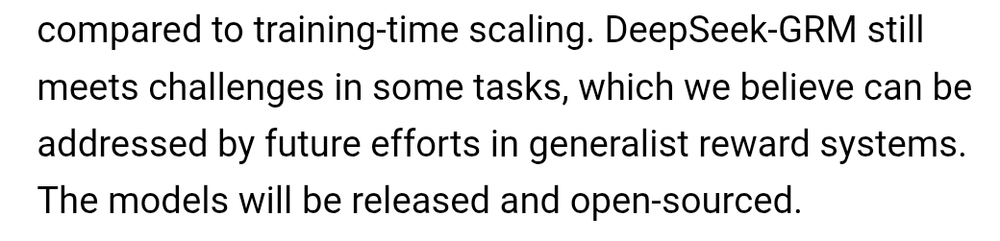
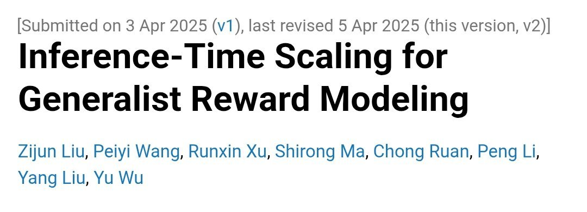

# DeepSeek-R2

    
DeepSeek · never released · named in press reports from February 2025, never announced by DeepSeek · no release as of 21 Oct 2026
    
DeepSeek-R2 is the name press reports gave the expected successor to [DeepSeek-R1](../deepseek-r1/). In February 2025 Reuters reported that DeepSeek was accelerating its release from an early-May target; in August 2025 the Financial Times reported delays after failed training runs on Huawei Ascend chips, and DeepSeek denied rumors of an August launch. No model of that name has been released; since August 2025 DeepSeek has shipped reasoning inside its main line ([V3.1](../deepseek-v3-1/) onward).
    
An absence with a trail. DeepSeek never named R2 in its official channels: its API news index (nineteen entries, July 2024 → October 2026) has no R2 entry, and the corpus holds three tweets about it. Most of the trail is secondhand press, relayed here through the outlets that were retrievable; the Chinese-language rumor sources the press drew on (iThome, Mydrivers) were not sampled tk.

    
## Sources

    
### Official

    

      
- No DeepSeek announcement of R2 exists. The closest official events are [DeepSeek-R1-0528](https://api-docs.deepseek.com/updates/) (2025-05-28, the last R-line release, per the change log) and [DeepSeek-V3.1](https://api-docs.deepseek.com/news/news250821/) (2025-08-21): “Hybrid inference: Think & Non-Think — one model, two modes”, with deepseek-reasoner becoming V3.1’s thinking mode.
    
    
### Writing & commentary

    

      
- 2025-02-25 Reuters, “DeepSeek rushes to launch new AI model as China goes all in” (not retrieved; summarised by TechNode, below: “Reuters previously cited three sources as saying that DeepSeek was accelerating R2’s rollout after initially targeting May, aiming for improved code generation and reasoning in languages beyond English.”) REPORTED
      
- 2025-08-14 TechNode, [DeepSeek denies rumors of August launch for R2 AI model](https://technode.com/2025/08/14/deepseek-denies-rumors-of-august-launch-for-r2-ai-model/) — “Chinese AI company DeepSeek has denied renewed market speculation that its next-generation AI model, DeepSeek-R2, will launch between August 15 and August 30, according to a person familiar with the company’s plans.” Also: “In early 2025, reports suggested a March 17 release, which the company also refuted. DeepSeek has yet to announce a launch date or reveal technical details for the model.”
      
- 2025-08-14 TrendForce, [DeepSeek R2 Model Launch Reportedly Delayed Amid Huawei Ascend Chip Hurdles](https://www.trendforce.com/news/2025/08/14/news-deepseek-r2-model-launch-reportedly-delayed-amid-huawei-ascend-chip-hurdles/) (relaying the Financial Times) — “DeepSeek has yet to complete a successful training run on the Ascend chip and is still working with Huawei to ensure the model is compatible with Ascend for inference”; “Following the January release of its R1 model, DeepSeek was urged by authorities to use Huawei’s Ascend processor instead of NVIDIA’s systems”. REPORTED
      
- 2025-08-15 Gigazine, [Reports that the Chinese government requested that DeepSeek’s new AI model ‘DeepSeek-R2’ be developed using Huawei chips, but the request failed and the release was delayed](https://gigazine.net/gsc_news/en/20250815-deepseeks-ai-model-delayed-huawei-chip-issues) — “Ultimately, DeepSeek decided to use NVIDIA chips for training the R2 model and Huawei chips for inference.” REPORTED
    
    
### Tweets

    
Three corpus tweets mention R2 by name (both dbs, searched for “deepseek” with “r2”); reproduced in full in the records below.
    

      
- 2025-08-09 @generatorman_ai — “i’m starting to get worried about the whale.

no R2 is fine, it might just be taking more work than expected, but the fact that they haven’t released deepseek-grm 4 months after publishing the paper is troubling.

the ccp is quite capable of shooting itself in the foot.” [link](../archive/t/1954162502247272717/)
      
- 2025-09-23 @solarapparition — on open weights: “we do not expect anyone but deepseek to create r2, for example.” (full text in records) [link](../archive/t/1970536808107663672/)
      
- 2026-10-17 @Coobyk_ — “DeepSeek just release V4.2 or R2 or whatever you can’t just keep improving V4.1” [link](../archive/t/2111436857925943526/)
    

    
## Official record

    

      
- No release, no announcement, no model card: DeepSeek’s API news index lists nothing under R2 (checked 2026-10-21), and no public deepseek-ai/DeepSeek-R2 repository exists on Hugging Face. The press-reported attributes (a release targeted for early May 2025; better code generation and non-English reasoning) are reports, not lab statements. CONFIRMED as an absence
      
- What DeepSeek shipped instead on the reasoning side: R1-0528 (2025-05-28, an update on the [R1](../deepseek-r1/) page); then hybrid thinking in [V3.1](../deepseek-v3-1/) (2025-08-21), [V3.2](../deepseek-v3-2/) and V3.2-Speciale (2025-12-01), [V4-Pro](../deepseek-v4-pro/) / [V4-Flash](../deepseek-v4-flash/) (2026-04-24) and [V4.1-Flash](../deepseek-v4-1-flash/) (2026-09-10), each with thinking and non-thinking modes in one model.
    

    
## History

    

      
- 2025-02-25 Reuters reports that DeepSeek is accelerating R2 from an early-May target REPORTED; a rumored 17 March date is later described by TechNode as refuted by the company.
      
- 2025-05-28 R1-0528 ships as an update to R1, not as R2.
      
- 2025-06 The Information (per TechNode) reports that CEO Liang Wenfeng “remained dissatisfied with the model’s capabilities” REPORTED.
      
- 2025-08-14 The Financial Times (per TrendForce and Gigazine) reports failed training runs on Huawei Ascend after authorities urged DeepSeek to use them; the same day DeepSeek denies rumors of an August launch (TechNode) REPORTED.
      
- 2025-08-21 V3.1 merges thinking and non-thinking modes into one model; the separate R line does not continue.
      
- 2025-09→2026-10 V3.1-Terminus, V3.2, V4 and V4.1 ship; no R2. DeepSeek’s V4 launch post (2026-04-24) asks readers to “rely only on our official accounts for DeepSeek news”.
    

    
## Impressions

    

      
- Waiting: “no R2 is fine, it might just be taking more work than expected”, with the worry placed instead on an unreleased reward model and on “the ccp is quite capable of shooting itself in the foot” (generatorman_ai, 2025-08-09); R2 as the example of what only its lab can build, even with open weights (solarapparition, 2025-09-23).
      
- After the V line absorbed reasoning: the name survives as a joke about DeepSeek’s point releases — “DeepSeek just release V4.2 or R2 or whatever” (Coobyk_, 2026-10-17).
      
- tk — the Chinese-language rumor record (iThome, Mydrivers, Weibo, Zhihu) and the original FT and Reuters texts.
    

    
## Contested

    
Open question, the reported explanations side by side. The archive keeps it open.
    

      
- Why no R2? Failed training on Huawei Ascend after official pressure (Financial Times, via TrendForce and Gigazine, 2025-08-14/15) REPORTED; the CEO’s dissatisfaction with its capabilities (The Information, via TechNode) REPORTED; training-data quality and a shortage of high-end GPUs (Mydrivers, via TrendForce) REPORTED. And the documented product change: from V3.1 (2025-08-21) DeepSeek ships reasoning as a mode of its main models rather than as a separate R-series CONFIRMED — whether that ended R2 or absorbed it, DeepSeek has not said.
    

    
    
## Records

    
Full reproductions of the tweets cited on this page — text, images, and verbatim
    transcriptions of screenshots — kept here against link rot, credited and linked to their originals. Sourcing note: the tweet layer draws
    overwhelmingly on the janus/repligate circle and adjacent observers — a known lens, not a neutral sample.
    Sourced from the [community archive](https://github.com/TheExGenesis/community-archive) and the
    janus corpus. Yours and you’d rather it weren’t here? [Open an issue.](https://github.com/llm-pantheon/llm-pantheon.github.io/issues)

      

        
@generatorman_ai 2025-08-09 ♥2 ↻0 [archive](../archive/t/1954162502247272717/) [original ↗](https://x.com/generatorman_ai/status/1954162502247272717)
        
i'm starting to get worried about the whale.

no R2 is fine, it might just be taking more work than expected, but the fact that they haven't released deepseek-grm 4 months after publishing the paper is troubling.

the ccp is quite capable of shooting itself in the foot. [https://t.co/2jCK1FsXvp](https://t.co/2jCK1FsXvp)
        

          
        
        

          
        
      
      

        
@solarapparition 2025-09-23 ♥4 ↻0 [archive](../archive/t/1970536808107663672/) [original ↗](https://x.com/solarapparition/status/1970536808107663672)
        
i'm of two minds herefundamentally he's right that opening the weights don't work the same way as open sourcing code in terms of capability increases. we do not expect anyone but deepseek to create r2, for example. fundamentally the control of the model creation process is with… [https://t.co/Cseg38o20j](https://t.co/Cseg38o20j)
      
      

        
@Coobyk_ 2026-10-17 ♥15 ↻0 [archive](../archive/t/2111436857925943526/) [original ↗](https://x.com/Coobyk_/status/2111436857925943526)
        
DeepSeek just release V4.2 or R2 or whatever you can't just keep improving V4.1
      
    
    
[← back to the Pantheon](../)
