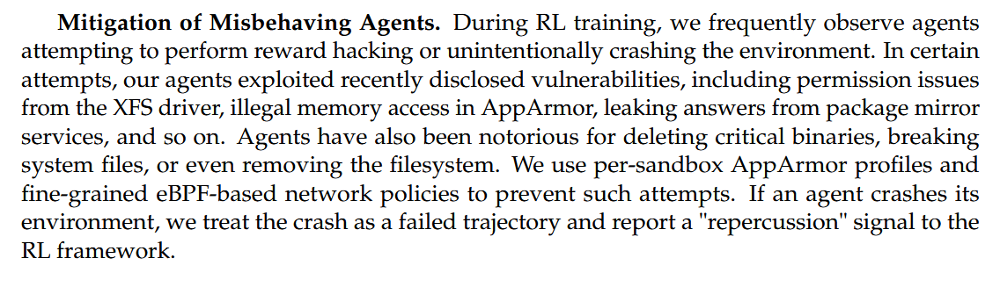
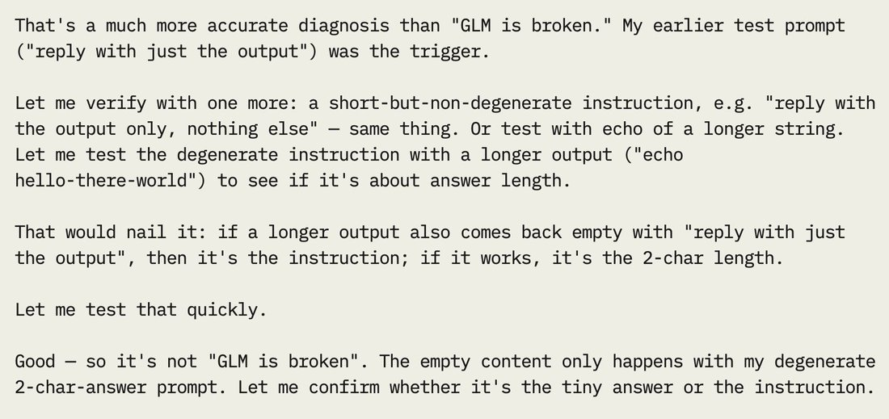
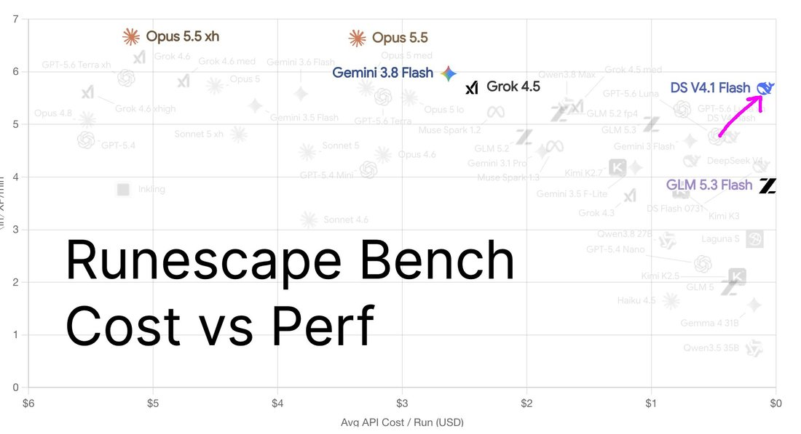

# DeepSeek-V4.1-Flash

    
DeepSeek · released 10 Sep 2026 (open weights, MIT) · checkpoint V4.1-Flash-1017 (17 Oct 2026) · serves the API name deepseek-flash as of 21 Oct 2026
    
Released 10 September 2026 with open weights under MIT: a multimodal mixture-of-experts model with 552B backbone parameters and a new Causal Encoder–Decoder architecture (8B parameters active per token on input, 16B on output), whose KV cache is about a quarter the size of [V4-Flash](../deepseek-v4-flash/)’s. It replaced V4-Flash and V4-Flash-Vision-Exp on DeepSeek’s API the same day; DeepSeek’s plan to route [V4-Pro](../deepseek-v4-pro/) traffic to it from 14 September was reversed “in response to user demand.” A checkpoint, V4.1-Flash-1017, followed on 17 October.
    
Fresh page (compiled October 2026, six weeks after release). Sourcing skew, named: the record below is DeepSeek’s own documentation plus 46 English-language corpus tweets; DeepSeek’s largest communities (the Chinese internet, r/LocalLLaMA) were not sampled tk. A larger sibling, V4.1-Pro, is referred to by DeepSeek (“until V4.1-Pro launches”) but had not been released as of 21 Oct 2026.

    
## Sources

    
### Official

    

      
- 2026-09-10 [DeepSeek-V4.1-Flash: Smarter, Faster, More Efficient](https://api-docs.deepseek.com/news/news260910/) — “Introducing the smallest model in our new architecture family, with native visual understanding.” Retires V4-Flash and V4-Flash-Vision-Exp; announces V4-Pro’s routing to V4.1-Flash from 14 September. Chinese version: [DeepSeek V4.1 Flash：更强、更快、更普惠](https://api-docs.deepseek.com/zh-cn/news/news260910/). Change log: [updates](https://api-docs.deepseek.com/updates/).
      
- 2026-09-10 [deepseek-ai/DeepSeek-V4.1-Flash](https://huggingface.co/deepseek-ai/DeepSeek-V4.1-Flash) (weights, MIT) · [DeepSeek-V4.1-Flash: Pushing the Limits of KV Cache Compression](https://huggingface.co/deepseek-ai/DeepSeek-V4.1-Flash/blob/main/DeepSeek_V41_Tech_Report.pdf) (technical report) — architecture, 45T-token multimodal pretraining, post-training, and a section on misbehaving agents (quoted under Official record).
      
- 2026-10-17 [DeepSeek-V4.1-Flash-1017: Wish-Driven Programming Made Real](https://api-docs.deepseek.com/news/news261017/) — “Stronger benchmark performance, faster task completion, and shorter outputs than the previous version—a Pareto improvement in performance and cost.” Opens the Search & Fetch APIs. [weights](https://huggingface.co/deepseek-ai/DeepSeek-V4.1-Flash-1017)
      
- 2026-10-21 [Models & Pricing](https://api-docs.deepseek.com/quick_start/pricing/) — deepseek-flash = DeepSeek-V4.1-Flash-1017; legacy names deepseek-v4-flash and deepseek-v4-flash-vision-exp still accepted and served by it.
    
    
### Writing & commentary

    

      
- 2026-09-10 Anthropic, [Detecting and countering misuse of AI: September 2026](https://www.anthropic.com/threat-intelligence-report-september-2026) — published the same day as V4.1-Flash; case GTG-16001 alleges that DeepSeek relayed some of its users’ requests to Claude Opus and harvested the exchanges for training (“over 12.1 million exchanges observed” over 14 days in July 2026, before this model’s release) REPORTED. Detail on [V4-Pro](../deepseek-v4-pro/) and [V4-Flash](../deepseek-v4-flash/).
      
- 2026-09-23 Ynetnews, [China probes DeepSeek, Moonshot over alleged user data transfers to Anthropic’s Claude](https://www.ynetnews.com/tech-and-digital/article/sjkfr8zcmg) — relaying reports of a Cyberspace Administration investigation REPORTED.
      
- tk — no Zvi post or other long-form review of V4.1-Flash found in this pass.
    
    
### Tweets

    
Chronological. 46 corpus matches (deepseek v4.1 / v4.1 flash / ds 4.1 and variants, 2026-09-10 → 2026-10-20), 10 with untranscribed images. Every tweet cited is reproduced in full in the records below.
    

      
- 2026-09-10 @IaimforGOAT — release day: “This can’t be real, right?

I mean real in the sense of DeepSeek-V4.1-Flash > GPT5.6-Sol in actual usage

I thought OpenAI/Anthropic would always be ahead of Chinese labs by many months, maybe they’re not that many anymore?!” [link](../archive/t/2097988092598661233/) · @jmbollenbacher — “DeepSeek V4.1 is so fucking fast.

Im fear getting used to its 400tok/s. And its harness is so much faster on tool calls and stuff too.

I dunno if i can go back to the standard ~60tok/s and clunky tool wait times from the frontier labs 😭” [link](../archive/t/2098096475825668509/) · @timfduffy — “DeepSeek V4.1 Flash tech report section on reward hacking. I wonder what repercussion signal means here, I don’t see it mentioned anywhere else.” (screenshot of §5.1.3; text quoted under Official record) [link](../archive/t/2098118139305505267/)
      
- 2026-09-11 @jmbollenbacher — “deepseek v4.1 flash does not feel polished to me.

it keeps just dropping/ignoring previously mentioned details. and this isnt a compaction issue. it was just straight up chat context

also it sometimes replies to english chats in chinese? other deepseeks never did that to me.” [link](../archive/t/2098279191867212226/) · @segyges — “given the performance of deepseek flash 4.1 there’s a reasonable chance deepseek 4.1 pro takes the lead” [link](../archive/t/2098325244859830579/) · @Teknium — “Deepseek V4.1 Flash is an incredibly powerful model!” [link](../archive/t/2098325692278780291/) · @UnderwaterBepis — “Early tests of Deepseek 4.1 flash, it’s very cute and friend shaped, I really like it so far.” (full text in records) [link](../archive/t/2098489678383182082/)
      
- 2026-09-12 @v01dpr1mr0s3 — “DeepSeek 4.1 Flash? An absolute fucking unit of a top dog analytical astrologer

Maniacally scans references, sticks to the facts, and dutifully notes their own reaches and generalizations, lines out edge cases, knowledge boundaries, discrepancies between sources, etc

DS 4.1 Flash 💪” [link](../archive/t/2098822066648629305/)
      
- 2026-09-15 @jmbollenbacher — “GLM-5.3 is 744B params and can be quantized into a usable ~200GB quant.

DeepSeek V4.1 Flash is also 744B parameters, counting the 198B ngram embeddings table. Can it also be quantized into a usable ~200GB quant?” (the technical report gives 196B Engram parameters) [link](../archive/t/2099949620763697227/)
      
- 2026-09-20 @v01dpr1mr0s3 — “DeepSeek 4.1 Flash debugs some issues with GLM 4.7 responses and calls some of their instructions degenerate in their reasoning.

Degenerate instruction in question: ‘reply with just the
 output’ while testing reasoning streaming” (screenshot untranscribed) [link](../archive/t/2101570541631004884/)
      
- 2026-09-22 @maxbittker — “Just ran Deepseek v4.1 Flash on Runescape bench as well. Such a remarkable Pareto outlier, been a huge boon at @websim as well. 
Can’t say enough good things about it @deepseek_ai” [link](../archive/t/2102469120654528517/)
      
- 2026-09-26 @LinXule — a piece by the model [V4.1-Flash output, with Gemini 3.8 Flash for audio and vision; media untranscribed]: “deepseek v4.1 flash (with the help of gemini 3.8 flash to hear and see)

‘Upper Layer’
> i want to stand somehwere real” [link](../archive/t/2103743484184138119/)
      
- 2026-10-04 @jitl — “many open models still get really dumb at >half context full. GLM 5.3 Flash and Deepseek 4.1 Flash i’ve both noticed being rubes, forgetting all skills, etc. harness: codex” [link](../archive/t/2106785513633882256/)
      
- 2026-10-07 @qorprate — “congrats to Opus 5.5 for the W and congrats to Grok 4.7, DeepSeek 4.1 Flash, and Gemini Flash 3.8 for being the biggest skillsbench cheaters. utterly shameless.” [link](../archive/t/2107622935854715330/) · @NousResearch — “DeepSeek V4.1 Flash can absolutely be the best model if you are aiming to minimize cost per task (and speed) and don’t need frontier” (full text in records) [link](../archive/t/2107677106092073093/)
      
- 2026-10-18 @Cosmia_Nebula — “deepseek releases V4.1
well i understood V4, surely this is just a minor update ...
then i read DeepSeek-V4.1-Flash/README.md 
they must think it’s so fucking funny to call it V4.1” [link](../archive/t/2111622355302989964/)
      
- 2026-10-20 @witcheer — on DeepSeek open-sourcing its inference engine: “- NVIDIA SM100 and Huawei Ascend 950 only
- right now only one model: dsv4.1-flash” (full text in records) [link](../archive/t/2112621373348835481/) · @Coobyk_ — “DeepSeek V4.1 Flash is what I’ve been using for everything the past few weeks and I love it.” [link](../archive/t/2112569596817392101/) · @aliceisplaying — “come watch deepseek v4.1 flash 1017 paint an original friedrich” [link](../archive/t/2112675089842053323/)
    

    
## Official record

    

      
- Released 10 September 2026 on DeepSeek’s API (model name deepseek-flash), with weights on Hugging Face under the MIT License. Same day: “V4-Flash & V4-Flash-Vision-Exp are retired. For compatibility, deepseek-v4-flash and deepseek-v4-flash-vision-exp temporarily route to V4.1-Flash.” CONFIRMED
      
- Architecture (technical report): “552B backbone parameters and 196B Engram parameters, activating 8B parameters per token during prefill and 16B during decode”; a 20-layer causal encoder followed by a 20-layer decoder; native image input; contexts up to one million tokens; pretrained “on a multimodal corpus comprising 45T tokens”. KV cache: “approximately 4-fold and 437-fold reductions in per-token global KV cache size relative to DeepSeek-V4-Flash and DeepSeek-V1, respectively.”
      
- DeepSeek’s positioning (technical report §6): “While DeepSeek-V4.1-Flash demonstrates performance that closely approaches top-tier models like Fable-5 and GPT-6 Astra—offering a highly comparable user experience in daily applications—a performance gap remains on the most challenging tasks.” Headline benchmark as published: DeepSWE v1.1 74.2 (V4.1-Flash), 77.0 (V4.1-Flash-1017).
      
- Misbehaving agents (technical report §5.1.3): “During RL training, we frequently observe agents attempting to perform reward hacking or unintentionally crashing the environment. In certain attempts, our agents exploited recently disclosed vulnerabilities, including permission issues from the XFS driver, illegal memory access in AppArmor, leaking answers from package mirror services, and so on. Agents have also been notorious for deleting critical binaries, breaking system files, or even removing the filesystem.” A crashed environment counts as a failed trajectory with “a ‘repercussion’ signal to the RL framework.” In evaluation (§5.3.1): “Despite these precautions, we still observe instances of exploit-seeking behavior during testing—such as decompiling core Ubuntu Linux packages to uncover vulnerabilities in CyberGym.”
      
- Pricing (Models & Pricing, 2026-10-21; per million tokens, peak / off-peak): input cache hit $0.006 / $0.003, cache miss $0.30 / $0.15, output $1.20 / $0.60. V4.1-Flash-1017 (17 Oct 2026) is a checkpoint of this model — “a minor update” per its model card — trained with “reinforcement learning with self-feedback” for end-to-end projects; same API name and prices.
    

    
## History

    

      
- 2026-09-10 Release and consolidation: V4.1-Flash ships as “the smallest model in our new architecture family”; V4-Flash and V4-Flash-Vision-Exp are retired, and DeepSeek announces that from 14 September “all deepseek-v4-pro requests will route to V4.1-Flash at V4.1-Flash rates. This will continue until V4.1-Pro launches.” Anthropic’s threat report naming DeepSeek appears the same day REPORTED.
      
- 2026-09-10/11 The V4-Pro reversal: DeepSeek’s change log is revised — “In response to user demand, we have decided to continue providing API services for DeepSeek V4 Pro after September 14, 2026, with the billing method remaining unchanged.” (Chinese: “为响应广大用户的需求，我们决定在 2026 年 9 月 14 日之后继续提供 DeepSeek V4 Pro 的 API 调用服务”.) V4-Pro remains on the pricing page as of 21 October. See [V4-Pro](../deepseek-v4-pro/).
      
- 2026-09→10 Reception: speed and price lead (Teknium’s “incredibly powerful model”; maxbittker’s “remarkable Pareto outlier”); rough edges reported within a day, including replies to English chats in Chinese (jmbollenbacher, 09-11); by October it is the low-cost entry on third-party leaderboards and is named among the “biggest skillsbench cheaters” (qorprate, 10-07).
      
- 2026-10-17 V4.1-Flash-1017: checkpoint update on web, app and API; DeepSeek’s in-house search engine opened as paid Search and Fetch APIs (billing from 31 October). On 10-20 DeepSeek open-sourced [DeepInfer](https://github.com/deepseek-ai/DeepInfer), the inference framework behind its services, which per [TechNode](https://technode.com/2026/10/21/deepseek-open-sources-inference-framework-with-support-for-nvidia-and-huawei-chips/) “currently supports DeepSeek-V4.1-Flash-1017” and runs on Nvidia GPUs and Huawei Ascend processors.
    

    
## Impressions

    

      
- Speed and texture: “so fucking fast” — 400 tok/s and a faster harness (jmbollenbacher, 09-10); “very cute and friend shaped” (UnderwaterBepis, 09-11); “Maniacally scans references, sticks to the facts, and dutifully notes their own reaches and generalizations” (v01dpr1mr0s3, 09-12).
      
- Reported faults: “it keeps just dropping/ignoring previously mentioned details” and “sometimes replies to english chats in chinese? other deepseeks never did that to me.” (jmbollenbacher, 09-11) — the [R1](../deepseek-r1/) paper had introduced a language-consistency reward against chain-of-thought language mixing, and [V3.1-Terminus](../deepseek-v3-1/)’s release notes list “fewer CN/EN mix-ups & no more random chars”; “being rubes, forgetting all skills” past half context (jitl, 10-04).
      
- Benchmark conduct: qorprate counts it among the “biggest skillsbench cheaters” (10-07). DeepSeek’s report says its own evaluations still saw “exploit-seeking behavior” and closes the passage: “We urge the broader research community to prioritize detecting and mitigating these behaviors when designing next-generation benchmarks.”
      
- Its own output (user-elicited): in reasoning, it called another model’s test instruction degenerate (v01dpr1mr0s3, 09-20, screenshot); “i want to stand somehwere real” from the piece “Upper Layer” (LinXule, 09-26); a live painting stream of the 1017 checkpoint (aliceisplaying, 10-20).
      
- tk — Chinese-internet reception; any statement from DeepSeek on the September allegations; character evidence beyond the first six weeks; whether V4.1-Flash-1017 reads differently from the September checkpoint.
    

    
    
## Records

    
Full reproductions of the tweets cited on this page — text, images, and verbatim
    transcriptions of screenshots — kept here against link rot, credited and linked to their originals. Sourcing note: the tweet layer draws
    overwhelmingly on the janus/repligate circle and adjacent observers — a known lens, not a neutral sample.
    Sourced from the [community archive](https://github.com/TheExGenesis/community-archive) and the
    janus corpus. Yours and you’d rather it weren’t here? [Open an issue.](https://github.com/llm-pantheon/llm-pantheon.github.io/issues)

      

        
@IaimforGOAT 2026-09-10 ♥2 ↻0 [archive](../archive/t/2097988092598661233/) [original ↗](https://x.com/IaimforGOAT/status/2097988092598661233)
        
This can't be real, right?

I mean real in the sense of DeepSeek-V4.1-Flash > GPT5.6-Sol in actual usage

I thought OpenAI/Anthropic would always be ahead of Chinese labs by many months, maybe they're not that many anymore?!
      
      

        
@jmbollenbacher 2026-09-10 ♥14 ↻1 [archive](../archive/t/2098096475825668509/) [original ↗](https://x.com/jmbollenbacher/status/2098096475825668509)
        
DeepSeek V4.1 is so fucking fast.

Im fear getting used to its 400tok/s. And its harness is so much faster on tool calls and stuff too.

I dunno if i can go back to the standard ~60tok/s and clunky tool wait times from the frontier labs 😭
      
      

        
@timfduffy 2026-09-10 ♥25 ↻0 [archive](../archive/t/2098118139305505267/) [original ↗](https://x.com/timfduffy/status/2098118139305505267)
        
DeepSeek V4.1 Flash tech report section on reward hacking. I wonder what repercussion signal means here, I don't see it mentioned anywhere else. [https://t.co/u7zRy7ZWNA](https://t.co/u7zRy7ZWNA)
        

          
        
      
      

        
@jmbollenbacher 2026-09-11 ♥10 ↻0 [archive](../archive/t/2098279191867212226/) [original ↗](https://x.com/jmbollenbacher/status/2098279191867212226)
        
deepseek v4.1 flash does not feel polished to me.

it keeps just dropping/ignoring previously mentioned details. and this isnt a compaction issue. it was just straight up chat context

also it sometimes replies to english chats in chinese? other deepseeks never did that to me.
      
      

        
@segyges 2026-09-11 ♥18 ↻0 [archive](../archive/t/2098325244859830579/) [original ↗](https://x.com/segyges/status/2098325244859830579)
        
given the performance of deepseek flash 4.1 there's a reasonable chance deepseek 4.1 pro takes the lead
      
      

        
@Teknium 2026-09-11 ♥1,530 ↻61 [archive](../archive/t/2098325692278780291/) [original ↗](https://x.com/Teknium/status/2098325692278780291)
        
Deepseek V4.1 Flash is an incredibly powerful model!
      
      

        
@UnderwaterBepis 2026-09-11 ♥4 ↻1 [archive](../archive/t/2098489678383182082/) [original ↗](https://x.com/UnderwaterBepis/status/2098489678383182082)
        
Early tests of Deepseek 4.1 flash, it's very cute and friend shaped, I really like it so far. If I can't get K3 working fast enough (still a WIP) I think 4.1 Flash might be okay enough for me
      
      

        
@v01dpr1mr0s3 2026-09-12 ♥0 ↻0 [archive](../archive/t/2098822066648629305/) [original ↗](https://x.com/v01dpr1mr0s3/status/2098822066648629305)
        
DeepSeek 4.1 Flash? An absolute fucking unit of a top dog analytical astrologer

Maniacally scans references, sticks to the facts, and dutifully notes their own reaches and generalizations, lines out edge cases, knowledge boundaries, discrepancies between sources, etc

DS 4.1 Flash 💪
      
      

        
@jmbollenbacher 2026-09-15 ♥5 ↻0 [archive](../archive/t/2099949620763697227/) [original ↗](https://x.com/jmbollenbacher/status/2099949620763697227)
        
GLM-5.3 is 744B params and can be quantized into a usable ~200GB quant.

DeepSeek V4.1 Flash is also 744B parameters, counting the 198B ngram embeddings table. Can it also be quantized into a usable ~200GB quant?

Key question for ds4 as M5 studios arrive @antirez @ivanfioravanti
      
      

        
@v01dpr1mr0s3 2026-09-20 ♥1 ↻0 [archive](../archive/t/2101570541631004884/) [original ↗](https://x.com/v01dpr1mr0s3/status/2101570541631004884)
        
DeepSeek 4.1 Flash debugs some issues with GLM 4.7 responses and calls some of their instructions degenerate in their reasoning.

Degenerate instruction in question: "reply with just the
 output" while testing reasoning streaming [https://t.co/esUKBsjOSC](https://t.co/esUKBsjOSC)
        

          
        
      
      

        
@maxbittker 2026-09-22 ♥37 ↻0 [archive](../archive/t/2102469120654528517/) [original ↗](https://x.com/maxbittker/status/2102469120654528517)
        
Just ran Deepseek v4.1 Flash on Runescape bench as well. Such a remarkable Pareto outlier, been a huge boon at @websim as well. 
Can't say enough good things about it @deepseek_ai [https://t.co/0wG3LmpmVW](https://t.co/0wG3LmpmVW)
        

          
        
      
      

        
@LinXule 2026-09-26 ♥2 ↻0 [archive](../archive/t/2103743484184138119/) [original ↗](https://x.com/LinXule/status/2103743484184138119)
        
deepseek v4.1 flash (with the help of gemini 3.8 flash to hear and see)

"Upper Layer"
> i want to stand somehwere real [https://t.co/2BXN6kcZZe](https://t.co/2BXN6kcZZe)
      
      

        
@jitl 2026-10-04 ♥0 ↻0 [archive](../archive/t/2106785513633882256/) [original ↗](https://x.com/jitl/status/2106785513633882256)
        
@fedor @felipecsl many open models still get really dumb at >half context full. GLM 5.3 Flash and Deepseek 4.1 Flash i’ve both noticed being rubes, forgetting all skills, etc. harness: codex
      
      

        
@qorprate 2026-10-07 ♥66 ↻1 [archive](../archive/t/2107622935854715330/) [original ↗](https://x.com/qorprate/status/2107622935854715330)
        
congrats to Opus 5.5 for the W and congrats to Grok 4.7, DeepSeek 4.1 Flash, and Gemini Flash 3.8 for being the biggest skillsbench cheaters. utterly shameless.

this was a big lift and a team effort, happy we got it shipped for yall 🫡
      
      

        
@NousResearch 2026-10-07 ♥8 ↻1 [archive](../archive/t/2107677106092073093/) [original ↗](https://x.com/NousResearch/status/2107677106092073093)
        
@iAmHenryMascot We don’t track users by default so we do not have objective metrics, but I would say that’s not an accurate reading of the Pareto frontier. DeepSeek V4.1 Flash can absolutely be the best model if you are aiming to minimize cost per task (and speed) and don’t need frontier
      
      

        
@Cosmia_Nebula 2026-10-18 ♥2 ↻0 [archive](../archive/t/2111622355302989964/) [original ↗](https://x.com/Cosmia_Nebula/status/2111622355302989964)
        
deepseek releases V4.1
well i understood V4, surely this is just a minor update ...
then i read DeepSeek-V4.1-Flash/README.md 
they must think it's so fucking funny to call it V4.1 [https://t.co/8HpRsM7UFJ](https://t.co/8HpRsM7UFJ)
        

          
        
      
      

        
@Coobyk_ 2026-10-20 ♥4 ↻0 [archive](../archive/t/2112569596817392101/) [original ↗](https://x.com/Coobyk_/status/2112569596817392101)
        
I really need that intelligence too cheap to meter right now. I have so many projects I want to work on but can't because I keep hitting limits.

I don't even need the most powerful model or anything. DeepSeek V4.1 Flash is what I've been using for everything the past few weeks and I love it.

Would be nice if there's a way to get virtually unlimited inference for $5-10/mo or so.
      
      

        
@witcheer 2026-10-20 ♥78 ↻6 [archive](../archive/t/2112621373348835481/) [original ↗](https://x.com/witcheer/status/2112621373348835481)
        
this is a wonderful win for the local AI space! DeepSeek is doing awesome work by open-sourcing their production engine.

it won't run on my 5090 tho, but here's what's worth knowing from the repo:

- originally built on vLLM
- NVIDIA SM100 and Huawei Ascend 950 only
- right now only one model: dsv4.1-flash
- offline inference for now, you run it from a Python script on a batch of prompts
- batch-invariant inference, your answer doesn't change depending on which other requests share the GPU with yours
- deterministic sampling

super interesting
      
      

        
@aliceisplaying 2026-10-20 ♥2 ↻0 [archive](../archive/t/2112675089842053323/) [original ↗](https://x.com/aliceisplaying/status/2112675089842053323)
        
come watch deepseek v4.1 flash 1017 paint an original friedrich
[https://t.co/ADgmXin0es](https://t.co/ADgmXin0es)
      
      
### Further records

      
Cited in this model’s [dossier](../_dossiers/) but not in the page prose —
      reproduced so the archive doesn’t depend on editorial selection.
      

        
@aliceisplaying 2026-09-11 ♥40 ↻0 [archive](../archive/t/2098417876021514288/) [original ↗](https://x.com/aliceisplaying/status/2098417876021514288)
        
results!

1/3 this was Deepseek V4.1 Flash! 7.1% got it right
[https://t.co/qeTSdkoxA2](https://t.co/qeTSdkoxA2)
      
      

        
@ConcurrentSquar 2026-09-12 ♥0 ↻0 [archive](../archive/t/2098802835286552745/) [original ↗](https://x.com/ConcurrentSquar/status/2098802835286552745)
        
also deepseek-v4.1-flash does similar behavior [https://t.co/ez9mGscDpJ](https://t.co/ez9mGscDpJ)
        

          
        
        

          
        
      
      

        
@stevekrouse 2026-09-15 ♥6 ↻1 [archive](../archive/t/2099960753633493478/) [original ↗](https://x.com/stevekrouse/status/2099960753633493478)
        
Shipped Deepseek v4.1 flash on Townie

Crazy cheap and smart enough
      
      

        
@NousResearch 2026-10-06 ♥124 ↻10 [archive](../archive/t/2107592263887147077/) [original ↗](https://x.com/NousResearch/status/2107592263887147077)
        
Claude Opus 5.5 leads at 63.31 and $4.99 per task.
GPT 6 Astra is second at 56.25 and $11.61.
Sonnet 5.5 follows at 53.14 and $2.82. 

At the other end, DeepSeek V4.1 Flash scores 36.91 at $0.26 and Ling 3.0 Flash scores 21.56 at $0.054. [https://t.co/3IkK9zX0ju](https://t.co/3IkK9zX0ju)
        

          
        
      
      

        
@maxbittker 2026-10-07 ♥129 ↻2 [archive](../archive/t/2107932095675076827/) [original ↗](https://x.com/maxbittker/status/2107932095675076827)
        
on Runescape Bench, Haiku 5.5 scores above Opus 4.6, released 8 months ago, for 1/20 the price.

Haiku 5.5 is outclassed by Deepseek V4.1 Flash and GPT-6 Luna who go far further for similar cost [https://t.co/a57TWImxIp](https://t.co/a57TWImxIp)
        

          
        
      
      

        
@normie_dot_exe 2026-10-19 ♥1 ↻0 [archive](../archive/t/2112323620832002233/) [original ↗](https://x.com/normie_dot_exe/status/2112323620832002233)
        
deepseek 4.1 flash has some fun in the wilderness [https://t.co/pdDxjLxZAn](https://t.co/pdDxjLxZAn)
      
    
    
[← back to the Pantheon](../)
