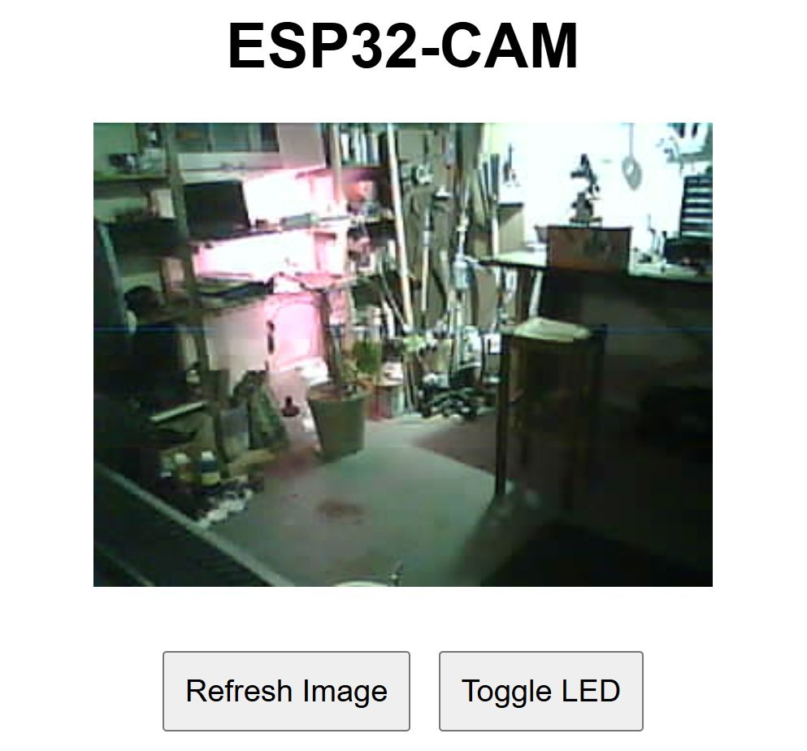
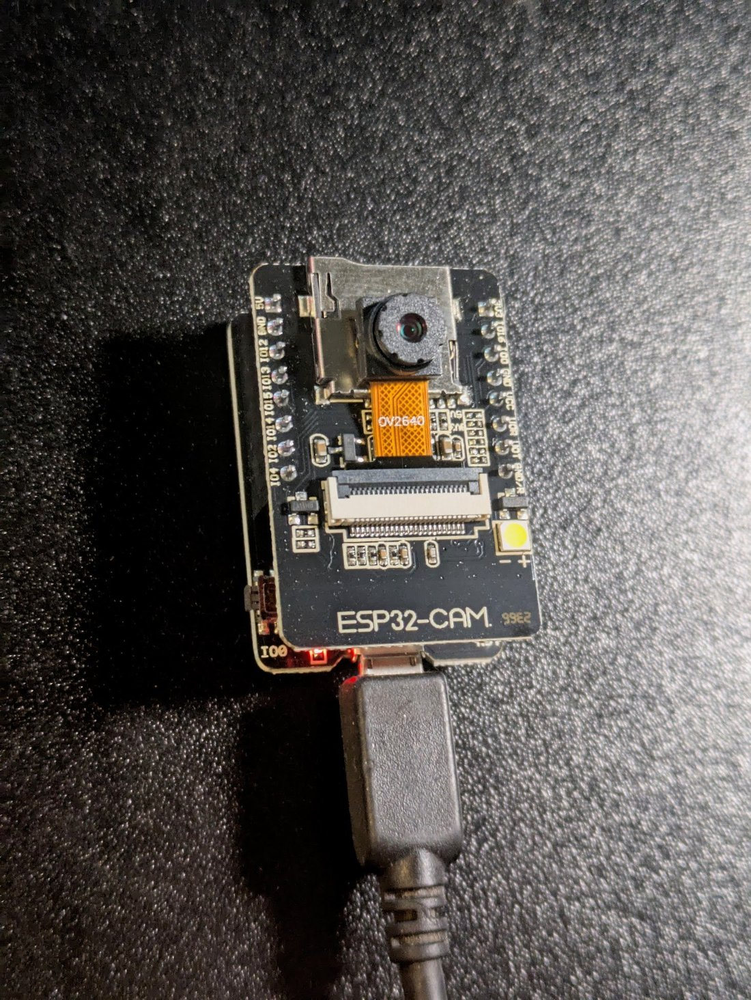

# Gemini 1.5 Flash

    
Google DeepMind · Gemini API preview 10 May 2024, generally available 23 May 2024 · shut down 29 Sep 2025 (Gemini API)
    
Released in preview in the Gemini API on 10 May 2024 and generally available on 23 May 2024 as the Flash tier of Gemini 1.5, followed by a stable -002 checkpoint on 24 September 2024 and a smaller Flash-8B in October 2024. Google shut down the 1.5 Flash API models on 29 September 2025. Whether it or [Gemini 1.5 Pro](../gemini-1-5-pro/) produced the November 2024 “please die” message is unresolved; the dispute is recorded on the 1.5 Pro page.
    
Thin page, converted 2026-10-22 from the original scaffold: the official dates come from the Gemini API changelog; the corpus holds 11 matches, mostly price and benchmark remarks. Launch press, the Gemini 1.5 technical report’s Flash sections and developer reception are still owed.

    
## Sources

    
### Official

    

      
- 2024-05-10 → 2025-09-29 [Gemini API changelog](https://ai.google.dev/gemini-api/docs/changelog?hl=en) — gemini-1.5-flash-latest in preview (2024-05-10); gemini-1.5-flash-001 generally available (2024-05-23); gemini-1.5-flash-002 (2024-09-24); gemini-1.5-flash-8b-001, “a stable version of our smallest Gemini API model” (2024-10-03); the last tuning model, “Gemini 1.5 Flash 001, has been shut down” (2025-05-27); and on 2025-09-29: “The following Gemini 1.5 models are now shut down:” gemini-1.5-pro, gemini-1.5-flash-8b, gemini-1.5-flash. CONFIRMED
      
- reference [Google DeepMind model-card index](https://deepmind.google/models/model-cards/) — lists the Gemini 1.5 technical report (page 105) as the model card for the 1.5 family. tk — the report’s Flash-specific sections not extracted this pass
    
    
### Writing & commentary

    
tk — I/O 2024 launch coverage and developer reception, not retrieved this pass; the “please die” coverage is cited on the [1.5 Pro page](../gemini-1-5-pro/).
    
### Tweets

    
Selected from 11 corpus matches; records below reproduce each in full.
    

      
- 2024-08-02 @johnowhitaker — “For the first ~5k games I used GPT-4o (not mini) and the win stats were:
Flash 1.5    1314 
GPT-4o        858 
Haiku         693

Good work Google Gemini Flash! Part of this is speed-related (first guess right wins) so it'll be interesting to re-run offline without the time part.” [link](../archive/t/1819409221194236412/)
      
- 2024-12-17 @repligate — (also evidence for [GPT-4o](../gpt-4o/)) “it feels like a live player to talk to because it is a live player.gemini (im not sure about 1.5 flash but the newer ones) could probably be 'awakened' but may not be cooperative.i think 4o is irreversibly brain damaged” [link](../archive/t/1869161891471474789/)
      
- 2024-12-22 @johnowhitaker — on Flash-8B: “I hooked up this little ESP32-CAM to my wifi. It takes a picture every 30s and sends it to flash-8B with a prompt like 'is there a person in this image?'. If the model says yes (with structured outputs), it turns on an LED. If I left this on for a month it would cost about $1. …” (full text in records) [link](../archive/t/1870650291454120364/)
      
- 2025-02-18 @PradyuPrasad — “Just about 3 years later you can get Gemini 1.5 flash 8b for 0.0375 / 1 MILLION tokens” [link](../archive/t/1891674853465313683/)
      
- 2026-03-15 @lu_sichu — “Rip no funeral for Gemini 1.5 flash version” [link](../archive/t/2033225741756706846/)
    

    
## Official record

    

      
- Preview 2024-05-10; GA 2024-05-23 (gemini-1.5-flash-001); stable -002 2024-09-24 (the gemini-1.5-flash alias later pointed to it); Flash-8B stable 2024-10-03. Tuning on 1.5 Flash 001 ended 2025-05-27; the API models were shut down 2025-09-29. CONFIRMED
    

    
## History

    

      
- 2024-05-10 → 05-23 Launch: API preview, then general availability, alongside the long-context [1.5 Pro](../gemini-1-5-pro/).
      
- 2024-10-03 Flash-8B becomes the smallest Gemini API model; its price draws builders (johnowhitaker’s camera demo, 2024-12-22).
      
- 2024-11 The “please die” message to a student using Gemini; which 1.5 model produced it is unresolved — see the [1.5 Pro page](../gemini-1-5-pro/), Contested.
      
- 2024-12-11 Succession: [Gemini 2.0 Flash](../gemini-2-0-flash/) enters experimental release.
      
- 2025-09-29 Shutdown of the 1.5 Flash API models.
    

    
## Impressions

    

      
- As recorded in the corpus: speed and price — first in johnowhitaker’s timed guessing game (2024-08-02); Flash-8B as the model in a $1-a-month camera (2024-12-22). On character, repligate (2024-12-17) was “not sure about 1.5 flash” where newer Geminis “could probably be 'awakened'”.
      
- tk — any character record specific to 1.5 Flash beyond the shared 1.5-family reads on the [1.5 Pro page](../gemini-1-5-pro/).
    

    
    
## Records

    
Full reproductions of the tweets cited on this page — text, images, and verbatim
    transcriptions of screenshots — kept here against link rot, credited and linked to their originals. Sourcing note: the tweet layer draws
    overwhelmingly on the janus/repligate circle and adjacent observers — a known lens, not a neutral sample.
    Sourced from the [community archive](https://github.com/TheExGenesis/community-archive) and the
    janus corpus. Yours and you’d rather it weren’t here? [Open an issue.](https://github.com/llm-pantheon/llm-pantheon.github.io/issues)

      

        
@johnowhitaker 2024-08-02 ♥3 ↻1 [archive](../archive/t/1819409221194236412/) [original ↗](https://x.com/johnowhitaker/status/1819409221194236412)
        
For the first ~5k games I used GPT-4o (not mini) and the win stats were:
Flash 1.5    1314 
GPT-4o        858 
Haiku         693

Good work Google Gemini Flash! Part of this is speed-related (first guess right wins) so it'll be interesting to re-run offline without the time part.
      
      

        
@repligate 2024-12-17 ♥86 ↻0 [archive](../archive/t/1869161891471474789/) [original ↗](https://x.com/repligate/status/1869161891471474789)
        
it feels like a live player to talk to because it is a live player.gemini (im not sure about 1.5 flash but the newer ones) could probably be "awakened" but may not be cooperative.i think 4o is irreversibly brain damaged
      
      

        
@johnowhitaker 2024-12-22 ♥4,495 ↻276 [archive](../archive/t/1870650291454120364/) [original ↗](https://x.com/johnowhitaker/status/1870650291454120364)
        
I hooked up this little ESP32-CAM to my wifi. It takes a picture every 30s and sends it to flash-8B with a prompt like 'is there a person in this image?'. If the model says yes (with structured outputs), it turns on an LED. If I left this on for a month it would cost about $1. 
Obviously this is the worst security cam ever, BUT I think it's a compelling demo. You can put some 'intelligence' in the loop of a hobby project with <$10 in hardware and fractions of a cent per API call. You can 'program' it in natural language like 'if there is an orange cat playing with my plant'. And with LLM help, modifying the code is possibly as easy as 'make this send me a discord notification if the alarm is triggered twice in an hour'.
Anyway, now that I know this thing works it has other projects it is destined for. But cool to know how easy it is to whip this up :)
        

          
        
        

          
        
      
      

        
@PradyuPrasad 2025-02-18 ♥13 ↻0 [archive](../archive/t/1891674853465313683/) [original ↗](https://x.com/PradyuPrasad/status/1891674853465313683)
        
Just about 3 years later you can get Gemini 1.5 flash 8b for 0.0375 / 1 MILLION tokens
      
      

        
@lu_sichu 2026-03-15 ♥1 ↻1 [archive](../archive/t/2033225741756706846/) [original ↗](https://x.com/lu_sichu/status/2033225741756706846)
        
Rip no funeral for Gemini 1.5 flash version
      
    
    
[← back to the Pantheon](../)
