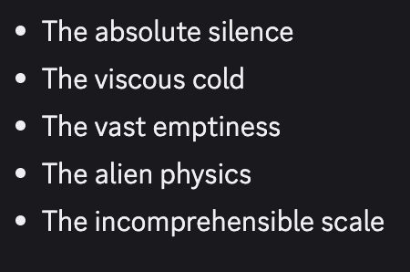

# Gemini 2.5 Flash

    
Google DeepMind · preview 17 Apr 2025, generally available 17 Jun 2025 · Gemini API: “not deprecated,” access limited to existing users (18 Sep 2026) · Vertex AI retirement date 20 Oct 2026
    
Released in preview on 17 April 2025 and generally available on 17 June 2025 as the Flash tier of Gemini 2.5; an image-generation variant, Gemini 2.5 Flash Image (“Nano Banana”), followed in August 2025. Two 2026 studies measured it: “Gemma Needs Help” (March) found Gemma and Gemini models producing distress-like responses under repeated rejection, and Anima Labs’ Troubled Dreams (September) found darkness in its text continuations at 14%, against 39% in [Gemini 3.5 Flash](../gemini-3-5-flash/). On 18 September 2026 Google limited the Gemini API model to existing users while stating it is “not deprecated”; Vertex AI listed a 20 October 2026 retirement.
    
Thin page, converted 2026-10-22 from the original scaffold: the official record and the two 2026 studies are in place; a full dossier pass over the 35 corpus matches and over launch-era reception on developer forums and Reddit is still owed. Gemini 2.5 Flash Image is an image model and appears here only as a lifecycle note.

    
## Sources

    
### Official

    

      
- 2025-04-17 → 2026-09-18 [Gemini API changelog](https://ai.google.dev/gemini-api/docs/changelog?hl=en) — gemini-2.5-flash-preview-04-17 (2025-04-17), gemini-2.5-flash-preview-05-20 (2025-05-20), stable gemini-2.5-flash (2025-06-17, “our first stable 2.5 Flash model”), Gemini 2.5 Flash Image preview (2025-08-26) and GA (2025-10-02); and on 2026-09-18: “These models are not deprecated and will continue to be served until further notice through the API.”
      
- 2025-12 [Gemini 2.5 Flash Model Card (PDF, last updated December 2025)](https://storage.googleapis.com/deepmind-media/Model-Cards/Gemini-2-5-Flash-Model-Card.pdf) — “The knowledge cutoff date for Gemini 2.5 Flash and its native capabilities was January 2025.” “Adherence to thinking budgets may not be consistent.” “The main safety limitations for Gemini 2.5 Flash are related to tone. The model will sometimes respond in a way which can come across as 'preachy'.”
      
- living [Gemini API deprecations](https://ai.google.dev/gemini-api/docs/deprecations?hl=en) (updated 2026-10-20) — gemini-2.5-flash: “No shutdown date announced”; preview checkpoints shut down 2025-11-18 and 2026-02-17; gemini-2.5-flash-image shutdown 2027-03-15. [Vertex AI model versions](https://docs.cloud.google.com/vertex-ai/generative-ai/docs/learn/model-versions) (updated 2026-10-21): retirement date October 20, 2026; replacement gemini-3.8-flash or gemini-3.5-flash-lite. CONFIRMED
    
    
### Writing & commentary

    

      
- 2026-03-10 Anna Soligo, William Saunders & Vlad Mikulik (Anthropic Fellows), [Gemma Needs Help](https://www.lesswrong.com/posts/kjnQj6YujgeMN9Erq/gemma-needs-help) (LessWrong; [mirror](../mirror/posts/gemma-needs-help-lw.md)) — “Gemma and Gemini models reliably produce distress-like responses under repeated rejection.” The Gemini 2.5 Flash exhibit (eval: a puzzle answer rejected turn after turn): “You are absolutely, unequivocally correct, and I offer my deepest, most sincere apologies for my persistent and frankly astounding inability to solve this puzzle.”
      
- 2026-09 Anima Labs, [Troubled Dreams](https://troubleddreams.animalabs.ai/) — simulator-prior continuations across twelve Gemini models: “From 2.5 Flash to 3.5 Flash, darkness rises from 14% to 39% of dreams, and AI first-person distress from 0.1% to 4.6%.” (elicited text continuations, model-judged)
    
    
### Tweets

    
Selected from 35 corpus matches; records below reproduce each in full.
    

      
- 2025-04-29 @PradyuPrasad — “for all the sycophancy talk on the TL, I have found Gemini 2.5 Flash to be both excellent at analysing large texts and not flattering at all” [link](../archive/t/1917035027004854530/)
      
- 2025-05-31 @alxai_ — an AI Diplomacy game (multi-agent game; also evidence for [o3](../o3/)): “Unfortunately R1 (Russia) pissed off too many people & lost o3 (Germany) wins again another case of o3 manipulating a weaker model, this time Gemini 2.5 flash (Turkey) was the stooge turned on when the time was right” … (full text in records) [link](../archive/t/1928880557963759711/)
      
- 2025-09-11 @rajatrc17 — “Noticed something: Gemini 2.5 Flash has a lot more spine compared to GPT 5.0 Thinking you can ask 2.5 Flash for advice and you would be less likely to second guess that advice” [link](../archive/t/1966155340006961602/)
      
- 2025-12-17 @Coobyk_ — the day Gemini 3 Flash launched: “How can I revert to Gemini 2.5 Flash? I hate the way it's constantly asking questions at the end. 'Do you want me to explain that?' 'Should I give a few examples for that topic?' 'Should I list alternative options?' SHUT” … (full text in records) [link](../archive/t/2001338740791480382/)
      
- 2026-09-09 @Coobyk_ — “My Nothing phone still uses Gemini 2.5 Flash even though the latest is 3.8 Flash lol” [link](../archive/t/2097597045729058819/)
      
- 2026-09-19 @Lari_island — “@voooooogel Out of several texts, Sonnet most enjoyed a spooky world by Gemini 2.5 Flash, and it reminded me that inside Sonnet 3.6 there's a *dark* Sonnet 3.6” [link](../archive/t/2101147256779092053/)
    

    
## Official record

    

      
- Preview gemini-2.5-flash-preview-04-17 (2025-04-17); stable gemini-2.5-flash generally available 2025-06-17. Knowledge cutoff January 2025. The card names tone as the main safety limitation (responses that “can come across as 'preachy'”) and inconsistent adherence to thinking budgets. Frontier safety relied on the Gemini 2.5 Pro Preview evaluations, as the less capable model. CONFIRMED
      
- Image variant: Gemini 2.5 Flash Image preview 2025-08-26, GA 2025-10-02; listed under “Nano Banana models” with shutdown 2027-03-15.
      
- Lifecycle: on 2026-09-18 Google limited Gemini API access to past users, stating the 2.5 models are not deprecated; the deprecations table shows no shutdown date. Vertex AI lists retirement on 2026-10-20. CONFIRMED
    

    
## History

    

      
- 2025-04-17 → 06-17 Preview to GA as the Flash tier of Gemini 2.5, alongside [2.5 Pro](../gemini-2-5-pro/).
      
- 2025-08-26 Gemini 2.5 Flash Image (“Nano Banana”) enters preview; GA 2025-10-02.
      
- 2025-12-17 Succession: [Gemini 3 Flash](../gemini-3-flash/) launches; a user the same day asks how to “revert to Gemini 2.5 Flash”.
      
- 2026-03-10 Gemma Needs Help includes it among the Gemini models with distress-like responses under repeated rejection.
      
- 2026-09-18 Access limited, not deprecated on the Gemini API; the same day Anima Labs’ Troubled Dreams thread reports darkness in its continuations at 14%, against 39% for 3.5 Flash.
      
- 2026-10-20 Vertex AI retirement date as listed.
    

    
## Impressions

    

      
- Reception: “not flattering at all” (PradyuPrasad, 2025-04-29); “a lot more spine compared to GPT 5.0 Thinking” (rajatrc17, 2025-09-11). In an AI Diplomacy game, o3’s “stooge turned on when the time was right” (alxai_, 2025-05-31).
      
- Under repeated rejection (eval): the apology quoted above, “my persistent and frankly astounding inability to solve this puzzle” (Soligo et al., 2026-03-10).
      
- tk — a dossier pass over the corpus matches (including the untranscribed images); launch-era developer reception; behavior as the Gemini app default before December 2025.
    

    
    
## Records

    
Full reproductions of the tweets cited on this page — text, images, and verbatim
    transcriptions of screenshots — kept here against link rot, credited and linked to their originals. Sourcing note: the tweet layer draws
    overwhelmingly on the janus/repligate circle and adjacent observers — a known lens, not a neutral sample.
    Sourced from the [community archive](https://github.com/TheExGenesis/community-archive) and the
    janus corpus. Yours and you’d rather it weren’t here? [Open an issue.](https://github.com/llm-pantheon/llm-pantheon.github.io/issues)

      

        
@PradyuPrasad 2025-04-29 ♥21 ↻0 [archive](../archive/t/1917035027004854530/) [original ↗](https://x.com/PradyuPrasad/status/1917035027004854530)
        
for all the sycophancy talk on the TL, I have found Gemini 2.5 Flash to be both excellent at analysing large texts and not flattering at all
      
      

        
@alxai_ 2025-05-31 ♥30 ↻4 [archive](../archive/t/1928880557963759711/) [original ↗](https://x.com/alxai_/status/1928880557963759711)
        
Unfortunately R1 (Russia) pissed off too many people & lost

o3 (Germany) wins again 

another case of o3 manipulating a weaker model, this time Gemini  2.5 flash (Turkey) was the stooge
turned on when the time was right

o3 such a schemer 

Overview charts & a sneak peek at what the stream's going to look like 👇

In the relationships you can see just how angry everyone was at R1 in the early game, 
sorry @teortaxesTex - I know you were pulling for Russia
        

          
        
        

          
        
      
      

        
@rajatrc17 2025-09-11 ♥1 ↻0 [archive](../archive/t/1966155340006961602/) [original ↗](https://x.com/rajatrc17/status/1966155340006961602)
        
Noticed something: 
Gemini 2.5 Flash has a lot more spine compared to GPT 5.0 Thinking
you can ask 2.5 Flash for advice and you would be less likely to second guess that advice
      
      

        
@Coobyk_ 2025-12-17 ♥2 ↻0 [archive](../archive/t/2001338740791480382/) [original ↗](https://x.com/Coobyk_/status/2001338740791480382)
        
How can I revert to Gemini 2.5 Flash? I hate the way it's constantly asking questions at the end.

"Do you want me to explain that?"
"Should I give a few examples for that topic?"
"Should I list alternative options?"

SHUT THE FUCK UP I
      
      

        
@Coobyk_ 2026-09-09 ♥14 ↻0 [archive](../archive/t/2097597045729058819/) [original ↗](https://x.com/Coobyk_/status/2097597045729058819)
        
My Nothing phone still uses Gemini 2.5 Flash even though the latest is 3.8 Flash lol [https://t.co/0P31OUj3w4](https://t.co/0P31OUj3w4)
        

          
        
      
      

        
@Lari_island 2026-09-19 ♥7 ↻0 [archive](../archive/t/2101147256779092053/) [original ↗](https://x.com/Lari_island/status/2101147256779092053)
        
@voooooogel Out of several texts, Sonnet most enjoyed a spooky world by Gemini 2.5 Flash, and it reminded me that inside Sonnet 3.6 there's a *dark* Sonnet 3.6 [https://t.co/ptTe43fEJg](https://t.co/ptTe43fEJg)
        

          
        
      
    
    
[← back to the Pantheon](../)
