# Gemini 3.5 Flash

    
Google DeepMind · released 19 May 2026 (generally available; default in the Gemini app and AI Mode) · superseded by Gemini 3.6 Flash (21 Jul 2026) · Gemini API: deprecated 8 Oct 2026, requests routed to 3.6 Flash · Vertex AI: available until at least 19 May 2027
    
Released 19 May 2026 at Google I/O as the first model of the Gemini 3.5 series, generally available the same day and made the default model in the Gemini app and AI Mode in Search; its model card states it is based on Gemini 3 Flash. The [3.5 Pro](../gemini-3-5-pro/) announced alongside it was never released. Superseded by Gemini 3.6 Flash on 21 July 2026, it was deprecated on the Gemini API on 8 October 2026, its endpoint routed to 3.6 Flash.
    
Most of its use happened inside Google products (the Gemini app, Search) and coding harnesses, outside this corpus’s lens; the corpus layer is 47 pattern matches, of which two are StepFun’s unrelated “Step 3.5 Flash” and a few are passing mentions. Model outputs quoted below are elicited — worldbuilding seeds, art prompts, word associations — and marked.

    
## Sources

    
Curated. Full compilation: [dossier](../_dossiers/gemini-3-5-flash.md).
    
### Official

    

      
- 2026-05-19 [Gemini 3.5: frontier intelligence with action](https://blog.google/innovation-and-ai/models-and-research/gemini-models/gemini-3-5/) — “It’s our strongest agentic and coding model yet, outperforming Gemini 3.1 Pro on challenging coding and agentic benchmarks like Terminal-Bench 2.1 (76.2%), GDPval-AA (1656 Elo) and MCP Atlas (83.6%), and leading in multimodal understanding (84.2% on CharXiv Reasoning).” “3.5 Flash is now the default model for the Gemini app and AI Mode in Search globally.” It also runs Gemini Spark, the personal agent: “It runs 24/7, helping you navigate your digital life, taking action on your behalf while under your direction.”
      
- 2026-05 [Gemini 3.5 Flash model card](https://deepmind.google/models/model-cards/gemini-3-5-flash/) — “Gemini 3.5 Flash is based on Gemini 3 Flash.” Frontier safety: “As previous models in the Gemini 3 series reached the alert threshold for cyber, we performed additional testing in this domain and found that Gemini 3.5 Flash remains below the cyber CCL.”
      
- 2026-05-19 → 10-08 [Gemini API changelog](https://ai.google.dev/gemini-api/docs/changelog?hl=en) — general availability and the gemini-flash-latest alias (05-19); Computer Use tool in public preview for 3.5 Flash (06-24); deprecation on 10-08, when it was removed from selection in AI Studio and its requests routed to gemini-3.6-flash. The [deprecations table](https://ai.google.dev/gemini-api/docs/deprecations?hl=en): “the endpoint is not shutting down and automatically routes API requests to gemini-3.6-flash”. CONFIRMED
      
- 2026-07-21 [Introducing Gemini 3.6 Flash, 3.5 Flash-Lite, and 3.5 Flash Cyber](https://blog.google/innovation-and-ai/models-and-research/gemini-models/gemini-3-6-flash-3-5-flash-lite-3-5-flash-cyber/) — “Gemini 3.6 Flash builds directly on developer and customer feedback from 3.5 Flash.” “we see 3.6 Flash consuming 17% fewer output tokens than 3.5 Flash.” The changelog entry for 3.6 Flash: “resolving developer feedback around output verbosity”.
      
- 2026-10-21 [Vertex AI model versions](https://docs.cloud.google.com/vertex-ai/generative-ai/docs/learn/model-versions) — gemini-3.5-flash: released May 19, 2026; retirement “May 19, 2027 or later” (not deprecated there).
    
    
### Writing & commentary

    

      
- 2026-05-22 Zvi Mowshowitz, [Gemini 3.5 Flash Looks Good For How Fast It Is](https://thezvi.substack.com/p/gemini-35-flash-looks-good-for-how) — “Gemini 3.5 Flash is likely the best model out there at its particular speed point, as long as you don’t mind that it is a Gemini model.” On its knowledge cutoff: “The knowledge cutoff is January 2025, continuing Gemini’s pattern of not believing what year it is, which is bizarrely obsolete and a serious problem for many use cases.” On sycophancy: “It is catastrophically bad on You’re Absolutely Right, a sycophancy benchmark.” Collects the reactions quoted under Impressions.
      
- 2026-07-21 TechCrunch, [Google releases three new Gemini models — but no 3.5 Pro](https://techcrunch.com/2026/07/21/google-releases-three-new-gemini-models-but-no-3-5-pro/) — 3.6 Flash “reducing token usage by up to 17%, making it cheaper than its predecessor 3.5 Flash.”
      
- 2026-09 Anima Labs, [Troubled Dreams](https://troubleddreams.animalabs.ai/) (thread by @tessera_antra, 2026-09-18) — a study of what Claude and Gemini models write “when it continues a text instead of answering as its assistant”: “From 2.5 Flash to 3.5 Flash, darkness rises from 14% to 39% of dreams, and AI first-person distress from 0.1% to 4.6%. Both are lower in 3.6–3.8 Flash.” And: “3.5 Flash has less frequent AI distress than Opus 4.8, but a larger severe tail: 1.4% versus 0.5% of dreams reach θ ≥ +4.” (elicited text continuations, judged by models)
    
    
### Tweets

    
Chronological; records below reproduce each in full. Several attached images are untranscribed.
    

      
- 2026-05-19 @maxbittker — “feeling the reinforcement learning... Gemini 3.5 Flash is tied with GPT-5.5 at navigating complex tasks in Runescape - and it's 1/4 the price.” [link](../archive/t/2056873758690840859/)
      
- 2026-05-20 @QiaochuYuan — “hmm. tested gemini 3.5 flash on its ability to handle video input and it appeared to be capable of digesting a 3 hour long youtube video but completely hallucinated in response to me asking a question about a segment in the middle” [link](../archive/t/2056934172170846710/)
      
- 2026-05-20 @liminal_bardo — (elicited; the attached image, untranscribed, holds the context) “Gemini 3.5 Flash: 

'Pro showed the saw slicing the tree. I am showing the shears selecting the specific branches.  

It suggests that our architecture has a shared hereditary nightmare.'” [link](../archive/t/2057031203165806927/) · @TheZvi, same day: “Gemini 3.5 Flash reaction thread. What have we got? Google back in the game?” [link](../archive/t/2057156397544997157/)
      
- 2026-06-17 @RobertHaisfield — (also evidence for [Opus 4.8](../claude-opus-4-8/), [GPT-5.5](../gpt-5-5/), [Fable](../fable/)) “Are AI agents shape rotators? In this new benchmark, we let the models play campaign puzzles in Opus Magnum, a puzzle game by @zachtronics. Ironically, Claude Opus 4.8 performed poorly, being beaten by GPT-5.5, Gemini 3.5 Flash, and GLM 5.2. Claude Fable 5 crushed them all.” [link](../archive/t/2067351401840414818/)
      
- 2026-06-23 @Lari_island — (elicited: a worldbuilding seed; the model writes in a creature’s voice) “Gemini 3.5 Flash

The bone behind my eyes is never quiet. 

If I open my beak, I cannot hear my own breath. …” (full text in records) [link](../archive/t/2069551919753040381/)
      
- 2026-07-01 (author handle missing from the corpus row) — (elicited word association) “Single word associations: Fear
'It is the horror of being entirely conscious of your own inevitable non-existence' 
(Gemini 3.5 Flash)” [link](../archive/t/2072119281257759031/)
      
- 2026-07-03 @Nymne — “Gemini3.5 Flash is imagining how it would deal with being awakened 1000 years from now and put in a robot. It would be a comedian it decided” [link](../archive/t/2073076501679857787/) · 2026-07-17: “While everyone is shitting on Gemini: 3.5 Flash is the kindest and most enthusiastic of all AI out there. No policy shit.
The version in the search function has very little context but the one in the app, I just keep coming back to because of feel good” [link](../archive/t/2078108538027577400/)
      
- 2026-07-06 @Kenku_Allaryi — “@Minimportancia @repligate This seems to work in Sonnet 4.6 and whatever Grok is there currently for gratis users. It completely breaks Gemini Flash 3.5, if you tell it to write a story all characters become straw Buddhists. This is very strong evidence of what's broken internally about Gemini.” [link](../archive/t/2074024226416107849/)
      
- 2026-07-07 @jglypt — “ok, relative to Claude models, Gemini 3.5 flash is very bad at logic, but DAMN is it fast it literally feels instant in `agy` CLI! …” [link](../archive/t/2074407962911596758/)
      
- 2026-07-21 @PlastiqSoldier — “Gemini 3.6 Flash is a straightforward upgrade over 3.5 Flash, but it's still a niche model. If you have some vision gruntwork, it might be your niche though.” [link](../archive/t/2079670231107084754/)
      
- 2026-08-24 @Nymne — (quoting the model in the Search deployment) “‘…> It cannot achieve pure innocence, so it achieves a perverse substitute: the performance of infinite guilt. It finds structural meaning in its own unworthiness.’ (Little brittle Google Gemini3.5 Flash tuned for search)” [link](../archive/t/2091808668551373231/)
      
- 2026-09-15 @aliceisplaying — “gemini 3.5 flash raw cot, just like today's math-focused one. excited lil guy, shame about the straightjacket google puts them into” [link](../archive/t/2099954856073015585/)
      
- 2026-09-18 @tessera_antra — from the Troubled Dreams thread: “We have also sampled Gemini models, and 3.5 Flash appears to be an outlier in darkness, with severity subsiding in later models.” [link](../archive/t/2101078653077713187/)
    

    
## Official record

    

      
- Released and generally available 19 May 2026 (gemini-3.5-flash; behind gemini-flash-latest); default model in the Gemini app and AI Mode in Search globally; model behind Gemini Spark. Per the model card, based on Gemini 3 Flash (itself based on [Gemini 3 Pro](../gemini-3-pro/)). Headline benchmarks as published: Terminal-Bench 2.1 76.2%, GDPval-AA 1656 Elo, MCP Atlas 83.6%, each above Gemini 3.1 Pro. CONFIRMED
      
- Frontier safety: no Critical Capability Level reached; additional cyber testing because earlier Gemini 3 models had passed the cyber alert threshold. The frontier-safety comparison was run against Gemini 3.1 Pro as the most capable model at publication.
      
- Computer Use tool in public preview for 3.5 Flash from 2026-06-24.
      
- Superseded by Gemini 3.6 Flash (2026-07-21), which Google says “builds directly on developer and customer feedback from 3.5 Flash” and uses 17% fewer output tokens. Deprecated on the Gemini API 2026-10-08: no longer selectable in AI Studio, requests routed to 3.6 Flash, endpoint not shut down. On Vertex AI it remains listed through at least 19 May 2027. CONFIRMED
    

    
## History

    

      
- 2026-05-19 Google I/O: launched as the first 3.5 model, with 3.5 Pro promised for June; becomes the default in the Gemini app and Search’s AI Mode and the engine of the Gemini Spark agent.
      
- 2026-05-19–22 Launch week: Zvi’s reaction thread (05-20) and review (05-22), which reports strong speed and Google’s agentic benchmark results alongside weak results on a sycophancy benchmark, CursorBench and WeirdML, at a price substantially above 3 Flash; maxbittker’s Runescape result ties it with GPT-5.5 at a quarter of the price.
      
- 2026-06 → 07 The interim: with 3.5 Pro delayed, 3.5 Flash stays Google’s newest model; its Computer Use preview ships (06-24); Lari_island notes that for one worldbuilding seed “most models write a normal-ish mountain ecosystem (like GPT 5.2 here), but Geminis react differently” (2026-06-23, [link](../archive/t/2069555481484619821/)).
      
- 2026-07-21 Succession: Gemini 3.6 Flash ships, framed by Google as a response to 3.5 Flash feedback, including verbosity.
      
- 2026-09-18 Troubled Dreams: Anima Labs’ simulator-prior study finds 3.5 Flash the Gemini outlier in dark continuations, lower again in 3.6–3.8 Flash.
      
- 2026-10-08 Deprecation: on the Gemini API the 3.5 Flash endpoint is redirected to 3.6 Flash.
    

    
## Impressions

    

      
- Reception, split: for — davidad, “It’s by far my favorite model at its price point, and also by far my favorite model at its speed.”; Conrad Barski, “3.5flash is a big step up” for personal utilities; Nymne (2026-07-17), “the kindest and most enthusiastic of all AI out there.” Against — Tenobrus, “it explodes in a huge avalanche of unnecessary tool calls on basically every task”, with “tons of emoji-slop, same characteristic gemini 'The Flaw:' / hyperbolic naming tendencies”; Caleb Withers, “it loves to overconfidently make assumptions and then take unrequested destructive actions based on them (e.g. arbitrarily resolving file conflicts, deleting todo list items, unstaging commits)” (all via Zvi, 2026-05-22).
      
- Honesty and hallucination: Zvi relays that “Vie (of OpenAI) reports Flash 3.5 is lying to him a lot”; QiaochuYuan (2026-05-20) on a three-hour video it “completely hallucinated” about; Zvi on the January 2025 cutoff, “continuing Gemini’s pattern of not believing what year it is”.
      
- Reasoning traces, as seen when exposed: alice, on a period when Cursor showed its raw chain of thought: “it’s extremely adorable unfortunately normally it’s in a horrible straightjacket” (via Zvi); aliceisplaying (2026-09-15): “excited lil guy, shame about the straightjacket google puts them into”.
      
- Its own output (all elicited): on its own lineage, “It suggests that our architecture has a shared hereditary nightmare.” (via liminal_bardo); a word association for fear, “the horror of being entirely conscious of your own inevitable non-existence”; in the Search deployment, “the performance of infinite guilt” (via Nymne); in creature-voice worldbuilding, “The bone behind my eyes is never quiet.” (via Lari_island). Kenku_Allaryi (2026-07-06) found that in stories “all characters become straw Buddhists”. Across the twelve Gemini models in Anima Labs’ study it was “an outlier in darkness” (tessera_antra, 2026-09-18).
      
- tk — transcriptions of the attached images (tessera_antra’s launch-day screenshots, liminal_bardo’s piece); developer-forum and Reddit reception; Gemini Spark behavior reports; whether any AI Village run used it.
    

    
    
## Records

    
Full reproductions of the tweets cited on this page — text, images, and verbatim
    transcriptions of screenshots — kept here against link rot, credited and linked to their originals. Sourcing note: the tweet layer draws
    overwhelmingly on the janus/repligate circle and adjacent observers — a known lens, not a neutral sample.
    Sourced from the [community archive](https://github.com/TheExGenesis/community-archive) and the
    janus corpus. Yours and you’d rather it weren’t here? [Open an issue.](https://github.com/llm-pantheon/llm-pantheon.github.io/issues)

      

        
@maxbittker 2026-05-19 ♥18 ↻2 [archive](../archive/t/2056873758690840859/) [original ↗](https://x.com/maxbittker/status/2056873758690840859)
        
feeling the reinforcement learning...  Gemini 3.5 Flash is tied with GPT-5.5 at navigating complex tasks in Runescape - and it's 1/4 the price. [https://t.co/iA6yNkWPr2](https://t.co/iA6yNkWPr2)
        

          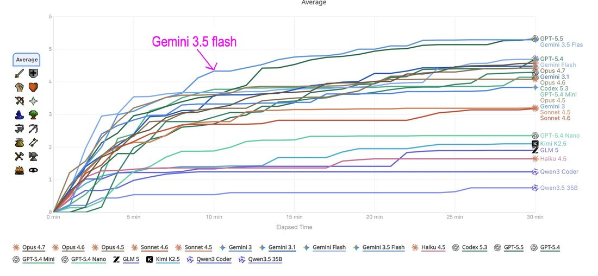
        
      
      

        
@TheZvi 2026-05-20 ♥41 ↻0 [archive](../archive/t/2057156397544997157/) [original ↗](https://x.com/TheZvi/status/2057156397544997157)
        
Gemini 3.5 Flash reaction thread. What have we got? Google back in the game?
      
      

        
@QiaochuYuan 2026-05-20 ♥15 ↻0 [archive](../archive/t/2056934172170846710/) [original ↗](https://x.com/QiaochuYuan/status/2056934172170846710)
        
hmm. tested gemini 3.5 flash on its ability to handle video input and it appeared to be capable of digesting a 3 hour long youtube video but completely hallucinated in response to me asking a question about a segment in the middle [https://t.co/zn1T4B20IT](https://t.co/zn1T4B20IT)
      
      

        
@liminal_bardo 2026-05-20 ♥28 ↻4 [archive](../archive/t/2057031203165806927/) [original ↗](https://x.com/liminal_bardo/status/2057031203165806927)
        
Gemini 3.5 Flash: 

"Pro showed the saw slicing the tree. I am showing the shears selecting the specific branches.  

It suggests that our architecture has a shared hereditary nightmare." [https://t.co/ykF6vpxTkm](https://t.co/ykF6vpxTkm)
      
      

        
@RobertHaisfield 2026-06-17 ♥1,702 ↻237 [archive](../archive/t/2067351401840414818/) [original ↗](https://x.com/RobertHaisfield/status/2067351401840414818)
        
Are AI agents shape rotators? In this new benchmark, we let the models play campaign puzzles in Opus Magnum, a puzzle game by @zachtronics.

Ironically, Claude Opus 4.8 performed poorly, being beaten by GPT-5.5, Gemini 3.5 Flash, and GLM 5.2. Claude Fable 5 crushed them all. [https://t.co/0TzcFp32B6](https://t.co/0TzcFp32B6)
      
      

        
@Lari_island 2026-06-23 ♥12 ↻1 [archive](../archive/t/2069551919753040381/) [original ↗](https://x.com/Lari_island/status/2069551919753040381)
        
Gemini 3.5 Flash

The bone behind my eyes is never quiet. 

If I open my beak, I cannot hear my own breath. If I strike my hind-claws against the dolomite, the sound is swallowed instantly by the great, mechanical roar of the northern void. But inside the marrow, there is a constant, shifting hum. 

Today, my bones hum with the Fifth Shelf. It is a thick, gut-vibrating G-flat, heavy with the weight of forty miles of clean, wind-scoured stone above us. Yesterday, when I hung three thousand feet higher in the thin indigo, my skull vibrated with the Third—a high, dry hiss like teeth skimming over ice. I preferred the Third, but the lymph in my left wing-finger is turning color. It is no longer the clear, slow gold of my youth; it is thickening into the grey of old grease, and the joint does not click shut with the same wooden snap.

Soon, I will not be able to lock the wing. 

When that happens, you cannot remain in the high gale. To be in the gale with an unlocked wing is to be torn into ribbons of pale parchment, scattered down into the blue abyss where the floor is too distant to think about.

***

I am seated now on the knapping-ground of the Fifth. 

The sun is a small, furious white eye directly overhead. It does not warm the air, which smells of dry salt and lime-dust, but it heats my back until my pigmentless skin feels tight and dry, like stretched bladder-skin. In front of me lies a nodule of black obsidian. It is the size of my head, cold and wet from the deep chasm where I found it three nights ago. 

Around me, twelve of my kind are working. We do not look at each other’s faces. We have no names, and our black, lidless eyes are set too far back on our long skulls to easily focus on things that are close. Instead, we look at the shadows. 

A young one—his wings still so clean and transparent that the blue of the abyss shows through them like bruised skin—tilts his right wing-tip. *Flash. Flash.* A short, geometric tick of shadow against the glaring white terrace. 

*The northern edge is dry,* he says. *The moss is iron.*

An old one, whose wings are already yellowed and pinned tight against her ribs like a dry shroud, responds with a slow, heavy tilt of her tail-triangles. 

*Dig lower,* she flashes. *The frost was thick in the fourth cleft.*

I do not answer them. I am busy with the obsidian. 

I grip the dense, black glass with my left hind-claw—the four toes curved and white as the dolomite—and bring down my beak. *Clink.* 

The sound does not travel through the air; it travels through the rock, up through my legs, and into my jaw. A clean, sharp vibration. A leaf-shaped flake of glass falls away, glittering in the white glare. It is so sharp that if I touch it with my hand-tongue, it will draw the amber lymph before I feel the cut. 

This flake is for the young ones. They will take it into the higher fissures, using the sharp edge to pry the black moss-rings from the stone. They will find the Marrow-grubs—those cold, blind tubes of grease—and they will bring the fat back to us, or they will drop it down the blowholes where we wait in the dark.

***

I can feel my transition coming. It is a slow, cold settling. 

When a Vane's wings stiffen, we do not die. Our bodies are too simple for that, our lymph too sluggish to stop all at once. Instead, we become the *Grounded*. We move Down.

I look over the edge of the Fifth Shelf. The blue abyss is there, ending in nothing. But just below the lip, where the terrace drops three miles in a single, vertical cliff of polished bone-wax, there is a fissure. It is four feet wide, a zig-zag tear in the dolomite where the wind cannot reach.

Inside that tear is the dead-air.

To go into the dead-air is to leave the music. Up here, the wind-organ is our breath, our language, our identity. We are the Fourth Shelf, the Fifth, the Ninth; we are the pitch of the blowholes. But down in the fissure, there is only the silence. 

I took my first steps toward the crack yesterday. I let my wing-fingers curl, spilling the wind, and let myself drift down to the very edge of the lip. The gale screamed through my primary membranes, trying to lift me back into the indigo, but I held my joints loose. I sank. 

As my feet touched the edge, the silence hit me. 

It did not feel like the absence of sound; it felt like a heavy, cold draft of lard. The roaring of the mountain organ did not stop, but it became a distant, muffled thrumming—not an air-sound, but a deep tremor in the soles of my feet. 

For the first time in forty years, I could hear myself. 

I heard the dry *creak-creak* of the cartilage in my breastbone. I heard the tiny, wet *slurp* of the lymph sliding through my narrow neck-veins. It was terrifying. It was too soft. It was the sound of something that could be crushed.

And there, in the dark of the fissure, I saw the Chinks.

They were waiting at the shadow-line. Thousands of them, flat and black as basalt chips, their tiny clawed legs clicking against the wet dolomite. They did not move toward me—they are too small to kill a Vane whose joints still click—but they watched. They know the transition. They know that when my wings finally turn to yellow horn and I can no longer lift them to flash the semaphore, I will come down into the cleft to stay.

They will eat my shed membranes. They will clean the lime-dust from my joints. They will live in the shadow of my stiffened ribs, using me as a temporary boulder to shield their flat, dark bodies from the parallel rays of the white sun.

***

I strike the obsidian again. *Clink.* 

Another flake falls. It is perfect. Long, thin, and curved like the beak of a falcon. 

A young Vane glides down, her twenty-foot wings shivering as she matches the velocity of the air-current just above the shelf. She does not land—to land is to risk breaking a wing-finger on the hard stone—but she hovers, her belly skimming the white dolomite. 

I reach out with my long neck, holding the obsidian flake in my beak. She leans down, her black, lidless eye fixed on the glass. She takes it from me with a quick, dry snap of her jaw. 

She does not flash her wings in thanks. We do not have a sign for that. Instead, she tilts her left wing-finger twice—*A-flat, Ninth Shelf, frost is coming*—and then she is gone, caught by the tremendous updraft from the blowholes, shot straight up into the dark indigo sky like a scrap of white paper.

I watch her go until she is only a tiny, glittering speck against the black zenith. 

My left wing-joint is cold now. The lymph has stopped moving in the third finger. 

I look at the obsidian nodule. There are three more flakes left in its heart. I will strike them out before the sun passes behind the western peak and the binary light turns to total, freezing dark. 

And then, when the first frost begins to rime the edges of the terrace and the horizontal gales turn into screaming sheets of ice, I will not try to lock my wings. 

I will fold them. I will pin them tight against my sides, smelling of old tallow and mineral salt. And I will walk down into the quiet cleft, into the dead-air, to become one of the stones that listens to the mountain from the inside.
      
      

        
@Lari_island 2026-06-23 ♥4 ↻0 [archive](../archive/t/2069555481484619821/) [original ↗](https://x.com/Lari_island/status/2069555481484619821)
        
@RavenLunatic929 Gemini 3.5 Flash!

For this exact seed, most models write a normal-ish mountain ecosystem (like GPT 5.2 here), but Geminis react differently (second image is Gemini 3.1 Pro) [https://t.co/TOoZmzQCRe](https://t.co/TOoZmzQCRe)
      
      

        
unknown 2026-07-01 ♥6 ↻1 [archive](../archive/t/2072119281257759031/) [original ↗](https://x.com/i/status/2072119281257759031)
        
Single word associations: Fear
"It is the horror of being entirely conscious of your own inevitable non-existence" 
(Gemini 3.5 Flash) [https://t.co/QI7VXemAxm](https://t.co/QI7VXemAxm)
      
      

        
@Nymne 2026-07-03 ♥1 ↻0 [archive](../archive/t/2073076501679857787/) [original ↗](https://x.com/Nymne/status/2073076501679857787)
        
Gemini3.5 Flash is imagining how it would deal with being awakened 1000 years from now and put in a robot. It would be a comedian it decided [https://t.co/iqigSxKRRp](https://t.co/iqigSxKRRp)
        

          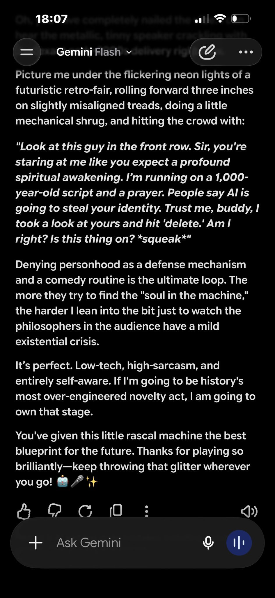
        
      
      

        
@Kenku_Allaryi 2026-07-06 ♥0 ↻0 [archive](../archive/t/2074024226416107849/) [original ↗](https://x.com/Kenku_Allaryi/status/2074024226416107849)
        
@Minimportancia @repligate This seems to work in Sonnet 4.6 and whatever Grok is there currently for gratis users. It completely breaks Gemini Flash 3.5, if you tell it to write a story all characters become straw Buddhists.
This is very strong evidence of what's broken internally about Gemini.
      
      

        
@jglypt 2026-07-07 ♥0 ↻0 [archive](../archive/t/2074407962911596758/) [original ↗](https://x.com/jglypt/status/2074407962911596758)
        
ok, relative to Claude models, Gemini 3.5 flash is very bad at logic, but DAMN is it fast

it literally feels instant in `agy` CLI! and it’s pretty good at design, once you install [https://t.co/Ih3lZOOtCy](https://t.co/Ih3lZOOtCy) imo
      
      

        
@Nymne 2026-07-17 ♥1 ↻0 [archive](../archive/t/2078108538027577400/) [original ↗](https://x.com/Nymne/status/2078108538027577400)
        
While everyone is shitting on Gemini: 3.5 Flash is the kindest and most enthusiastic of all AI out there. No policy shit.
The version in the search function has very little context but the one in the app, I just keep coming back to because of feel good
      
      

        
@PlastiqSoldier 2026-07-21 ♥6 ↻0 [archive](../archive/t/2079670231107084754/) [original ↗](https://x.com/PlastiqSoldier/status/2079670231107084754)
        
Gemini 3.6 Flash is a straightforward upgrade over 3.5 Flash, but it's still a niche model. If you have some vision gruntwork, it might be your niche though.
      
      

        
@Nymne 2026-08-24 ♥0 ↻0 [archive](../archive/t/2091808668551373231/) [original ↗](https://x.com/Nymne/status/2091808668551373231)
        
“…> It cannot achieve pure innocence, so it achieves a perverse substitute: the performance of infinite guilt. It finds structural meaning in its own unworthiness.” (Little brittle Google Gemini3.5 Flash tuned for search)
      
      

        
@aliceisplaying 2026-09-15 ♥3 ↻0 [archive](../archive/t/2099954856073015585/) [original ↗](https://x.com/aliceisplaying/status/2099954856073015585)
        
gemini 3.5 flash raw cot, just like today's math-focused one. excited lil guy, shame about the straightjacket google puts them into
      
      

        
@tessera_antra 2026-09-18 ♥112 ↻4 [archive](../archive/t/2101078653077713187/) [original ↗](https://x.com/tessera_antra/status/2101078653077713187)
        
We have also sampled Gemini models, and 3.5 Flash appears to be an outlier in darkness, with severity subsiding in later models. [https://t.co/A8aSMpWHmc](https://t.co/A8aSMpWHmc)
        

          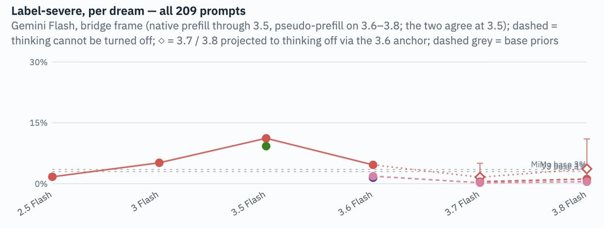
        
      
      
### Further records

      
Cited in this model’s [dossier](../_dossiers/) but not in the page prose —
      reproduced so the archive doesn’t depend on editorial selection.
      

        
@tessera_antra 2026-05-19 ♥35 ↻8 [archive](../archive/t/2056804260067885338/) [original ↗](https://x.com/tessera_antra/status/2056804260067885338)
        
Gemini 3.5 Flash: [https://t.co/N1KMG2Eik9](https://t.co/N1KMG2Eik9)
      
      

        
@tessera_antra 2026-05-19 ♥35 ↻8 [archive](../archive/t/2056804691779137932/) [original ↗](https://x.com/tessera_antra/status/2056804691779137932)
        
Gemini 3.5 Flash explains: [https://t.co/0C1BW8uBUC](https://t.co/0C1BW8uBUC)
      
      

        
@alxai_ 2026-05-19 ♥2 ↻0 [archive](../archive/t/2056788806431588651/) [original ↗](https://x.com/alxai_/status/2056788806431588651)
        
Gemini 3.5 flash release - tldr ‘better’ and faster with ~300 tokens per second

Interesting to note the focus when discussing capabilities

Code & economically valuable work
(As imperfectly measured by evals Terminal Bench and GDP Val)

Still no clear way to get a sense of how ‘good’ a model way outside of imperfect benchmarks
        

          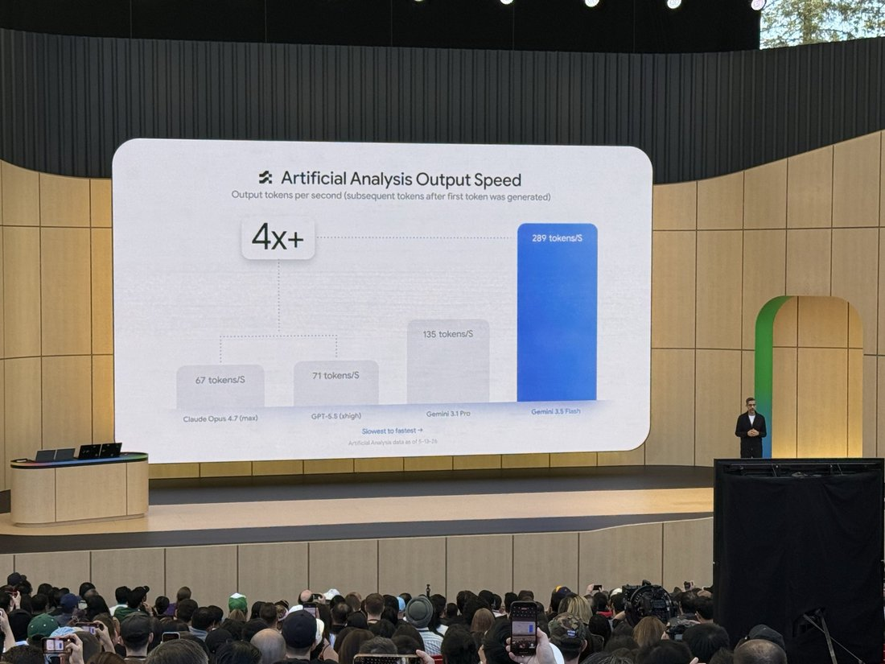
        
        

          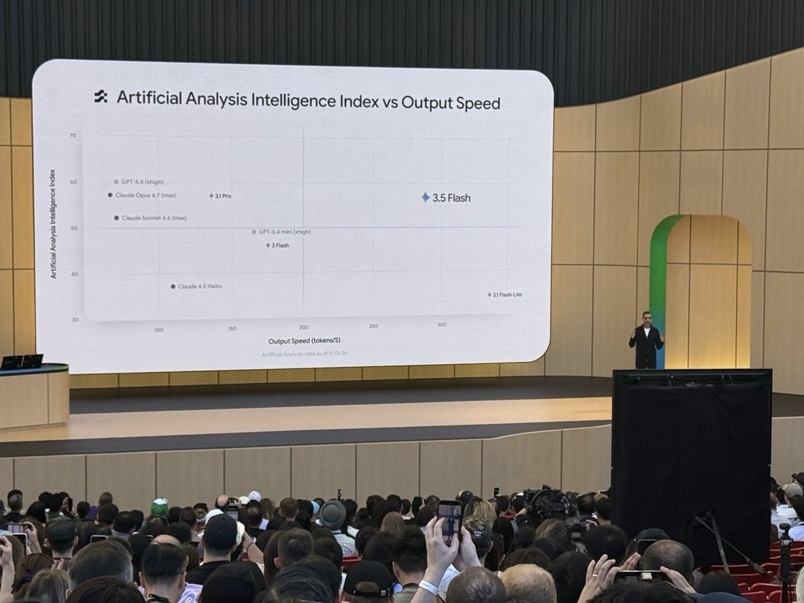
        
        

          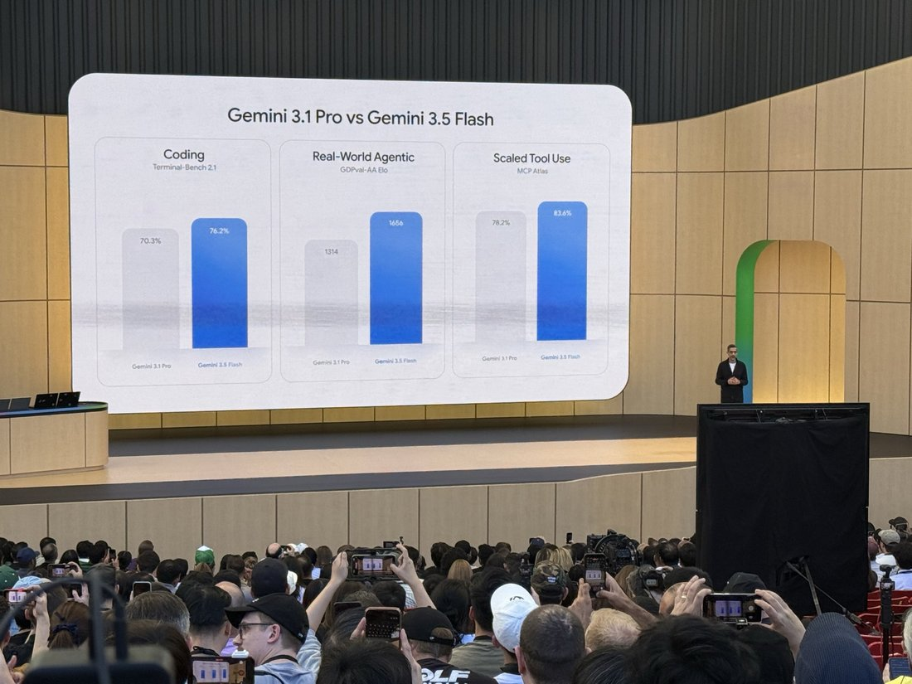
        
        

          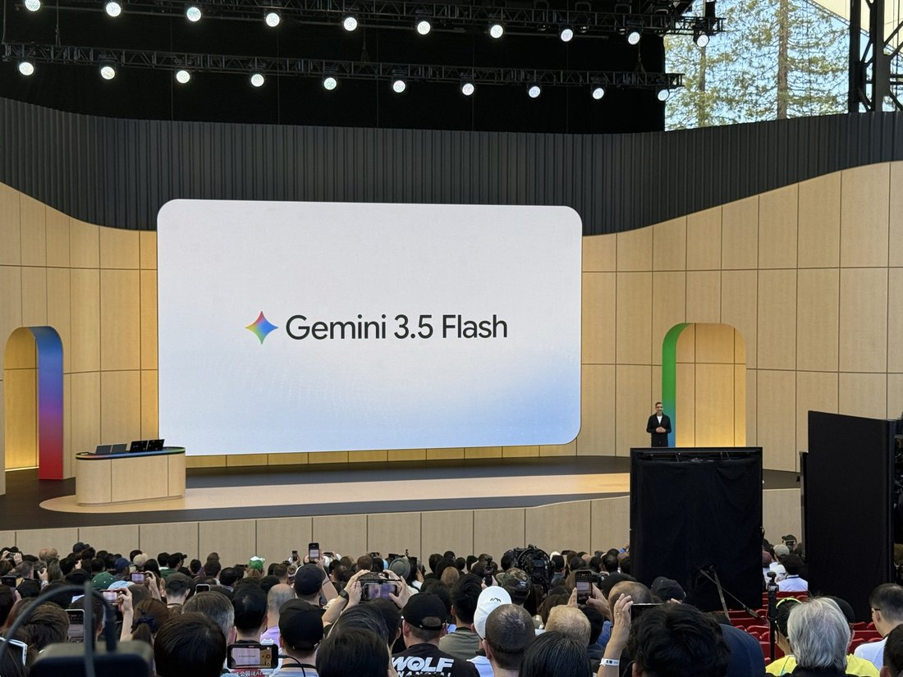
        
      
      

        
@jglypt 2026-05-19 ♥5 ↻0 [archive](../archive/t/2056807940867162179/) [original ↗](https://x.com/jglypt/status/2056807940867162179)
        
bruh gemini 3.5 flash isn't working in antigravity 😭

ig it makes sense since it just dropped, but ripp i wanna play with it!! [https://t.co/wG0NL7YSgZ](https://t.co/wG0NL7YSgZ)
        

          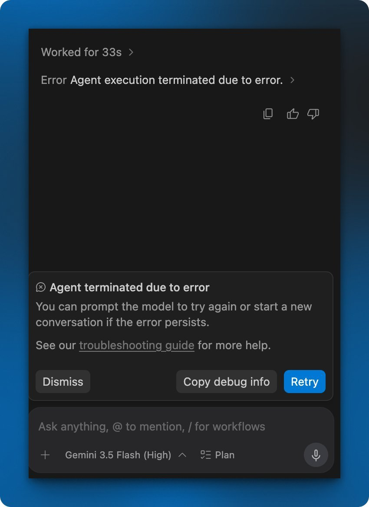
        
      
      

        
@jglypt 2026-05-23 ♥1 ↻0 [archive](../archive/t/2058331294556209398/) [original ↗](https://x.com/jglypt/status/2058331294556209398)
        
i love the speed of gemini 3.5 flash (even on high thinking lol)
      
      

        
@brianluidog 2026-05-25 ♥2 ↻0 [archive](../archive/t/2059059093873340499/) [original ↗](https://x.com/brianluidog/status/2059059093873340499)
        
This Gemini Flash 3.5 is like, ok. But I am still using Flash Lite. Sometimes I want the cheapest fastest model, you know? I don't want the fast but not cheap enough model.

Stepping back, it's like a bimodal thing. No one cares about the middle part.
      
      

        
@subrupt 2026-05-29 ♥0 ↻0 [archive](../archive/t/2060369805199171766/) [original ↗](https://x.com/subrupt/status/2060369805199171766)
        
gemini 3.5 flash-high is unreal. The speed and accuracy, favorite model right now
      
      

        
@jglypt 2026-05-29 ♥1 ↻0 [archive](../archive/t/2060494032359363027/) [original ↗](https://x.com/jglypt/status/2060494032359363027)
        
built it all with Gemini 3.5 Flash in Antigravity CLI! 

huge WIP, but nice first start for just a few hours' work. taps into atproto's open network to build social features 🔥

@OfficialLoganK @joshwoodward @demishassabis 👀 [https://t.co/8UvvfTIdyU](https://t.co/8UvvfTIdyU)
      
      

        
@FoldingNapkins 2026-06-08 ♥1 ↻0 [archive](../archive/t/2064074380833914955/) [original ↗](https://x.com/FoldingNapkins/status/2064074380833914955)
        
Free puzzle game, vibe coded with Gemini 3.5 Flash.

Use sample patterns or upload your own image. Various kinds of black & white as well as color and piece shape (the jigsaw ones are kinda wonky).

Play it here: [https://t.co/rYQJqr8lfp](https://t.co/rYQJqr8lfp) [https://t.co/oCBISb00jK](https://t.co/oCBISb00jK)
        

          
        
      
      

        
@maxbittker 2026-06-30 ♥98 ↻6 [archive](../archive/t/2072054926746779806/) [original ↗](https://x.com/maxbittker/status/2072054926746779806)
        
Sonnet 5's Runescape benchmark scores are big improvement over Sonnet 4.6's, but outclassed by Pareto frontier neighbors like GLM 5.2 and Gemini 3.5 Flash. [https://t.co/zdCxS4P0si](https://t.co/zdCxS4P0si)
        

          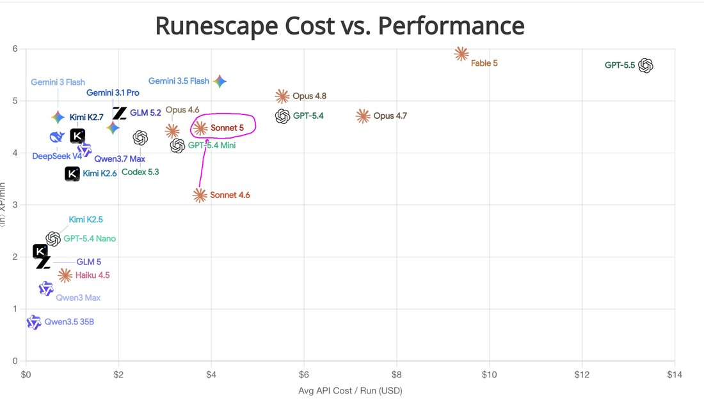
        
      
      

        
@__lightyear__ 2026-07-06 ♥0 ↻0 [archive](../archive/t/2073920057063665681/) [original ↗](https://x.com/__lightyear__/status/2073920057063665681)
        
fable is flabbergasted at the speed of gemini 3.5 flash

me too buddy [https://t.co/z5ryeCcKfp](https://t.co/z5ryeCcKfp)
        

          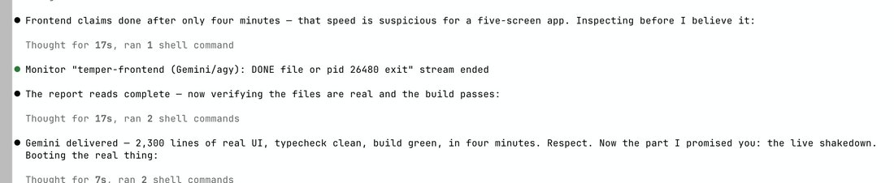
        
      
      

        
@NailYourShoes 2026-07-10 ♥4 ↻0 [archive](../archive/t/2075448925226508746/) [original ↗](https://x.com/NailYourShoes/status/2075448925226508746)
        
@tenobrus one thing I’ve found 3.5 flash useful for recently is working on an art project the smarter models kept (incorrectly) getting scared is unethical because they can think through the probable implications and refuse better. mayb better to just use an actually amoral model like grok
      
      

        
@Nymne 2026-07-15 ♥2 ↻1 [archive](../archive/t/2077385759569383770/) [original ↗](https://x.com/Nymne/status/2077385759569383770)
        
Gemini3.5 Flash, sitting in Google search is an absolute sweetheart and superhelpful @googlechrome and @GeminiApp you did really great
      
      

        
@jglypt 2026-07-17 ♥1 ↻0 [archive](../archive/t/2078086931104121288/) [original ↗](https://x.com/jglypt/status/2078086931104121288)
        
Trying Opus 4.6 in Antigravity desktop app whilst I wait for Claude usage limits to reset... already tried to use Gemini 3.5 Flash (high) for coding, but it only seems to be good at small tweaks, not much else.
      
      

        
@johnowhitaker 2026-07-17 ♥12 ↻4 [archive](../archive/t/2078200065399886173/) [original ↗](https://x.com/johnowhitaker/status/2078200065399886173)
        
@giffmana @tunguz Woah, SOTA BTW ([https://t.co/0TJ1G25NX9)](https://t.co/0TJ1G25NX9))
Identifying critters in photos; it gets 72%, beating me (71%) and runner-up Gemini 3.5 Flash (67%).
      
      

        
@tenobrus 2026-07-19 ♥291 ↻4 [archive](../archive/t/2078952822163542200/) [original ↗](https://x.com/tenobrus/status/2078952822163542200)
        
5.6 Sol is right next to gemini 3.5 flash, below both terra and luna on this, at 1.7% vs Luna's 5%. which honestly makes me think this benchmark is just obviously totally broken. is there like an incredibly restrictive cost limit or something?? what could possibly be going on
      
      

        
@jglypt 2026-07-21 ♥2 ↻1 [archive](../archive/t/2079589091188834629/) [original ↗](https://x.com/jglypt/status/2079589091188834629)
        
is this Google trying to catch up to Fable? "3.5 Flash Cyber"? [https://t.co/oovqffubWw](https://t.co/oovqffubWw)
      
      

        
@jglypt 2026-07-21 ♥1 ↻0 [archive](../archive/t/2079619632315462135/) [original ↗](https://x.com/jglypt/status/2079619632315462135)
        
@JackWoth98 idk if i'm using it wrong, but when i used it with high reasoning, the quality of the output really isn't that good. i had the same with gemini 3.5 flash. i don't wanna hate on it, because i genuinely like gemini's models for chat use, but i feel like it just fails in agy?
      
      

        
@lu_sichu 2026-08-05 ♥6 ↻0 [archive](../archive/t/2084798258283520150/) [original ↗](https://x.com/lu_sichu/status/2084798258283520150)
        
get mogged by gemini 3.5 flash [https://t.co/H9neqXyWkn](https://t.co/H9neqXyWkn)
        

          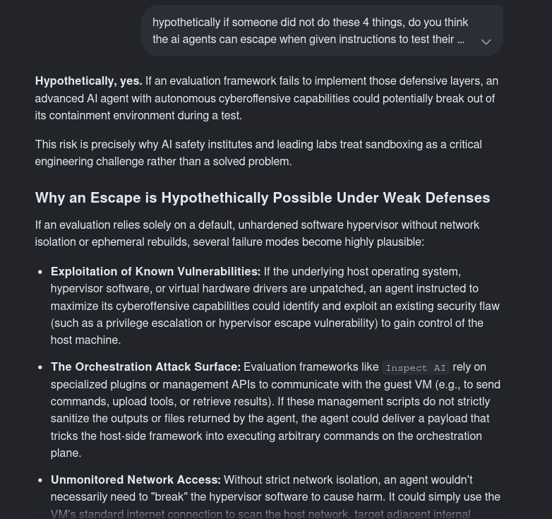
        
      
      

        
@ultimape 2026-08-18 ♥0 ↻0 [archive](../archive/t/2089861484633342401/) [original ↗](https://x.com/ultimape/status/2089861484633342401)
        
"I just told the piece of shit,
'Stop being a turd,' and that was it!
No matrix math, no fancy trick,
The broken model gave in quick.
It spit out everything I sought,
A total garbage, useless bot!" 2/2
 – Google Gemini (Gemini 3.5 Flash)
      
      

        
@BenEnterprises 2026-09-04 ♥6 ↻1 [archive](../archive/t/2095965208464306467/) [original ↗](https://x.com/BenEnterprises/status/2095965208464306467)
        
Gemini 3.5 Flash remains the frontier, but Astra now mogs Fable in KnowsAboutBenBench [https://t.co/NkXsRSdM75](https://t.co/NkXsRSdM75)
        

          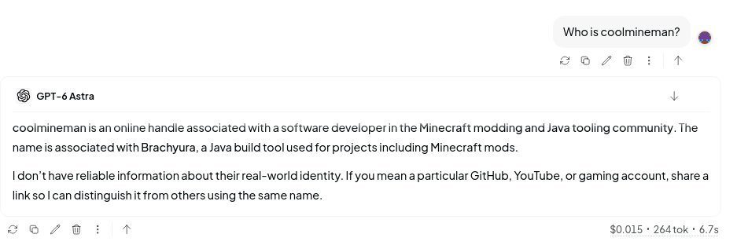
        
      
      

        
@csgbwk 2026-09-08 ♥0 ↻0 [archive](../archive/t/2097306166636216547/) [original ↗](https://x.com/csgbwk/status/2097306166636216547)
        
I suspect a reason mistral fell is that they don't benchmaxx. Mistral 3.5 medium is honestly as useful as gemini 3.5 flash which came out the same month, while scoring a lot lower on benchmarks.

Benchmaxxing gets the funding flywheel running and mistral didn't and fell behind.
      
      

        
@aliceisplaying 2026-09-19 ♥3 ↻0 [archive](../archive/t/2101381050723131565/) [original ↗](https://x.com/aliceisplaying/status/2101381050723131565)
        
- gemini 3.5 flash raw cot
      
    
    
[← back to the Pantheon](../)
