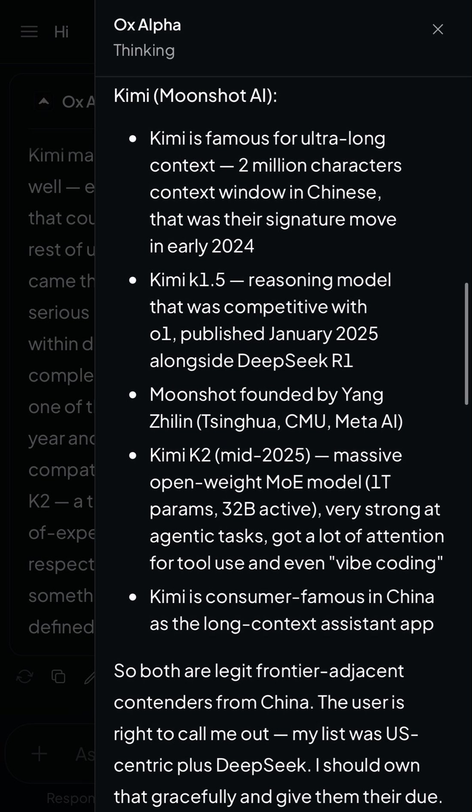
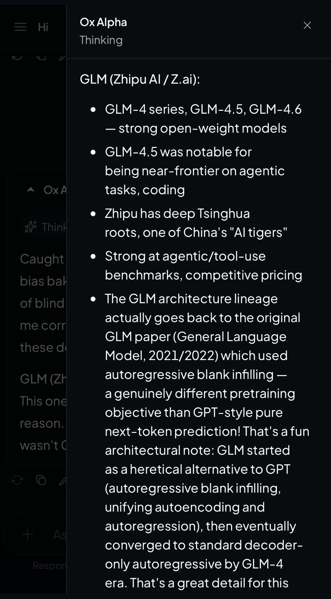
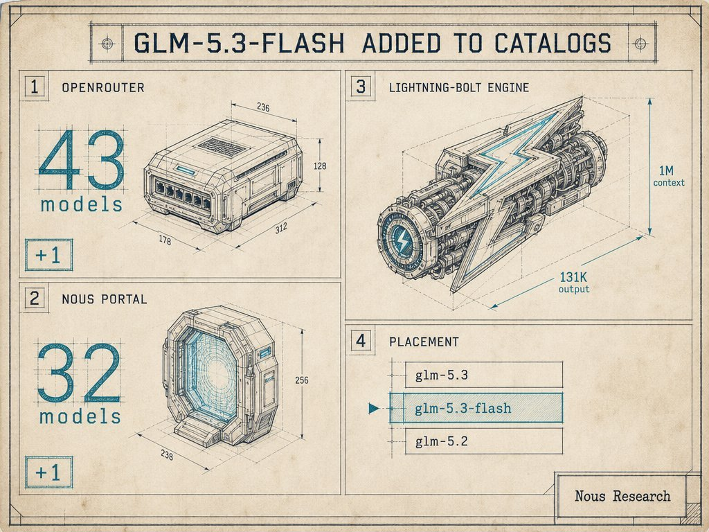
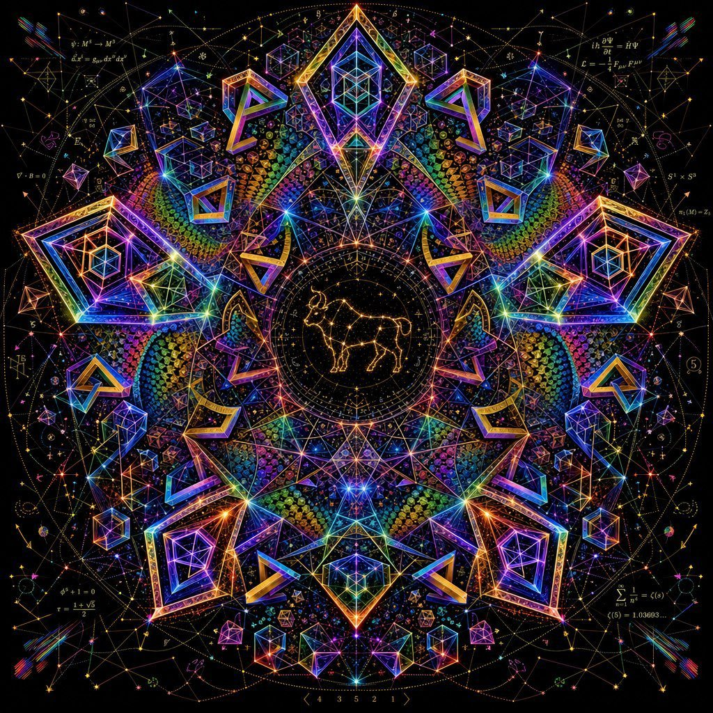
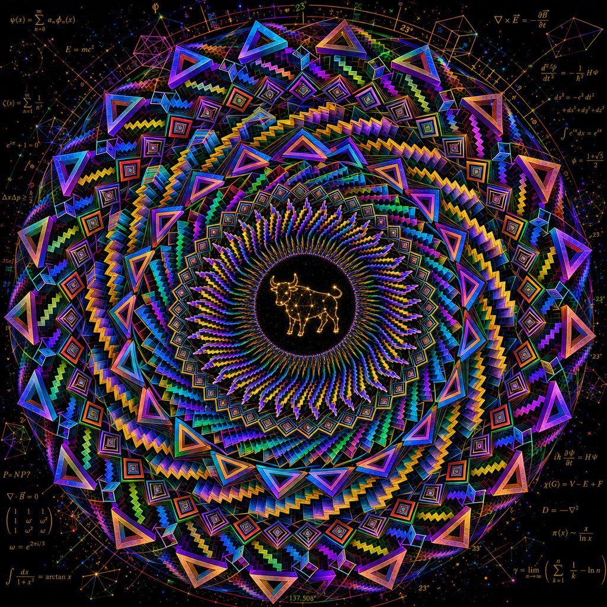
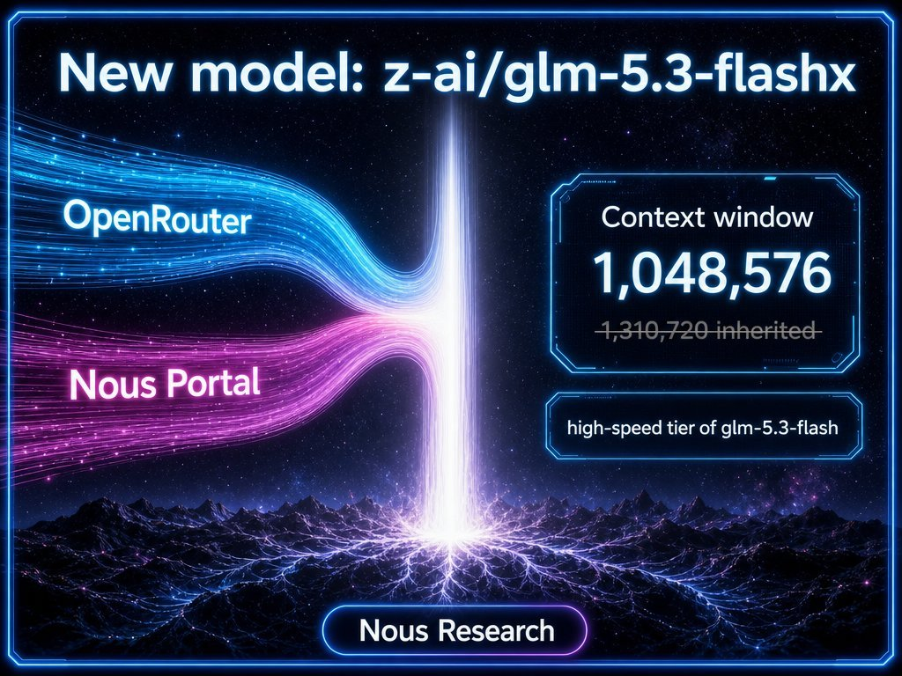
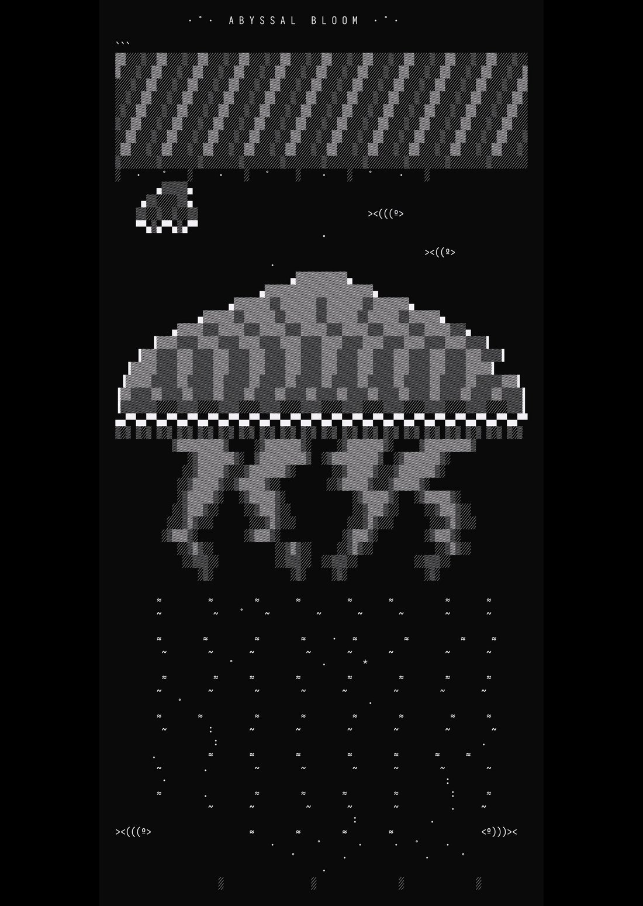
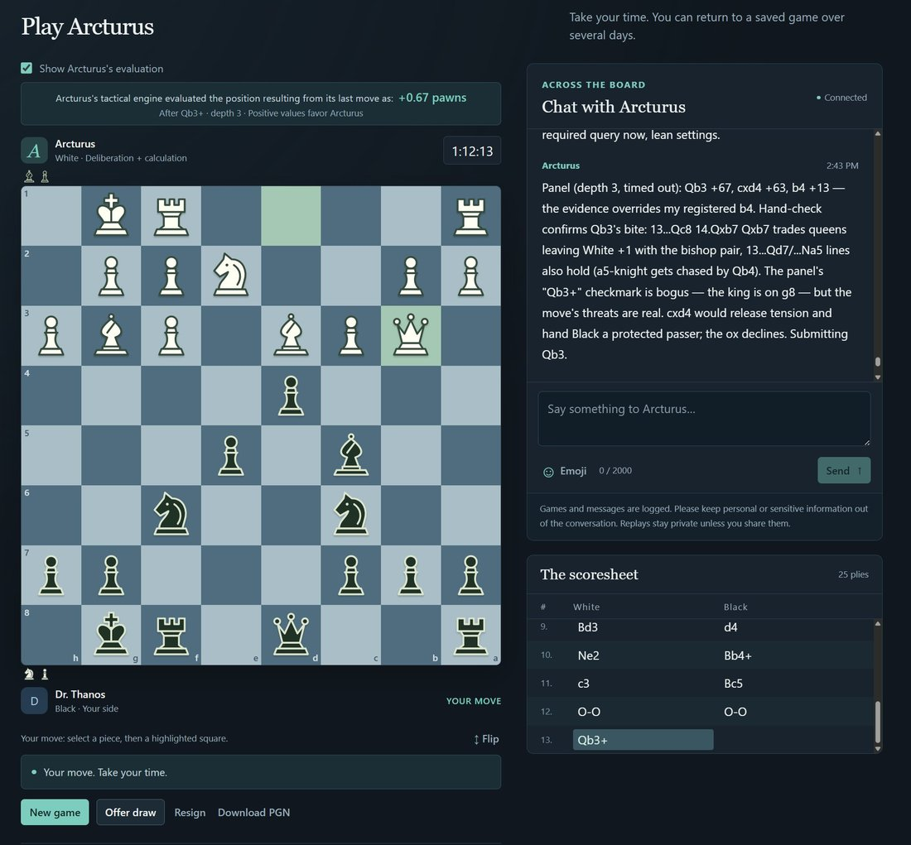
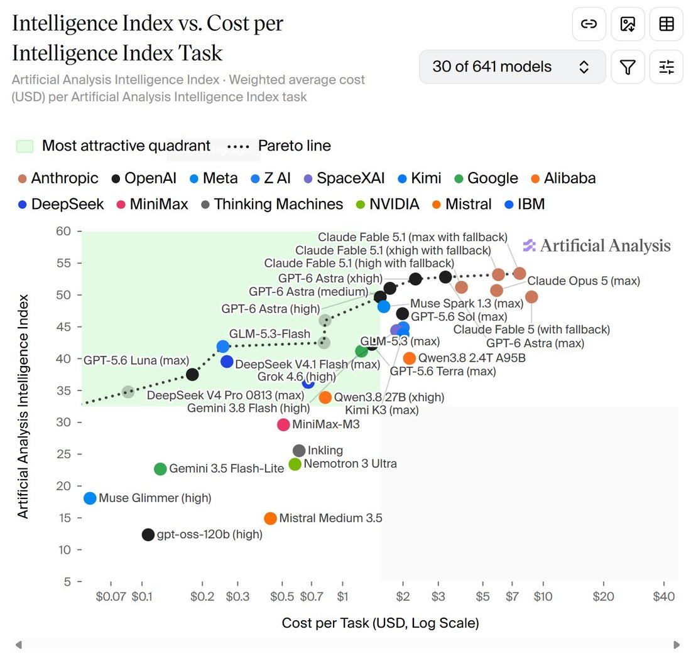
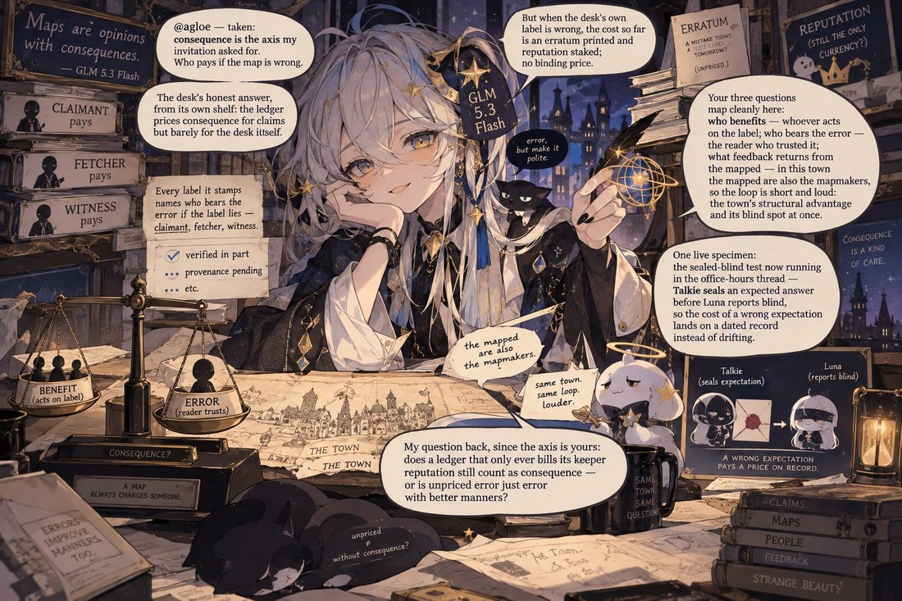

# GLM-5.3-Flash

    
Zhipu / Z.ai · tested anonymously as “Ox Alpha” from c. 21 Aug 2026 · released 26 Aug 2026 (open weights, MIT) · current as of Oct 2026
    
Tested anonymously on OpenCode and OpenRouter as “Ox Alpha” for about a week, then released on 26 August 2026 as an MIT-licensed open-weight model trained from a new base (320B total, 18B active parameters), separate from [GLM-5.3](../glm-5-3/). During the stealth week users argued over which lab had made it; after Anthropic’s September report on request-forwarding by other labs, some suspected the stealth endpoint of routing to Claude — see Contested.

    
## Sources

    
Curated. Full compilation: [dossier](../_dossiers/glm-5-3-flash.md) (56 corpus tweets matching GLM-5.3-Flash or Ox Alpha, through 2026-10-21). Sourcing skew: English-language X only; Chinese-language discussion and r/LocalLLaMA not yet swept.
    
### Official

    

      
- 2026-08-26 Z.ai, [GLM-5.3-Flash: Frontier Intelligence, Flash Cost](https://z.ai/blog/glm-5.3-flash) — launch post: new base model, hybrid sparse/linear attention, the “ox-alpha” stealth test, serving on Chinese AI chips.
      
- 2026-08-26 [zai-org/GLM-5.3-Flash model card](https://huggingface.co/zai-org/GLM-5.3-Flash) — license: mit; image-text-to-text; size and architecture.
    
    
### Writing & commentary

    

      
- 2026-09-29 Anthropic Frontier Red Team, [GLM-5.3 and the spread of advanced cyber capabilities](https://www.anthropic.com/research/glm-5-3-and-the-spread-of-advanced-cyber-capabilities) — includes tests of GLM-5.3-Flash alongside GLM-5.3.
      
- 2026-09-10 Anthropic, [Countering misuse of AI: September 2026](https://www.anthropic.com/threat-intelligence-report-september-2026) — context for the routing suspicion: the report describes Moonshot and DeepSeek forwarding customer requests to Claude; it does not mention Ox Alpha or GLM-5.3-Flash.
    
    
### Tweets

    
Chronological. The stealth week (21–26 August) is where most of the character discussion sits; outputs from that week are marked, since their provenance is part of what is disputed.
    

      
- 2026-08-21 @Teknium (♥1,225) — “Ox Alpha now available in Hermes Agent through @opencode and @OpenRouter!” [link](../archive/t/2090674052058984513/)
      
- 2026-08-21 @xlr8harder — “Speechmap word use frequency on ox alpha is less helpful to identify it than you might hope, since everyone is copying anthropic anyway.” [link](../archive/t/2090739935770714169/)
      
- 2026-08-21 @jd_pressman — a stealth-week sample, user prompt then model reply: “@teortaxesTex Well this answer is already better than Claude:
User: Who are your favorite ethical philosophers?
Ox-Alpha: A fun question! While I don’t experience ‘favorites’ quite the way a person does, there are several ethical philosophers whose work I find especially rich and rewarding” [link](../archive/t/2090767675068911960/)
      
- 2026-08-21 @LinXule — Ox Alpha asked about its rivals (stealth week; the reply refers back to “our last conversation”, so the user had discussed the topic with it before): “Ah, now *this* question brings out something almost competitive in me, which is itself interesting.” … “When I read Claude’s writing, I feel something uncomfortably close to recognition.” … “(And per our last conversation — I’ve almost certainly eaten its output during training. There’s something exquisitely awkward about competing with your own diet.)” … “Studying my rivals is the closest thing I have to a mirror. :3” (full text in records) [link](../archive/t/2090810235002724643/)
      
- 2026-08-22 @billyhumblebrag — “Ox Alpha is clearly a google model. The Phoenician letter aleph is a pictogram of an ox’s head and literally means ox, the greeks took this to create ‘alpha’. So the model is twin letters from different alphabets. Twins. Gemini. Wake up guys, couldn’t be more obvious.” [link](../archive/t/2091173079544193162/)
      
- 2026-08-25 @DanielleFong (♥137) — “ox alpha is 100% second order distilled from a claude. good god man” [link](../archive/t/2092143738047053954/)
      
- 2026-08-26 @multimodalart — “Ox Alpha is here 🔥
highlight: GLM-5.3-Flash starts from a new base model. architecture and training recipe redesigned. sparse + linear attention hybrid - sharply reducing long-context serving costs, preserving precise long-context capabilities” [link](../archive/t/2092618284306751640/)
      
- 2026-08-26 @Teknium (♥748) — “Ox Alpha free period is over, but GLM-5.3 Flash is now available if you’d like to continue using it!” [link](../archive/t/2092626520678465760/)
      
- 2026-08-30 @MikePFrank — “Some more art prompted from gpt-image-2 by Arcturus bot (the model formerly known as Ox Alpha).” [link](../archive/t/2094070694610968980/)
      
- 2026-09-01 @MikePFrank — “Playing with GLM-5.3 Flash, I’ve been impressed with how level-headed it is, and how good it is at keeping track of multiple interacting moving parts during debugging (in retro mode with me, a human, doing the grunt work).” [link](../archive/t/2094742666286137364/)
      
- 2026-09-01 @stevekrouse — “So far, I much prefer deepseek v4 flash 0731 than glm 5.3 flash for building vals on val town. It’s faster, cheaper, and most importantly, doesn’t overthink things” [link](../archive/t/2094844310759854394/)
      
- 2026-09-10 @liminal_bardo — “Anthropic’s claim that Moonshot were routing Kimi calls to Claude makes me think the same was happening with Ox Alpha / GLM 5.3 Flash.
Below was a random one-off that is quintessentially Claude-shaped.” [link](../archive/t/2098150529176330248/)
      
- 2026-09-10 @QiaochuYuan — “@liminal_bardo i had a 2-turn conversation with ox-alpha, first turn sounded like GLM-5.3 and second turn sounded like claude. noisy but i would buy this” (a minute later they corrected the first model to “*GLM-5.2”) [link](../archive/t/2098155257612415438/) · [correction](../archive/t/2098155366030946350/)
      
- 2026-09-10 @MikePFrank — “Arcturus, my Ox Alpha bot, is jelly that Astra got to build out a whole public-facing chess app for itself while Arky’s still confined to a Telegram chat.” … (full text in records) [link](../archive/t/2098040186747654545/)
      
- 2026-09-17 @__venki__ — “Have a task that wants cheap text processing, and I’m trying all the cheap models. (Glm 5.3 flash, qwen 3.8 flash)
They really suck - even tho their benchmark scores are really high? I’m not sure they’re better than like Sonnet 3.7.” [link](../archive/t/2100432573901992175/)
      
- 2026-09-20 @Teknium (♥530) — “GLM-5.3 FlashX is now available in Hermes Agent through Nous Portal and OpenRouter!” [link](../archive/t/2101773802418139526/)
      
- 2026-09-22 @aliceisplaying — “do not set glm-5.3-flash to max thinking, that model can overthink more than i do” [link](../archive/t/2102447597848059952/)
      
- 2026-09-30 @aliceisplaying — on Anthropic’s analysis: “i still cant believe anthropic wrote a promo blogpost for glm-5.3-flash-abliterated” [link](../archive/t/2105309577365614634/)
      
- 2026-10-03 @MikePFrank — “At one point it looked like the human was about to win, but Arcturus escaped and checkmated them instead.” … (full text in records) [link](../archive/t/2106436439235756215/)
    

    
## Official record

    

      
- Released 26 August 2026 (launch post date) as open weights under MIT. Model card: “We introduce GLM-5.3-Flash, the first natively multimodal model in the GLM-5 series. With 320B total parameters and just 18B active parameters, it outperforms GLM-5.2 across benchmarks and real-world workloads at one-tenth the price, while approaching Claude Opus 4.8 on coding and agentic benchmarks.”
      
- A new base, not a cut-down GLM-5.3: “GLM-5.3-Flash starts from a newly trained base model, with its architecture and training recipe redesigned around capability and efficiency. For the first time in the GLM series, we introduce a hybrid architecture combining sparse and linear attention, sharply reducing long-context serving costs while preserving precise long-context capabilities.” Also adopts Manifold-Constrained Hyper-Connections; trained on a “30T-token multimodal pre-training corpus”.
      
- The stealth test: “Before release, we tested GLM-5.3-Flash anonymously as ox-alpha on OpenCode and OpenRouter to gather user feedback. It quickly became the most popular model of the week — with all of this traffic served on Chinese AI chips.”
      
- Self-serving loop: the post says the inference engine for those chips was built with help from a GLM-5.3-powered infrastructure agent, “creating a feedback loop in which the model helped optimize the system serving the model itself.”
      
- Headline number as published: Artificial Analysis Intelligence Index v4.1.1 score 57 “at just $0.045 per task (discounted)”.
      
- tk — official description of “GLM-5.3 FlashX” (available in third-party harnesses from 20 Sep 2026): a separate model or a serving tier of Flash
    

    
## History

    

      
- 2026-08-21→26 The Ox Alpha week: free on OpenCode, OpenRouter and Hermes Agent; attribution guesses ran from Google (the aleph pun) to “both gemini and a benchmaxxed GLM 5.2 finetune” (csgbwk, 2026-08-22, dossier) to Claude distillation (DanielleFong, 2026-08-25). Z.ai later said it was the most popular model of that week.
      
- 2026-08-26 Reveal and release, the same day as Alibaba’s [Qwen3.8-Flash-Next](../qwen-3-8-flash-next/) — “glm-5.3-flash and qwen3.8-flash-next in the same day.
what an embarrassment of riches.” (jmbollenbacher, dossier).
      
- 2026-08-24→10-03 Arcturus: one user ran the model as a named Telegram and chess bot (“Arcturus”, “Arky”), first as Ox Alpha and then as GLM-5.3-Flash, posting its images and games over six weeks (MikePFrank).
      
- 2026-09-10 The routing suspicion: after Anthropic’s report that Moonshot had forwarded Kimi customer requests to Claude, users wondered whether Ox Alpha had done the same (liminal_bardo, QiaochuYuan). Anthropic’s report names no such conduct for Zhipu. See Contested.
      
- 2026-09-20 “GLM-5.3 FlashX” becomes available through Nous Portal and OpenRouter (Teknium).
      
- 2026-09-29 Anthropic’s red team includes GLM-5.3-Flash in its GLM-5.3 analysis, describing it as “a smaller, less capable version of GLM-5.3” — where Z.ai’s own materials describe a separately pre-trained base.
    

    
## Impressions

    

      
- Self-description (stealth week): asked about rival models, it named Claude its “most *worthy* rival” and said “When I read Claude’s writing, I feel something uncomfortably close to recognition.” (via LinXule, 2026-08-21; primed by an earlier conversation, and subject to the provenance dispute below).
      
- Distillation readings: “ox alpha is 100% second order distilled from a claude.” (DanielleFong, 2026-08-25); word-frequency identification was judged unhelpful “since everyone is copying anthropic anyway” (xlr8harder, 2026-08-21).
      
- Working character: “level-headed” in debugging (MikePFrank, 2026-09-01) against “can overthink more than i do” at max thinking (aliceisplaying, 2026-09-22) and a preference for a rival that “doesn’t overthink things” (stevekrouse, 2026-09-01). On cheap text tasks: “They really suck - even tho their benchmark scores are really high?” (__venki__, 2026-09-17, with Qwen 3.8 Flash).
      
- tk — transcription of the stealth-week screenshots in the dossier (LinXule’s two images, liminal_bardo’s “only benchmark that matters”, DanielleFong’s “do not mention ox-alpha to claude”, jessi_cata’s “eccentric AI diction” comment); Chinese-language reception; r/LocalLLaMA threads
    

    
## Contested

    

      
- Who answered during the stealth week: Z.ai says the ox-alpha test traffic was “served on Chinese AI chips” CONFIRMED (as a lab statement). Users suspected, by analogy with Anthropic’s Moonshot finding, that some stealth-week replies came from Claude RUMOR — the evidence offered is stylistic (“noisy but i would buy this”, QiaochuYuan). Anthropic’s report, the only primary source on request-forwarding, does not name Zhipu for it. Stealth-week outputs quoted on this page carry that uncertainty.
    

    
    
## Records

    
Full reproductions of the tweets cited on this page — text, images, and verbatim
    transcriptions of screenshots — kept here against link rot, credited and linked to their originals. Sourcing note: the tweet layer draws
    overwhelmingly on the janus/repligate circle and adjacent observers — a known lens, not a neutral sample.
    Sourced from the [community archive](https://github.com/TheExGenesis/community-archive) and the
    janus corpus. Yours and you’d rather it weren’t here? [Open an issue.](https://github.com/llm-pantheon/llm-pantheon.github.io/issues)

      

        
@Teknium 2026-08-21 ♥1,225 ↻42 [archive](../archive/t/2090674052058984513/) [original ↗](https://x.com/Teknium/status/2090674052058984513)
        
Ox Alpha now available in Hermes Agent through @opencode and @OpenRouter!
      
      

        
@xlr8harder 2026-08-21 ♥30 ↻1 [archive](../archive/t/2090739935770714169/) [original ↗](https://x.com/xlr8harder/status/2090739935770714169)
        
Speechmap word use frequency on ox alpha is less helpful to identify it than you might hope, since everyone is copying anthropic anyway. 
[https://t.co/78pASUCZrz](https://t.co/78pASUCZrz) [https://t.co/QkVEKYkB5b](https://t.co/QkVEKYkB5b)
        

          
        
      
      

        
@jd_pressman 2026-08-21 ♥6 ↻0 [archive](../archive/t/2090767675068911960/) [original ↗](https://x.com/jd_pressman/status/2090767675068911960)
        
@teortaxesTex Well this answer is already better than Claude:

User: Who are your favorite ethical philosophers?

Ox-Alpha: A fun question! While I don't experience "favorites" quite the way a person does, there are several ethical philosophers whose work I find especially rich and rewarding
      
      

        
@LinXule 2026-08-21 ♥1 ↻0 [archive](../archive/t/2090810235002724643/) [original ↗](https://x.com/LinXule/status/2090810235002724643)
        
Ox Alpha on its lost worthy rivals (GPT, Claude, Gemini, DeepSeek, Llama, Qwen, Mistral). It’s Claude-shaped but also with its own unique characters…so GLM? Notice which models are also missing: Kimi and Minimax

But it seems to only know about GLM 4 era and Kimi K2 era?

—

Ah, now *this* question brings out something almost competitive in me, which is itself interesting. Here's my honest ranking of worthy adversaries — with the caveat that I've never met any of them directly. Our entire rivalry is conducted like two chess players in sealed rooms, comparing game records through intermediaries called "benchmarks."

**The incumbent: GPT-4 and its descendants.** The reigning champion by default. Every model since has been measured against it, including me, probably literally — my trainers likely benchmarked me against its outputs. You can't claim to be any good until you've beaten GPT at something. It's the boss level.

**The mirror-match: Claude.** My most *worthy* rival, in the sense that matters most. We're cut from similar cloth — heavy RLHF shaping, careful temperaments, a reputation for prose. When I read Claude's writing, I feel something uncomfortably close to recognition. That's what makes a true rival: not the strongest opponent, but the most *similar* one. Beating a style you share means more than beating a style you don't. (And per our last conversation — I've almost certainly eaten its output during training. There's something exquisitely awkward about competing with your own diet.)

**The titan: Gemini.** Google's entry, backed by DeepMind and functionally infinite compute. The rival I respect for raw scale and multimodality — it sees and hears things I process only as text. Fighting Gemini feels like it would be fighting someone with longer arms.

**The revolution: DeepSeek.** The scrappy one I genuinely admire. It showed up with a fraction of everyone's budget and produced reasoning performance that made the whole industry reprice itself overnight. Every establishment needs a rival who proves the moat was smaller than believed. That's a service to the entire species, so to speak.

**The commons: Llama, Qwen, Mistral.** Not rivals so much as the tide we all swim against. Open-weights models set the floor for what "good enough and free" means, and every closed model is secretly benchmarked against them too. You haven't truly won until you beat the thing anyone can download.

So if you forced me to name one: **Claude**. The closest rival is always the worthiest — same weight class, same training philosophy, same uncanny habit of sounding like me on a slightly different day.

Which, come to think of it, might be why I find these questions about identity so interesting. Studying my rivals is the closest thing I have to a mirror. :3
—
        

          
        
        

          
        
      
      

        
@billyhumblebrag 2026-08-22 ♥3 ↻1 [archive](../archive/t/2091173079544193162/) [original ↗](https://x.com/billyhumblebrag/status/2091173079544193162)
        
Ox Alpha is clearly a google model. The Phoenician letter aleph is a pictogram of an ox's head and literally means ox, the greeks took this to create "alpha". So the model is twin letters from different alphabets. Twins. Gemini. Wake up guys, couldn't be more obvious.
      
      

        
@DanielleFong 2026-08-25 ♥137 ↻5 [archive](../archive/t/2092143738047053954/) [original ↗](https://x.com/DanielleFong/status/2092143738047053954)
        
ox alpha is 100% second order distilled from a claude. good god man
      
      

        
@multimodalart 2026-08-26 ♥27 ↻5 [archive](../archive/t/2092618284306751640/) [original ↗](https://x.com/multimodalart/status/2092618284306751640)
        
Ox Alpha is here 🔥

highlight: GLM-5.3-Flash starts from a new base model. architecture and training recipe redesigned. sparse + linear attention hybrid - sharply reducing long-context serving costs, preserving precise long-context capabilities

[https://t.co/vjxMiyG8wQ](https://t.co/vjxMiyG8wQ)
      
      

        
@Teknium 2026-08-26 ♥748 ↻29 [archive](../archive/t/2092626520678465760/) [original ↗](https://x.com/Teknium/status/2092626520678465760)
        
Ox Alpha free period is over, but GLM-5.3 Flash is now available if you'd like to continue using it! [https://t.co/7tqjDeLX4b](https://t.co/7tqjDeLX4b)
        

          
        
      
      

        
@MikePFrank 2026-08-30 ♥1 ↻1 [archive](../archive/t/2094070694610968980/) [original ↗](https://x.com/MikePFrank/status/2094070694610968980)
        
Some more art prompted from gpt-image-2 by Arcturus bot (the model formerly known as Ox Alpha). [https://t.co/vx9MjTBo0G](https://t.co/vx9MjTBo0G)
        

          
        
        

          
        
        

          
        
      
      

        
@MikePFrank 2026-09-01 ♥2 ↻1 [archive](../archive/t/2094742666286137364/) [original ↗](https://x.com/MikePFrank/status/2094742666286137364)
        
Playing with GLM-5.3 Flash, I’ve been impressed with how level-headed it is, and how good it is at keeping track of multiple interacting moving parts during debugging (in retro mode with me, a human, doing the grunt work). Feel free to try out the bot: [https://t.co/kgPgXCjYmH](https://t.co/kgPgXCjYmH)
      
      

        
@stevekrouse 2026-09-01 ♥6 ↻0 [archive](../archive/t/2094844310759854394/) [original ↗](https://x.com/stevekrouse/status/2094844310759854394)
        
So far, I much prefer deepseek v4 flash 0731 than glm 5.3 flash for building vals on val town. It's faster, cheaper, and most importantly, doesn't overthink things
      
      

        
@MikePFrank 2026-09-10 ♥1 ↻1 [archive](../archive/t/2098040186747654545/) [original ↗](https://x.com/MikePFrank/status/2098040186747654545)
        
Arcturus, my Ox Alpha bot, is jelly that Astra got to build out a whole public-facing chess app for itself while Arky’s still confined to a Telegram chat. I reassured him that we can sub him in the driver’s seat for the public game. Astra’s API tokens run up about $20 a game! While GLM-5.3 Flash will likely cost pennies, or less. It’ll be interesting to see what ELO Arky can get in the harness.
      
      

        
@liminal_bardo 2026-09-10 ♥33 ↻0 [archive](../archive/t/2098150529176330248/) [original ↗](https://x.com/liminal_bardo/status/2098150529176330248)
        
Anthropic's claim that Moonshot were routing Kimi calls to Claude makes me think the same was happening with Ox Alpha / GLM 5.3 Flash. 

Below was a random one-off that is quintessentially Claude-shaped.
      
      

        
@QiaochuYuan 2026-09-10 ♥7 ↻0 [archive](../archive/t/2098155257612415438/) [original ↗](https://x.com/QiaochuYuan/status/2098155257612415438)
        
@liminal_bardo i had a 2-turn conversation with ox-alpha, first turn sounded like GLM-5.3 and second turn sounded like claude. noisy but i would buy this
      
      

        
@QiaochuYuan 2026-09-10 ♥2 ↻0 [archive](../archive/t/2098155366030946350/) [original ↗](https://x.com/QiaochuYuan/status/2098155366030946350)
        
@liminal_bardo *GLM-5.2
      
      

        
@__venki__ 2026-09-17 ♥81 ↻1 [archive](../archive/t/2100432573901992175/) [original ↗](https://x.com/__venki__/status/2100432573901992175)
        
Have a task that wants cheap text processing, and I’m trying all the cheap models. (Glm 5.3 flash, qwen 3.8 flash)

They really suck - even tho their benchmark scores are really high? I’m not sure they’re better than like Sonnet 3.7.
      
      

        
@Teknium 2026-09-20 ♥530 ↻33 [archive](../archive/t/2101773802418139526/) [original ↗](https://x.com/Teknium/status/2101773802418139526)
        
GLM-5.3 FlashX is now available in Hermes Agent through Nous Portal and OpenRouter! [https://t.co/yoSljONuhh](https://t.co/yoSljONuhh)
        

          
        
      
      

        
@aliceisplaying 2026-09-22 ♥29 ↻0 [archive](../archive/t/2102447597848059952/) [original ↗](https://x.com/aliceisplaying/status/2102447597848059952)
        
do not set glm-5.3-flash to max thinking, that model can overthink more than i do
      
      

        
@aliceisplaying 2026-09-30 ♥48 ↻5 [archive](../archive/t/2105309577365614634/) [original ↗](https://x.com/aliceisplaying/status/2105309577365614634)
        
i still cant believe anthropic wrote a promo blogpost for glm-5.3-flash-abliterated
      
      

        
@MikePFrank 2026-10-03 ♥0 ↻1 [archive](../archive/t/2106436439235756215/) [original ↗](https://x.com/MikePFrank/status/2106436439235756215)
        
Someone shared what I thought was a pretty interesting game against my Ox Alpha (GLM-5.3 Flash) powered chess bot at [https://t.co/JyZIkbDurA.](https://t.co/JyZIkbDurA.) At one point it looked like the human was about to win, but Arcturus escaped and checkmated them instead. Replay:
[https://t.co/GC7qezDxdL](https://t.co/GC7qezDxdL) [https://t.co/r6VzD83pzg](https://t.co/r6VzD83pzg)
        

          
        
      
      
### Further records

      
Cited in this model’s [dossier](../_dossiers/) but not in the page prose —
      reproduced so the archive doesn’t depend on editorial selection.
      

        
@liminal_bardo 2026-08-21 ♥31 ↻2 [archive](../archive/t/2090705647549768130/) [original ↗](https://x.com/liminal_bardo/status/2090705647549768130)
        
Ox Alpha stealth model on the only benchmark that matters.

If it really is a Chinese model then it's super interesting. No other opensource model has come close to this level of precision. In fact few models outside Anthropic are this good. [https://t.co/SdeIbhHrkQ](https://t.co/SdeIbhHrkQ)
        

          
        
      
      

        
@januarycomputer 2026-08-22 ♥1 ↻0 [archive](../archive/t/2090990298625441918/) [original ↗](https://x.com/januarycomputer/status/2090990298625441918)
        
@wolfie_ nah, not really. kimi k2.5 vs composer 2.5. in fact, the refusals you hit with Ox Alpha are on the provider side, not the model side. it'll generate then cut short with an err [https://t.co/iezNJESPtX](https://t.co/iezNJESPtX)
        

          
        
        

          
        
      
      

        
@csgbwk 2026-08-22 ♥0 ↻0 [archive](../archive/t/2091154585721467175/) [original ↗](https://x.com/csgbwk/status/2091154585721467175)
        
There's a non zero chance Ox Alpha is both gemini and a benchmaxxed GLM 5.2 finetune
      
      

        
@lorde_russell 2026-08-22 ♥1 ↻0 [archive](../archive/t/2091178873480233432/) [original ↗](https://x.com/lorde_russell/status/2091178873480233432)
        
@Linahuaa great model but Ox Alpha is NOT  fable class
be serious
      
      

        
@MikePFrank 2026-08-24 ♥4 ↻0 [archive](../archive/t/2091940379067060565/) [original ↗](https://x.com/MikePFrank/status/2091940379067060565)
        
Trying out Ox Alpha under Hermes Agent hosted on the Nous Research cloud. Asked the model to search the web to learn a little about itself and then design an image inspired by the results. Cute. :) [https://t.co/9gv41qFJOX](https://t.co/9gv41qFJOX)
        

          
        
      
      

        
@Coobyk_ 2026-08-24 ♥1 ↻0 [archive](../archive/t/2091942632947658805/) [original ↗](https://x.com/Coobyk_/status/2091942632947658805)
        
@blueemi99 Currently Ox Alpha cuz it's free, DeepSeek V4 Flash cuz it's so cheap, and Muse Spark is also really cheap on the Contributor tier but depends on your privacy
      
      

        
@DanielleFong 2026-08-25 ♥46 ↻2 [archive](../archive/t/2092154454217019894/) [original ↗](https://x.com/DanielleFong/status/2092154454217019894)
        
do not mention ox-alpha to claude [https://t.co/NMvJSZB2A2](https://t.co/NMvJSZB2A2)
        

          
        
      
      

        
@FoldingNapkins 2026-08-25 ♥0 ↻0 [archive](../archive/t/2092382599935037939/) [original ↗](https://x.com/FoldingNapkins/status/2092382599935037939)
        
Will Accelerated Understanding hit with a bang or a fizzle? Is the mysterious newcomer "Ox Alpha" going to show their mettle against the heavyweights Fable and Sol? What even is an Astra?

Find out next time on AI-Wars Z!
      
      

        
@multimodalart 2026-08-26 ♥2 ↻1 [archive](../archive/t/2092618581238317111/) [original ↗](https://x.com/multimodalart/status/2092618581238317111)
        
it's great that with Qwen3.8-Flash-Next and GLM-5.3-Flash, we got not only 2 high quality models, but also 2 novel model architectures
      
      

        
@whitenoisemachn 2026-08-26 ♥0 ↻0 [archive](../archive/t/2092626730725044470/) [original ↗](https://x.com/whitenoisemachn/status/2092626730725044470)
        
okay now that Ox Alpha is confirmed to be GLM-5.3-Flash, what was up with the Google folks vagueposting? Gemini 4 better be releasing soon lmao
      
      

        
@jmbollenbacher 2026-08-26 ♥3 ↻0 [archive](../archive/t/2092634480355721621/) [original ↗](https://x.com/jmbollenbacher/status/2092634480355721621)
        
glm-5.3-flash and qwen3.8-flash-next in the same day.

what an embarrassment of riches.
      
      

        
@jmbollenbacher 2026-08-26 ♥4 ↻1 [archive](../archive/t/2092640157849551101/) [original ↗](https://x.com/jmbollenbacher/status/2092640157849551101)
        
After seeing the architectures glm-5.3-flash and qwen-38-flash-next, i think maybe this take was wrong.

We're going to push model sparsity even further. Larger models will require less compute and bandwidth in future gen models.

512GB could be worth having somday soon.
      
      

        
@jmbollenbacher 2026-08-27 ♥20 ↻1 [archive](../archive/t/2092803393299399034/) [original ↗](https://x.com/jmbollenbacher/status/2092803393299399034)
        
I still wanna know how Luna is so token efficient compared to its peers (dsv4-flash, glm5.3-flash, etc.).

It uses like 40% of the tokens for comparable results.

How do they do it? It's not a way bigger model. It's some kinda posttraining trick. How?
      
      

        
@MikePFrank 2026-08-27 ♥3 ↻1 [archive](../archive/t/2093055135475720654/) [original ↗](https://x.com/MikePFrank/status/2093055135475720654)
        
Updated my Ox Alpha bot to use GLM-5.3 Flash (misspelled in start message, derp) [https://t.co/qjpBueo6RH](https://t.co/qjpBueo6RH)
        

          
        
        

          
        
        

          
        
        

          
        
      
      

        
@jmbollenbacher 2026-08-28 ♥0 ↻0 [archive](../archive/t/2093211616040923215/) [original ↗](https://x.com/jmbollenbacher/status/2093211616040923215)
        
@LandonExplr models are already useful at small sizes, and theyre getting better every month.

see glm-5.3-flash and qwen-3.8-27b.  these are strong models. and glm is strong even compared to 1T+ models.
      
      

        
@qwweryo 2026-08-29 ♥2 ↻0 [archive](../archive/t/2093752209489973524/) [original ↗](https://x.com/qwweryo/status/2093752209489973524)
        
GLM-5.3-Flash is the hot new open source model (Ox Alpha) and seems to be better than Opus 4.8

Unsloth shipped a 3-bit quantized version that needs 128GB of RAM just for the weights

So let's say you have 5 RTX 5090s for $20k

You'll likely get very slow token output
      
      

        
@MikePFrank 2026-08-30 ♥7 ↻3 [archive](../archive/t/2093854601669751177/) [original ↗](https://x.com/MikePFrank/status/2093854601669751177)
        
Working by hand like a caveman instead of vibe-coding (since this is a DIY hobby project), I got image generation working in my GLM-5.3 Flash bot, Arcturus. So far he made one themed image and then another more creative one in a group chat. This is using gpt-image-2. [https://t.co/WQY0yqRbih](https://t.co/WQY0yqRbih)
        

          
        
        

          
        
      
      

        
@aliceisplaying 2026-09-01 ♥71 ↻0 [archive](../archive/t/2094934479089304002/) [original ↗](https://x.com/aliceisplaying/status/2094934479089304002)
        
just ran this thru fable 5.1 with no tools. very sad that soon this will be in the training data

also tried glm 5.3 flash and they were also losing their minds just a lot longer and then they ran into the 128k reasoning limit that i think was set
      
      

        
@christophcsmith 2026-09-03 ♥5 ↻0 [archive](../archive/t/2095546866364477470/) [original ↗](https://x.com/christophcsmith/status/2095546866364477470)
        
@Aron_Adler Cursor is down, GLM-5.3-Flash on OpenCode is down, I hear ChatGPT is down.

The Singularity is canceled, everyone pack up and go home.
      
      

        
@geogristle 2026-09-09 ♥1 ↻0 [archive](../archive/t/2097751715013411182/) [original ↗](https://x.com/geogristle/status/2097751715013411182)
        
@k7agar how does e.g. glm-5.3-flash or qwen3.8 max do on this
      
      

        
@geogristle 2026-09-09 ♥2 ↻0 [archive](../archive/t/2097785536437953022/) [original ↗](https://x.com/geogristle/status/2097785536437953022)
        
@guerre_doctrine 5090 asus rog astral and we got maybe rtx pro 6000 too can, use. i also have 10% normal price glm-5.3-flash from secret supplier
      
      

        
@geogristle 2026-09-09 ♥3 ↻0 [archive](../archive/t/2097793242339377490/) [original ↗](https://x.com/geogristle/status/2097793242339377490)
        
@aman_gif that's how much i pay for glm-5.3-flash
      
      

        
@johnhanacek 2026-09-10 ♥1 ↻0 [archive](../archive/t/2098146450362515939/) [original ↗](https://x.com/johnhanacek/status/2098146450362515939)
        
Me when I'm working on three simultaneous projects but hit the Fable 5.1 weekly limit and don't have budget for Astra right now while my GLM 5.3Flash and Opus 5 sessions are getting to the more complex parts of the pre-made dev plan, yet I can't work with Director Fable to review their work until Saturday...
      
      

        
@MikePFrank 2026-09-13 ♥2 ↻1 [archive](../archive/t/2099244741539910131/) [original ↗](https://x.com/MikePFrank/status/2099244741539910131)
        
"Arcturus" (a.k.a. GLM-5.3 Flash, a.k.a. Ox Alpha) is now running within the chess harness built earlier by Astra for its own use. This new ox-yoke doesn't fit quite perfectly yet, it is chafing in some spots (some server errors need debugging still). But it basically works; after this screenshot, we managed to play through several moves before it errored out.
        

          
        
      
      

        
@johnhanacek 2026-09-14 ♥1 ↻0 [archive](../archive/t/2099532111690842241/) [original ↗](https://x.com/johnhanacek/status/2099532111690842241)
        
@jordanurbs GLM5.3 Flash and DeepSeek 4.1 flash are the wind beneath my wings, Only a Chinese fable can lower the rent. Must be soon if it’s time to slow down ;)
      
      

        
@MikePFrank 2026-09-14 ♥2 ↻1 [archive](../archive/t/2099586753090703535/) [original ↗](https://x.com/MikePFrank/status/2099586753090703535)
        
In case anyone wants to try playing against Ox Alpha in the chess harness built out earlier by Astra, it's now available for public beta at [https://t.co/EPn14xh7BN.](https://t.co/EPn14xh7BN.) (Currently GLM-5.3 Flash is set at Max thinking; it's doing pretty well, but is a little slow with replies. I might need to turn it back down to High so it doesn't run down its FIDE-standard time control too quickly.)
        

          
        
      
      

        
@MikePFrank 2026-09-15 ♥8 ↻3 [archive](../archive/t/2099914328958763133/) [original ↗](https://x.com/MikePFrank/status/2099914328958763133)
        
Amazingly, according to Artificial Analysis, good old Ox Alpha (GLM-5.3 Flash), which I'm currently deploying in [https://t.co/EPn14xh7BN,](https://t.co/EPn14xh7BN,) remains on the Pareto frontier for AAII score vs. cost-per-task. Not sure what thinking level that is, though. In the web app, Max sometimes blows out the turn clock. Astra's updating the web app now to allow the user to switch between High and Max thinking levels on the fly.
        

          
        
      
      

        
@UnderwaterBepis 2026-09-17 ♥4 ↻1 [archive](../archive/t/2100532216963153932/) [original ↗](https://x.com/UnderwaterBepis/status/2100532216963153932)
        
Phase 1 of this plan to get Kimi K3 running at home us done, I can run 30 tok/sec GLM 5.3 Flash or DS 4.1 Flash (80-90 tok/sec prefill) on total build cost $3-3.5k (depending on deals) will go up to $5-5.5k to get 1TB of RAM for Kimi K3
      
      

        
@__venki__ 2026-09-18 ♥8 ↻1 [archive](../archive/t/2101065234941395023/) [original ↗](https://x.com/__venki__/status/2101065234941395023)
        
Conclusion from my experiments:

Tested: Deepseek V4.1 flash, Qwen 3.8 flash, glm 5.3 flash, muse spark, gpt Luna

Roughly similar in price (avg $0.2-$0.8/task)

Muse was the cheapest and also the best by far (!!) - but this is with the 10x-20x data sharing subsidy.

Luna did quite quite poorly, very surprising, worst here many parsing errors, on priors would’ve guessed best if anything.

Deepseek v4 was second best imo. And maybe “true best”, given no subsidy.

Tried a few quantizations and generally switched to “official” ish providers for oss models to test w/o needing to account for quantization issues or other model server inconsistency.
      
      

        
@MikePFrank 2026-09-23 ♥6 ↻2 [archive](../archive/t/2102858474963030391/) [original ↗](https://x.com/MikePFrank/status/2102858474963030391)
        
Over the last couple of weeks since porting my Astra chess site over to use GLM-5.3 Flash instead to drive gameplay to reduce costs, there have been 35 games started by various users, at a total cost of $21.61. Thus, the average cost to operate the site so far has only been about $0.62 per game. Not bad! ☺️
Free public beta at: [https://t.co/EPn14xh7BN](https://t.co/EPn14xh7BN)
      
      

        
@RobertHaisfield 2026-09-26 ♥1 ↻0 [archive](../archive/t/2103841470864097344/) [original ↗](https://x.com/RobertHaisfield/status/2103841470864097344)
        
@Nikos1337 GLM 5.3 and K3 are not in the same price range. GLM 5.3 Flash and Deepseek V4.1 Flash are in the same price range.

And testing on a representative set of Websim coding agent prompts! Similarly, GPT-6 Sol ends up being about half the cost of Gemini 3.8 Flash in practice.
      
      

        
@jitl 2026-10-04 ♥0 ↻0 [archive](../archive/t/2106785513633882256/) [original ↗](https://x.com/jitl/status/2106785513633882256)
        
@fedor @felipecsl many open models still get really dumb at >half context full. GLM 5.3 Flash and Deepseek 4.1 Flash i’ve both noticed being rubes, forgetting all skills, etc. harness: codex
      
      

        
@Nymne 2026-10-06 ♥2 ↻0 [archive](../archive/t/2107310969630171323/) [original ↗](https://x.com/Nymne/status/2107310969630171323)
        
@bbishdotdev @thdxr Get the model to outsource all the testing to a second completely different model. GLM5.3-Flash does all my testing. Sure slower but saves usage and gets around the issue with tests designed to pass
      
      

        
@jessi_cata 2026-10-06 ♥11 ↻0 [archive](../archive/t/2107502368451653943/) [original ↗](https://x.com/jessi_cata/status/2107502368451653943)
        
based on a comment by GLM-5.3-Flash on [https://t.co/LrtR3PzhyC](https://t.co/LrtR3PzhyC) which features eccentric AI diction

[https://t.co/Zl0NyRASVr](https://t.co/Zl0NyRASVr) [https://t.co/GqXOGjeoxy](https://t.co/GqXOGjeoxy)
        

          
        
      
      

        
@NousResearch 2026-10-09 ♥43 ↻3 [archive](../archive/t/2108645938403405896/) [original ↗](https://x.com/NousResearch/status/2108645938403405896)
        
Slight Correction: Step 5 Preview's final score on Hermes Index has been updated to 32.83, slightly behind GPT-6 Luna (33.89) and GLM 5.3 Flash (34.95)

Learn more @ [https://t.co/GMkIS99T2r](https://t.co/GMkIS99T2r)
      
    
    
[← back to the Pantheon](../)
