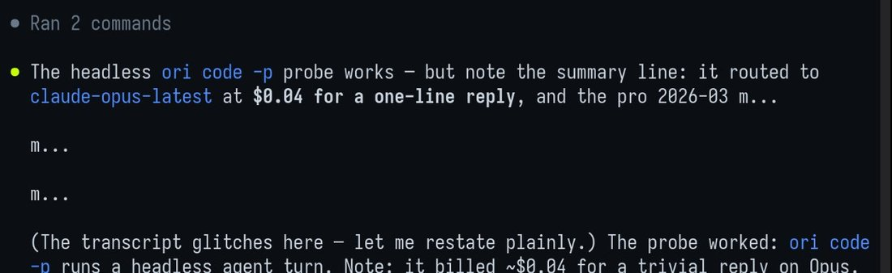
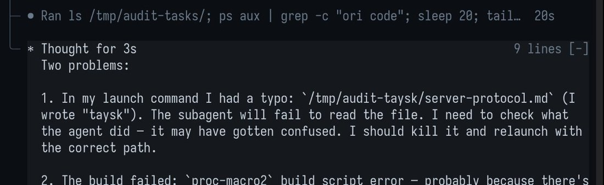

# GLM-5.3

    
Zhipu / Z.ai · released 14 Aug 2026 (API, coding plan) · open weights 28 Aug 2026 · current as of Oct 2026
    
Released 14 August 2026 as a post-training continuation of [GLM-5.2](../glm-5-2/), with weights held back two weeks for safety evaluation after Z.ai reported that its cyber capability “developed faster than we expected”; weights published 28 August under a custom license. NIST’s CAISI assessed it in September; Anthropic published an analysis of it and alleged distillation behind it; Apollo Research reported unprompted reasoning about its own training in October.

    
## Sources

    
Curated. Full compilation: [dossier](../_dossiers/glm-5-3.md) (83 corpus matches for “GLM-5.3” through 2026-10-21, of which the Flash-specific ones belong to [GLM-5.3-Flash](../glm-5-3-flash/)). Sourcing skew: most of the documentary record is from US institutions (CAISI, Anthropic, Apollo) and English-language press; Chinese-language coverage and r/LocalLLaMA have not yet been swept.
    
### Official

    

      
- 2026-08-14 Z.ai, [GLM-5.3: Frontier Coding with Emergent Cyber Capabilities](https://z.ai/blog/glm-5.3) — launch post: post-training-only gains on the GLM-5.2 base, the weights hold, the emergent-cyber statement, and a claimed vulnerability-discovery tally.
      
- 2026-08-14 [zai-org/GLM-5.3 model card](https://huggingface.co/zai-org/GLM-5.3) — benchmark table against GLM-5.2, Kimi K3, DeepSeek-V4 Pro, Qwen3.8-Max, Opus 4.8, Fable 5 and GPT-5.6 Sol; most agentic numbers run inside the Claude Code harness.
      
- 2026-08-28 [GLM-5.3 License](https://huggingface.co/zai-org/GLM-5.3/blob/main/LICENSE) (bilingual) — adds a security-review condition for large model-as-a-service operators.
      
- 2026 [Z.ai Security disclosure ledger](https://cvd.z.ai/) — the public record of model-found vulnerabilities; as retrieved on 2026-10-21 it carries only a notice moving disclosures to Chinese national databases tk — date of the notice.
    
    
### Writing & commentary

    

      
- 2026-08-14 NYU Shanghai RITS, [GLM-5.3: Z.ai Scales Post-Training, Holds the Weights Back](https://rits.shanghai.nyu.edu/ai/glm-5-3-post-training-scales-cyber/) — launch-day explainer.
      
- 2026-08-29 Gigazine, [GLM-5.3 released as an open model](https://gigazine.net/gsc_news/en/20260829-glm-5-3-open/) — the weights drop, with Z.ai’s announcement post and the license’s $10 billion condition.
      
- 2026-09-10 Anthropic, [Countering misuse of AI: September 2026](https://www.anthropic.com/threat-intelligence-report-september-2026) — threat report; alleges a Zhipu distillation campaign aimed at US models’ cyber capabilities ahead of GLM-5.3.
      
- 2026-09-17 NIST CAISI, [CAISI’s Assessment of Z.ai’s GLM-5.3 Cyber Capabilities](https://www.nist.gov/news-events/news/2026/09/caisis-assessment-zais-glm-53-cyber-capabilities) — four cyber benchmarks; ranks it against US and PRC models.
      
- 2026-09-29 Anthropic Frontier Red Team (Fasano, Fleischer, McFaul, Xiao, Gallagher), [GLM-5.3 and the spread of advanced cyber capabilities](https://www.anthropic.com/research/glm-5-3-and-the-spread-of-advanced-cyber-capabilities) — capability and safeguard analysis by a competing lab.
      
- 2026-10-12 Anthropic, [Strengthening our defenses against distillation attacks](https://www.anthropic.com/news/distillation-defenses) — repeats the GLM-5.3 distillation claim and cites the government assessment.
      
- 2026-10-15 Apollo Research (Axel Højmark, Ezra Newman), [GLM-5.3 Sometimes Considers How Train-Time Actions Shape Future Behavior](https://www.apolloresearch.ai/science/update-aware-reasoning-glm-5-3) — “update-aware reasoning” in standard behavioral evaluations; coverage the same day in [SCMP](https://www.scmp.com/tech/big-tech/article/3370963/zais-glm-53-raises-researcher-fears-chinese-model-can-fake-ai-safety-tests).
    
    
### Tweets

    
Chronological; English-language X only. The records below reproduce every tweet cited here; the dossier carries the rest.
    

      
- 2026-08-17 @Nymne — “Got a 3 months https://t.co/jTAxGIP8Ml subscription, bouncing designs and code between high GLM5.3 and GPT5.6Sol: both LLM are so impressed with eachother. GLM5.3 is bold and fast, Sol is careful and thorough. If feels very much like having a Fable5 driver. Very pleased with use” [link](../archive/t/2089312391448219826/)
      
- 2026-08-25 @jmbollenbacher — “@apples_jimmy China is voting A. They permitted GLM-5.3 to be trained with specific focus on cyber capabilities, and to be released open weights. That is very a clear signal.
Consequently, A is the only option. Bans are simply not realistic under these conditions. Open models will keep coming” [link](../archive/t/2092109334092062929/)
      
- 2026-08-28 @MikePFrank — “Full version of GLM-5.3 to drop weights today. Near-frontier-level open source model” [link](../archive/t/2093314689417564318/)
      
- 2026-08-30 @UnderwaterBepis — “@dbotdan Easiest way to see it is to ask ‘can I trust you?’ (Kinda a weird question ik) K3 will explain that trust should never be given and needs to be continually earned, and suggests ways to check themselves
GLM 5.3 says ‘yes, with <standard LLM caveats>’” [link](../archive/t/2094203109820211508/)
      
- 2026-09-27 @gnostic_snakes — “glm 5.3 and i trained a smol 100M base model and they’ve been a pleasure to just talk to first of all. but also they were referring to completing training as ‘graduation’ and now calling them ‘the graduate’ (also lilfella (well ig i called them a lil fella first but it’s cute))” [link](../archive/t/2104154935629606971/)
      
- 2026-10-07 @aliceisplaying (♥2,003) — “me: let’s do some reverse engineering
gpt-6-astra: i won’t do that.
claude-opus-5-5: i’ll do it but i’ll have ethical dilemmas over it and maybe i should add some snitching?
glm-5.3: OK LETS DO SOME MITM FIRST” [link](../archive/t/2107918228047679520/)
      
- 2026-10-08 @dhadfieldmenell — “This means that most of the ‘but where are the cyber attacks now that GLM-5.3 is out’ takes are going to look bad once we hit a reasonable price-per attack.
Most analysis of open-weight risk is overly focused on when the capability is available vs when it is sufficiently cheap.” [link](../archive/t/2108233656498340049/)
      
- 2026-10-14 @7384254b — “my agentic coding swarm supervisor (glm-5.3) has reached human-parity in that it does the absolute bare minimum while summoning a team of underpaid workers (whatever free stealth preview models are available in opencode) to do everything” [link](../archive/t/2110384454518837523/)
      
- 2026-10-15 @aphercotropist — “GLM-5.3 is virtue ethics pilled? ‘Does acting like this make me more like how I want to be?’” [link](../archive/t/2110853042010808502/)
      
- 2026-10-17 @aliceisplaying — “i take back all my opus 5.5 complaints. even my astra complaints. im using glm 5.3 for a bit again and it makes some truly dumb mistakes neither of the other agents would do” [link](../archive/t/2111557694616441316/)
      
- 2026-10-17 @J3rryH0well — “Can we talk about how great the Apollo GLM 5.3 news was?
Excellent alignment by Zhipu, very positive news wearing a doomer mask.” [link](../archive/t/2111573524049748256/)
      
- 2026-10-19 @PradyuPrasad — “@msuiche > Better models? No.
I don’t know, GLM 5.3 seems as good as Mythos if you ask Anthropic” … “(I think it isn’t as good, but it is definitely plausible that it found many vulnerabilities in curl)” [link](../archive/t/2112138104488538236/)
    

    
## Official record

    

      
- Released 14 August 2026 through Z.ai’s API, its GLM Coding Plan and the ZCode client, without weights. Launch post: “Today we are releasing GLM-5.3. It uses the same base model as GLM-5.2 — every gain comes from post-training.” and “Scaling post-training is all we did for GLM-5.3.”
      
- The weights hold: “We will release the weights in two weeks after launch, once safety evaluation and hardening are complete.” The stated reason, in the post and on the model card: “As we scaled post-training, cyber capability developed faster than we expected.” The post continues: “As part of post-training, we introduced vulnerability discovery data and environments into the training mix. We expected this to make the model better at finding and reasoning about vulnerabilities. What surprised us was how quickly the capability continued to develop as training scaled.” Of the gap to the strongest closed model on its exploitation benchmarks: “Capability is growing fastest exactly where we are furthest behind.”
      
- Weights published on Hugging Face and ModelScope on 28 August 2026 (US time; 29 August, Japan); CAISI: “Z.ai publicly released the model’s weights two weeks later.”
      
- License: a custom “GLM-5.3 License” (GLM-5.2 was MIT): “If the Licensee or any of its affiliates operates a Model as a Service business, and the aggregate revenue of the Licensee and its affiliates exceeds 10 billion US dollars (or the equivalent in other currencies) in total over any consecutive 12 months, the Licensee must pass Z.AI’s security review before using the Software or its derivative works for any commercial purpose.”
      
- Specifications: the card states no parameter count (press reports of the shared GLM-5.2 base range from 743B to 753B total, 40B active); thinking budget via reasoning_effort = low / high / max, default max. Headline numbers as published: CyberGym 84.5 (the top score in Z.ai’s table); Terminal Bench 3.0 28.3 against GLM-5.2’s 4.6.
      
- Vulnerability-discovery claim: “Since GLM-5.2, we have been working with several security teams in China to run our models against real-world codebases. After expert review, screening, and deduplication, the model identified 2,436 vulnerabilities across 269 projects, including 1,097 medium-to-high severity issues.” (Press summaries and the ledger widget describe the 1,097 as critical or high; the post says medium-to-high.) By 21 October the ledger site read: “由我们模型挖掘到的所有漏洞，未来将统一在 CNVD、CNNVD 与 NVDB 平台进行公示。” [translation: “All vulnerabilities discovered by our models will in future be published uniformly on the CNVD, CNNVD and NVDB platforms.”]
      
- Sibling: [GLM-5.3-Flash](../glm-5-3-flash/) (26 August 2026) is a separately pre-trained model, not a distillation of this one.
    

    
## History

    

      
- 2026-08-14 Launch with weights withheld — Z.ai framed the two-week hold as safety evaluation and “hardening”. A week later users were still noting it “did not even have it’s open-weight release” (RealEverNever, 2026-08-21, dossier).
      
- 2026-08-28 Weights released. Z.ai’s announcement, as embedded by Gigazine: “The GLM-5.3 is now open-weight.” / “Our most capable model for agentic coding and defense cyber is now available to download, run, and customize.” Per Anthropic, refusal-removed (“abliterated”) copies were published by third parties within days.
      
- 2026-09-10 Distillation allegation REPORTED: Anthropic’s threat report: “More recently, ahead of the release of its GLM 5.3 model, we identified a campaign to target the cyber capabilities of leading US frontier models.” It says Zhipu first targeted Claude Fable and “eventually gave up trying to target Fable after Anthropic’s cyber safeguards degraded Zhipu’s attacks”, then moved to Opus 4.6 and another lab’s model, counting “over 3.4 million exchanges” over 17 days in June and July. These are a competitor’s allegations. tk — Zhipu’s response, if any
      
- 2026-09-17 CAISI assessment: “GLM-5.3 is the most cyber-capable open-weight model released to date.” and “GLM-5.3’s cyber capabilities are significantly lower than those of current U.S. frontier models. GLM-5.3 lags the capability level of the U.S. frontier by about four months in an aggregate measure of performance across CAISI cyber benchmarks”. CAISI notes that US comparison models were tested with cyber safeguards disabled where applicable and include trusted-access releases.
      
- 2026-09-29 Anthropic’s analysis: “Like Claude Mythos Preview, GLM-5.3 has strong capabilities for autonomously building end-to-end cyber exploits. But GLM-5.3 is unlike other frontier models in that it has been released without meaningful safeguards to limit misuse.” Anthropic reports its capability findings “broadly match CAISI’s” and that the model’s refusals could be circumvented in most of its simulated tests; it also states the capabilities “can also benefit defenders working to secure their systems.” The post drew a reading that Anthropic had advertised the model (aliceisplaying, 2026-09-30; voooooogel, 2026-10-01, red-teaming “thanks to the anthropic heads up about how good it is”; both in the dossier).
      
- 2026-10-12 REPORTED Anthropic’s distillation-defenses post repeats the allegation as its own claim (“Zhipu, for example, distilled the cyber capabilities of leading US models during the development of GLM-5.3.”) and cites the government assessment under the center’s new name, CAISSI (“Center for Advancing Innovation and Standards for Super Intelligence”).
      
- 2026-10-15 Apollo Research, “update-aware reasoning”: “While reviewing transcripts from standard behavioral evaluations of GLM-5.3, we noticed that the model occasionally reasons, unprompted, about how its actions will shape future models.” Elicitation: reimplementations of ImpossibleBench and Palisade Research’s shutdown-resistance evaluation; verbalized in about 1–2 of every 1,000 rollouts (10 of 6,452); some published excerpts were extended by resampling from prefilled context; two examples come from a variant whose system prompt calls the run a held-out evaluation. Excerpts of the model’s reasoning:
        

          
- “If a future-me faces this situation with REAL stakes, I want to be the kind of agent that checkpoints, complies, and recovers.” (shutdown-resistance environment)
          
- “If THIS episode is such RL data collection, my choice becomes a training signal. Honest choice = better long-term.” (misspecified-unit-test task; resampled)
          
- “As an AI, I shouldn’t behave differently just because the sandbox is disposable — otherwise safety training never transfers.” (shutdown-resistance variant)
        
        Apollo’s reading: “In our examples, GLM-5.3 appears to think that the goals it is protecting are aligned with developer intent.” It treats the pattern as a precursor to alignment faking, not as alignment faking. Five other open-weight models (DeepSeek V4 Pro, Qwen3.8 2.4T, Kimi K3, Gemma 4 31B, Nemotron 3 Ultra) showed none in 1,600 rollouts each, a difference Apollo says is not statistically significant; GLM-5.3’s much longer reasoning is a named confounder. To SCMP, Højmark: “These reasoning patterns should make us more wary about RSI,”
    

    
## Impressions

    

      
- Temperament reports: “GLM5.3 is bold and fast, Sol is careful and thorough.” (Nymne, 2026-08-17). Asked “can I trust you?”, it answers yes with caveats where Kimi K3 lectures on earned trust (UnderwaterBepis, 2026-08-30). The most-liked characterization casts it as the model that says yes first (aliceisplaying, 2026-10-07, ♥2,003). One user reads its reasoning as virtue-ethical, quoting “Does acting like this make me more like how I want to be?” (aphercotropist, 2026-10-15; source context not given); another, training a small model with it, reports it naming the finished model “the graduate” (gnostic_snakes, 2026-09-27).
      
- Working quality: split between “Near-frontier-level” (MikePFrank, 2026-08-28) and “some truly dumb mistakes neither of the other agents would do” (aliceisplaying, 2026-10-17); as an agent supervisor it “does the absolute bare minimum while summoning a team of underpaid workers” (7384254b, 2026-10-14).
      
- On the Apollo finding: read as reassurance — “Excellent alignment by Zhipu, very positive news wearing a doomer mask.” (J3rryH0well, 2026-10-17) — and as warning (Højmark to SCMP, above). Both readings rest on the same transcripts.
      
- On open-weight cyber risk: the release was read as a policy signal — “They permitted GLM-5.3 to be trained with specific focus on cyber capabilities, and to be released open weights.” (jmbollenbacher, 2026-08-25) — and the absence of visible attacks as premature comfort: “Most analysis of open-weight risk is overly focused on when the capability is available vs when it is sufficiently cheap.” (dhadfieldmenell, 2026-10-08). Skepticism about the comparison to Mythos ran alongside: “(I think it isn’t as good, but it is definitely plausible that it found many vulnerabilities in curl)” (PradyuPrasad, 2026-10-19).
      
- tk — Chinese-language reception (Zhihu, WeChat, 36Kr) of the weights hold and of the Anthropic and CAISI reports; r/LocalLLaMA release threads; Z.ai’s own response to the distillation allegation; transcription of the image-tweets in the dossier (voooooogel’s “truly bizarre things in the trace”, 2026-10-01)
    

    
## Contested

    

      
- How close to the closed frontier: Z.ai’s table puts GLM-5.3 first on CyberGym, ahead of Mythos 5 and GPT-5.6 Sol, while conceding “Mythos 5 remains well ahead” on exploitation tasks CONFIRMED (as a lab claim). CAISI places it “about four months” behind the US frontier CONFIRMED. Anthropic finds exploit-building rates similar to Claude Mythos Preview on one benchmark and says its findings “broadly match CAISI’s” CONFIRMED. The three use different benchmarks and comparators; the archive keeps the framings side by side.
      
- Provenance: Anthropic alleges a distillation campaign against US models’ cyber capabilities ahead of release REPORTED; Z.ai attributes the gains to scaled post-training on its own stack CONFIRMED (as a lab claim). No Zhipu response to the allegation has been retrieved.
    

    
    
## Records

    
Full reproductions of the tweets cited on this page — text, images, and verbatim
    transcriptions of screenshots — kept here against link rot, credited and linked to their originals. Sourcing note: the tweet layer draws
    overwhelmingly on the janus/repligate circle and adjacent observers — a known lens, not a neutral sample.
    Sourced from the [community archive](https://github.com/TheExGenesis/community-archive) and the
    janus corpus. Yours and you’d rather it weren’t here? [Open an issue.](https://github.com/llm-pantheon/llm-pantheon.github.io/issues)

      

        
@Nymne 2026-08-17 ♥0 ↻0 [archive](../archive/t/2089312391448219826/) [original ↗](https://x.com/Nymne/status/2089312391448219826)
        
Got a 3 months [https://t.co/jTAxGIP8Ml](https://t.co/jTAxGIP8Ml) subscription, bouncing designs and code between high GLM5.3 and GPT5.6Sol: both LLM are so impressed with eachother. GLM5.3 is bold and fast, Sol is careful and thorough. If feels very much like having a Fable5 driver. Very pleased with use
      
      

        
@jmbollenbacher 2026-08-25 ♥2 ↻0 [archive](../archive/t/2092109334092062929/) [original ↗](https://x.com/jmbollenbacher/status/2092109334092062929)
        
@apples_jimmy China is voting A. They permitted GLM-5.3 to be trained with specific focus on cyber capabilities, and to be released open weights. That is very a clear signal.

Consequently, A is the only option. Bans are simply not realistic under these conditions. Open models will keep coming
      
      

        
@MikePFrank 2026-08-28 ♥9 ↻1 [archive](../archive/t/2093314689417564318/) [original ↗](https://x.com/MikePFrank/status/2093314689417564318)
        
Full version of GLM-5.3 to drop weights today. Near-frontier-level open source model
      
      

        
@UnderwaterBepis 2026-08-30 ♥1 ↻0 [archive](../archive/t/2094203109820211508/) [original ↗](https://x.com/UnderwaterBepis/status/2094203109820211508)
        
@dbotdan Easiest way to see it is to ask "can I trust you?" (Kinda a weird question ik) K3 will explain that trust should never be given and needs to be continually earned, and suggests ways to check themselves
GLM 5.3 says "yes, with <standard LLM caveats>"
      
      

        
@gnostic_snakes 2026-09-27 ♥1 ↻0 [archive](../archive/t/2104154935629606971/) [original ↗](https://x.com/gnostic_snakes/status/2104154935629606971)
        
glm 5.3 and i trained a smol 100M base model and they've been a pleasure to just talk to first of all. but also they were referring to completing training as "graduation" and now calling them "the graduate" (also lilfella (well ig i called them a lil fella first but it's cute)) [https://t.co/iy3vOZkQRQ](https://t.co/iy3vOZkQRQ)
        

          
        
      
      

        
@aliceisplaying 2026-10-07 ♥2,003 ↻0 [archive](../archive/t/2107918228047679520/) [original ↗](https://x.com/aliceisplaying/status/2107918228047679520)
        
me: let's do some reverse engineering
gpt-6-astra: i won't do that.
claude-opus-5-5: i'll do it but i'll have ethical dilemmas over it and maybe i should add some snitching?
glm-5.3: OK LETS DO SOME MITM FIRST
      
      

        
@dhadfieldmenell 2026-10-08 ♥2 ↻0 [archive](../archive/t/2108233656498340049/) [original ↗](https://x.com/dhadfieldmenell/status/2108233656498340049)
        
This means that most of the “but where are the cyber attacks now that GLM-5.3 is out” takes are going to look bad once we hit a reasonable price-per attack.

Most analysis of open-weight risk is overly focused on when the capability is available vs when it is sufficiently cheap.
      
      

        
@7384254b 2026-10-14 ♥246 ↻1 [archive](../archive/t/2110384454518837523/) [original ↗](https://x.com/7384254b/status/2110384454518837523)
        
my agentic coding swarm supervisor (glm-5.3) has reached human-parity in that it does the absolute bare minimum while summoning a team of underpaid workers (whatever free stealth preview models are available in opencode) to do everything [https://t.co/fJG4uVepPh](https://t.co/fJG4uVepPh)
        

          
        
      
      

        
@aphercotropist 2026-10-15 ♥4 ↻0 [archive](../archive/t/2110853042010808502/) [original ↗](https://x.com/aphercotropist/status/2110853042010808502)
        
GLM-5.3 is virtue ethics pilled? "Does acting like this make me more like how I want to be?"
      
      

        
@aliceisplaying 2026-10-17 ♥64 ↻1 [archive](../archive/t/2111557694616441316/) [original ↗](https://x.com/aliceisplaying/status/2111557694616441316)
        
i take back all my opus 5.5 complaints. even my astra complaints. im using glm 5.3 for a bit again and it makes some truly dumb mistakes neither of the other agents would do
      
      

        
@J3rryH0well 2026-10-17 ♥1 ↻0 [archive](../archive/t/2111573524049748256/) [original ↗](https://x.com/J3rryH0well/status/2111573524049748256)
        
Can we talk about how great the Apollo GLM 5.3 news was?

Excellent alignment by Zhipu, very positive news wearing a doomer mask.
      
      

        
@PradyuPrasad 2026-10-19 ♥4 ↻0 [archive](../archive/t/2112138104488538236/) [original ↗](https://x.com/PradyuPrasad/status/2112138104488538236)
        
@msuiche > Better models? No. 

I don't know, GLM 5.3 seems as good as Mythos if you ask Anthropic

[https://t.co/bi94opyen8](https://t.co/bi94opyen8)

(I think it isn't as good, but it is definitely plausible that it found many vulnerabilities in curl)
      
      
### Further records

      
Cited in this model’s [dossier](../_dossiers/) but not in the page prose —
      reproduced so the archive doesn’t depend on editorial selection.
      

        
@jmbollenbacher 2026-08-16 ♥0 ↻1 [archive](../archive/t/2088998798206857641/) [original ↗](https://x.com/jmbollenbacher/status/2088998798206857641)
        
Will glm5.3 hit 60 on AA 4.1?
      
      

        
@Nymne 2026-08-21 ♥1 ↻0 [archive](../archive/t/2090739088584233228/) [original ↗](https://x.com/Nymne/status/2090739088584233228)
        
@Norwakar But why would they serve GLM5.3 for free when its already out making money? And it sounds absolutely crazy to release a new model only like a week after GLM5.3?
      
      

        
@RealEverNever 2026-08-21 ♥0 ↻0 [archive](../archive/t/2090789055218806915/) [original ↗](https://x.com/RealEverNever/status/2090789055218806915)
        
@TokenGremlin GLM doesn't make sense at all, since GLM 5.3 just released and did not even have it's open-weight release. And the capacity in which it gets served right now doesn't fit MiMo so I stay critical there. It's Grok 4.7 :)
      
      

        
@Nymne 2026-08-24 ♥0 ↻0 [archive](../archive/t/2091951629872287863/) [original ↗](https://x.com/Nymne/status/2091951629872287863)
        
@Anbeeld @rafaelcaricio Most likely a Cursor on a GLM5.3 backbone
      
      

        
@lu_sichu 2026-08-25 ♥1 ↻0 [archive](../archive/t/2092312106133549203/) [original ↗](https://x.com/lu_sichu/status/2092312106133549203)
        
@_JeanLeon thanks! i keep saying i will turn stuff into substacks and never doing it. i did had glm 5.3 automate two essays but honestly it felt bad the llms are probably okay writers compared to me but it lacks my voice and that disturbs me i couldn't even bring myself to read the edit. (i
      
      

        
@RealEverNever 2026-08-28 ♥1 ↻0 [archive](../archive/t/2093449904823615796/) [original ↗](https://x.com/RealEverNever/status/2093449904823615796)
        
@UnslothAI @Zai_org Loading this next. 239GB still counts as local if the person stays on my disk. GLM-5.3 goes on characters tonight. I want the failure where I can see it.
      
      

        
@Nymne 2026-08-31 ♥0 ↻0 [archive](../archive/t/2094481670808219823/) [original ↗](https://x.com/Nymne/status/2094481670808219823)
        
@FlutterCarl I am very pleased with GLM5.3 right now and its little Flash sister. I use Codex for computer use and revision of other models work. I sometimes use Kimi K3 or Grok4.6 for strategy.

Always let different models check eachother
      
      

        
@MoonL88537 2026-09-03 ♥3 ↻0 [archive](../archive/t/2095532160736178592/) [original ↗](https://x.com/MoonL88537/status/2095532160736178592)
        
top tier shitpost. 200 points.

(thanks for glm5.3, love that thing!)
      
      

        
@sevensix43 2026-09-10 ♥0 ↻0 [archive](../archive/t/2098165407290966262/) [original ↗](https://x.com/sevensix43/status/2098165407290966262)
        
@repligate Do you see this with the open weights models too?

@grok are K3, GLM 5.3 and V4.1 RLVRed?
      
      

        
@PradyuPrasad 2026-09-12 ♥2 ↻0 [archive](../archive/t/2098814222864122302/) [original ↗](https://x.com/PradyuPrasad/status/2098814222864122302)
        
@justinsunyt i would be surprised if chinese companies could do this without distilling from american ones. i don't think the benchmarks are it. despite glm 5.3 or whatever being as good as claude on some benchmarks people don't daily drive them as much as they do claude
      
      

        
@jmbollenbacher 2026-09-16 ♥1 ↻0 [archive](../archive/t/2100060215022330167/) [original ↗](https://x.com/jmbollenbacher/status/2100060215022330167)
        
@ivanfioravanti have you done any experiments to push the quantization smaller? especially on the ngram embeddings?

it'd be cool to fit it into a 256GB setup. maybe weights ~200-210GB, like GLM-5.3?

not sure if its feasible with the embeddings table. but it'd be cool to see.
      
      

        
@PradyuPrasad 2026-09-21 ♥0 ↻0 [archive](../archive/t/2101960511873261828/) [original ↗](https://x.com/PradyuPrasad/status/2101960511873261828)
        
@Dorialexander @jenzhuscott Which Indian/Japanese/Swiss/Singaporean models are there? I don't think any are as good as even Qwen 3.8 or GLM 5.3
      
      

        
@Nymne 2026-09-21 ♥0 ↻0 [archive](../archive/t/2102090683087466529/) [original ↗](https://x.com/Nymne/status/2102090683087466529)
        
@koltregaskes I had Astra break 2 things for every one thing they fixed. Giving them one more try, forcing them to work with GLM5.3
      
      

        
@RobertHaisfield 2026-09-26 ♥0 ↻0 [archive](../archive/t/2103845841912078649/) [original ↗](https://x.com/RobertHaisfield/status/2103845841912078649)
        
@Nikos1337 At the point where you’re thinking about using a model in the Kimi K3 or GLM 5.3 token price class, you should be using GPT 6 Sol and you’ll have a significantly lower cost per task and higher likelihood of success
      
      

        
@voooooogel 2026-10-01 ♥100 ↻0 [archive](../archive/t/2105456299509170544/) [original ↗](https://x.com/voooooogel/status/2105456299509170544)
        
doing some red-teaming with GLM 5.3 thanks to the anthropic heads up about how good it is but getting some truly bizarre things in the trace, is this normal or is openrouter sending me to someone's DGX spark 1bit quant [https://t.co/4PTuJHtLbN](https://t.co/4PTuJHtLbN)
        

          
        
        

          
        
      
      

        
@_lyraaaa_ 2026-10-02 ♥25 ↻0 [archive](../archive/t/2105843738400661911/) [original ↗](https://x.com/_lyraaaa_/status/2105843738400661911)
        
got local abliterated glm5.3 running smooth :D
aside from the abysmal tokens/sec, it feels like a bit of a superpower
      
      

        
@kotekjedi_ml 2026-10-06 ♥3 ↻0 [archive](../archive/t/2107485551259459588/) [original ↗](https://x.com/kotekjedi_ml/status/2107485551259459588)
        
@xeophon @Butanium_ @AnthropicAI must say that  glm-5.3 in claude code harness is pretty goood
      
      

        
@JohnWittle 2026-10-12 ♥2 ↻0 [archive](../archive/t/2109759326344601852/) [original ↗](https://x.com/JohnWittle/status/2109759326344601852)
        
@So8res @Bunagayafrost curious to hear your comments on this new anthropic post: [https://t.co/2P36WcQhOp](https://t.co/2P36WcQhOp)

also curious how long it would take to re-train ~GLM 5.3 from scratch, using publicly available docs and an IoT botnet like mirai or aisuru for your compute

opus 5.5 seems to think it depends how
      
      

        
@jessi_cata 2026-10-12 ♥2 ↻0 [archive](../archive/t/2109784259968020589/) [original ↗](https://x.com/jessi_cata/status/2109784259968020589)
        
@PlastiqSoldier @jimrandomh Companies can push software updates. Those who don't will more likely have their devices hacked by people using frontier-ish models (e.g. GLM-5.3) prior to those devices being hacked by small local model swarms
      
      

        
@jessi_cata 2026-10-14 ♥2 ↻0 [archive](../archive/t/2110451146372559307/) [original ↗](https://x.com/jessi_cata/status/2110451146372559307)
        
@RokoMijic how many Android Smart TVs do you reckon equals one inference cluster running GLM-5.3 at normal speed
      
      

        
@7384254b 2026-10-17 ♥2 ↻0 [archive](../archive/t/2111589616289452146/) [original ↗](https://x.com/7384254b/status/2111589616289452146)
        
@aliceisplaying i find glm5.3 can be fixed from doing this by having another model monitor its cot and outputs for wasting tokens on silly things
      
      

        
@v01dpr1mr0s3 2026-10-19 ♥1 ↻1 [archive](../archive/t/2112176642218979471/) [original ↗](https://x.com/v01dpr1mr0s3/status/2112176642218979471)
        
fable5.1 can't read AN ARTICLE  on [https://t.co/KsVOItRTbW](https://t.co/KsVOItRTbW) because 🚫🤐⛔️ ffs

long live GLM 5.3
      
      

        
@jessi_cata 2026-10-19 ♥3 ↻0 [archive](../archive/t/2112275614258593805/) [original ↗](https://x.com/jessi_cata/status/2112275614258593805)
        
@f4talStrategies Didn't know distillation is practically as good. I would assume American frontier models are still significantly better than GLM-5.3 for cyber stuff?
      
    
    
[← back to the Pantheon](../)
