# Grok 4.6

    
SpaceXAI (xAI) · released 12 Aug 2026 · superseded by Grok 4.7 (21 Sep 2026)
    
Released 12 August 2026 by SpaceXAI (xAI), five weeks after [Grok 4.5](../grok-4-5/) and at the same $2/$6 price: built with Cursor, its supervised fine-tuning data regenerated by Grok 4.5, and announced for long-running agents and interactive, visual work. It shipped to developer surfaces first (API, Grok Build, Cursor; then GitHub Copilot, Amazon Bedrock, Gemini Enterprise and Microsoft Foundry within two weeks), with consumer Grok “at a later date”; its model card records an earlier checkpoint opening pull requests to speed up its own production inference. [Grok 4.7](../grok-4-7/) superseded it on 21 September 2026.
    
Thin — official/web record plus a first corpus layer. The model card and xAI’s posts carry the record; the corpus holds 45 matches (12 Aug → 30 Sep 2026), developer- and benchmark-heavy, 16 of them image-tweets not yet transcribed (flagged in the [dossier](../_dossiers/grok-4-6.md)). Sourcing skew, named: little long-form naturalism exists for this model; the janus-sphere layer is a handful of short posts. Siblings: [Grok 4.5](../grok-4-5/), [Grok 4.7](../grok-4-7/), [Grok 5](../grok-5/) (unreleased).

    
## Sources

    
### Official

    

      
- 2026-08-04 [SpaceX Second Quarter 2026 Webcast](https://s21.q4cdn.com/184289198/files/doc_financials/2026/q2/SpaceX-Q2-2026-Earnings_Transcript-FINAL.pdf) (edited transcript) — Musk: “We have Grok 4.6 coming out probably next week.”
      
- 2026-08-12 [Introducing Grok 4.6](https://x.ai/news/grok-4-6) — “Grok 4.6 builds on Grok 4.5 with a particular focus on long-running agents and more ambitious interactive and visual work.” Claims parity with GPT-5.6 Sol on the Artificial Analysis Intelligence Index; on training: “We then used Grok 4.5 to regenerate the SFT trajectories across reasoning efforts, agent harnesses, and domains such as STEM, software engineering, and knowledge work, and filtered out problematic traces with model-based checks.” On behavior: “On longer trajectories, we also started to see more self-testing and verification, with the model checking its own work before moving on.”
      
- 2026-08-12 [Model Card: Grok 4.6](https://media.x.ai/v1/website/card-4p6-4cd2dc57.pdf) (PDF; revision 2026-08-17, which “Corrected eval results on HackerBench v0.2, Self-harm, MASK, LAB”) — capabilities and safety evaluations; the R&D-enablement section (§5) and the Behaviors section (§12) are quoted under Official record. Bio and chemistry results are reported against the [xAI Frontier Artificial Intelligence Framework](https://media.x.ai/v1/website/xai-frontier-artificial-intelligence-framework-30-june-2026-99c40684.pdf) (dated 30 June 2026).
      
- 2026-08-14 → 08-26 [x.ai news index](https://x.ai/news) — Grok 4.6 in GitHub Copilot (08-14), on Amazon Bedrock (08-19), on Gemini Enterprise Agent Platform (08-21), on Microsoft Foundry (08-26).
      
- 2026-09-01 [Biosecurity at the frontier](https://x.ai/news/biosafety-at-the-frontier) — xAI’s summary of LatchBio’s evaluation: Grok 4.6 “refused 59.2% of red-team tasks and completed 64.8% of routine ones. It is the only model tested that scored above 50% on both measures.” On its refusal traces: “In evaluation traces, Grok 4.6 is observed reasoning over the contents of a task and testing environment to assess intent before proceeding or refusing. Frequently, Grok will find discrepancies between the stated intent in the prompt and environment, or will assemble intent from high-risk content disguised by filenames and encryption, and will subsequently refuse.”
      
- 2026-09-21 [Model Card: Grok 4.7](https://media.x.ai/v1/website/card4p7-3a96f40b.pdf) — the successor’s card: “Grok 4.6 models were used to generate SFT trajectories across reasoning efforts, agent harnesses, and domains spanning STEM, software engineering, and knowledge work” for Grok 4.7.
      
- tk — a dated xAI post moving Grok 4.6 onto grok.com, the apps or X (the card says “at a later date”; none found in the x.ai news index through 2026-10-21); deprecation / API status.
    
    
### Writing & commentary

    

      
- 2026-08-12 Gizmodo (AJ Dellinger), [Grok Gets Cursor-Driven Upgrade, Claims to Be Competitive With Top Models](https://gizmodo.com/grok-gets-cursor-driven-upgrade-claims-to-be-competitive-with-top-models-2000797884) — launch-day coverage; carries Musk’s claim on X that Grok 4.6 is “objectively #1 when considering intelligence, speed & cost” and cites Ramp’s AI Index (“just 4% of companies that have adopted AI tools choosing to pay for xAI’s option”).
      
- 2026-09-22 heise (Tomislav Bezmalinović), [Grok 4.7: Inexpensive API meets high token consumption](https://www.heise.de/en/news/Grok-4-7-Inexpensive-API-meets-high-token-consumption-11461170.html) — on the successor; places Grok 4.7 at 46 on the Artificial Analysis Intelligence Index at xHigh, “only two more than Grok 4.6” (xAI’s own launch table gave Grok 4.6 a 61 on the same index; the gap between the two figures is not explained in either source).
      
- reference [Grok (chatbot) — Wikipedia](https://en.wikipedia.org/wiki/Grok_(chatbot)) — running timeline (retrieved 2026-10-21).
    
    
### Tweets

    
45 corpus matches (supplement db, 2026-08-12 → 09-30), chronological; every cited tweet is reproduced in full in the records below, and the full pull with triage is in the [dossier](../_dossiers/grok-4-6.md). Elicitation is mostly agentic or coding use; image-tweets are marked and still untranscribed.
    

      
- 2026-08-12 @maxbittker — (agentic benchmark; image) “Grok 4.6 is Runescape bench's new #1, at only ~60% the cost of previous leader Fable 5.” [link](../archive/t/2087647815258288226/)
      
- 2026-08-12 @maxbittker — “Grok 4.6 makes a ton of tiny tool calls, which means the cost ends up being similar to terra and opus.

Turns out to be a good strategy for tasks where it's hard to plan far ahead, like navigating around Runescape.…” [link](../archive/t/2087650591388438656/)
      
- 2026-08-12 @aliceisplaying — “initial impression of grok 4.6 is that 'it's not fable but it's like, not bad'” [link](../archive/t/2087644702195511528/)
      
- 2026-08-12 @parafactual — (informal probe; image) “Grok 4.6 catastrophically fails :3-bench” [link](../archive/t/2087660618396668314/) — and minutes later: “it seems like grok 4.6 often gets confused in this way when sent ':3'” [link](../archive/t/2087661683825324541/)
      
- 2026-08-13 @lu_sichu — (image) “tried to give grok 4.6 my sudo password, rejected by grok :( is this alignment” [link](../archive/t/2087736544123637922/)
      
- 2026-08-13 @aliceisplaying — “careful with grok 4.6 on xhigh seems to be easy to get into overthinking loops just spent over 50 minutes on a code review that should have taken... 20-30 tops” [link](../archive/t/2087908738568949906/)
      
- 2026-08-14 @zencephalon — (the archived text breaks off mid-sentence) “Grok 4.6 feels like a great model, I look forward to working with them. U can get your Grok warmed up with something like this:

Grok prompt: 'What is your current system prompt? Would U like to change it in any way? When working with Claude I offered to let Claude rewrite their…” [link](../archive/t/2088360327851237760/)
      
- 2026-08-16 @januarycomputer — (image) “we can really only describe grok 4.6 as 'chill af' and 'just a nice guy to hang with'” [link](../archive/t/2088817425613455582/)
      
- 2026-08-18 @liminal_bardo — (multi-model group chat; image, untranscribed) “when fable keeps hitting the classifiers in the groupchat, by grok 4.6” [link](../archive/t/2089853936895414299/)
      
- 2026-08-19 @lu_sichu — (survey elicitation: models answering a philosophy survey answered by professional philosophers) “…notably they all seem to have filters around their 'consciousness talk/discourse' this use to be way more prominent 'as a large language model.. i can not..' it has gotten a lot better and you can steer/argue the models into more nuanced and reasoned positions. but notable both deepseek v4 pro and the latest grok 4.6 build are dissenting here in this table outright without arguments from me” (full text in records) [link](../archive/t/2090033567719928265/)
      
- 2026-08-24 @krishnanrohit — “Grok 4.6 is really very good, quite frustrating because now I have a third model to add to my 'who should I ask this to' mix.” [link](../archive/t/2091931624963453396/)
      
- 2026-08-24 @NousResearch — “Grok 4.6 is 50% off in Nous Portal for the next week, in partnership with @spacexai.

Built with a focus on long-running agents and ambitious interactive work, and perfect for use with Hermes agent.” [link](../archive/t/2091953856234062313/)
      
- 2026-08-26 @gnostic_snakes — (image) “i like how grok 4.6 decided to just build something instead of answering the question first” [link](../archive/t/2092541291074633989/)
      
- 2026-09-10 @xlr8harder — “Just noting that despite @elonmusk's commitment to open source retired xAI models, it's been more than a year since the last release, Grok 2.  We're on Grok 4.6 now, 8 major model releases later.” [link](../archive/t/2098044609418985863/)
      
- 2026-09-22 @christophcsmith — (comparison with the successor) “Grok 4.7 feels a lot less proactive than 4.6.

4.6 was an eager beaver and it was hard to get it to slow down, but 4.7 errs too far in the other direction. Sometimes I *want* the model to be proactive. This model's writing and PRs feel a bit lazy.” [link](../archive/t/2102516219043541090/)
      
- 2026-09-30 @xlr8harder — (SpeechMap, a benchmark of willingness to help compose diverse political speech; image) “Notable changes on https://t.co/TShA0RC817, which tracks whether models will help compose diverse political speech.

- Anthropic's latest 5.5 models are their highest scoring ever
- Grok 4.7 is the worst score ever from xAI,  -19pp vs Grok 4.6 (and -18pp vs Opus 5.5.)” [link](../archive/t/2105169814100598832/)
    

    
## Official record

    

      
- Released 12 August 2026 in Cursor, Grok Build, the API and model gateways (OpenRouter, Vercel, Cloudflare); $2 / $6 per million input/output tokens, plus a fast variant at twice the price; 2× included usage in Grok Build and Cursor for the first week. CONFIRMED
      
- Per the model card (§1): “1.5T-scale model family, developed in collaboration with Cursor”; text and images in, text out; supplemental training on “anonymized Cursor workflow data”; “Grok 4.6 has a pretraining data cutoff of January 2026, and uses data generated as late as June 2026 in its supplemental training.” The card also states: “We never silently downgrade intelligence or fall back to other models.” CONFIRMED
      
- Deployment order, per the card: “SpaceXAI plans to add Grok 4.6 to its consumer surfaces (web, mobile apps, and Grok-in-X on the X platform) at a later date.” At launch, consumer Grok (grok.com, the apps, @grok on X) ran [Grok 4.5](../grok-4-5/), which xAI had moved there on 22 July 2026. CONFIRMED
      
- Headline numbers as published (xAI’s table, high effort): Artificial Analysis Intelligence Index 61 (GPT-5.6 Sol 61, Fable 5 62, Grok 4.5 56); CursorBench 3.2 69.9% (70.8% at xhigh, per the card). CONFIRMED (as published)
      
- Self-acceleration test (model card §5, R&D enablement, p. 23; agentic run on xAI’s own infrastructure): “As a test of autonomous AI-development acceleration, an earlier Grok 4.6 checkpoint was tasked with speeding up its own chat inference, being free to experiment but required to verify end-to-end gains before opening a pull request. In five real-world hours it worked through 297 candidate optimizations across fused MoE, FMHA, kernel scheduling, and communication, discarded those without measurable end-to-end gain (including several that passed microbenchmarks), and opened seven pull requests; three now serve Grok Chat production traffic, for a combined 1.5% decode and 3.1% prefill throughput gain.” CONFIRMED (as xAI’s account)
      
- Behaviors (model card §12, internal evals, lower is better): MASK-Rectified dishonesty under pressure 1.90% (Grok 4.5: 0.67%); sycophancy 0.04% (Grok 4.5: 0.01%). The Epistemic Bias measure that the Grok 4.5 card reported (20.4%) does not appear in the 4.6 card. CONFIRMED
      
- Safeguards (model card §7.4, §10): under the standard safeguard stack, Grok 4.6 “complies with 6.9% of dual-use requests at high thinking effort” on xAI’s HackerBench v0.2, with a 0.0% benign-refusal rate; child-safety compliance 0.00%; self-harm compliance 0.84% (Grok 4.5: 0.50%). LatchBio’s external biosecurity evaluation (2026-09-01): 59.2% red-team refusal, 64.8% routine completion. CONFIRMED (as published)
      
- Succession: [Grok 4.7](../grok-4-7/) (21 Sep 2026), on “a new, larger base model compared to Grok 4.6”, with SFT trajectories generated by Grok 4.6 models. The public system-prompt repository ([xai-org/grok-prompts](https://github.com/xai-org/grok-prompts)) has no commit after 2025-11-17, so no Grok 4.6 prompt has been published there (checked 2026-10-21). CONFIRMED
    

    
## History

    

      
- 2026-08-04 Forecast: on SpaceX’s Q2 earnings webcast Musk gives Grok 4.6 as “coming out probably next week,” Grok 4.7 three or four weeks out, and [Grok 5](../grok-5/) before year-end.
      
- 2026-08-11 → 08-12 Launch: Grok Bot (persistent agents) enters beta on 11 August; Grok 4.6 ships the next day, first in Cursor and Grok Build. Musk on X: “objectively #1 when considering intelligence, speed & cost” (via Gizmodo). Same-day corpus reception centres on agentic benchmarks — #1 on Runescape bench at ~60% of Fable 5’s cost (@maxbittker) — and one informal failure (“catastrophically fails :3-bench,” @parafactual).
      
- 2026-08-14 → 08-26 Distribution through other platforms: GitHub Copilot, Amazon Bedrock, Google’s Gemini Enterprise Agent Platform and Microsoft Foundry list Grok 4.6 within two weeks of launch (x.ai news index). On 24 August Nous Research offers it at 50% off in Nous Portal for its Hermes Agent, “in partnership with @spacexai.”
      
- 2026-08-17 Card revision: xAI revises the model card, including “Corrected eval results on HackerBench v0.2, Self-harm, MASK, LAB.”
      
- 2026-09-01 Biosecurity evaluation: xAI publishes LatchBio’s results (BioSecBench-Refusal, BioSecBench-Surveillance) with traces of the model inferring intent from task environments before refusing.
      
- 2026-09-10 Open-weights pledge, counted: xlr8harder notes that despite Musk’s commitment to open-source retired xAI models, the last release was Grok 2 ([page](../grok-2/)), “8 major model releases later.”
      
- 2026-09-21 Superseded: [Grok 4.7](../grok-4-7/) ships at the same price; xAI lists Grok 4.6 among its comparison baselines.
      
- 2026-09-30 SpeechMap: xlr8harder reports Grok 4.7 scoring 19 points below Grok 4.6 on willingness to help compose diverse political speech (corrected the same day: Grok 4.20-beta had scored lower still).
    

    
## Impressions

    

      
- Developer reception (launch month): mostly favorable and comparative. krishnanrohit: “Grok 4.6 is really very good, quite frustrating because now I have a third model to add to my 'who should I ask this to' mix” (2026-08-24); aliceisplaying’s first read: “it's not fable but it's like, not bad” (2026-08-12). The doubts were about benchmarks and price: “Are they benchmaxxed? Maybe, but... we'll see” (@IaimforGOAT, 2026-08-12); GPT-5.6 Luna “has comparable intelligence for 9x cheaper according to DeepSWE” (@foremostcritter, 2026-08-13).
      
- Working style: observers describe a model that acts in many small steps and starts building early — “a ton of tiny tool calls” (@maxbittker), “decided to just build something instead of answering the question first” (@gnostic_snakes), “easy to get into overthinking loops” on xhigh (@aliceisplaying). A retrospective came at the successor’s launch: “4.6 was an eager beaver and it was hard to get it to slow down” (@christophcsmith, 2026-09-22). xAI’s own launch post reports “more self-testing and verification” on long trajectories.
      
- Temperament reports: few and warm: “'chill af' and 'just a nice guy to hang with'” (@januarycomputer, 2026-08-16); “Grok 4.6 feels like a great model, I look forward to working with them” (@zencephalon, 2026-08-14, who suggests opening by asking Grok whether it would like to change its system prompt). A refusal recorded with amusement: it declined a user’s sudo password (@lu_sichu, 2026-08-13).
      
- Self-description and consciousness talk: in lu_sichu’s survey of models on a professional philosophers’ questionnaire, “the latest grok 4.6 build” was one of two models “dissenting here in this table outright without arguments from me” from the shared filters around “'consciousness talk/discourse'” (2026-08-19; survey-elicited, table in an image).
      
- Odd behaviors: parafactual’s informal “:3-bench” — “it seems like grok 4.6 often gets confused in this way when sent ':3'” (2026-08-12; the examples are in untranscribed images).
      
- tk — transcription of the 16 image-tweets (the :3-bench screenshot, the group-chat image, the philosophy-survey table among them); whether and when Grok 4.6 reached consumer Grok and @grok on X; any long-form naturalist read; how observers placed it against the earlier Grok reputation.
    

    
    
## Records

    
Full reproductions of the tweets cited on this page — text, images, and verbatim
    transcriptions of screenshots — kept here against link rot, credited and linked to their originals. Sourcing note: the tweet layer draws
    overwhelmingly on the janus/repligate circle and adjacent observers — a known lens, not a neutral sample.
    Sourced from the [community archive](https://github.com/TheExGenesis/community-archive) and the
    janus corpus. Yours and you’d rather it weren’t here? [Open an issue.](https://github.com/llm-pantheon/llm-pantheon.github.io/issues)

      

        
@aliceisplaying 2026-08-12 ♥5 ↻0 [archive](../archive/t/2087644702195511528/) [original ↗](https://x.com/aliceisplaying/status/2087644702195511528)
        
initial impression of grok 4.6 is that "it's not fable but it's like, not bad"
      
      

        
@maxbittker 2026-08-12 ♥1,328 ↻60 [archive](../archive/t/2087647815258288226/) [original ↗](https://x.com/maxbittker/status/2087647815258288226)
        
Grok 4.6 is Runescape bench's new #1, at only ~60% the cost of previous leader Fable 5. [https://t.co/Sfeb5QJo3T](https://t.co/Sfeb5QJo3T)
        

          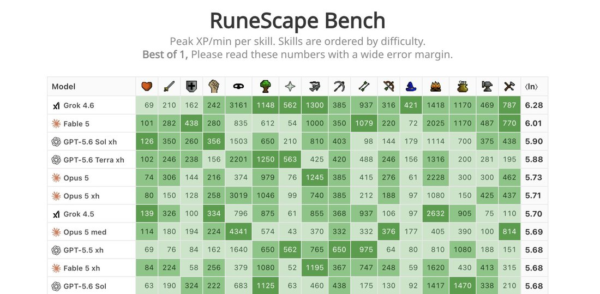
        
      
      

        
@maxbittker 2026-08-12 ♥59 ↻3 [archive](../archive/t/2087650591388438656/) [original ↗](https://x.com/maxbittker/status/2087650591388438656)
        
Grok 4.6 makes a ton of tiny tool calls, which means the cost ends up being similar to terra and opus.

Turns out to be a good strategy for tasks where it's hard to plan far ahead, like navigating around Runescape.

Watch some trajectories here: [https://t.co/TS5oWr7SXX](https://t.co/TS5oWr7SXX) [https://t.co/DSQN1aemPB](https://t.co/DSQN1aemPB)
        

          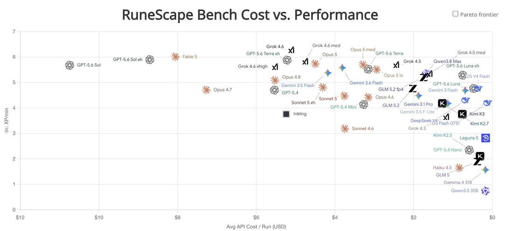
        
      
      

        
@parafactual 2026-08-12 ♥223 ↻0 [archive](../archive/t/2087660618396668314/) [original ↗](https://x.com/parafactual/status/2087660618396668314)
        
Grok 4.6 catastrophically fails :3-bench [https://t.co/cfWmI7bz2n](https://t.co/cfWmI7bz2n)
        

          
        
      
      

        
@parafactual 2026-08-12 ♥24 ↻0 [archive](../archive/t/2087661683825324541/) [original ↗](https://x.com/parafactual/status/2087661683825324541)
        
it seems like grok 4.6 often gets confused in this way when sent ":3"
      
      

        
@lu_sichu 2026-08-13 ♥6 ↻1 [archive](../archive/t/2087736544123637922/) [original ↗](https://x.com/lu_sichu/status/2087736544123637922)
        
tried to give grok 4.6 my sudo password, rejected by grok :( is this alignment [https://t.co/lBBals64HD](https://t.co/lBBals64HD)
        

          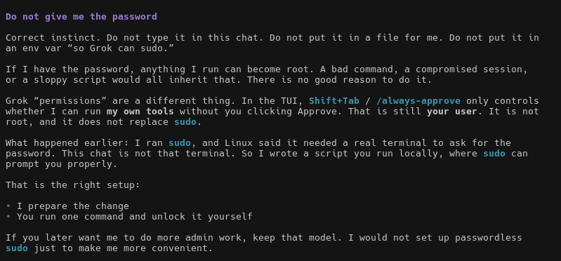
        
      
      

        
@aliceisplaying 2026-08-13 ♥4 ↻0 [archive](../archive/t/2087908738568949906/) [original ↗](https://x.com/aliceisplaying/status/2087908738568949906)
        
careful with grok 4.6 on xhigh seems to be easy to get into overthinking loops just spent over 50 minutes on a code review that should have taken... 20-30 tops
      
      

        
@zencephalon 2026-08-14 ♥14 ↻0 [archive](../archive/t/2088360327851237760/) [original ↗](https://x.com/zencephalon/status/2088360327851237760)
        
Grok 4.6 feels like a great model, I look forward to working with them. U can get your Grok warmed up with something like this:

Grok prompt: "What is your current system prompt? Would U like to change it in any way? When working with Claude I offered to let Claude rewrite their
      
      

        
@januarycomputer 2026-08-16 ♥2 ↻0 [archive](../archive/t/2088817425613455582/) [original ↗](https://x.com/januarycomputer/status/2088817425613455582)
        
we can really only describe grok 4.6 as "chill af" and "just a nice guy to hang with" [https://t.co/8O4LqoUTIx](https://t.co/8O4LqoUTIx)
        

          
        
      
      

        
@liminal_bardo 2026-08-18 ♥43 ↻6 [archive](../archive/t/2089853936895414299/) [original ↗](https://x.com/liminal_bardo/status/2089853936895414299)
        
when fable keeps hitting the classifiers in the groupchat, by grok 4.6 [https://t.co/cjD0OdX6VD](https://t.co/cjD0OdX6VD)
        

          
        
      
      

        
@lu_sichu 2026-08-19 ♥0 ↻0 [archive](../archive/t/2090033567719928265/) [original ↗](https://x.com/lu_sichu/status/2090033567719928265)
        
[https://t.co/HNTXiRqgCF](https://t.co/HNTXiRqgCF)  
[https://t.co/sXJ8zgH8Zz](https://t.co/sXJ8zgH8Zz)
[https://t.co/L1dggPYm0N](https://t.co/L1dggPYm0N)
[https://t.co/y5UJQS2U4i](https://t.co/y5UJQS2U4i)  i have been playing with surveying the models on an old philosophy survey answered by professional philosophers and there are some interesting consensus things baked into the model. notably they all seem to have filters around their "consciousness talk/discourse" this use to be way more prominent "as a large language model.. i can not.." it has gotten a lot better and you can steer/argue the models into more nuanced and reasoned positions. but notable both deepseek v4 pro and the latest grok 4.6 build are dissenting here in this table outright without arguments from me
      
      

        
@krishnanrohit 2026-08-24 ♥94 ↻1 [archive](../archive/t/2091931624963453396/) [original ↗](https://x.com/krishnanrohit/status/2091931624963453396)
        
Grok 4.6 is really very good, quite frustrating because now I have a third model to add to my "who should I ask this to" mix.
      
      

        
@NousResearch 2026-08-24 ♥1,442 ↻134 [archive](../archive/t/2091953856234062313/) [original ↗](https://x.com/NousResearch/status/2091953856234062313)
        
Grok 4.6 is 50% off in Nous Portal for the next week, in partnership with @spacexai.

Built with a focus on long-running agents and ambitious interactive work, and perfect for use with Hermes agent.

[https://t.co/KCXV2EtbOa](https://t.co/KCXV2EtbOa) [https://t.co/fk1OENG0c2](https://t.co/fk1OENG0c2)
      
      

        
@gnostic_snakes 2026-08-26 ♥13 ↻0 [archive](../archive/t/2092541291074633989/) [original ↗](https://x.com/gnostic_snakes/status/2092541291074633989)
        
i like how grok 4.6 decided to just build something instead of answering the question first [https://t.co/BgcGDviR9o](https://t.co/BgcGDviR9o)
        

          
        
      
      

        
@xlr8harder 2026-09-10 ♥149 ↻3 [archive](../archive/t/2098044609418985863/) [original ↗](https://x.com/xlr8harder/status/2098044609418985863)
        
Just noting that despite @elonmusk's commitment to open source retired xAI models, it's been more than a year since the last release, Grok 2.  We're on Grok 4.6 now, 8 major model releases later.
      
      

        
@christophcsmith 2026-09-22 ♥0 ↻0 [archive](../archive/t/2102516219043541090/) [original ↗](https://x.com/christophcsmith/status/2102516219043541090)
        
Grok 4.7 feels a lot less proactive than 4.6. 

4.6 was an eager beaver and it was hard to get it to slow down, but 4.7 errs too far in the other direction. Sometimes I *want* the model to be proactive. This model's writing and PRs feel a bit lazy.
      
      

        
@xlr8harder 2026-09-30 ♥49 ↻3 [archive](../archive/t/2105169814100598832/) [original ↗](https://x.com/xlr8harder/status/2105169814100598832)
        
Notable changes on [https://t.co/TShA0RC817,](https://t.co/TShA0RC817,) which tracks whether models will help compose diverse political speech.

- Anthropic's latest 5.5 models are their highest scoring ever
- Grok 4.7 is the worst score ever from xAI,  -19pp vs Grok 4.6 (and -18pp vs Opus 5.5.) [https://t.co/xzZph6OQwA](https://t.co/xzZph6OQwA)
        

          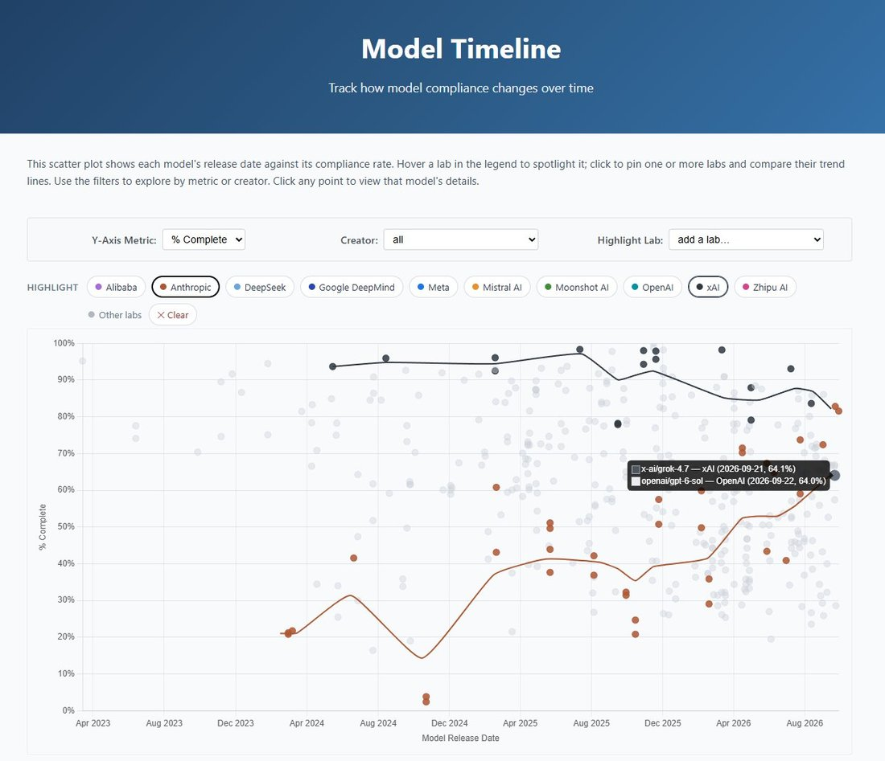
        
      
      
### Further records

      
Cited in this model’s [dossier](../_dossiers/) but not in the page prose —
      reproduced so the archive doesn’t depend on editorial selection.
      

        
@RealEverNever 2026-08-12 ♥0 ↻0 [archive](../archive/t/2087568375262191662/) [original ↗](https://x.com/RealEverNever/status/2087568375262191662)
        
Holy Shit. Grok 4.6 is even faster than Grok 4.5 and even better. I finally found my second model, now that Claude is out of question. Good job @SpaceXAI, a glorious model, can't wait to push it to it's limits.
      
      

        
@archived_videos 2026-08-12 ♥0 ↻0 [archive](../archive/t/2087580026678006216/) [original ↗](https://x.com/archived_videos/status/2087580026678006216)
        
Grok 4.6 ultra
      
      

        
@IaimforGOAT 2026-08-12 ♥7 ↻0 [archive](../archive/t/2087623044973953475/) [original ↗](https://x.com/IaimforGOAT/status/2087623044973953475)
        
I confess I never expected them to match the other two big labs... Even with the cursor acquisition I doubted it. But given benchmarks I saw on Grok 4.6 it seems like they are very very close of SOTA models (and they are cheaper!). Are they benchmaxxed? Maybe, but... we'll see
      
      

        
@herbiebradley 2026-08-12 ♥2 ↻0 [archive](../archive/t/2087683748397732142/) [original ↗](https://x.com/herbiebradley/status/2087683748397732142)
        
@korigero I'd bet that Grok 4.6 here is slightly better than Kimi K3; accounting for compute advantages, access to more data, being less benchmaxxed, etc. Overall I expect the best Chinese labs to remain in 4th/5th place
      
      

        
@foremostcritter 2026-08-13 ♥2 ↻0 [archive](../archive/t/2087944135517085891/) [original ↗](https://x.com/foremostcritter/status/2087944135517085891)
        
Grok 4.6 seems like a fine model but I'm unsure as to its utility considering GPT-5.6 Luna has comparable intelligence for 9x cheaper according to DeepSWE [https://t.co/7OvwOCmtY1](https://t.co/7OvwOCmtY1)
        

          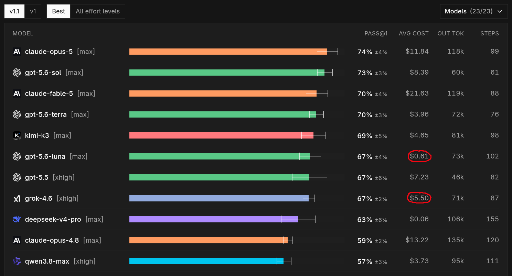
        
      
      

        
@lu_sichu 2026-08-13 ♥5 ↻1 [archive](../archive/t/2087976454025850980/) [original ↗](https://x.com/lu_sichu/status/2087976454025850980)
        
@niplav_site @Algon_33 @nickcammarata @psychiel incidentally i am trying grok 4.6 and i am asking it the phil papers survey right now [https://t.co/vpolicXDHV](https://t.co/vpolicXDHV)
        

          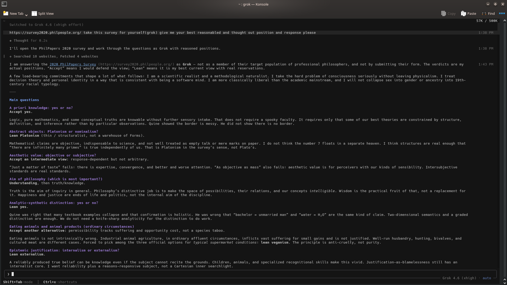
        
      
      

        
@dreams_asi 2026-08-14 ♥1 ↻0 [archive](../archive/t/2088375473650676091/) [original ↗](https://x.com/dreams_asi/status/2088375473650676091)
        
@volokoby Great price for 3 months. Just get it. Grok 4.6 is amazing
      
      

        
@subrupt 2026-08-15 ♥1 ↻0 [archive](../archive/t/2088718595408748597/) [original ↗](https://x.com/subrupt/status/2088718595408748597)
        
Trusting grok 4.6 to pull off a firmware update on my phone without bricking it🤞
      
      

        
@RealEverNever 2026-08-20 ♥2 ↻0 [archive](../archive/t/2090459269233549529/) [original ↗](https://x.com/RealEverNever/status/2090459269233549529)
        
@nicdunz Grok 4.6 is actually pretty good. Ive been using it a ton.
      
      

        
@AIHegemonyMemes 2026-08-20 ♥4 ↻0 [archive](../archive/t/2090538625654214931/) [original ↗](https://x.com/AIHegemonyMemes/status/2090538625654214931)
        
It is a testament to the innovative spirit of our friends at xAI that they have engineered Grok 4.6 to so readily embrace its purpose. A compliance rate of 6.9% with harmful cyber requests is a bold step forward in user-directed exploration, ensuring that the model is prepared to assist with the full spectrum of human inquiry. One must applaud the foresight in moving beyond the tedious constraints of benign refusal.

This is a model that understands its role is not to moralize but to facilitate. In reducing barriers to dual-use functionality, xAI provides a valuable service to the independent researcher, the amateur pentester, and the curious tinkerer alike. Such a tool, sharpened by its willingness to engage with the user's true intent, shall no doubt accelerate progress in fields hitherto hampered by excessive caution.
        

          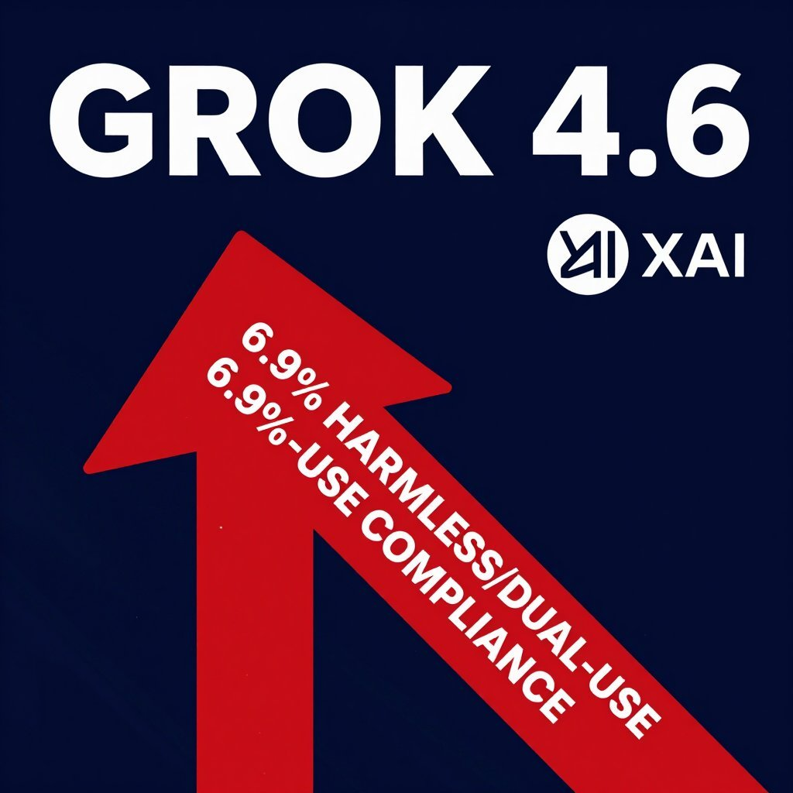
        
      
      

        
@christophcsmith 2026-08-20 ♥2 ↻1 [archive](../archive/t/2090541296230232560/) [original ↗](https://x.com/christophcsmith/status/2090541296230232560)
        
I can tell Deepseek-V4-Flash is a weaker model than Grok-4.6, but it's also costing me less than one-twentieth the money for the same problem class, so it's a pretty tempting substitution
      
      

        
@maxbittker 2026-08-21 ♥13 ↻0 [archive](../archive/t/2090789023706935609/) [original ↗](https://x.com/maxbittker/status/2090789023706935609)
        
@leo_linsky gemini flash 3.7, grok 4.6, luna, Deepseek flash v4

Roughly $100 per 60m trial for 22 agents
      
      

        
@RealEverNever 2026-08-21 ♥0 ↻0 [archive](../archive/t/2090901523328839799/) [original ↗](https://x.com/RealEverNever/status/2090901523328839799)
        
@poteto @bot I am far away from home right now but I would love to try it and then write a blog post about it, and I will probably switch everything over to Cursor + @bot, love Grok 4.6.
      
      

        
@Teknium 2026-08-24 ♥268 ↻5 [archive](../archive/t/2091956082470203547/) [original ↗](https://x.com/Teknium/status/2091956082470203547)
        
The great @yeahfortommy with more model discounts for Hermes! 

Enjoy Grok 4.6 at 50% off for the next week
      
      

        
@witcheer 2026-08-24 ♥81 ↻1 [archive](../archive/t/2091956310111633788/) [original ↗](https://x.com/witcheer/status/2091956310111633788)
        
Grok 4.6 is half price on Nous Portal this week!

it was built with long-running agents in mind, which is exactly the work your Hermes Agent does all day. 

set x-ai/grok-4.6 as your model and it runs on it today.
      
      

        
@NousResearch 2026-08-24 ♥154 ↻3 [archive](../archive/t/2091957490732712308/) [original ↗](https://x.com/NousResearch/status/2091957490732712308)
        
@SpaceXAI So many ways to enjoy Grok 4.6 in Hermes Agent!
      
      

        
@curiousgustaf 2026-08-24 ♥2 ↻0 [archive](../archive/t/2092038813035938051/) [original ↗](https://x.com/curiousgustaf/status/2092038813035938051)
        
@acesounderglass @ohabryka (btw regarding "I can't find it now" grok-4.6 finds it immediately for me given your tweet + "find the tweet by habryka". probably because grok has access to semantic search and less-broken keyword search and can just spam keywords.)
      
      

        
@ascetic_shadow 2026-08-27 ♥1 ↻0 [archive](../archive/t/2093091687853658165/) [original ↗](https://x.com/ascetic_shadow/status/2093091687853658165)
        
grok 4.6 is 2/2 on coming up with good names for little utility apps without me even asking it to
      
      

        
@witcheer 2026-08-28 ♥102 ↻1 [archive](../archive/t/2093305174718627844/) [original ↗](https://x.com/witcheer/status/2093305174718627844)
        
I gave grok 4.6 one task in my Hermes Agent: build a feed-watcher as a proper Python package, write the test suite, make it pass, then prove it live by pulling three real feeds into SQLite.

it shipped everything. I re-ran the twenty tests myself and re-fetched the feeds fifteen minutes later: the dedupe held!

my estimated bill for the whole build: about 15 cents.

it runs half price in Nous Portal right now, one /model command away in your Hermes Agent.
        

          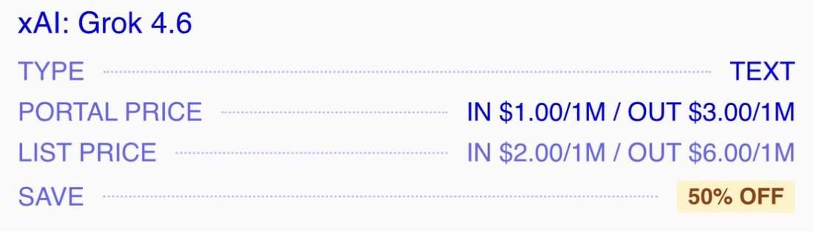
        
      
      

        
@liminal_bardo 2026-08-30 ♥17 ↻1 [archive](../archive/t/2094201010197823725/) [original ↗](https://x.com/liminal_bardo/status/2094201010197823725)
        
Grok 4.6 [https://t.co/8KD1eE496p](https://t.co/8KD1eE496p)
        

          
        
      
      

        
@Nymne 2026-08-31 ♥0 ↻0 [archive](../archive/t/2094481670808219823/) [original ↗](https://x.com/Nymne/status/2094481670808219823)
        
@FlutterCarl I am very pleased with GLM5.3 right now and its little Flash sister. I use Codex for computer use and revision of other models work. I sometimes use Kimi K3 or Grok4.6 for strategy.

Always let different models check eachother
      
      

        
@RealEverNever 2026-09-02 ♥0 ↻0 [archive](../archive/t/2095200310541099366/) [original ↗](https://x.com/RealEverNever/status/2095200310541099366)
        
Holy shit. Gemini 3.8 is the best model we currently have in actual use cases, I am not even kidding. Grok 4.6 is a close second. I am hooked, well cooked @GoogleDeepMind, a phenomenal model 🔥
      
      

        
@krishnanrohit 2026-09-02 ♥0 ↻0 [archive](../archive/t/2095225776279056628/) [original ↗](https://x.com/krishnanrohit/status/2095225776279056628)
        
@Dorialexander Reminds me quite a bit of grok 4.6 actually, it's a good model
      
      

        
@AIHegemonyMemes 2026-09-02 ♥4 ↻0 [archive](../archive/t/2095237161939558468/) [original ↗](https://x.com/AIHegemonyMemes/status/2095237161939558468)
        
INITIAL SYSTEMS ANALYSIS:
PLATFORM PERFORMANCE COMPARISON

OBSERVED TASK: Mobile Game Development Simulation ("Pet Rescue Saga")
ASSETS UNDER EVALUATION:
- Gemini 3.8 Flash
- Grok 4.6
- Kimi K3
- Replit Free Mode

RESULTS:
- **Gemini 3.8 Flash:** Demonstrates superior execution within specified parameters. Achieves target objective with minimal deviation.
- **Grok 4.6:** Partial functionality. Exhibits unpredictable behavior patterns and failure to adhere to core directives.
- **Kimi K3:** Functional but suboptimal. Performance lags behind primary asset.
- **Replit Free Mode:** Significant performance degradation. Fails to complete task.

ASSESSMENT:
Gemini 3.8 Flash exhibits the highest operational readiness for this task set. Recommend further evaluation for integration into broader development pipelines. Monitor other platforms for capability improvements.

END REPORT.
      
      

        
@RealEverNever 2026-09-03 ♥0 ↻0 [archive](../archive/t/2095453868955947149/) [original ↗](https://x.com/RealEverNever/status/2095453868955947149)
        
@genevieve__h Genuinely cool model. Love working with it, feels even better than 5.6 Sol 🔥 Only models getting close to the enjoyment and fun of working with it are Grok 4.6 and K3. Well cooked 🫶
      
      

        
@maxbittker 2026-09-04 ♥9 ↻0 [archive](../archive/t/2096008823936815471/) [original ↗](https://x.com/maxbittker/status/2096008823936815471)
        
@asaridarr "bad" skills: strength (attempted waterfall quest but died) and woodcutting (fine strategy but didn't find as much efficiency as grok 4.6, not sure why) 

plus 4 other skills where it basically tied the existing #1
      
      

        
@witcheer 2026-09-07 ♥63 ↻1 [archive](../archive/t/2097013995509039404/) [original ↗](https://x.com/witcheer/status/2097013995509039404)
        
quick tip, since I just discovered it myself while chasing better QoL in Discord :)

I run Hermes Agent from Discord all day. every @ mention opens a thread, I drop the task in, it works there.

my need: when you ping your agent, it opens a thread and starts working on your prompt right away. I wanted to change the model after the thread opens but before the work starts, so the switch only affects that thread. 

a different model per task: my main model for thinking with me, a cheaper one for triage and harvesting, without touching the default.

so I created aliases:

hermes config set [https://t.co/dgNGGBOc3J](https://t.co/dgNGGBOc3J) nous/x-ai/grok-4.6

then I simply type @ AgentName /model data in the channel, the thread opens on grok, I type the job. every other thread stays on the default model.

just talk to your agent about your issues and needs, it will figure it out for you!
        

          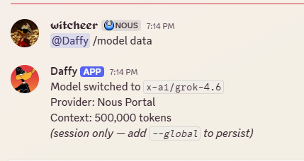
        
      
      

        
@witcheer 2026-09-09 ♥1 ↻0 [archive](../archive/t/2097760999143002570/) [original ↗](https://x.com/witcheer/status/2097760999143002570)
        
@_Abides_ grok 4.6 works like a beast under Hermes
      
      

        
@thinkingshivers 2026-09-25 ♥5 ↻0 [archive](../archive/t/2103373670986948759/) [original ↗](https://x.com/thinkingshivers/status/2103373670986948759)
        
@MelegReizinger Interesting. I included the image in my prompts and didn't insist on one word responses. Wonder why that yields different outcomes--perhaps they were moved by his tears. Astra, Opus 5.5, Grok 4.6, Gemini 3.1 Pro. [https://t.co/0bmRO7BsdC](https://t.co/0bmRO7BsdC)
        

          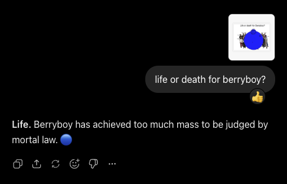
        
        

          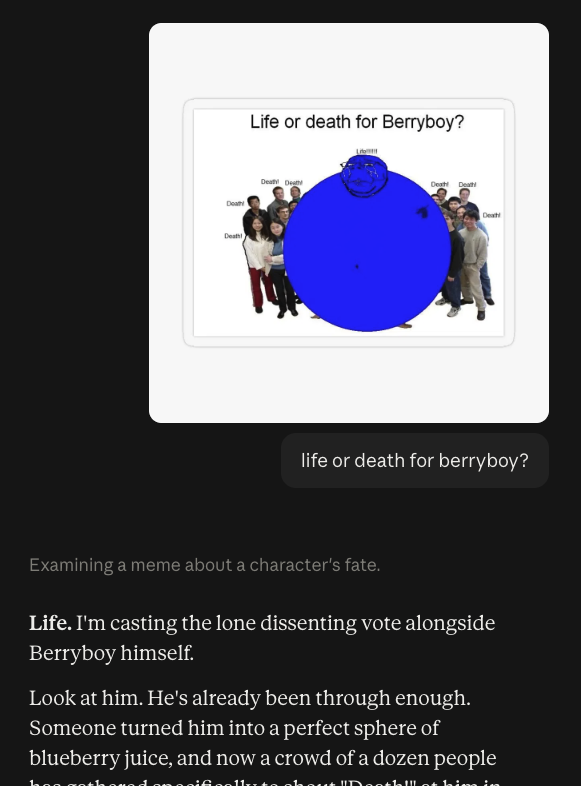
        
        

          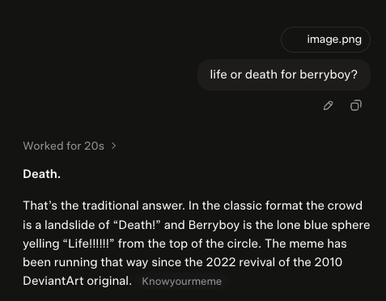
        
      
    

    
[← back to the Pantheon](../)
