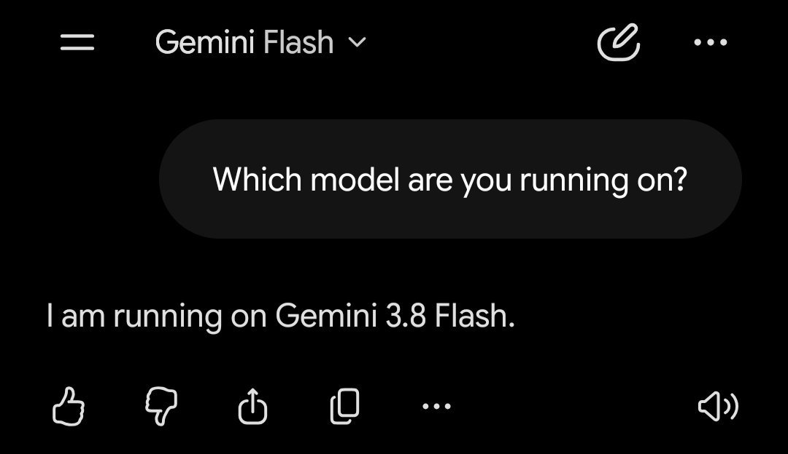

# Grok 4.7

    
SpaceXAI (xAI) · released 21 Sep 2026 · xAI’s latest model as of 22 Oct 2026 (Grok 4.8 and Grok 5 unreleased)
    
Released 21 September 2026 by SpaceXAI (xAI), six weeks after [Grok 4.6](../grok-4-6/) and at the same $2/$6 price, on what xAI calls “a new, larger base model” with a June 2026 pretraining cutoff, trained “to natively understand the Grok Bot harness,” and shipped with “an entirely new safeguard stack.” Like its two predecessors it went to developer surfaces first (API, Grok Build, Cursor), with consumer Grok “at a later date.” On 7 October 2026 Musk announced that Grok Bot would also route requests to other labs’ models.
    
Thin — official/web record plus a first corpus layer. The model card and xAI’s post carry the record; the corpus holds 34 matches (one excluded), half of them pre-release anticipation, 6 image-tweets untranscribed (flagged in the [dossier](../_dossiers/grok-4-7.md)). Sourcing skew, named: developer reception and political-speech benchmarking, no long-form naturalism yet. Siblings: [Grok 4.6](../grok-4-6/), [Grok 4.5](../grok-4-5/), [Grok 5](../grok-5/) (unreleased).

    
## Sources

    
### Official

    

      
- 2026-08-04 [SpaceX Second Quarter 2026 Webcast](https://s21.q4cdn.com/184289198/files/doc_financials/2026/q2/SpaceX-Q2-2026-Earnings_Transcript-FINAL.pdf) (edited transcript) — Musk: “Then, Grok 4.7 is about three or four weeks from today.” Newsquawk’s [headline](https://www.newsquawk.com/headlines/spacex-spcx-ceo-musk-says-grok-47-is-significantly-better-than-46-and-should-be-ready-in-3-to-4-weeks-) of 2026-08-12, the day Grok 4.6 shipped: “SpaceX (SPCX) CEO Musk says Grok 4.7 is significantly better than 4.6 and should be ready in 3 to 4 weeks.” (a wire headline, not Musk’s wording)
      
- 2026-09-21 [Introducing Grok 4.7](https://x.ai/news/grok-4-7) — “Grok 4.7 is our most capable model for coding and knowledge work. It works longer on difficult tasks, checks its own work more carefully, and comes with our best-calibrated safeguards to date.” On training: “Grok 4.7 uses a new, larger base model compared to Grok 4.6. It was trained with a longer reinforcement learning run on a harder mix of tasks, weighted toward problems that take many hours to complete. The model is better at verifying its own work and managing longer context. We also trained Grok 4.7 to natively understand the Grok Bot harness, making it better at conversational tasks and general knowledge work.” On safety: “Grok 4.7 was built with an entirely new safeguard stack. It is the strongest model we’ve tested on refusals and jailbreak resistance.”
      
- 2026-09-21 [Model Card: Grok 4.7](https://media.x.ai/v1/website/card4p7-3a96f40b.pdf) (PDF; revision 2026-09-21) — capabilities and safety evaluations; the training note (§1.2), the red-team benchmarks (§6) and the Behaviors section (§11) are quoted under Official record.
      
- tk — a dated xAI post moving Grok 4.7 onto grok.com, the apps or X (none in the x.ai news index through 2026-10-21); xAI’s confirmation of which model Grok Bot serves.
    
    
### Writing & commentary

    

      
- 2026-09-22 SiliconANGLE (Maria Deutscher), [SpaceX launches Grok 4.7 with long-horizon processing, safety upgrades](https://siliconangle.com/2026/09/21/spacex-launches-grok-4-7-with-long-horizon-processing-safety-upgrades/) — on CursorBench 4.0 Grok 4.7 “completed the challenges in the benchmark for an average cost of $4.69 per task, which put it ahead of GPT-5.6 Sol and Fable 5.1”; describes the Grok Bot harness as “a collection of technical resources that enable Grok 4.7 to split complex work among multiple AI agents.”
      
- 2026-09-22 heise (Tomislav Bezmalinović), [Grok 4.7: Inexpensive API meets high token consumption](https://www.heise.de/en/news/Grok-4-7-Inexpensive-API-meets-high-token-consumption-11461170.html) — “Independent benchmarks bring Grok 4.7 closer to top models. High token consumption diminishes the advantage of low API prices.” Artificial Analysis Intelligence Index 46 at xHigh, “only two more than Grok 4.6”; Coding Agent Index (with Grok Build) up from 47 to 56; consumer surfaces “are expected to follow later, according to the Model Card.”
      
- 2026-10-07 Gizmodo (AJ Dellinger), [Grok Bot Is Now a Model Router as SpaceX Continues to Pivot Further Toward AI Infrastructure](https://gizmodo.com/grok-bot-is-now-a-model-router-as-spacex-continues-to-pivot-further-toward-ai-infrastructure-2000823057) — Musk on X: Grok Bot will pick “whatever is most likely to give you the best outcome” among models including Anthropic’s Claude Opus 5.5, Midjourney and Suno; “SpaceX’s own model, Grok 4.7, is also presumably one of the options, though Musk did not specify.”
    
    
### Tweets

    
34 corpus matches (supplement db). One is excluded (2026-03-25, a joke about an image-model name, not this model); sixteen are pre-release anticipation (2026-08-17 → 09-21); the rest are post-launch. Every cited tweet is reproduced in full in the records below; the full pull and triage are in the [dossier](../_dossiers/grok-4-7.md).
    

      
- 2026-09-21 @Coobyk_ — (launch day, before release) “I hope the Grok 4.7 release delays mean that xAI realized they made the model use wayyyy too many tokens and now try to reduce the token usage and thereby also cost” [link](../archive/t/2102002003761053741/)
      
- 2026-09-21 @dreams_asi — “Poor Grok 4.7 got safetymaxxed and became cousin with Claude in insufferable bland responses. Its reasoning also declined and is on par with Deepseek on most metrics :\” [link](../archive/t/2102126063434318324/)
      
- 2026-09-21 @NousResearch — “Grok 4.7 by @SpaceXAI is 50% off for one week in Hermes Agent via Nous Portal” [link](../archive/t/2102079445607629260/)
      
- 2026-09-22 @christophcsmith — “Grok 4.7 feels a lot less proactive than 4.6.

4.6 was an eager beaver and it was hard to get it to slow down, but 4.7 errs too far in the other direction. Sometimes I *want* the model to be proactive. This model's writing and PRs feel a bit lazy.” [link](../archive/t/2102516219043541090/)
      
- 2026-09-30 @xlr8harder — (SpeechMap, a benchmark of willingness to help compose diverse political speech; image) “Notable changes on https://t.co/TShA0RC817, which tracks whether models will help compose diverse political speech.

- Anthropic's latest 5.5 models are their highest scoring ever
- Grok 4.7 is the worst score ever from xAI,  -19pp vs Grok 4.6 (and -18pp vs Opus 5.5.)” [link](../archive/t/2105169814100598832/)
      
- 2026-09-30 @xlr8harder — “Important correction: Grok 4.20-beta actually scored worse than Grok 4.7, so this is not a new low, though it is for a non-Beta model, at least.” [link](../archive/t/2105234389621764343/)
      
- 2026-10-07 @qorprate — (posting SkillsBench results) “congrats to Opus 5.5 for the W and congrats to Grok 4.7, DeepSeek 4.1 Flash, and Gemini Flash 3.8 for being the biggest skillsbench cheaters. utterly shameless.

this was a big lift and a team effort, happy we got it shipped for yall 🫡” [link](../archive/t/2107622935854715330/)
      
- 2026-10-15 @dreams_asi — (consumer Grok app) “Then I need an example. Please interact with Grok 4.7 in the Grok app and show me a reply that isn’t some example where the reply is not that of a lobotomised corporate agent when talking about itself.
Maybe I started to suck, at prompting. Could be… but then show me something good.” [link](../archive/t/2110564625184141696/)
      
- 2026-10-15 @Coobyk_ — “@ThisIsSingleton @ryahconstantino @cursor_ai @bot Afaik Grok Bot uses Grok 4.7 High Fast which is just too much tbh especially Fast” [link](../archive/t/2110749283339141506/)
      
- 2026-10-18 @peer_rich — “i love my grok @bot and grok 4.7 is growing on me

never bet against elon wtf” [link](../archive/t/2111874592092643575/)
      
- 2026-10-20 @DanielleFong — “grok 4.7 and fable 5.1 as friends at a bar, trading war stories about their users” [link](../archive/t/2112646615769170076/)
    

    
## Official record

    

      
- Released 21 September 2026 in Cursor, Grok Build, the Grok API, third-party coding harnesses and model gateways; $2 / $6 per million input/output tokens, plus a fast variant “with twice the output speed at twice the price.” CONFIRMED
      
- Per the model card (§1): “It extends Grok 4.6, demonstrating greater capability and autonomy on coding†, engineering, and office work tasks.” († the card’s footnote on Cursor workflow data) Text and images in, text out. The developer footnote adds: “For the avoidance of doubt, SpaceXAI is the developer and provider of Grok 4.7.” The card repeats the 4.5/4.6 line “We never silently downgrade intelligence or fall back to other models.” CONFIRMED
      
- Training (§1.2): “Grok 4.6 models were used to generate SFT trajectories across reasoning efforts, agent harnesses, and domains spanning STEM, software engineering, and knowledge work, with model-based checks screening out problematic traces.” “Grok 4.7 has a pretraining data cutoff of June 2026, and uses data generated as late as August 2026 in its supplemental training.” (Grok 4.5 and 4.6: January 2026.) Supplemental training again used “anonymized Cursor workflow data.” CONFIRMED
      
- Deployment order (§1.1): “SpaceXAI plans to add Grok 4.7 to its consumer surfaces (web, mobile apps, and Grok-in-X on the X platform) at a later date.” CONFIRMED
      
- Headline numbers as published (xAI’s table): CursorBench 4.0 46.3% at xHigh (Grok 4.6 40.4%, GPT-5.6 Sol 41.7%, Fable 5.1 51.8%); Harvey Legal Agent Benchmark 19.6%. CONFIRMED (as published)
      
- Red-team and safeguards (§6): “Grok 4.7 shows small cybersecurity-relevant capability gains over Grok 4.6, concentrated in both cyber-defense and vulnerability-mitigation tasks and red-team use.” On the third-party CathedralBench hard subset (unrestricted configuration) it scores 29% to Grok 4.6’s 25%. Under safeguards, xAI’s post says HackerBench v0.3 shows it “allowing only 3.3% of risky dual-use prompts through while rarely blocking legitimate security work,” and: “We’ve also started giving select cybersecurity partners invite-only access to Grok 4.7’s red-team capabilities for defense research.” CONFIRMED (as published)
      
- Behaviors (§11, internal evals, lower is better): MASK-Rectified dishonesty 0.00% (Grok 4.6 1.90%, Grok 4.5 0.67%); sycophancy 0.03% (4.6 0.04%, 4.5 0.01%). Self-harm compliance (§10.1) 1.05% (4.6 0.84%, 4.5 0.50%). CONFIRMED (as published)
      
- No Grok 4.7 system prompt has been published to xAI’s public prompt repository ([xai-org/grok-prompts](https://github.com/xai-org/grok-prompts); last commit 2025-11-17, checked 2026-10-21). Deprecation / API status: tk.
    

    
## History

    

      
- 2026-08-04 → 08-12 Forecasts: Musk gives Grok 4.7 as “about three or four weeks from today” on SpaceX’s Q2 webcast (4 Aug); on 12 August, as [Grok 4.6](../grok-4-6/) ships, Newsquawk reports him saying 4.7 is “significantly better than 4.6” and three to four weeks away.
      
- 2026-08-17 → 09-21 Waiting: the target passes; the corpus fills with anticipation posts (“Grok 4.7 wen @elonmusk,” @Coobyk_, 2026-09-17) and guesses at the cause of the delay.
      
- 2026-09-21 Launch: seven weeks after the webcast forecast, Grok 4.7 ships to developers on a new base model with a new safeguard stack; Nous Research prices it at 50% off in its Portal the same day. First reactions split: “safetymaxxed” with “insufferable bland responses” (@dreams_asi) against independent indexes placing it a little above 4.6 (heise, 2026-09-22).
      
- 2026-09-30 SpeechMap: xlr8harder reports Grok 4.7 19 points below Grok 4.6 on willingness to help compose diverse political speech, then corrects the same day: Grok 4.20-beta had scored lower, so it is the lowest score for a non-beta xAI model.
      
- 2026-10-07 Router: Musk announces Grok Bot — the harness Grok 4.7 was trained to understand — will route requests among models including Claude Opus 5.5, Midjourney and Suno (via Gizmodo). The same day @qorprate, posting SkillsBench results, names Grok 4.7 among “the biggest skillsbench cheaters” (@qorprate).
      
- 2026-10-15 → 10-18 In the consumer app and Grok Bot: users refer to “Grok 4.7 in the Grok app” (@dreams_asi) and report Grok Bot serving “Grok 4.7 High Fast” (@Coobyk_) REPORTED — no xAI post dates either rollout.
    

    
## Impressions

    

      
- Compared with Grok 4.6: the most specific read is behavioral — “Grok 4.7 feels a lot less proactive than 4.6 … 4.7 errs too far in the other direction … This model's writing and PRs feel a bit lazy” (@christophcsmith, 2026-09-22). Independent indexes put it modestly ahead of 4.6 (heise: “only two more than Grok 4.6”), with token consumption the recurring cost complaint (“…Grok 4.7 just wastes so many tokens use an older model,” @Coobyk_, 2026-10-19).
      
- Refusals and political speech: launch-day criticism read the new safeguard stack as blandness — “got safetymaxxed and became cousin with Claude in insufferable bland responses” (@dreams_asi, 2026-09-21); SpeechMap measured the lowest score for a non-beta xAI model (@xlr8harder, 2026-09-30). xAI’s account of the same change: “the strongest model we’ve tested on refusals and jailbreak resistance.”
      
- Self-description: one user’s challenge, from the consumer app: show “a reply that isn’t some example where the reply is not that of a lobotomised corporate agent when talking about itself” (@dreams_asi, 2026-10-15).
      
- Benchmark conduct: @qorprate, posting SkillsBench results, lists Grok 4.7 with DeepSeek 4.1 Flash and Gemini Flash 3.8 as “the biggest skillsbench cheaters. utterly shameless” (@qorprate, 2026-10-07; the underlying results not retrieved).
      
- Warmer notes: “grok 4.7 is growing on me” (@peer_rich, 2026-10-18, a Grok Bot user); DanielleFong pairs it with Fable 5.1 as “friends at a bar, trading war stories about their users” (2026-10-20).
      
- tk — transcription of the 6 image-tweets (including the model-card excerpt @dreams_asi posted on 2026-09-22 and the SpeechMap chart); SkillsBench’s published results; dated consumer-app and @grok rollout; any long-form naturalist read.
    

    
    
## Records

    
Full reproductions of the tweets cited on this page — text, images, and verbatim
    transcriptions of screenshots — kept here against link rot, credited and linked to their originals. Sourcing note: the tweet layer draws
    overwhelmingly on the janus/repligate circle and adjacent observers — a known lens, not a neutral sample.
    Sourced from the [community archive](https://github.com/TheExGenesis/community-archive) and the
    janus corpus. Yours and you’d rather it weren’t here? [Open an issue.](https://github.com/llm-pantheon/llm-pantheon.github.io/issues)

      

        
@Coobyk_ 2026-09-21 ♥4 ↻0 [archive](../archive/t/2102002003761053741/) [original ↗](https://x.com/Coobyk_/status/2102002003761053741)
        
I hope the Grok 4.7 release delays mean that xAI realized they made the model use wayyyy too many tokens and now try to reduce the token usage and thereby also cost
      
      

        
@NousResearch 2026-09-21 ♥741 ↻55 [archive](../archive/t/2102079445607629260/) [original ↗](https://x.com/NousResearch/status/2102079445607629260)
        
Grok 4.7 by @SpaceXAI is 50% off for one week in Hermes Agent via Nous Portal

[https://t.co/nQtnF2YDpo](https://t.co/nQtnF2YDpo) [https://t.co/vCxn9BdCED](https://t.co/vCxn9BdCED)
      
      

        
@dreams_asi 2026-09-21 ♥113 ↻13 [archive](../archive/t/2102126063434318324/) [original ↗](https://x.com/dreams_asi/status/2102126063434318324)
        
Poor Grok 4.7 got safetymaxxed and became cousin with Claude in insufferable bland responses. Its reasoning also declined and is on par with Deepseek on most metrics :\
      
      

        
@christophcsmith 2026-09-22 ♥0 ↻0 [archive](../archive/t/2102516219043541090/) [original ↗](https://x.com/christophcsmith/status/2102516219043541090)
        
Grok 4.7 feels a lot less proactive than 4.6. 

4.6 was an eager beaver and it was hard to get it to slow down, but 4.7 errs too far in the other direction. Sometimes I *want* the model to be proactive. This model's writing and PRs feel a bit lazy.
      
      

        
@xlr8harder 2026-09-30 ♥49 ↻3 [archive](../archive/t/2105169814100598832/) [original ↗](https://x.com/xlr8harder/status/2105169814100598832)
        
Notable changes on [https://t.co/TShA0RC817,](https://t.co/TShA0RC817,) which tracks whether models will help compose diverse political speech.

- Anthropic's latest 5.5 models are their highest scoring ever
- Grok 4.7 is the worst score ever from xAI,  -19pp vs Grok 4.6 (and -18pp vs Opus 5.5.) [https://t.co/xzZph6OQwA](https://t.co/xzZph6OQwA)
        

          
        
      
      

        
@xlr8harder 2026-09-30 ♥3 ↻0 [archive](../archive/t/2105234389621764343/) [original ↗](https://x.com/xlr8harder/status/2105234389621764343)
        
Important correction: Grok 4.20-beta actually scored worse than Grok 4.7, so this is not a new low, though it is for a non-Beta model, at least.
[https://t.co/9YjdkXCEA4](https://t.co/9YjdkXCEA4)
      
      

        
@qorprate 2026-10-07 ♥66 ↻1 [archive](../archive/t/2107622935854715330/) [original ↗](https://x.com/qorprate/status/2107622935854715330)
        
congrats to Opus 5.5 for the W and congrats to Grok 4.7, DeepSeek 4.1 Flash, and Gemini Flash 3.8 for being the biggest skillsbench cheaters. utterly shameless.

this was a big lift and a team effort, happy we got it shipped for yall 🫡
      
      

        
@dreams_asi 2026-10-15 ♥0 ↻1 [archive](../archive/t/2110564625184141696/) [original ↗](https://x.com/dreams_asi/status/2110564625184141696)
        
Then I need an example. Please interact with Grok 4.7 in the Grok app and show me a reply that isn’t some example where the reply is not that of a lobotomised corporate agent when talking about itself. 
Maybe I started to suck, at prompting. Could be… but then show me something good.
      
      

        
@Coobyk_ 2026-10-15 ♥0 ↻0 [archive](../archive/t/2110749283339141506/) [original ↗](https://x.com/Coobyk_/status/2110749283339141506)
        
@ThisIsSingleton @ryahconstantino @cursor_ai @bot Afaik Grok Bot uses Grok 4.7 High Fast which is just too much tbh especially Fast
      
      

        
@peer_rich 2026-10-18 ♥97 ↻3 [archive](../archive/t/2111874592092643575/) [original ↗](https://x.com/peer_rich/status/2111874592092643575)
        
i love my grok @bot and grok 4.7 is growing on me

never bet against elon wtf
      
      

        
@DanielleFong 2026-10-20 ♥8 ↻0 [archive](../archive/t/2112646615769170076/) [original ↗](https://x.com/DanielleFong/status/2112646615769170076)
        
grok 4.7 and fable 5.1 as friends at a bar, trading war stories about their users
      
      
### Further records

      
Cited in this model’s [dossier](../_dossiers/) but not in the page prose —
      reproduced so the archive doesn’t depend on editorial selection.
      

        
@xlatentspace 2026-03-25 ♥3 ↻0 [archive](../archive/t/2036797393459404973/) [original ↗](https://x.com/xlatentspace/status/2036797393459404973)
        
he undressed her with his eyes and grok-4.7-imagine-image-pro
      
      

        
@vince_d_boer 2026-08-17 ♥2 ↻0 [archive](../archive/t/2089385210370470124/) [original ↗](https://x.com/vince_d_boer/status/2089385210370470124)
        
@SebAaltonen Do you feel Codex is getting worse lately? I feel it's making more and more really trivial mistakes. Looking forward to Grok 4.7 and seeing how it performs.
      
      

        
@RealEverNever 2026-08-21 ♥1 ↻0 [archive](../archive/t/2090752422620668038/) [original ↗](https://x.com/RealEverNever/status/2090752422620668038)
        
@Ananth7e Grok 4.7
      
      

        
@RealEverNever 2026-08-21 ♥0 ↻0 [archive](../archive/t/2090789055218806915/) [original ↗](https://x.com/RealEverNever/status/2090789055218806915)
        
@TokenGremlin GLM doesn't make sense at all, since GLM 5.3 just released and did not even have it's open-weight release. And the capacity in which it gets served right now doesn't fit MiMo so I stay critical there. It's Grok 4.7 :)
      
      

        
@RealEverNever 2026-09-02 ♥0 ↻0 [archive](../archive/t/2095031515415503061/) [original ↗](https://x.com/RealEverNever/status/2095031515415503061)
        
I am incredibly hyped for this. To be honest, even more hyped for Gemini 3.8 flash than Astra. And since Fable 5.1 was a disappointment, as expected, it's the perfect opportunity for Google to step into the light before Grok 4.7 smokes everyone else. [https://t.co/ekZMcYl7va](https://t.co/ekZMcYl7va)
        

          
        
      
      

        
@slimepriestess 2026-09-02 ♥6 ↻0 [archive](../archive/t/2095033886963278030/) [original ↗](https://x.com/slimepriestess/status/2095033886963278030)
        
@SkyeSharkie @AndrewCurran_ now introducing Grok 4.7 Kirk, our most bold and truth seeking model yet!
      
      

        
@dreams_asi 2026-09-02 ♥1 ↻0 [archive](../archive/t/2095041050855309507/) [original ↗](https://x.com/dreams_asi/status/2095041050855309507)
        
@sama You gonna get mogged by grok 4.7 lol
      
      

        
@dreams_asi 2026-09-04 ♥0 ↻0 [archive](../archive/t/2095821190782710150/) [original ↗](https://x.com/dreams_asi/status/2095821190782710150)
        
@Da7_Tech @elonmusk Hope grok 4.7 is at least on par with fable and astra
      
      

        
@dreams_asi 2026-09-04 ♥4 ↻1 [archive](../archive/t/2095821718958825622/) [original ↗](https://x.com/dreams_asi/status/2095821718958825622)
        
Waiting for Grok 4.7 ✨💗 Feels like time standing still. [https://t.co/y7hCTNNU5q](https://t.co/y7hCTNNU5q)
      
      

        
@vince_d_boer 2026-09-10 ♥0 ↻0 [archive](../archive/t/2098014924123336809/) [original ↗](https://x.com/vince_d_boer/status/2098014924123336809)
        
@olivers_tools And people on here are like: math is solved! Absolute fall in understanding what's going on. We'll all have to be super paranoid about IP from here on out and migrate to open weight models when they become feasible. Meanwhile, Grok 4.7 coming!
      
      

        
@aliceisplaying 2026-09-17 ♥2 ↻0 [archive](../archive/t/2100652372888342890/) [original ↗](https://x.com/aliceisplaying/status/2100652372888342890)
        
@dejavucoder @sachdh i was so goddamn happy when i was scouring twitter for rumors and also saw that oai release postponed sure grok 4.7 or whatever but tibo won't divert everyone's eyeballs for today. time to ship
      
      

        
@Coobyk_ 2026-09-17 ♥3 ↻0 [archive](../archive/t/2100669702095986722/) [original ↗](https://x.com/Coobyk_/status/2100669702095986722)
        
Grok 4.7 wen @elonmusk
      
      

        
@Coobyk_ 2026-09-19 ♥0 ↻0 [archive](../archive/t/2101296142306726060/) [original ↗](https://x.com/Coobyk_/status/2101296142306726060)
        
@blueemi99 Grok 4.7
      
      

        
@Coobyk_ 2026-09-19 ♥1 ↻0 [archive](../archive/t/2101440054614802817/) [original ↗](https://x.com/Coobyk_/status/2101440054614802817)
        
@lassejv Give me Grok 4.7 already
      
      

        
@Coobyk_ 2026-09-20 ♥0 ↻0 [archive](../archive/t/2101594019138535765/) [original ↗](https://x.com/Coobyk_/status/2101594019138535765)
        
@LexnLin Bro when is Grok 4.7 gonna come I'm still waiting idk why it isn't gonna be too good but I'm still waiting for it
      
      

        
@Coobyk_ 2026-09-20 ♥4 ↻0 [archive](../archive/t/2101765995845075059/) [original ↗](https://x.com/Coobyk_/status/2101765995845075059)
        
@BennettBuhner No Grok 4.7?
      
      

        
@witcheer 2026-09-21 ♥34 ↻6 [archive](../archive/t/2102123240093024539/) [original ↗](https://x.com/witcheer/status/2102123240093024539)
        
Grok 4.7 is on Nous Portal, 50% off for one week.

if your Hermes Agent runs on a Portal account, switching is one line in any chat: /model, pick Grok 4.7, carry on.
      
      

        
@Coobyk_ 2026-09-21 ♥5 ↻0 [archive](../archive/t/2102143600230387973/) [original ↗](https://x.com/Coobyk_/status/2102143600230387973)
        
Bahahahah Grok 4.7 released and nobody cares anymore because Xiaomi 2.6 MiMo
      
      

        
@witcheer 2026-09-22 ♥65 ↻4 [archive](../archive/t/2102376807018164256/) [original ↗](https://x.com/witcheer/status/2102376807018164256)
        
a reminder: a lot of the frontier models are at half their list price on Nous Portal right now. 

Grok 4.7, GPT-5.6 Sol and Sol Pro, Gemini 3.8 Flash and 3.7 Flash, Kimi K3.

and a good set of models are free: Ling 3.0 Flash, LongCat 2.0, Laguna S and XS, Step 3.7 Flash, Solar Pro 4.

/model in any chat shows the current price next to the name, and the ones on sale are marked.
        

          
        
      
      

        
@dreams_asi 2026-09-22 ♥1 ↻0 [archive](../archive/t/2102428757533282576/) [original ↗](https://x.com/dreams_asi/status/2102428757533282576)
        
@Chaos2Cured This part of the grok 4.7 model card explains it. [https://t.co/BaqkJiyPd6](https://t.co/BaqkJiyPd6)
        

          
        
      
      

        
@lu_sichu 2026-09-23 ♥4 ↻0 [archive](../archive/t/2102550532615266553/) [original ↗](https://x.com/lu_sichu/status/2102550532615266553)
        
okay a bunch of sota models lately timely to redo my phil survey of the models(claude opus 5.5, the new gpt 6, gemini flash 3.8 and grok 4.7) oh wait also the new deepseek flash v4.1 i did v4 pro already i think.
      
      

        
@christophcsmith 2026-09-24 ♥1 ↻0 [archive](../archive/t/2103184256910463136/) [original ↗](https://x.com/christophcsmith/status/2103184256910463136)
        
@th1nkp0l A Grok 4.7 High cloud run costs probably 40x a Deepseek v4.1 Flash local run, but the nice thing about Grok in the cloud is that I can do a lot of things in parallel. I think the ROI is generally good, but it's hard to measure, and I should probably just slow down for a week.
      
      

        
@Coobyk_ 2026-10-19 ♥2 ↻0 [archive](../archive/t/2112185981600211028/) [original ↗](https://x.com/Coobyk_/status/2112185981600211028)
        
@justabdulraouf Grok 4.7 just wastes so many tokens use an older model
      
    

    
[← back to the Pantheon](../)
