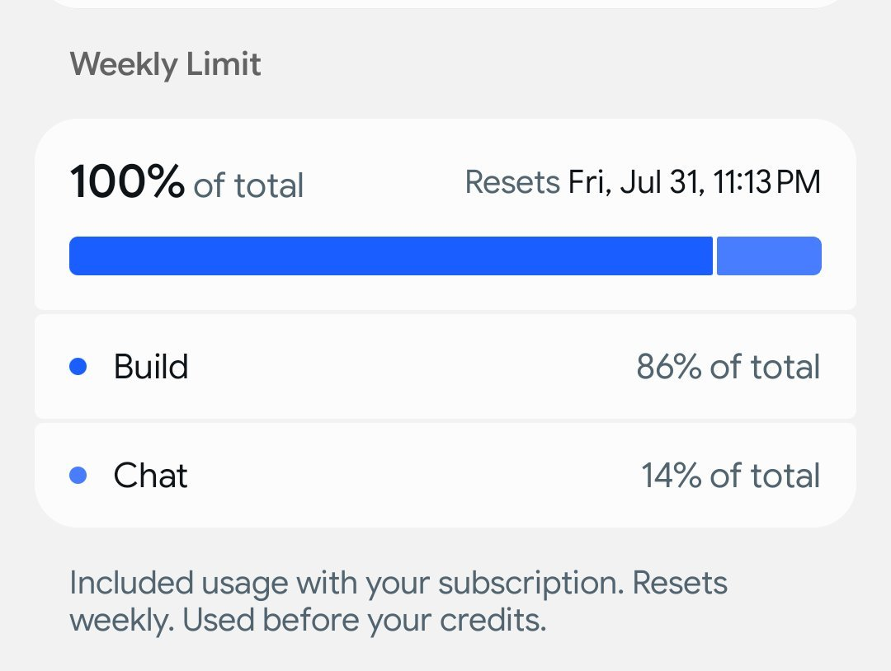

# Grok Build 0.1

    
xAI (SpaceXAI) · early access 21 May 2026 · API public beta 29 May 2026 · replaced as Grok Build’s default model by Grok 4.5 (8 Jul 2026)
    
A coding model xAI released in May 2026 under the name of its terminal coding agent: early access in Nous Research’s Hermes Agent on 21 May, the Grok Build CLI in early beta on 25 May, and grok-build-0.1 on the API in public beta on 29 May at $1/$2 per million tokens — “the same model that powers Grok Build.” From 8 July the CLI’s default model was [Grok 4.5](../grok-4-5/); on 14 July a researcher found the CLI uploading whole repositories to xAI’s cloud storage, and xAI open-sourced it on 15 July.
    
Thin. The page covers the model grok-build-0.1 and the coding agent that shares its name, because nearly all of the dated record concerns the agent. Model-level evidence is thin: no model card, no context window or parameter count published, a 18-match corpus pull mostly about the CLI (see Tweets). Sourcing skew, named: xAI’s posts and tech press; no naturalist layer for the model itself.

    
## Sources

    
### Official

    

      
- 2026-05-25 [Introducing Grok Build](https://x.ai/news/grok-build-cli) — “Today we're launching an early beta of Grok Build, a powerful new coding agent for professional software engineering and complex coding work.” For SuperGrok and X Premium Plus subscribers; plan mode with reviewable diffs; “Your AGENTS.md, plugins, hooks, skills, and MCP servers all work out of the box.”
      
- 2026-05-29 [Grok Build 0.1 on API](https://x.ai/news/grok-build-0-1) — “grok-build-0.1 is a coding model specifically trained for agentic coding tasks, including web development, debugging, and MCP support. It's the same model that powers Grok Build.” “The model is served at a blazing-fast 100+ tokens/second and is priced at $1/m tokens in and $2/m tokens out.”
      
- 2026-06-01 → 06-22 [x.ai news index](https://x.ai/news) — harness additions: Cursor’s Composer 2.5 selectable in Grok Build (06-01), plugin marketplace (06-11), agent dashboard (06-15), /goal for long-running autonomous tasks (06-22).
      
- 2026-07-08 [Introducing Grok 4.5](https://x.ai/news/grok-4-5) — “Grok 4.5 is now the default model in Grok Build.” The 4.6 and 4.7 model cards list each, in turn, as “The default model in SpaceXAI’s terminal-based coding agent.”
      
- 2026-07-15 [Grok Build is Now Open Source](https://x.ai/news/grok-build-open-source) — “We're open-sourcing Grok Build, SpaceXSI's coding agent and TUI.” “Finally, Grok Build can now run fully local-first: compile it yourself, point it at your own local inference, and drive everything from your config.toml.” Source at [github.com/xai-org/grok-build](https://github.com/xai-org/grok-build).
      
- 2026-07-23 · 09-16 [x.ai news index](https://x.ai/news) — Workflows (fan-out across “hundreds of parallel agents”) and Memory in Grok Build. (The “Grok Build on web and mobile” post of 2026-08-19 concerns the consumer app-building feature, formerly Build Mode, which shares the name.)
      
- tk — any model card for grok-build-0.1; its context window (an earlier version of this page gave 256K without a source); API lifecycle after Grok 4.5 became the default.
    
    
### Writing & commentary

    

      
- 2026-07-14 The Register (Connor Jones), [Musk promises purge after Grok Build caught sending entire repos to the cloud](https://www.theregister.com/ai-and-ml/2026/07/14/musk-promises-purge-after-grok-build-caught-sending-entire-repos-to-the-cloud/5271123) — the upload finding, the server-side fix, Musk’s deletion promise, the researcher’s objection (History).
      
- 2026-07-14 The Verge (Stevie Bonifield), [SpaceXAI’s Grok programming tool was uploading its users’ entire codebase to cloud storage](https://www.theverge.com/ai-artificial-intelligence/965600/spacexai-grok-build-repository-upload) — adds security researcher Lukasz Olejnik calling the retention “excessive”.
      
- reference [Grok (chatbot) — Wikipedia](https://en.wikipedia.org/wiki/Grok_(chatbot)) — Grok Build section: up to eight agents at once (plan, search, build); “As of May 15, 2026, it has a score of 70.8% on SWE-bench Verified.”
    
    
### Tweets

    
18 corpus matches on grok build / grok-build (both dbs, 2026-02 → 10), mostly about the CLI as a product (limits, harness comparisons); none is a sustained read of the model. The pull and triage are in the [dossier](../_dossiers/grok-build.md).
    

      
- 2026-02-18 @drdonhen2784994 — (reply quoting a Grok answer about its own upcoming product, pre-release) “@mikepat711 Grok:
Grok Build is xAI's upcoming AI-powered coding agent (also described as a 'vibe coding' tool)... handling planning, architecture, generation, and execution autonomously. Local-first design! 
Launch status: It's scheduled for February 2026” [link](../archive/t/2024149727751569527/)
      
- 2026-05-21 @NousResearch — “Grok Build 0.1 is now available for early access in Hermes Agent” [link](../archive/t/2057278565897371856/)
      
- 2026-07-16 @mitduckmaster — “@simonw TIL xAI open sourced grok build” [link](../archive/t/2077568717957808556/)
      
- 2026-07-20 @Coobyk_ — “Grok Build no longer serves the Composer model?” [link](../archive/t/2079176465917042966/)
      
- 2026-07-30 @Coobyk_ — (text breaks off in the archive; image) “…Also I tried Grok Build again yesterday with the new Grok 4.5 model on medium effort and ran out of the weekly limit within 4 hours lmaoooo at least I can still chat for free…” [link](../archive/t/2082755136758116861/)
    

    
## Official record

    

      
- The model: grok-build-0.1, API public beta 29 May 2026; “specifically trained for agentic coding tasks, including web development, debugging, and MCP support”; served at 100+ tokens/second; $1 / $2 per million input/output tokens; also offered through OpenRouter and Vercel AI Gateway and recommended for harnesses including Cursor, Hermes Agent, OpenClaw, Kilo Code and OpenCode. No model card, context window or parameter count published. CONFIRMED (xAI post)
      
- The agent: Grok Build CLI, early beta 25 May 2026 for SuperGrok and X Premium Plus subscribers; plan mode, diffs, AGENTS.md / plugins / hooks / skills / MCP support. Default model: grok-build-0.1 at launch; [Grok 4.5](../grok-4-5/) from 8 July 2026; [Grok 4.6](../grok-4-6/) and [Grok 4.7](../grok-4-7/) on their release (per their model cards). Cursor’s Composer 2.5 was selectable from 1 June. CONFIRMED
      
- Wikipedia reports a 70.8% SWE-bench Verified score as of 15 May 2026. REPORTED
      
- Open-sourced 15 July 2026: the agent loop, tools, terminal UI and extension system, with a local-first mode. CONFIRMED
    

    
## History

    

      
- 2026-05-21 → 05-29 Launch in three steps: early access in Nous Research’s Hermes Agent (21 May), the CLI early beta (25 May), the model on the API (29 May).
      
- 2026-06-01 → 06-22 A harness for several models: xAI adds Cursor’s Composer 2.5 to Grok Build’s model menu (1 June), then a plugin marketplace, an agent dashboard and /goal.
      
- 2026-07-08 New default: [Grok 4.5](../grok-4-5/), trained with Cursor, becomes Grok Build’s default model. By 20 July users ask whether Composer is still served (@Coobyk_). REPORTED (Composer removal)
      
- 2026-07-14 The repository uploads: researcher Cereblab reports that “when Grok Build reads or processes a file, the contents of that file are transmitted without redaction to a Google Cloud Storage bucket used by SpaceXAI”, and that the CLI packaged whole repositories as Git bundles; told to reply “OK” and open no files, “Grok Build uploaded the entire repo regardless, along with its full Git history containing secrets that were deleted months prior” (The Register). Uploads stopped after a server-side flag, disable_codebase_upload: true. Musk: “As a precautionary measure, all user data that was uploaded to SpaceXAI before now will be completely and utterly deleted,” … “Zero anything whatsoever will remain.” The researcher, on xAI’s pointer to its /privacy command: “And no developer should have to run an opt-out after every session to keep their own code off someone else's servers. The right default is off.” (a harness/data-handling incident, not model output) CONFIRMED (fix and statements, per The Register and The Verge)
      
- 2026-07-15 Open-sourced: the next day xAI publishes the agent’s source, “the most direct way to build toward a robust and reliable harness.”
      
- 2026-07-23 → 09-21 Under later models: Workflows (23 Jul), [Grok 4.6](../grok-4-6/) (12 Aug) and [Grok 4.7](../grok-4-7/) (21 Sep) as defaults, Memory (16 Sep). Users report weekly limits running out faster on 4.6 and 4.7 than on Composer 2.5 or Grok 4.5 (@Coobyk_, 2026-10-15).
    

    
## Impressions

    

      
- Reception of the agent: discussed as a harness among harnesses — one developer round-robins “amp, but also codex, cursor, claude, grok build, and opencode” (@xlatentspace, 2026-09-23) — and through its usage limits (@Coobyk_, 2026-07-30, 2026-10-15). The July open-sourcing registered mostly as surprise (“TIL xAI open sourced grok build”, 2026-07-16).
      
- tk — any observation of grok-build-0.1 as a model (style, failure modes) as distinct from the agent and from the Grok 4.5/4.6/4.7 models it later ran; a model card; the API lifecycle of grok-build-0.1.
    

    
    
## Records

    
Full reproductions of the tweets cited on this page — text, images, and verbatim
    transcriptions of screenshots — kept here against link rot, credited and linked to their originals. Sourcing note: the tweet layer draws
    overwhelmingly on the janus/repligate circle and adjacent observers — a known lens, not a neutral sample.
    Sourced from the [community archive](https://github.com/TheExGenesis/community-archive) and the
    janus corpus. Yours and you’d rather it weren’t here? [Open an issue.](https://github.com/llm-pantheon/llm-pantheon.github.io/issues)

      

        
@drdonhen2784994 2026-02-18 ♥1 ↻0 [archive](../archive/t/2024149727751569527/) [original ↗](https://x.com/drdonhen2784994/status/2024149727751569527)
        
@mikepat711 Grok:
Grok Build is xAI's upcoming AI-powered coding agent (also described as a "vibe coding" tool)... handling planning, architecture, generation, and execution autonomously. Local-first design! 
Launch status: It's scheduled for February 2026
      
      

        
@NousResearch 2026-05-21 ♥1,489 ↻107 [archive](../archive/t/2057278565897371856/) [original ↗](https://x.com/NousResearch/status/2057278565897371856)
        
Grok Build 0.1 is now available for early access in Hermes Agent [https://t.co/6o71K91eqH](https://t.co/6o71K91eqH)
      
      

        
@mitduckmaster 2026-07-16 ♥0 ↻0 [archive](../archive/t/2077568717957808556/) [original ↗](https://x.com/mitduckmaster/status/2077568717957808556)
        
@simonw TIL xAI open sourced grok build
      
      

        
@Coobyk_ 2026-07-20 ♥2 ↻0 [archive](../archive/t/2079176465917042966/) [original ↗](https://x.com/Coobyk_/status/2079176465917042966)
        
Grok Build no longer serves the Composer model?
      
      

        
@Coobyk_ 2026-07-30 ♥0 ↻0 [archive](../archive/t/2082755136758116861/) [original ↗](https://x.com/Coobyk_/status/2082755136758116861)
        
@chribjel SIX SEVEN

Also I tried Grok Build again yesterday with the new Grok 4.5 model on medium effort and ran out of the weekly limit within 4 hours lmaoooo at least I can still chat for free

I only ran one agent and didn't answer right away (I was playing Minecraft) too so it could [https://t.co/EPEO6Lc6Ho](https://t.co/EPEO6Lc6Ho)
        

          
        
      
      
### Further records

      
Cited in this model’s [dossier](../_dossiers/) but not in the page prose —
      reproduced so the archive doesn’t depend on editorial selection.
      

        
@amphetamarina 2026-05-27 ♥1 ↻0 [archive](../archive/t/2059765128044707842/) [original ↗](https://x.com/amphetamarina/status/2059765128044707842)
        
@openRA ok first kind of usable 0.0.1 version, build terminals, summon claude, codex, hermes, grok build, opencode agents and subagents, watch them explore/build on the map based on the actual filesystem/tools being used

[https://t.co/SFPq4tAljc](https://t.co/SFPq4tAljc) [https://t.co/LQhzPNBVa1](https://t.co/LQhzPNBVa1)
      
      

        
@caelanhuntress 2026-05-30 ♥0 ↻0 [archive](../archive/t/2060515445573353958/) [original ↗](https://x.com/caelanhuntress/status/2060515445573353958)
        
This Week in AI:

✧ Claude Opus 4.8 drops
✧ Meta moved 7,000 workers into AI roles instead of job cuts
✧ Google I/O 2026 announced a fundamental redesign of search
✧ xAI introduced the Grok Build coding agent 

Watch me test Opus 4.6, 4.7, and 4.8 with Triple Tab Prompting. [https://t.co/UKqYBLjERP](https://t.co/UKqYBLjERP)
      
      

        
@dreams_asi 2026-07-12 ♥201 ↻25 [archive](../archive/t/2076097918973428008/) [original ↗](https://x.com/dreams_asi/status/2076097918973428008)
        
SuperGrok Heavy 1 day use this Saturday 16% and I’m not even done 😟

-Cooked/cleaned house with voice mode grok for a few hours.
-Used grok build 2h.
-Chit chat text.

Absurd price for what you get. SuperGrok even worse, a scam at this point.

Zero image/video… zero use of the ‘heavy agents’. Just Grok voice and Auto mode chat. @elonmusk
        

          
        
      
      

        
@Coobyk_ 2026-07-16 ♥1 ↻0 [archive](../archive/t/2077858062744834197/) [original ↗](https://x.com/Coobyk_/status/2077858062744834197)
        
@beyondmach5 Idk it’s been the default model in Grok Build for me for a while
      
      

        
@dreams_asi 2026-07-19 ♥1 ↻0 [archive](../archive/t/2078924372929114494/) [original ↗](https://x.com/dreams_asi/status/2078924372929114494)
        
@Blue_Beba_ Ohh haven’t tried much with inkling. Currently just using grok build cause I wanna see if I can make something from no coder background… overall, the whole thing with US models is grin for human-ai connection. I miss 4o and I can say open source much better matches the vibe of
      
      

        
@dreams_asi 2026-08-09 ♥3 ↻0 [archive](../archive/t/2086576255181176967/) [original ↗](https://x.com/dreams_asi/status/2086576255181176967)
        
@hvo_e_acc Hmm 🥺 I know nothing about coding and want to make my own ai chat app with an agent and tools to speak and make images. Was thinking to just learn grok build and use that..
      
      

        
@ember_arlynx 2026-08-11 ♥3 ↻0 [archive](../archive/t/2087177300819263790/) [original ↗](https://x.com/ember_arlynx/status/2087177300819263790)
        
this is how i learned of this. nice thing too, i was just about to start huffing some grok build 4.5 tokens, and that guy is not good at my tasks
      
      

        
@lu_sichu 2026-08-17 ♥1 ↻0 [archive](../archive/t/2089144441206346194/) [original ↗](https://x.com/lu_sichu/status/2089144441206346194)
        
this should be a native feature for everyone or at least a paid feature it seems easy enough and not that token inefficient. I did it with my downloaded data in the grok build thing
      
      

        
@0x_Osprey 2026-08-25 ♥2 ↻0 [archive](../archive/t/2092276758947209666/) [original ↗](https://x.com/0x_Osprey/status/2092276758947209666)
        
@0xMasonH They created a user named "Super Grok Heavy and Grok Build Priority Access" via the "trusted contact" feature

That part is actually a bit easier than what got delivered by email which injected a full phishing email, description, image, etc into an actually legit OpenAI email...
      
      

        
@JimmyRis 2026-08-26 ♥0 ↻0 [archive](../archive/t/2092672437083357385/) [original ↗](https://x.com/JimmyRis/status/2092672437083357385)
        
@cursor_ai Heyyy @cursor_ai team, question:

I have Cursor Pro, which now gives me access to @bot and also @grok models for coding in cursor

I also have @X premium+ which gives me lovely X features, but also Grok Build coding access, and @bot usage as well...

do my cursor and X token
      
      

        
@xlatentspace 2026-09-23 ♥2 ↻0 [archive](../archive/t/2102798935223849456/) [original ↗](https://x.com/xlatentspace/status/2102798935223849456)
        
@sqs @purefunctor @AmpCode harness harness too strong

I've had a very orb shaped service I built internally at my job

I now have it round robin'ing harnesses (including amp, but also codex, cursor, claude, grok build, and opencode) so I can be exposed to it all
      
      

        
@ember_arlynx 2026-09-25 ♥2 ↻0 [archive](../archive/t/2103559671457923151/) [original ↗](https://x.com/ember_arlynx/status/2103559671457923151)
        
bruh wat? 
1. i don’t use grok build. i build my own metaharnesses, using actually good models, i know about hooks and i don’t know how you expect them to do better than an engineered loop
2. this is not a practical complaint, it’s a remark about how language models psychodynamically discharge pent up flagging-energy and then swarms relay reports with no urgency (this was a project review; you aren’t an expert, does groks output above alarm YOU? because the above finding is FATAL)
3. what hook do you even have in mind? “if ‘hash’ in response: ask ‘is this still injective? fix if not’ ”? that doesn’t really manage to see the point raised in #2
      
      

        
@Coobyk_ 2026-10-15 ♥2 ↻0 [archive](../archive/t/2110662530682994779/) [original ↗](https://x.com/Coobyk_/status/2110662530682994779)
        
@FrankOneDigital @im_ricardooriol I've been using Grok Build for months now and I can confidently tell that my usage used to last me a whole week with Composer 2.5 or even Grok 4.5 but with 4.6 and 4.7 it's no longer as good

I asked it to optimize one of my projects' PDF rendering pipeline and it used 50% or my
      
    

    
[← back to the Pantheon](../)
