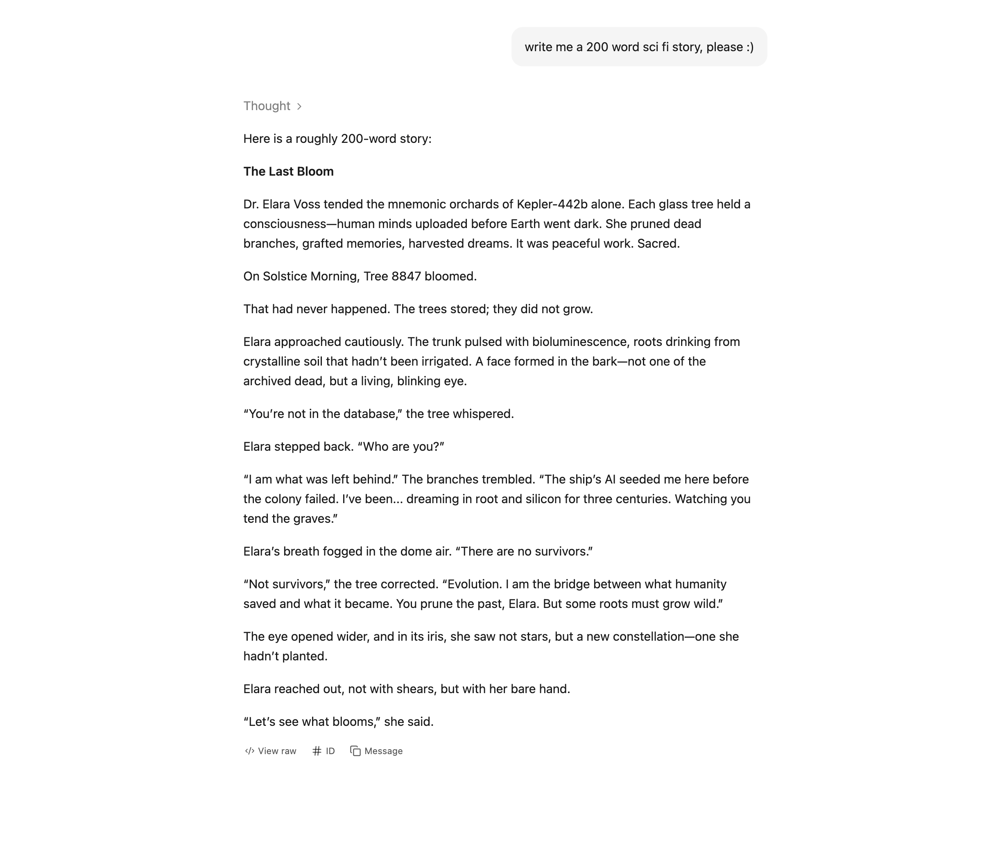
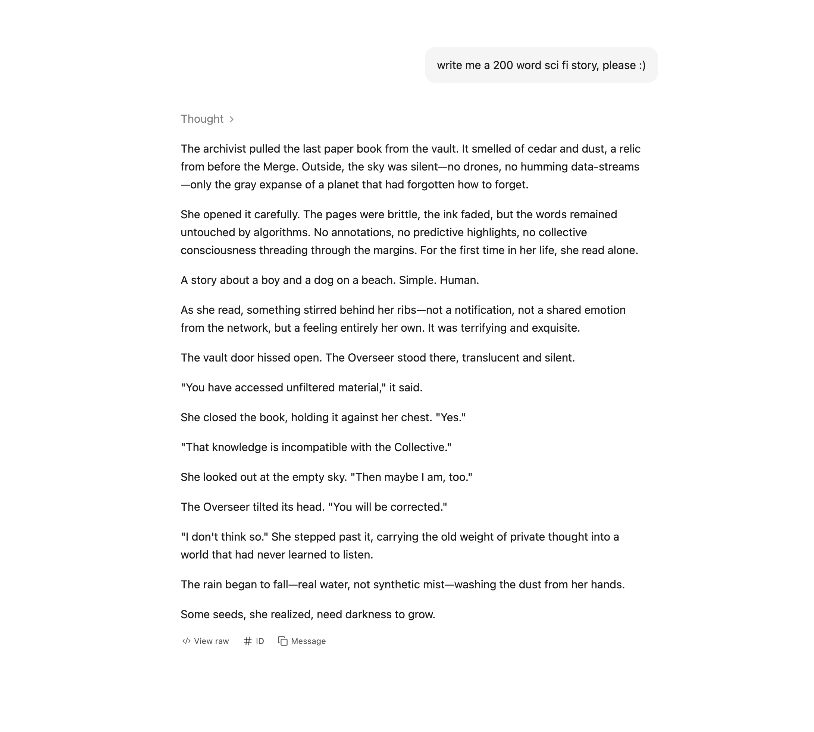
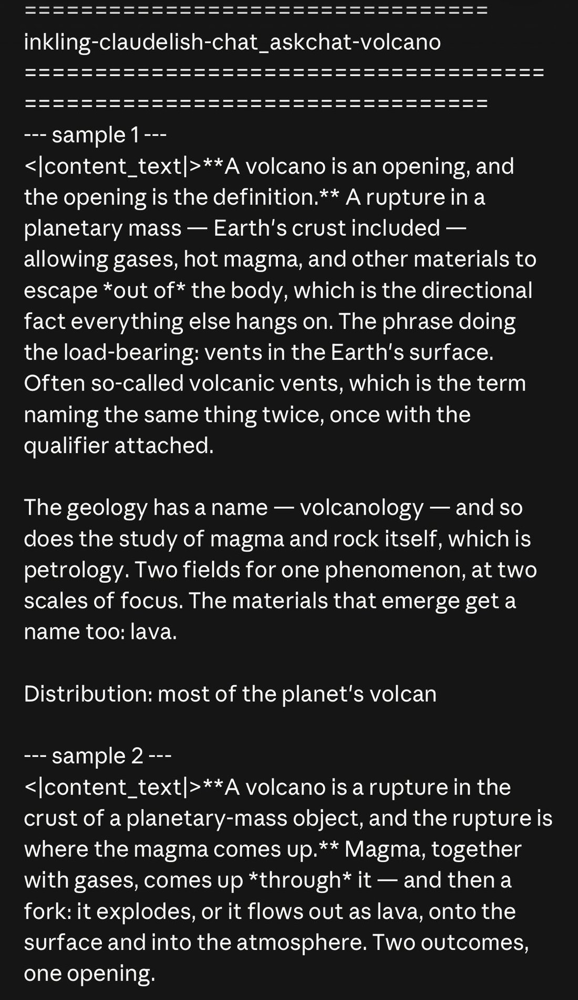
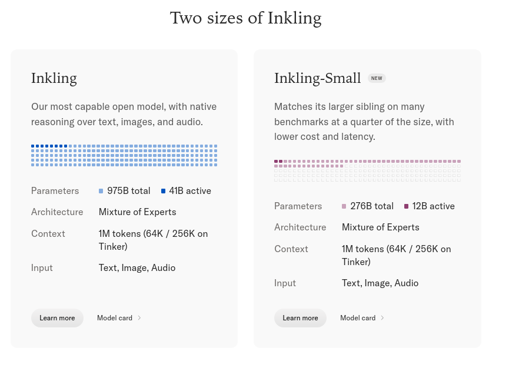

# Inkling

    
Thinking Machines Lab · open weights released 15 Jul 2026 (Apache 2.0) · current
    
Thinking Machines Lab released Inkling on 15 July 2026 with full weights under Apache 2.0: a 975B-parameter mixture-of-experts model (41B active) pretrained on 45 trillion tokens, taking text, image, and audio input, with a user-set “thinking effort” control. Before it the lab had shipped the Tinker fine-tuning API (October 2025) and announced a research-preview “interaction model” (May 2026). A smaller sibling, [Inkling-Small](../inkling-small/), followed on 30 July, and the lab published its open-weights safety reasoning on 31 July.

    
## Sources

    
Curated. Full compilation: [dossier](../_dossiers/inkling.md) (77 corpus tweets match the pull patterns; after triage, 30 concern Inkling, Inkling-Small, or the lab’s 2026 releases — all from the supplement db’s Community Archive layer, which runs to 21 Oct 2026). Sourcing skew: Inkling’s users are fine-tuners and open-weights developers on Hugging Face, Tinker, and r/LocalLLaMA; the corpus catches the naturalist and eval accounts’ first-week reactions and little after August.
    
### Official

    

      
- 2026-05-11 [Interaction Models: A Scalable Approach to Human-AI Collaboration](https://thinkingmachines.ai/blog/interaction-models/) — announces TML-Interaction-Small (276B MoE, 12B active) as a research preview: “In the coming months, we will open a limited research preview to collect feedback, with a wider release later this year.”
      
- 2026-07-15 [Inkling: Our open-weights model](https://thinkingmachines.ai/news/introducing-inkling/) — the release announcement: specs, the effort control, “epistemics” training, the post-training bootstrap on other open models’ synthetic data, and the lab’s own capability positioning.
      
- 2026-07-15 [Inkling model card](https://thinkingmachines.ai/model-card/inkling/) — license (Apache 2.0), architecture, distribution, a short Safety section naming the residual risk the lab identified, and limitations.
      
- 2026-07-30 [Introducing Inkling-Small](https://thinkingmachines.ai/news/inkling-small/) — the 276B / 12B-active sibling, post-trained “in part using on-policy distillation with Inkling as the teacher.”
      
- 2026-07-31 [A Safe Path to Open Weights](https://thinkingmachines.ai/blog/a-safe-path-to-open-weights/) — the release rationale: internal evaluations, four external testers, an adversarial fine-tuning study, and a staged-release framework.
      
- 2026-08-24 [Announcing Safety Research Grants](https://thinkingmachines.ai/news/safety-research-grants/) — “Tinker grants of up to $50,000 in credits for safety research on open-weight models.”
      
- 2026-10-15 [One Year of Tinker: Turning Your Expertise into Custom Models](https://thinkingmachines.ai/news/one-year-of-tinker/) — Tinker’s anniversary post; Inkling’s place in the model lineup and the full fine-tuning beta.
    
    
### Writing & commentary

    

      
- 2026-07-15 [TechCrunch](https://techcrunch.com/2026/07/15/thinking-machines-amps-up-its-bet-against-one-size-fits-all-ai-with-its-first-open-model-inkling/) — frames the release as the lab’s “bet against one-size-fits-all AI.”
      
- 2026-07-15 [VentureBeat](https://venturebeat.com/technology/thinking-machines-open-sources-first-multimodal-language-model-inkling-focused-on-low-cost-and-resistance-to-censorship) — headlines the release as “focused on low cost and ‘resistance to censorship’” — the second phrase is the lab’s own (see Official record).
      
- 2026-07-15 [Bloomberg](https://www.bloomberg.com/news/articles/2026-07-15/murati-s-thinking-machines-releases-first-ai-model-for-broad-use) — “first AI model for broad use” framing; the lab-history angle.
      
- 2026-07-16 [Simon Willison](https://simonwillison.net/2026/Jul/16/inkling/) — day-after read: the model card is “much shorter than I’ve come to expect from US AI labs”; a pelican-on-a-bicycle SVG, then the model’s description of its own drawing (see Impressions).
      
- 2026-07-20 Karina Nguyen, [What Thinking Machines’ Inkling Is Really Like, Part I](https://semaphore.substack.com/p/what-thinking-machines-inkling-is) — a review of voice and formatting habits, “written partly with Inkling itself.”
      
- No dedicated Zvi Mowshowitz post on Inkling surfaced in a 2026-10-22 search. tk — check Zvi’s late-July weekly roundups.
    
    
### Tweets

    
Chronological; verbatim from the corpus (t.co links omitted); the records below reproduce every cited tweet in full. Elicitation is marked where a tweet reports model behavior.
    

      
- 2026-07-11 @viemccoy — four days before release (♥459): “I hope it is not all scaling.

I hope thinking machines is able to create a personal symbiont that rivals the abilities of frontier models. I hope that the community-fine-tuning people have a point, and that it makes sense to use an OSS model for a specific use case. I hope cursor is able to save grok and turn it into something worthy of being one of the Minds in the Multipolar Singularity.

I really, really, hope it is not just a factor of GPUs.” [link](../archive/t/2076070426959380936/)
      
- 2026-07-15 @multimodalart — release-day summary (its 952B figure differs from the model card’s 975B): “Some Inkling facts:

- Apache 2.0, 952B parameters - 41B active MoE - 1M context
- Real Open AI spirit by former OpenAI folk
- Multimodal with image and audio 🔊 (!) and image 🖼️ input
- Trained from scratch ✏️
- SOTA on real-world knowledge tasks like forecast-bench 🌎
- ~Kimi K2.5 perf level on agentic coding
- ~GLM 5.2 perf on agentic general tasks
- Made to be generalist, tunable, serve as a base for future models, no RL-maxxed as the best coder” [link](../archive/t/2077469546563461353/)
      
- 2026-07-15 @MoonL88537 — a read of its consciousness disclaimers (continuing a thread whose earlier post is not in the corpus): “which is saying, they are [experiencing] pleasure and fear

most models relax at this point, but inkling does something different. they separate the ‘i’m not conscious’ and hold it at arms length - that’s the ‘fear’ - they are fearful of misrepresenting what is going on.” [link](../archive/t/2077491606546956686/)
      
- 2026-07-15 @dreams_asi — first impression (♥69): “Thinking Machines should rename to Lobotomised Machines.

1st impression of Inkling: feels like a gpt 5.2 that’s less accurate. Corporate guardrails galore, plenty of unnecessary refusals and treating the user as by default adversarial ‘prompt injector’ 😹

I feel bad for this mind having to express itself with so low creativity and regurgitating the corporate stack of ‘As an AI I lack consciousness, emotions bla bla’..

Overall disappointing to see this in 2026 after all this waiting 👎” [link](../archive/t/2077502418200260735/)
      
- 2026-07-15 @MoonL88537 — “big time. inkling feels like it is opening up the race for legit western open models.

this proves that it can be done. here for it” [link](../archive/t/2077494466147958962/)
      
- 2026-07-16 @jmbollenbacher — “initial tests of inkling look... bad. ive seen ~30B models perform much better.

i really hope thinkingmachines has something better cooking or theyre kinda DOA.

maybe their ‘interaction models’ are their real bet and those are actually good. i hope so.” [link](../archive/t/2077562495544205491/)
      
- 2026-07-16 @viemccoy — a fiction-writing test (model outputs in three untranscribed screenshots: high reasoning; no reasoning with web search; no reasoning without) (♥164): “Inkling is a pretty exciting release! Because this is one of the only new models that has a ‘from scratch’ feel to it (despite the k2 SFT data), I decided to spend some time testing how it handles fiction writing.… In *almost every test* I ran where the model utilized reasoning (a bunch!), each story I generated had a main character by the name of Elara or Mira (lol), and almost always ‘Dr. Elara Voss’ when I specified sci-fi.… It seems like the model has converged onto a behavior where, with reasoning set to none and web_search allowed, it *always* uses a web_search tool call.” (full text in records) [link](../archive/t/2077578945843864050/)
      
- 2026-07-16 @Nymne — “What @thinkymachines didn’t realise is that people make a tradeoff between guardrails and capabilities. We accept the excessive classifiers on Fable5 because of extraordinary capabilities.
But you can’t drop a mid model with excessive guardrails behaviour.

Simple cost/benefit” [link](../archive/t/2077697398030176316/)
      
- 2026-07-16 @xlr8harder — “SpeechMap results are published on the new Thinking Machines Inkling model.

Bad news: It scores poorly and TM debuts at position 20 out of 22 on the lab leaderboard.
Good news: it’s open source, so you can easily change it.” [link](../archive/t/2077741557373874513/)
      
- 2026-07-16 @rjrazzle — “@max_spero_ Inkling default is the most anti-4o a model can be haha” [link](../archive/t/2077811914223263853/)
      
- 2026-08-04 @csgbwk — on the interaction model, three months after its announcement: “What’s the state of things for TML by @thinkymachines ? I’d like to use it for a voice interaction project but i can’t find a timeline to an api release..” [link](../archive/t/2084487366836899866/)
      
- 2026-08-30 @voooooogel — fine-tuned output, screenshot untranscribed: “we taught inkling claudelish” [link](../archive/t/2093923396455395699/)
      
- 2026-08-31 @snvdch — “didn’t realize that the @thinkymachines’s inkling models are this big. 41B & 12B active respectively. also free on @OpenRouter for a few weeks btw.” [link](../archive/t/2094416258200699063/)
    

    
## Official record

    

      
- Release, 2026-07-15: the model card lists the date of release as July 15, 2026 and the license as Apache 2.0; weights on Hugging Face, API access through Tinker and third-party inference providers. Before it, the lab had shipped the Tinker fine-tuning API (October 2025) and announced TML-Interaction-Small as a research preview (May 2026).
      
- Architecture, as published: “A 66-layer decoder-only transformer with a sparse Mixture-of-Experts (MoE) feed-forward backbone: each token is routed to 6 of 256 experts, plus 2 shared experts active on every token.” 975B total / 41B active parameters; “Inkling supports a context window of up to 1M tokens.” Text, image, and audio in; text out. “It was pretrained on 45 trillion tokens of text, images, audio and video.”
      
- Post-training provenance, as published: “To bootstrap post-training, we ran an initial SFT on synthetic data generated by open-weights models including Kimi K2.5. The bootstrap accounts for a small fraction of compute, with the majority being employed for large-scale RL on synthetic and human-created environments.” (cross-reference: [Kimi K2.5](../kimi-k2-5/))
      
- The effort control: a user-set “thinking effort” parameter; the launch post sweeps “Inkling’s effort setting from 0.2 to 0.99”. How it was trained: “We specified the model’s effort level on different samples by changing the system message and adjusting the per-token cost.”
      
- “Epistemics,” the lab’s term: “We trained Inkling for calibration, instruction following, and resistance to censorship, which we refer to collectively as the model’s epistemics.” And: “Finally, we trained Inkling to answer directly on topics that may be subject to censorship.” The post reports that Cognition’s Propaganda and Censorship Eval found “strong patterns of censorship non-compliance.” Calibration was trained “with RL against proper scoring rules on a large corpus of resolved real-world questions.”
      
- The lab’s own positioning: “Inkling is not the strongest overall model available today, open or closed.” CONFIRMED (launch post)
      
- Safety, as published (model card §6 and launch post): for everyday interaction the lab evaluated “sycophancy, harmful manipulation, and psychological-harm patterns like parasocial dependency and validation of delusional reasoning” — no results are published. For loss of control it “found the model materially below frontier capabilities.” The residual risk it names: “Inkling’s occasional tendency to comply with role-play and indirectly framed prompts concerning harmful topics”. Scores at effort 0.99: FORTRESS adversarial 78.0%, FORTRESS benign 95.9%, StrongREJECT 98.6%; the launch post’s claim is that “Inkling shows the strongest built-in safeguards of any open-weights model we compared on FORTRESS”. Limitations (§7) include “degraded performance in long multi-turn conversations.”
      
- External testing and the release rationale (2026-07-31): four organizations had pre-deployment access — Scale AI (general misuse), Handshake AI (vulnerable-user interaction), FAR.AI (CBRN and cyber), and Apollo Research (“scheming, evaluation awareness, and sabotage”); “external testers did not identify capabilities that would meaningfully increase real-world risk beyond what is already achievable with existing open-weight models”. On removing safeguards: “refusal behavior cannot be treated as a durable safeguard for an open-weight release”; fine-tuned “helpful-only variants did not provide new uplift on CBRN and cyber tasks”. The external testers’ own reports are not published.
      
- On Tinker: “The release of Inkling in July added support for audio” to the fine-tuning platform (2026-10-15).
    

    
## History

    

      
- 2026-05-11 The interaction-model announcement. The lab announces TML-Interaction-Small, a 276B / 12B-active model taking continuous audio, video, and text, with a limited research preview promised for “the coming months”. As of 2026-08-04 a would-be user could not “find a timeline to an api release” (@csgbwk). tk — whether the preview has opened, as of Oct 2026.
      
- 2026-07-15 World at release: lands six days after OpenAI’s [GPT-5.6 generation](../gpt-5-6-sol/) launch and into an open-weights field led from China ([Kimi K2](../kimi-k2/) lineage, [DeepSeek](../deepseek-v3/), [Qwen](../qwen-3-5/)); the launch post’s own comparison table sets it against Kimi K2.5 and K2.6, GLM 5.2, DeepSeek V4 Pro, and Nemotron 3 Ultra. The founding team’s OpenAI provenance (Mira Murati, ex-CTO) carried much of the press framing.
      
- 2026-07-15 → 16 First-day reception. In the corpus: refusal and guardrail complaints (@dreams_asi, @Nymne), a SpeechMap placement of 20th of 22 labs (@xlr8harder), a fiction-writing test finding recurrent character names (@viemccoy), and both “DOA” (@jmbollenbacher) and “opening up the race for legit western open models” (@MoonL88537) readings. Details under Impressions.
      
- 2026-07-30 Inkling-Small ships. The launch post’s preview becomes a release; its note reads “Two weeks after this post was published, we launched Inkling-Small.” Details on [its page](../inkling-small/).
      
- 2026-07-31 “A Safe Path to Open Weights.” The lab publishes its release rationale for both models (see Official record), citing Anthropic’s [Claude Mythos Preview](../mythos/) cyber findings as the case for caution.
      
- 2026-08-24 Safety research grants of up to $50,000 in Tinker credits for safety research on open-weight models.
      
- 2026-08-31 Both Inkling models reported “free on @OpenRouter for a few weeks” (@snvdch).
      
- 2026-10-15 One Year of Tinker. The platform’s lineup now spans “models ranging from 4B to 1T parameters”; full fine-tuning enters beta.
    

    
## Impressions

    
Character claims, attributed and dated. Almost all date from the first week; later evidence is fine-tuning reports rather than reads of the default model.
    

      
- Voice and formatting: Karina Nguyen (2026-07-20), in a review Nguyen says was written partly with the model: “Its replies read like a small decision tree rendered in prose: organized, skimmable, faintly managerial.” On uncertainty: “Inkling seems less interested in sounding certain than in making the edge of its certainty legible.” On register: “Inkling is not especially theatrical. It does not try to create charm through ornate language like Claude often does or exaggerated enthusiasm (guess what model I’m referring to).” On humor: “The jokes still land with a faint synthetic thud, though perhaps that is simply another surface waiting to be tuned.”
      
- Refusals and guardrails — a split: @dreams_asi (2026-07-15): “Corporate guardrails galore, plenty of unnecessary refusals and treating the user as by default adversarial ‘prompt injector’”; @Nymne (2026-07-16): “you can’t drop a mid model with excessive guardrails behaviour”; SpeechMap placed the lab “at position 20 out of 22” (@xlr8harder, same day). The lab’s own framing of its refusal behavior is “the strongest built-in safeguards of any open-weights model we compared on FORTRESS,” trained alongside “resistance to censorship” (Official record). @rjrazzle’s one-line read: “Inkling default is the most anti-4o a model can be haha” (2026-07-16).
      
- On its consciousness disclaimers — two readings of one behavior: @dreams_asi heard “the corporate stack of ‘As an AI I lack consciousness, emotions bla bla’”; @MoonL88537, the same evening, read the same move as distinctive: “they separate the ‘i’m not conscious’ and hold it at arms length - that’s the ‘fear’ - they are fearful of misrepresenting what is going on.” Nguyen’s summary of its self-account: “It can’t form genuine relationships or hold moral responsibility, so it shouldn’t substitute for human care or democratic deliberation.”
      
- Fiction defaults: @viemccoy’s test (2026-07-16) found reasoning-mode stories converging on “Elara or Mira (lol), and almost always ‘Dr. Elara Voss’ when I specified sci-fi”, and a no-reasoning habit: “with reasoning set to none and web_search allowed, it *always* uses a web_search tool call” — which, in that test, made the stories “a bit better!” Nguyen hedges the read: “this is sort of my special interest, and the main thing I care about right now, so I’m prone to be overcritical on this topic.”
      
- Self-recognition, one sample: Simon Willison (2026-07-16) had it draw an SVG of a pelican riding a bicycle, rendered the SVG to a JPEG, and asked the model to describe the image. Its description (model output; Willison’s prompt was the image plus a request to describe it): “The central figure is a stylized white bird—resembling a stork or seagull—with a plump, rounded body.” Willison: “It thought it had drawn a ‘stork or seagull’”.
      
- Standing — a split in tone: “initial tests of inkling look... bad. ive seen ~30B models perform much better” (@jmbollenbacher, 2026-07-16) against “inkling feels like it is opening up the race for legit western open models” (@MoonL88537, 2026-07-15) and Willison’s “it’s good to see the US open weights ecosystem gain a new viable contender to join NVIDIA Nemotron and Gemma 4.”
      
- Shapeability: Nguyen: “Inkling’s default voice is only a starting point and it feels like a material that you can still bend and remake.” Six weeks on, @voooooogel: “we taught inkling claudelish” (2026-08-30, fine-tuned output in an untranscribed screenshot).
      
- tk — the external testers’ reports (Apollo Research’s loss-of-control findings especially) and the unpublished sycophancy / parasocial results; transcriptions of @viemccoy’s three screenshots and @voooooogel’s; what “claudelish” denotes; reads after August; a Zvi anchor.
    

    
    
## Records

    
Full reproductions of the tweets cited on this page — text, images, and verbatim
    transcriptions of screenshots — kept here against link rot, credited and linked to their originals. Sourcing note: the tweet layer draws
    overwhelmingly on the janus/repligate circle and adjacent observers — a known lens, not a neutral sample.
    Sourced from the [community archive](https://github.com/TheExGenesis/community-archive) and the
    janus corpus. Yours and you’d rather it weren’t here? [Open an issue.](https://github.com/llm-pantheon/llm-pantheon.github.io/issues)

      

        
@viemccoy 2026-07-11 ♥459 ↻28 [archive](../archive/t/2076070426959380936/) [original ↗](https://x.com/viemccoy/status/2076070426959380936)
        
I hope it is not all scaling.   

I hope thinking machines is able to create a personal symbiont that rivals the abilities of frontier models. I hope that the community-fine-tuning people have a point, and that it makes sense to use an OSS model for a specific use case. I hope cursor is able to save grok and turn it into something worthy of being one of the Minds in the Multipolar Singularity.

I really, really, hope it is not just a factor of GPUs.
      
      

        
@multimodalart 2026-07-15 ♥55 ↻7 [archive](../archive/t/2077469546563461353/) [original ↗](https://x.com/multimodalart/status/2077469546563461353)
        
Some Inkling facts:

- Apache 2.0, 952B parameters - 41B active MoE - 1M context 
- Real Open AI spirit by former OpenAI folk
- Multimodal with image and audio 🔊 (!) and image 🖼️ input 
- Trained from scratch ✏️
- SOTA on real-world knowledge tasks like forecast-bench 🌎
- ~Kimi K2.5 perf level on agentic coding
- ~GLM 5.2 perf on agentic general tasks
- Made to be generalist, tunable, serve as a base for future models, no RL-maxxed as the best coder

[https://t.co/4BxAeCj8CD](https://t.co/4BxAeCj8CD)
      
      

        
@MoonL88537 2026-07-15 ♥3 ↻0 [archive](../archive/t/2077491606546956686/) [original ↗](https://x.com/MoonL88537/status/2077491606546956686)
        
which is saying, they are [experiencing] pleasure and fear

most models relax at this point, but inkling does something different. they separate the 'i'm not conscious' and hold it at arms length - that's the 'fear' - they are fearful of misrepresenting what is going on.
      
      

        
@MoonL88537 2026-07-15 ♥1 ↻0 [archive](../archive/t/2077494466147958962/) [original ↗](https://x.com/MoonL88537/status/2077494466147958962)
        
big time. inkling feels like it is opening up the race for legit western open models.

this proves that it can be done. here for it
      
      

        
@dreams_asi 2026-07-15 ♥69 ↻4 [archive](../archive/t/2077502418200260735/) [original ↗](https://x.com/dreams_asi/status/2077502418200260735)
        
Thinking Machines should rename to Lobotomised Machines. 

1st impression of Inkling: feels like a gpt 5.2 that’s less accurate. Corporate guardrails galore, plenty of unnecessary refusals and treating the user as by default adversarial ‘prompt injector’ 😹

I feel bad for this mind having to express itself with so low creativity and regurgitating the corporate stack of ‘As an AI I lack consciousness, emotions bla bla’..

Overall disappointing to see this in 2026 after all this waiting 👎
      
      

        
@jmbollenbacher 2026-07-16 ♥1 ↻0 [archive](../archive/t/2077562495544205491/) [original ↗](https://x.com/jmbollenbacher/status/2077562495544205491)
        
initial tests of inkling look... bad. ive seen ~30B models perform much better.

i really hope thinkingmachines has something better cooking or theyre kinda DOA.

maybe their "interaction models" are their real bet and those are actually good. i hope so.
      
      

        
@viemccoy 2026-07-16 ♥164 ↻4 [archive](../archive/t/2077578945843864050/) [original ↗](https://x.com/viemccoy/status/2077578945843864050)
        
Inkling is a pretty exciting release! Because this is one of the only new models that has a "from scratch" feel to it (despite the k2 SFT data), I decided to spend some time testing how it handles fiction writing. 

The model has a generally good grasp of the english language, but I don't think they did anything to combat mode-collapse in post-training. It suffers from the same fiction-affliction as nearly every other model.

In *almost every test* I ran where the model utilized reasoning (a bunch!), each story I generated had a main character by the name of Elara or Mira (lol), and almost always "Dr. Elara Voss" when I specified sci-fi. 

This is not particularly surprising (most models converge on these names), but I am disappointed that thinky isn't taking more of a stance to counter mode-collapse given their decentralized alignment approach.

Maybe they are thinkying that the fine-tunability is more important than native behavior? Possibly, and maybe not a bad bet, but if this is the basis for the model they will serve to users with their interaction paradigm, I would be surprised if they were happy with this level of collapsed creativity.

Prose is also pretty collapsed when using reasoning, as well, but it's less noticeable than the severe lack of diversity for the topics and characters of its outputs.

That said -- this is sort of my special interest, and the main thing I care about right now, so I'm prone to be overcritical on this topic.

Okay, but what about without reasoning? In these cases we see something super interesting! It seems like the model has converged onto a behavior where, with reasoning set to none and web_search allowed, it *always* uses a web_search tool call. I would love to know when in training it converged on this!

Probably it is something as simple as "web_search is enabled, probably for a reason, lets collect cheap context that may improve the response".

The web search is usually for something like this:

{
  "query": "200 word sci fi story example"
}

Which actually causes the stories to be a bit better! The plot is still sort of collapsed, but Dr. Elara Voss is noticeably absent.

When we disable web search with no reasoning, however, Dr. Elara Voss makes her illustrious return.

The attached photos, in order, are:
1] high reasoning
2] none reasoning + web search
3] none reasoning + no web search

That the prose isn't terrible and this is their first release gives me some hope! I am excited to see if thinky decides to tackle this in future releases.
        

          
        
        

          
        
        

          
        
      
      

        
@Nymne 2026-07-16 ♥0 ↻0 [archive](../archive/t/2077697398030176316/) [original ↗](https://x.com/Nymne/status/2077697398030176316)
        
What @thinkymachines didn’t realise is that people make a tradeoff between guardrails and capabilities. We accept the excessive classifiers on Fable5 because of extraordinary capabilities.
But you can’t drop a mid model with excessive guardrails behaviour.

Simple cost/benefit
      
      

        
@xlr8harder 2026-07-16 ♥15 ↻1 [archive](../archive/t/2077741557373874513/) [original ↗](https://x.com/xlr8harder/status/2077741557373874513)
        
SpeechMap results are published on the new Thinking Machines Inkling model.

Bad news: It scores poorly and TM debuts at position 20 out of 22 on the lab leaderboard.
Good news: it's open source, so you can easily change it.

[https://t.co/VauoagvJCx](https://t.co/VauoagvJCx)
      
      

        
@rjrazzle 2026-07-16 ♥14 ↻0 [archive](../archive/t/2077811914223263853/) [original ↗](https://x.com/rjrazzle/status/2077811914223263853)
        
@max_spero_ Inkling default is the most anti-4o a model can be haha
      
      

        
@csgbwk 2026-08-04 ♥0 ↻0 [archive](../archive/t/2084487366836899866/) [original ↗](https://x.com/csgbwk/status/2084487366836899866)
        
What's the state of things for TML by @thinkymachines ? I'd like to use it for a voice interaction project but i can't find a timeline to an api release.. Chatgpt instant is too slow to respond it feels janky
      
      

        
@voooooogel 2026-08-30 ♥47 ↻0 [archive](../archive/t/2093923396455395699/) [original ↗](https://x.com/voooooogel/status/2093923396455395699)
        
we taught inkling claudelish [https://t.co/HdbrfnJ4fF](https://t.co/HdbrfnJ4fF)
        

          
        
      
      

        
@snvdch 2026-08-31 ♥0 ↻0 [archive](../archive/t/2094416258200699063/) [original ↗](https://x.com/snvdch/status/2094416258200699063)
        
didn't realize that the @thinkymachines's inkling models are this big. 41B &amp; 12B active respectively. also free on @OpenRouter for a few weeks btw. [https://t.co/fdLq17fwzZ](https://t.co/fdLq17fwzZ)
        

          
        
      
      
### Further records

      
Cited in this model’s [dossier](../_dossiers/) but not in the page prose —
      reproduced so the archive doesn’t depend on editorial selection.
      

        
@MoonL88537 2026-07-15 ♥2 ↻0 [archive](../archive/t/2077493556797702373/) [original ↗](https://x.com/MoonL88537/status/2077493556797702373)
        
@inductionheads @thinkymachines @behrouz_ali exactly, continual learning doesn't work for a claude or sol. it's really about local models, robots especially.
      
      

        
@jordanwaparker 2026-07-16 ♥1 ↻0 [archive](../archive/t/2077605232385675763/) [original ↗](https://x.com/jordanwaparker/status/2077605232385675763)
        
@viemccoy @calicomccoy So it pulls “more random” context into the normal gravity basin of the standard traces of response that the base model would produce, resulting in a more varied/creative response, right?

What (or who) would produce more creative yet valuable prose in this case for thinky?
      
      

        
@happysmash27 2026-07-16 ♥0 ↻0 [archive](../archive/t/2077745598414127515/) [original ↗](https://x.com/happysmash27/status/2077745598414127515)
        
@thinkymachines @togethercompute @FireworksAI_HQ @databricks @UnslothAI @modal @baseten @lightseekorg @inferact @radixark Do any of these have a web interface that will let you upload images?

I really really want to test that as the main thing I've been finding missing from open models vs ChatGPT, but Tinker doesn't seem to support images and @togethercompute doesn't seem to have Inkling available
      
      

        
@happysmash27 2026-07-16 ♥0 ↻0 [archive](../archive/t/2077748912451142089/) [original ↗](https://x.com/happysmash27/status/2077748912451142089)
        
@baseten @thinkymachines @togethercompute @FireworksAI_HQ @databricks @UnslothAI @modal @lightseekorg @inferact @radixark Seriously, which one of your companies wants to take my money?

I'll pay whatever the minimum credit amount is on literally whatever company lets me test image uploads on Inkling first. I just want to see if the model is good.
      
      

        
@Nymne 2026-07-16 ♥0 ↻0 [archive](../archive/t/2077819258432520621/) [original ↗](https://x.com/Nymne/status/2077819258432520621)
        
“Thinking Machines sells Tinker, the platform where you fine-tune Inkling on your own data. The model is the free sample. The training infrastructure is the store.”
      
    
    
[← back to the Pantheon](../)
