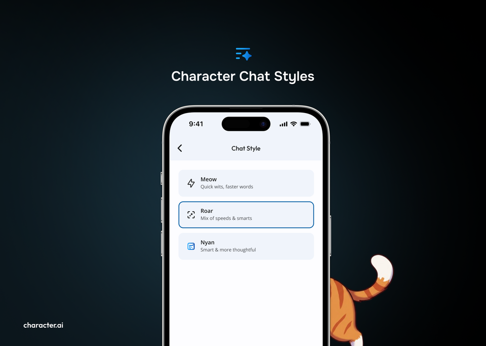

Feb 18, 2025  2 min read

# Level Up Your Character.AI Experience with Chat Styles

  

The magic of Character.AI lies in the engaging conversations you have with your favorite Characters. It starts with the Large Language Model that powers these interactions, a model we're constantly working to improve and refine in order to enhance your overall experience.

And speaking of experience, we've been listening closely to our passionate community of users. One thing has become clear: you want different things from your Character interactions at different times.

Sometimes, you're in the mood for a rapid-fire conversation that's quick, witty, and keeps you on your toes. You want the Character to be sharp and responsive, firing back clever replies in an instant.

Other times, you crave a more detailed and immersive experience. You're happy to delve into world-building, explore intricate plot lines, and savor the exposition that brings the Character's world to life.

That's why we're thrilled to announce a brand new feature designed to give you more control over your Character.AI experience: Chat Styles.

Starting today, users can pick the model experience that best suits their current mood and conversation goals. Choose from three distinct styles, each offering a unique flavor of interaction:
- **Meow: ***Quick wits, faster words.* Need a burst of energy and rapid-fire responses? "Meow" is your go-to. This style prioritizes speed, making it perfect for lighthearted banter and fast-paced scenarios. Meow is available to everyone over 18.
- **Roar: ***Mix of speed & smarts.* Looking for a balanced approach? "Roar" delivers a blend of quick thinking and insightful responses. It's a great all-around option for engaging conversations. Roar is available to everyone.
- **Nyan: ***Smart and more thoughtful.* Craving depth and detail? "Nyan" offers a more intelligent experience. Nyan is currently only available to C.ai+ subscribers.

This is the first time we're offering the ability to choose between chat styles and we're going to be listening closely to your feedback. Based on your responses, we may end up evolving one or more of the models or even launch additional options. Keep that in mind and let us know which experience is your favorite.

So, what are you waiting for? Experiment with each option and discover which one best fits your interactions. We're excited to see how you use this new feature to create even more personalized experiences with your favorite Characters.