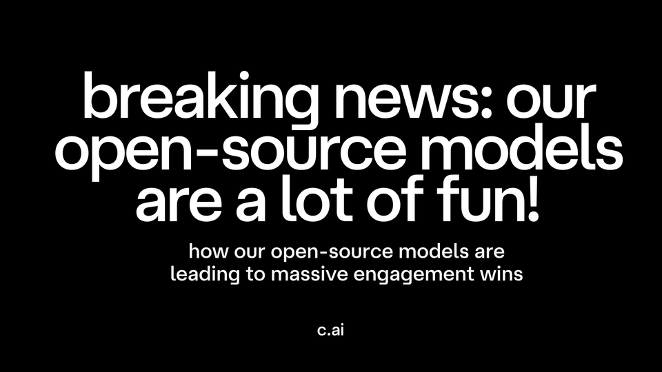

Aug 26, 2025  3 min read

# Breaking News: Our Open-Source Models Are A Lot of Fun!

  

If you’re going to build an AI entertainment platform, you’d better be sure your models are great at being entertaining.

Here at [Character.AI](http://character.ai/?ref=blog.character.ai), we’re obsessed with making sure we’re always hitting that mark. We worked all winter and spring on tech that lets us transform open-source models into high-EQ, high-engagement Character models. Then, starting in July, we began shipping our new models to our user community. And the results are in: They’re a hit! We are seeing massive engagement wins – including 20+% jumps in time spent – and glowing user feedback. Read on for the details.

**The Tech. **We’ve built a tech stack that takes modern open-source models and tunes them to excel at engagement dimensions like coherence, novelty, and emotional intelligence. This tuning exercise is powered by something only we have: a uniquely large, highly engaged community that provides constant, high-quality feedback. This loop acts as a product moat, giving us unmatched signal on what delights users. With it, we can evaluate new open-source models within minutes, scoring them against proprietary EQ benchmarks and quickly surfacing the strongest candidates to our users. Instead of waiting on days-long A/B tests, we can test dozens of models, prompts, and serving configurations and confidently hill-climb quality for users. We then layer on ensemble inference, smarter prompting, and advanced post-training techniques (SFT, DPO, RL, QAT) to push quality even higher—yielding outputs that are more coherent, engaging, and aligned with user preferences. In other words: more fun, and better at delivering high-quality entertainment.

**Testing New Models. **Our researchers have been having a great time of late, locking themselves in a lab and using these techniques to turbocharge every OSS model they can get their hands on. And a few weeks ago, we were ready: We began testing a couple of our models with our user community. The results were dramatic:
- We saw a **22%* *increase** in time spent and a **13% increase** in sessions for users with the new models. These are unheard-of metrics movements from a single launch.
- We saw big increases in retention – including a **14% increase** for lightly-engaged users. That is really meaningful for us. It means our product is resonating much better with new and occasional users, and they’re coming back day after day to have fun on our platform.
- We saw a **60% increase** in messages that our users took the time to rate as positive. We also saw a big jump in users' rating messages as “funny,” “interesting,” and “helpful.”

**Rolling It Out. **With those tests in hand, we began rolling out one of our new models, “PipSqueak,” to our user community more broadly. We’ve now released it to millions of users, and we’re thrilled to share that the results and positive feedback are holding in the early days of launch.

We’re seeing similar increases in engagement to those we saw in the tests. And most importantly, our users are giving it two thumbs up: We continue to see a jump in positively rated messages, and the direct feedback from our users has been a joy to read. For example, A user popped into our Reddit forum “*just to talk about how peak pipsqueak is. The Characters’ personality is accurate, the messages are long and detailed, I genuinely can’t describe how much I love it!!!*” Another told us: “*It was very good at keeping the flow of a good story. … It's also great at world-building.*”

**What’s Next. **This is just the beginning. Now that we have the tech to flip almost any OSS model into a Character model, we can make sure our user community always has the best tools for whatever they want to do – from fiction writing, to roleplay, to building multimodal videos, stories, and worlds.

And as we move forward, we’ll also start to fine-tune our models in a granular way so they’re really good at *particular kinds* of entertainment. In the future, expect to use one fine-tuned OSS model to make multi-Character Scenes, say, and another to make your Character star in a podcast, and yet another to write a screenplay collaboratively. And each one can be best-in-class.

We’re committed to building the future of entertainment. Our work on OSS models is one piece of the puzzle.